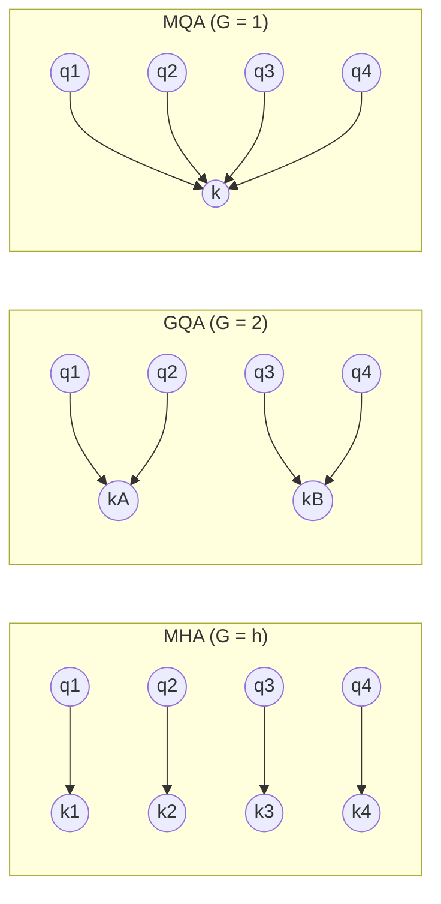

# 09｜GQA/MQA：注意力头的参数共享

> **阅读目标**：理解 Multi-Query Attention（MQA）与 Grouped-Query Attention（GQA）如何在不减少 query 头数量的前提下，把 KV cache 的内存占用和 K/V 投影参数量成倍压缩；能独立算出给定配置下三种方案的 KV cache 大小，并说清"省的是内存带宽，而不是注意力核心的 FLOPs"。
>
> **前置知识**：缩放点积注意力（第 02 篇）——$`Attention(Q,K,V)=softmax(QK^T/\sqrt{d_k})V`$；多头注意力（第 03 篇）——每个头有独立的 $`W_Q, W_K, W_V`$ 投影；KV cache（第 08 篇）——解码时逐 token 缓存 $`K, V`$ 以避免重复计算；因果 mask（第 04 篇）——解码第 $`t`$ 步只能看到位置 $`j \le t`$。

---

## 1. 直觉：query 负责"问什么"，K、V 负责"存什么"

第 03 篇里我们说过：多头注意力的价值在于每个 **query 头**可以学出不同的"问题视角"——一个头关注语法结构，一个头关注指代关系，一个头追踪长距离依赖。query 头的数量，直接决定了模型能同时维持多少种"提问方式"，这是注意力机制表达力的主要来源。

但换个角度想：**被查询的"答案库"** 真的也需要 $`h`$ 份不同的拷贝吗？一个类比：数据库里有一张表，$`h`$ 个分析师（query 头）各自写 SQL 查这张表——你会给每个分析师复制一份完整的表吗？不会。表只有一份（K、V），查询各写各的（Q）。query 决定"问什么"，K、V 决定"存什么"，这两者的多样性需求并不对称：**问题可以有很多种，但事实只有一份。**

这就是 MQA 和 GQA 的核心思想：**query 头数保持不变，只让多个 query 头共享同一组 K、V 头。**

- **MQA**（Multi-Query Attention）：最激进的版本——全部 $`h`$ 个 query 头共享**同一对** K、V 头。
- **GQA**（Grouped-Query Attention）：MQA 的推广——把 $`h`$ 个 query 头分成 $`G`$ 个组，每组共享一对 K、V 头。

注意两个事实，后面会反复用到：

1. **MHA 是 GQA 的特例**（$`G = h`$，每组只有 1 个 query 头）；
2. **MQA 也是 GQA 的特例**（$`G = 1`$，所有 query 头分在同一组）。



其实"共享"这件事在 MHA 里已经存在一半了：同一个 key 向量 $`k_j`$ 本来就要被**所有 query 位置**（$`t`$ 个）反复查询——K、V 天生就是"被共享"的数据结构。GQA 只是把共享从"位置维度"推广到了"头维度"：以前是 $`t`$ 个位置共享 $`h`$ 套 key，现在是 $`t`$ 个位置 × $`h`$ 个头共享 $`h_{kv}`$ 套 key。从这个角度看，GQA 不是离经叛道，而是把注意力机制里本来就有的共享思想推向了极致。

这个类比的边界也要说清楚（严格推导 vs 直觉）：K、V 共享并不是"免费的"。固定某个位置 $`j`$，所有 query 头能拿到的 key 信息总共只有 $`h_{kv} \cdot d_k`$ 个维度（$`h_{kv}`$ 个 key 向量拼起来），而 MHA 下是 $`h \cdot d_k`$ 维。也就是说，共享给模型的信息通道加了一个"瓶颈"：**query 可以问出花来，但答案库的丰富程度被压缩了**。这个瓶颈正是 GQA/MQA 可能损失质量的理论根源——而损失到底有多大，是实验问题（第 4 节）。

## 2. 三种模式的精确定义与参数量

记模型维度为 $`d_{model}`$，query 头数为 $`h`$，每头维度为 $`d_k`$（通常 $`h \cdot d_k = d_{model}`$），KV 头数为 $`h_{kv}`$，总层数为 $`L`$。三种模式的区别只在于 $`h_{kv}`$：

| 模式 | $`h_{kv}`$ | K/V 投影参数量（每层） | 每 token 每层的 KV cache（浮点数个数） |
|---|---|---|---|
| MHA | $`h`$ | $`2 \cdot d_{model} \cdot h \cdot d_k`$ | $`2 \cdot h \cdot d_k`$ |
| GQA | $`h / G`$ | $`2 \cdot d_{model} \cdot h_{kv} \cdot d_k`$ | $`2 \cdot h_{kv} \cdot d_k`$ |
| MQA | $`1`$ | $`2 \cdot d_{model} \cdot d_k`$ | $`2 \cdot d_k`$ |

推导一下参数量（以 $`W_K`$ 为例）：输入 $`x \in \mathbb{R}^{d_{model}}`$，MHA 里每个 K 头有自己的投影矩阵 $`W_K^{(i)} \in \mathbb{R}^{d_{model} \times d_k}`$，共 $`h`$ 个，所以 $`W_K`$ 总参数是 $`d_{model} \cdot h \cdot d_k`$；GQA 里 K 头只有 $`h_{kv}`$ 个，所以是 $`d_{model} \cdot h_{kv} \cdot d_k`$。$`W_V`$ 同理，故上表的参数量里都有一个因子 2（K 和 V 各一份）。

**压缩比一目了然**：KV 投影参数和 KV cache 都被压缩了 $`h / h_{kv}`$ 倍。GQA 里这个比值就是分组数 $`G`$；MQA 里是 $`h`$ 倍。

这里要区分一个容易混淆的点：$`W_Q`$ 的参数**完全不变**（$`d_{model} \cdot h \cdot d_k`$），输出投影 $`W_O`$（把 $`h`$ 个头拼回 $`d_{model}`$）也不变。GQA 削减的是 K 和 V 的投影，query 头还是 $`h`$ 个，输出的注意力权重矩阵形状仍是 $`h \times t \times t`$。所谓"注意力头变少了"是一个常见误解（见第 8 节误区 1）。

实现上，共享通常用"复制"来表达——把 $`h_{kv}`$ 个 key 头按组重复 $`h/h_{kv}`$ 次，凑成 $`h`$ 个，再走和 MHA 完全相同的计算流程（这是 HuggingFace `repeat_kv` 的做法）：

```python
# q: [batch, t, h, d_k], k: [batch, t, h_kv, d_k], v: [batch, t, h_kv, d_k]
n_rep = h // h_kv
k = k.repeat_interleave(n_rep, dim=2)  # → [batch, t, h, d_k]
v = v.repeat_interleave(n_rep, dim=2)  # → [batch, t, h, d_k]
scores = q @ k.transpose(-1, -2) / sqrt(d_k)  # [batch, h, t, t]，与 MHA 同形
```

这段代码说明了一个重要事实：**共享只改变数据的来源，不改变注意力的计算图形状**。下游（softmax、加权求和、输出投影）完全不知道 K、V 是被复制过的。

### 前向过程中的形状流转（prefill，batch 记为 $`b`$）

| 阶段 | 张量 | 形状 |
|---|---|---|
| 输入 | $`x`$ | $`[b, t, d_{model}]`$ |
| Query 投影 | $`q = xW_Q`$ | $`[b, t, h, d_k]`$（不变） |
| Key/Value 投影 | $`k = xW_K`$，$`v = xW_V`$ | $`[b, t, h_{kv}, d_k]`$（第 3 维被压缩） |
| 复制对齐 | `repeat_interleave` | $`[b, t, h, d_k]`$（与 $`q`$ 对齐） |
| 注意力分数 | $`qK^{\top}/\sqrt{d_k}`$ | $`[b, h, t, t]`$（不变） |
| 输出拼接 + $`W_O`$ | $`out`$ | $`[b, t, d_{model}]`$（不变） |

只有 K、V 投影那一行发生了变化——这就是为什么 GQA 可以被看作对 MHA 的"局部手术"：动了数据最宽的那条通道（$`h \times d_k`$ 维的 key/value 流），而保留了表达力最关键的 query 多样性。

## 3. 注意力打分的形式化：共享前后分数长什么样

设第 $`i`$ 个 query 头属于第 $`g(i)`$ 个组。它的 query 向量是 $`q_i = x W_Q^{(i)} \in \mathbb{R}^{d_k}`$，而它查询的 key 来自所属组的共享 K 头：$`k_{g} = x W_K^{(g)} \in \mathbb{R}^{d_k}`$。

在 decoder 的第 $`t`$ 步（query 为当前 token 的 $`q_i`$，key 为所有历史位置 $`j \le t`$ 的 $`k_{g,j}`$，因果 mask 保证 $`j > t`$ 不可见），未归一化的打分为：

```math
s_{i,j} = \frac{q_i^{\top} k_{g(i),\,j}}{\sqrt{d_k}}, \qquad j = 1, \dots, t
```

与 MHA 唯一的区别：下标 $`g(i)`$ 取代了下标 $`i`$。归一化之后：

```math
a_{i,j} = \frac{\exp(s_{i,j})}{\sum_{j'=1}^{t} \exp(s_{i,j'})}, \qquad \text{head}_i = \sum_{j=1}^{t} a_{i,j} \, v_{g(i),\,j}
```

每个 query 头仍然有自己独立的权重分布 $`a_{i,\cdot}`$（因为 $`q_i`$ 不同），只是所有位置 $`j`$ 的 key 向量都取自共享的那份 $`k_g`$。这正好对应第 1 节的数据库比喻：表是共享的，但每个分析师的查询结果各不相同。

### 一个手算的玩具例子

取 $`d_k = 2`$，$`h = 4`$ 个 query 头，$`G = 2`$（头 1、2 共享 key 组 A，头 3、4 共享 key 组 B）。历史有 2 个位置，key 向量为：

- 组 A：$`k_{A,1} = [1, 0]`$，$`k_{A,2} = [0, 1]`$
- 组 B：$`k_{B,1} = [1, 1]`$，$`k_{B,2} = [1, -1]`$

query 向量：$`q_1 = [1, 1]`$，$`q_2 = [1, -1]`$（同属组 A），$`q_3 = [2, 0]`$，$`q_4 = [0, 2]`$（同属组 B）。缩放因子 $`\sqrt{d_k} = \sqrt{2} \approx 1.414`$。

**组 A 的两个头（用的是同一对 key）：**

```math
s_{1,1} = \frac{[1,1]^{\top}[1,0]}{\sqrt{2}} = \frac{1}{1.414} \approx 0.707, \quad
s_{1,2} = \frac{[1,1]^{\top}[0,1]}{\sqrt{2}} \approx 0.707
```

$`q_1`$ 对两个位置打分相同 → 权重 $`[0.5, 0.5]`$。

```math
s_{2,1} = \frac{[1,-1]^{\top}[1,0]}{\sqrt{2}} \approx 0.707, \quad
s_{2,2} = \frac{[1,-1]^{\top}[0,1]}{\sqrt{2}} \approx -0.707
```

$`q_2`$ 的打分是 $`[0.707, -0.707]`$：$`e^{0.707} \approx 2.028`$，$`e^{-0.707} \approx 0.493`$，和为 $`2.521`$ → 权重约 $`[0.804, 0.196]`$。

**看到了吗**：头 1 和头 2 查询的是**完全相同的 key**，但因为 query 不同，得到的权重分布截然不同（$`[0.5,0.5]`$ vs $`[0.804,0.196]`$）。这就是"共享 K 不等于共享注意力模式"的具体含义。

再看输出。设组 A 的 value 为 $`v_{A,1} = [1, 2]`$，$`v_{A,2} = [3, 0]`$：

```math
\text{head}_1 = 0.5 \cdot [1,2] + 0.5 \cdot [3,0] = [2.0,\ 1.0]
```

```math
\text{head}_2 = 0.804 \cdot [1,2] + 0.196 \cdot [3,0] = [0.804 + 0.588,\ 1.608 + 0] = [1.392,\ 1.608]
```

验算：$`0.804 \times 1 = 0.804`$，$`0.196 \times 3 = 0.588`$，相加 $`1.392`$ ✓；$`0.804 \times 2 = 1.608`$，$`0.196 \times 0 = 0`$，相加 $`1.608`$ ✓。

如果这是 MHA，头 1 和头 2 会各自拥有独立的 $`k_1, k_2`$ 和 $`v_1, v_2`$；而在 GQA 下，它们被迫从同一份 $`(k_A, v_A)`$ 里"各取所需"。query 的多样性保留了，value 的多样性被压缩了——这正是第 1 节说的"信息瓶颈"，在这个玩具例子里你可以亲手摸到它。

## 4. 真正的省钱点：KV cache 的内存带宽

第 08 篇我们算过，解码阶段每一步要把整个 KV cache 从显存**读出来**，和当前 token 的 $`q`$ 做点积。当 batch 较大或上下文较长时，这一步是**内存带宽受限**的——瓶颈不是算力，而是每秒能搬多少字节。KV cache 变小，就意味着每步能搬更少的数据、支持更大的 batch 和更长的上下文。

来看一个具体配置的对比（$`L = 80`$ 层，$`h = 64`$，$`d_k = 128`$，$`d_{model} = 4096`$，fp16 即每浮点数 2 字节）。

**每 token 的 KV cache（全部层加总）**：

```math
\text{cache}(\text{每 token}) = 2 \times L \times h_{kv} \times d_k \times 2\,\text{字节}
```

- MHA（$`h_{kv} = 64`$）：$`2 \times 80 \times 64 \times 128 \times 2 = 2{,}621{,}440`$ 字节 ≈ **2.5 MB / token**
- GQA $`G = 8`$（$`h_{kv} = 8`$）：$`2 \times 80 \times 8 \times 128 \times 2 = 327{,}680`$ 字节 ≈ **320 KB / token**（8 倍压缩）
- MQA（$`h_{kv} = 1`$）：$`2 \times 80 \times 1 \times 128 \times 2 = 40{,}960`$ 字节 ≈ **40 KB / token**（64 倍压缩）

验算 MHA：$`2 \times 80 \times 64 \times 128 = 1{,}310{,}720`$ 个浮点数，fp16 下 ×2 = 2,621,440 字节 = 2.5 MiB ✓。

**4096 token 上下文、单条序列的总占用**：MHA ≈ 10 GB，GQA（G=8）≈ 1.25 GB，MQA ≈ 160 MB。batch size 再乘上去：batch=32 时 MHA 需要约 320 GB 显存放 KV cache——这已经超过了单张 A100（80GB）的全部显存，而 GQA 只需要约 40 GB。

**带宽视角（数量级估算）**：假设 HBM 带宽约 2 TB/s。解码每一步都要把 KV cache 完整读一遍：batch=32、上下文 4096 时，MHA 每步要搬 320 GB，光是"读数据"就要约 $`320/2000 = 0.16`$ 秒——每秒只能生成 6 个 token（还是 32 条序列分摊的）。GQA 下每步只搬 40 GB，约 0.02 秒。**KV cache 缩小 $`G`$ 倍，解码吞吐的上限就大约提高 $`G`$ 倍**（在带宽受限的区间内）。

**K/V 投影参数量（每层）**：MHA 的 $`2 \cdot d_{model} \cdot h \cdot d_k = 2 \times 4096 \times 64 \times 128 = 67{,}108{,}864`$ ≈ 67M 参数/层，80 层就是约 5.4B 个参数——光 K、V 投影就占了相当可观的比例；GQA（G=8）降到约 8.4M 参数/层（80 层约 671M）；MQA 降到约 1M 参数/层（80 层约 84M）。这部分参数既占权重显存，也要在每步前向中被读取，同样受益于压缩。

**严格结论**（条件：同一 $`d_{model}, h, d_k, L`$ 配置下）：GQA 把 KV cache 内存和 K/V 参数都精确压缩了 $`G`$ 倍。这是一个可以直接代入数字验证的结论，不需要实验。

### 真实模型的对照

| 模型 | $`L`$ | $`h`$ | $`h_{kv}`$ | 模式 | 每 token KV cache（fp16） |
|---|---|---|---|---|---|
| Llama 2 70B | 80 | 64 | 8 | GQA（$`G=8`$） | $`2\times80\times8\times128\times2 = 327{,}680`$ B ≈ 320 KB |
| Mistral 7B | 32 | 32 | 8 | GQA（$`G=8`$） | $`2\times32\times8\times128\times2 = 131{,}072`$ B ≈ 128 KB |
| 同配置 MHA 版 Llama 2 70B（假想） | 80 | 64 | 64 | MHA | ≈ 2.5 MB（8 倍于 GQA 版） |

可以看到，Llama 2 70B 如果用 MHA，单个 4096 上下文的 KV cache 就要 10 GB——这就是它选择 GQA（$`G=8`$）的直接动机。

### 一个关键的 regime 划分：权重搬运 vs KV 搬运

解码每一步要从显存读两类数据：**模型权重**和 **KV cache**。权重读取量与 $`G`$ 几乎无关（fp16 下约 $`2P`$ 字节，$`P`$ 为总参数量），KV cache 读取量则随 $`G`$ 缩放。于是存在两个区间：

- **小 batch / 短上下文**：KV cache 总量 $`\ll`$ 权重（如 batch=1、上下文 512：KV cache 仅约 1.25 GB，而 70B 模型的权重约 140 GB）——此时每步的搬运大头是权重，GQA 的带宽收益被稀释；
- **大 batch / 长上下文**：KV cache 总量超过权重（如 batch=32、上下文 4096：KV cache 320 GB > 权重 140 GB）——此时 GQA 把 KV 搬运量砍到 1/8，直接决定了吞吐上限。

这是一个**条件性结论**：GQA 的推理加速效果取决于你处在哪个区间。部署时如果 batch 很小却指望 GQA 带来数倍提速，可能会失望——瓶颈分析永远要先看数字，再下结论。

## 5. 它没有省下什么：注意力打分的计算量

直觉上"头少了，计算就少了"，但对 GQA 要小心：**注意力权重矩阵的计算量一点没变**。

解码第 $`t`$ 步，$`QK^{\top}`$ 的乘法量级是：$`h`$ 个 query 头 × 每个头与 $`t`$ 个历史 key 做 $`d_k`$ 维点积，再加上加权求和的同样量级，即 $`O(2 \cdot h \cdot t \cdot d_k)`$ 次乘加——query 头还是 $`h`$ 个，所以这个量级在 MHA/GQA/MQA 下**完全相同**。代入第 4 节的配置（$`t = 4096`$）：每层每步约 $`2 \times 64 \times 4096 \times 128 \approx 6.7 \times 10^7`$ 次乘加，80 层约 5.4 GMACs——在几百 TFLOPS 的算力面前，这连 0.1 毫秒都不到，根本不是瓶颈。

省下来的只是：

1. **K、V 投影的计算**：每步只算 $`h_{kv}`$ 个头而非 $`h`$ 个（$`O(d_{model} \cdot h_{kv} \cdot d_k)`$）。注意 MHA 下这部分是 $`2 \times 4096 \times 64 \times 128 \approx 6.7 \times 10^7`$ 乘加/层/步——和注意力核心本身一个量级！所以 K/V 投影的压缩对**计算量**也是实打实的贡献，只是它发生在投影阶段而非注意力矩阵阶段。
2. **从显存加载 KV cache 的带宽**（第 4 节算过，这是大头）；
3. **KV 投影矩阵本身的显存占用**。

所以准确的说法是：**GQA/MQA 主要优化的是内存（容量 + 带宽），附带减少 K/V 投影的计算；但注意力权重矩阵 $`h \times t \times t`$ 的核心 FLOPs 不变**。在 prefill 阶段（长输入一次性编码，算力受限）收益较小；在 decode 阶段（逐 token 生成，内存带宽受限）收益巨大。这也解释了为什么它是"推理优化"而非"训练加速"技术——训练时 KV cache 根本不存在，省的主要是 K/V 投影参数。

| 阶段 | 瓶颈 | GQA 的收益 |
|---|---|---|
| 训练 | 算力（FLOPs） | 小：只省 K/V 投影参数与计算 |
| Prefill（长输入编码） | 算力 | 小：注意力核心 FLOPs 不变 |
| Decode（逐 token 生成） | 显存带宽 | 大：KV cache 搬运量降 $`G`$ 倍 |

## 6. 严格推导：共享给注意力分数矩阵加了一个秩约束

第 1 节提到共享会带来"信息瓶颈"，这里把它写成一个严格的数学命题。先明确结论成立的条件：**单层、单个 attention 的分数矩阵**（softmax 之前），记为 $`S \in \mathbb{R}^{h \times t}`$，$`S_{i,j} = q_i^{\top} k_{g(i),j} / \sqrt{d_k}`$。

固定第 $`g`$ 组，它包含 $`h/G`$ 个 query 头。把这些头的 query 向量堆成矩阵 $`Q_g \in \mathbb{R}^{(h/G) \times d_k}`$（每行是一个 $`q_i^{\top}`$），把该组的 key 向量堆成 $`K_g \in \mathbb{R}^{t \times d_k}`$（每行是一个 $`k_{g,j}^{\top}`$）。那么这一组对应的分数子矩阵可以写成：

```math
S_{(g)} = \frac{1}{\sqrt{d_k}} \, Q_g K_g^{\top} \quad \in \mathbb{R}^{(h/G) \times t}
```

矩阵乘积的秩不超过任一因子的秩：

```math
\mathrm{rank}(S_{(g)}) \le \min\big(\mathrm{rank}(Q_g),\, \mathrm{rank}(K_g)\big) \le d_k
```

完整的分数矩阵 $`S`$ 是 $`G`$ 个这样的子矩阵在行方向上的堆叠，所以：

```math
\mathrm{rank}(S) \le \sum_{g=1}^{G} \mathrm{rank}(S_{(g)}) \le G \cdot d_k = h_{kv} \cdot d_k
```

对比 MHA（$`G = h`$，每组 1 个头）：$`\mathrm{rank}(S) \le h \cdot d_k`$。于是得到严格结论：

> **在相同 $`h, d_k`$ 下，GQA 的注意力分数矩阵的秩上界是 MHA 的 $`1/G`$。**

这个上界的直观含义：$`h`$ 个 query 头的打分行向量，被迫挤在 $`G`$ 个 $`d_k`$ 维子空间里——每组的 $`h/G`$ 个头只能对同一组 key 做线性组合式的"不同提问"。MQA（$`G=1`$）最极端：全部 $`h`$ 个头的打分都落在**同一个** $`d_k`$ 维子空间里。

两个必要的限定（结论成立的条件）：

1. 这是**上界**，不是实际秩。训练好的模型的 $`S`$ 实际秩可能远小于上界（比如很多头学出了近似重复的模式），这时压缩 $`G`$ 倍几乎无损；也可能接近上界，这时压缩就会疼。实际落在哪，取决于训练——又是一个实验问题。
2. 秩约束针对的是**分数矩阵**，经过 softmax 的非线性之后，权重矩阵 $`A`$ 的秩行为会变化（softmax 是逐行非线性，不改变"每组共享 key 结构"这一事实，但秩上界不再是 $`G \cdot d_k`$ 这么干净的形式）。所以不要把这个上界直接套用到注意力权重上。

这个推导的价值在于：它把"信息瓶颈"的直觉变成了一个可以写下来的不等式，让"GQA 可能损失表达力"不再是一句空话，而是一个有明确适用条件的命题。

## 7. 从 MHA 到 GQA：热启动的转换技巧

实践中一个常见问题：手头已经有一个训好的 MHA 模型，不想从头训练，怎么得到 GQA 版本？GQA 的原始论文（Ainslie et al., 2023）给出的答案是"uptraining"：把 MHA checkpoint 的 K/V 投影按组**取平均**，转成 GQA 结构，再用少量数据继续训练。

第 $`g`$ 组的新 K 头 = 组内旧 K 头投影矩阵的均值：

```math
W_K^{(g),\text{new}} = \frac{1}{h/G} \sum_{i \in \text{group } g} W_K^{(i),\text{old}}, \qquad W_V \text{ 同理}
```

为什么取平均是合理的初始化？直觉上：如果组内 $`h/G`$ 个旧头的 K 投影学到的东西彼此相近，均值就是一个很好的代表；即使不完全相近，均值也保留了"平均意义上的 key 方向"，让新模型从一个不太离谱的起点开始微调，而不是随机初始化。这是一个**启发式**（直觉层面），不是定理。

当然，uptraining 不是唯一的路。另一条路是**直接从头训练 GQA 结构**（如 Llama 2、Mistral 就是原生 GQA 训练的）。两条路的选择是工程问题：如果已经有一个训好的 MHA 大模型且重训成本极高，uptraining 是务实的选择；如果是新项目，直接按目标 $`G`$ 训练通常更干净——省去了"旧头分组"的人为设计（按什么顺序把 64 个头分成 8 组？相邻分组还是交错分组？这些细节都会影响 uptraining 的起点质量）。

**需要实验验证的结论**：这样转换 + 继续训练后，模型质量能恢复到接近 MHA 的水平吗？论文在自家模型和任务上的测量答案是：在 $`G=8`$ 左右时基本相当，而推理内存大幅下降。但"基本相当"是在该论文的模型规模和评测集上成立的——**压缩比和内存节省是数学，质量损失是实验**，这是两个层面的结论，不要混为一谈。选 $`G`$ 本质上是一个"内存预算 vs 质量"的工程 trade-off：MQA（$`G=1`$）压缩最狠但质量风险最高，GQA 取中间值，没有 universally 最优的答案。

现实中的选型也可以佐证这条光谱：PaLM 用了 MQA（Shazeer, 2019，原始 MQA 论文 "Fast Transformer Decoding: One Write-Head is All You Need"），Falcon 系列用了 MQA，而 Llama 2 70B 和 Mistral 7B 选择了 GQA（Llama 2 70B：64 个 query 头、8 个 KV 头，即 $`G=8`$）——大模型推理部署的主流答案目前是 GQA 而非最激进的 MQA，这本身就是"质量 vs 内存"权衡的经验证据。

## 8. 常见误区澄清

**误区 1：「GQA 把注意力头从 64 个减到了 8 个。」**
错。query 头仍然是 64 个（$`W_Q`$ 参数纹丝不动），减少的是 **KV 头**（64 → 8）。输出拼接的仍然是 64 个头的 $`head_i`$ 向量，注意力权重矩阵仍是 $`64 \times t \times t`$。把"KV 头数"说成"头数"会漏掉最关键的信息。

**误区 2：「KV 共享意味着不同 layer 之间也共享。」**
错。共享只发生在**同一层内部**的 query 头之间，每一层有自己独立的 K/V 头。跨层共享是另一个话题（如 YOCO 这类架构），不要混淆。KV cache 公式里的层数因子 $`L`$ 依然存在，第 4 节的 80 层一个都少不了。

**误区 3：「参数少了，推理 FLOPs 一定大幅下降。」**
不完全对。注意力权重矩阵 $`h \times t \times t`$ 的计算量不变（第 5 节），省的是显存带宽和 K/V 投影。在 decode 这种带宽受限的场景下，带宽节省会转化为实实在在的吞吐提升；但如果你测的是纯 FLOPs 计数器，变化会比你想象的小——FLOPs 和墙钟时间在带宽受限时是脱钩的。

**误区 4：「MQA 是 GQA 的升级版（或反过来）。」**
两者是同一条光谱上的两个点：$`G=1`$（MQA）←→ $`1 < G < h`$（GQA）←→ $`G=h`$（MHA）。"升级"暗示了单向优劣，但这里只有 trade-off：压缩比越高，信息瓶颈越紧（第 1 节），质量风险越大。

**误区 5：「用了 GQA，模型表达力一定不如 MHA。」**
这是一个需要实验回答的问题，不是先验真理。GQA 论文的实验显示，在合适的 $`G`$（如 8）和 uptraining 策略下，GQA 可以接近 MHA 的质量（第 7 节）。但"接近"是在特定规模和评测集上成立的，你的场景仍需实测。

**误区 6：「KV cache 变小了，所以 batch size 可以无脑放大 $`G`$ 倍。」**
方向对，但"无脑"错了。KV cache 只是显存占用的一部分——模型权重、激活值（prefill 阶段）、CUDA 上下文、碎片都会吃显存。GQA 把 KV cache 的上限抬高了 $`G`$ 倍，不等于总显存需求降为 $`1/G`$。实际能放大的 batch 需要按完整的显存账本重算。

## 9. 自测题

**Q1.** 某模型 $`d_{model} = 4096`$，$`h = 32`$，$`d_k = 128`$，$`L = 32`$ 层，用 bf16（2 字节）推理。分别计算 MHA 和 GQA（$`G = 4`$）下，单个 token 的 KV cache 占用多少字节？压缩了几倍？

<details>
<summary>答案</summary>

每 token 全部层的 KV cache = $`2 \times L \times h_{kv} \times d_k \times 2`$ 字节。

- MHA（$`h_{kv} = 32`$）：$`2 \times 32 \times 32 \times 128 \times 2 = 524{,}288`$ 字节 = 512 KB
- GQA $`G=4`$（$`h_{kv} = 32/4 = 8`$）：$`2 \times 32 \times 8 \times 128 \times 2 = 131{,}072`$ 字节 = 128 KB
- 压缩比 = $`32/8 = 4`$ 倍 = $`G`$ ✓
</details>

**Q2.** 解码第 $`t`$ 步，比较 MHA 与 MQA 在计算 $`QK^{\top}`$（注意力打分）这一步的乘加次数。哪个更少？为什么？

<details>
<summary>答案</summary>

两者相同。打分计算量是 $`h \times t \times d_k`$ 次乘加（$`h`$ 个 query 头，每个与 $`t`$ 个 key 做 $`d_k`$ 维点积），而 $`h`$ 在 MQA 下没有减少——减少的只是 key 的**种类数**（$`h_{kv}=1`$），每个 query 头仍要和全部 $`t`$ 个历史 key 逐一打分。
</details>

**Q3.** 一个 MHA checkpoint 有 64 个 K 头。你想把它转成 GQA（$`G = 8`$）并继续训练。新的 K 头有几个？第 $`g`$ 个新 K 头的初始化权重如何从旧权重得到？

<details>
<summary>答案</summary>

新 K 头有 $`h_{kv} = 64/8 = 8`$ 个。第 $`g`$ 个新 K 头 = 旧的第 $`g`$ 组内 8 个 K 头投影矩阵的**平均值**（mean-pooling，见第 7 节公式），然后继续训练（uptraining）恢复质量。
</details>

**Q4.** 判断正误并说明理由：「把 MHA 换成 GQA（$`G=8`$）后，prefill 阶段（输入 4096 token 一次性编码）的注意力计算 FLOPs 会降为原来的 1/8。」

<details>
<summary>答案</summary>

错误。prefill 的注意力核心计算是 $`O(h \times t \times t \times d_k)`$ 量级，query 头数 $`h`$ 不变，所以这部分 FLOPs 不变。GQA 省的是 K/V 投影的计算与参数、以及 KV cache 的内存——而 prefill 阶段甚至不需要 KV cache（是一次性前向），所以 prefill 的加速主要来自 K/V 投影变小，远不到 8 倍。
</details>

**Q5.** 在第 3 节的玩具例子里，如果把 $`q_2`$ 改成 $`[0, 1]`$（仍属组 A），它对两个历史位置的注意力权重是多少？这个结果说明了什么？

<details>
<summary>答案</summary>

$`s_{2,1} = [0,1]^{\top}[1,0]/\sqrt{2} = 0`$，$`s_{2,2} = [0,1]^{\top}[0,1]/\sqrt{2} \approx 0.707`$。$`e^0 = 1`$，$`e^{0.707} \approx 2.028`$，和为 $`3.028`$ → 权重约 $`[0.330, 0.670]`$。说明：即使 query 头共享同一组 key，不同的 query 向量依然能产生差异显著的注意力分布——"共享 key"压缩的是答案库的多样性，而不是 query 的表达自由度。
</details>

**Q6.** 某推理服务用 MHA 模型，batch=16、上下文 8192 时 KV cache 占满显存而 OOM。换成同等配置的 GQA（$`G=8`$）模型后，KV cache 占用变为原来的几分之一？batch 能否直接放大到 128？

<details>
<summary>答案</summary>

变为 $`1/8`$（压缩比 = $`G`$）。batch 不能直接 ×8 放到 128：KV cache 只是显存的一部分，模型权重、激活、框架开销都不随 $`G`$ 缩小（见误区 6）。正确做法是按完整显存账本重算，或者逐步放大 batch 并实测 OOM 边界。
</details>

**Q7.** 用第 6 节的秩上界：某层 $`h = 32`$，$`d_k = 128`$，分别求 MHA 和 GQA（$`G = 4`$）下注意力分数矩阵 $`S \in \mathbb{R}^{h \times t}`$ 的秩上界。这个上界在什么情况下接近实际秩（紧的），什么情况下远大于实际秩（松的）？

<details>
<summary>答案</summary>

- MHA：$`\mathrm{rank}(S) \le h \cdot d_k = 32 \times 128 = 4096`$
- GQA（$`G=4`$）：$`\mathrm{rank}(S) \le G \cdot d_k = 4 \times 128 = 512`$

紧/松取决于训练学出的 $`Q_g, K_g`$：如果各头的 query/key 方向高度多样化（$`Q_g`$ 列满秩），实际秩会接近上界，此时把 $`G`$ 压得很小可能真的挤掉表达力；如果很多头学出了近似重复的模式（实际中常见），真实秩远小于上界，压缩 $`G`$ 倍几乎无损。上界本身不能告诉你属于哪种情况——必须看训练结果。
</details>

**Q8.** 一个 70B 模型（权重 fp16 约 140 GB），batch=1、上下文 512，用 MHA 时每步要搬运权重 140 GB + KV cache（2.5 MB/token × 512 ≈ 1.28 GB）。换成 GQA（$`G=8`$）后，每步总搬运量下降了百分之几？这个数字说明了什么？

<details>
<summary>答案</summary>

GQA 后 KV cache 变为 $`1.28/8 = 0.16`$ GB，总搬运量从 $`141.28`$ GB 降到 $`140.16`$ GB，下降约 $`1.12/141.28 \approx 0.8\%`$。说明：在小 batch、短上下文的区间里，每步搬运的大头是模型权重，GQA 的带宽收益被稀释到可以忽略——GQA 的加速红利主要在大 batch / 长上下文区间兑现（第 4 节的 regime 划分）。
</details>

---

**下一篇预告**：第 10 篇《训练目标：交叉熵与 teacher forcing》——模型到底在优化什么？为什么训练时喂的是真实词（teacher forcing），而推理时只能喂自己？这两者之间的鸿沟叫什么名字？

*参考：Ainslie et al., "GQA: Training Generalized Multi-Query Transformer Models from Multi-Head Checkpoints", arXiv:2305.13245, 2023；Shazeer, "Fast Transformer Decoding: One Write-Head is All You Need", arXiv:1911.02150, 2019.*
