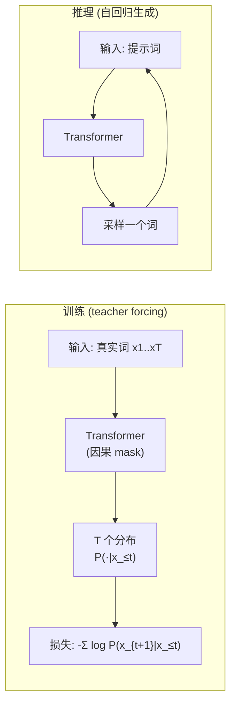

# 10｜训练目标：交叉熵与 teacher forcing

> **阅读目标**：理解语言模型训练时到底在优化什么——为什么损失函数是"负对数似然"（交叉熵）；能独立推导 softmax + 交叉熵的梯度形式 $`\partial L/\partial z_i = p_i - y_i`$；说清 teacher forcing 如何让训练并行化、它与推理的本质差异，以及 "exposure bias" 这个鸿沟。
>
> **前置知识**：缩放点积注意力（第 02 篇）——$`Attention(Q,K,V)=softmax(QK^T/\sqrt{d_k})V`$；因果 mask（第 04 篇）——位置 $`t`$ 只能看到 $`j \le t`$；softmax 把任意实数向量变成概率分布；多头注意力（第 03 篇）——Transformer 块的前向结构。

---

## 1. 直觉：模型在学"给定上文，下一个词的概率分布"

前面九篇我们都在讲**前向计算**：输入一串 token，模型输出一串 logits。但"训练"这件事本身——模型到底在优化什么、梯度从哪里来——我们一直没讲。

直觉很简单。语言模型是一个"接龙机器"：读到"那只猫坐"，它要给词表里的每个词打分——"在"(0.4)、"的"(0.2)、"上"(0.1)……训练的目标就是：**当真实的下一个词确实是"在"时，让模型给"在"的概率尽可能高**。反复做这件事，模型就学会了"什么上文后面跟什么词"。

用概率的语言说：模型定义了一个条件分布 $`P_\theta(x_t \mid x_1, \dots, x_{t-1})`$（$`\theta`$ 是全部参数），训练就是调整 $`\theta`$，让**真实语料在模型眼中的概率最大**。这就是"最大似然估计"（Maximum Likelihood Estimation, MLE）——一个严格的统计学框架，不是启发式。

为什么是"最大化概率"而不是"最小化预测错的词数"？因为"预测对了几个词"是离散的、不可微的，没法求梯度；而概率是连续的、可微的。**可微性**是整个深度学习训练的前提——这是个严格结论，不是偏好。

再补一个直觉：语料可以看作从真实分布 $`p^*`$ 里的一次次独立采样。最大化"语料在模型眼中的概率"，就是让模型分布 $`q_\theta`$ 在**观测到的样本上**表现最好——这叫经验风险最小化。数据越多，样本的经验分布越接近真实分布（大数定律的直觉），经验最优就越接近真实最优。所以"喂更多数据"有效，不是因为模型"背"下了更多句子，而是经验分布更逼近了 $`p^*`$。这是直觉层面的论证，严格版本需要统计学习理论。

## 2. 从"整句的概率"到"每个位置的损失"

一整句话 $`x_1, \dots, x_T`$ 在模型眼中的概率，用链式法则展开：

```math
P_\theta(x_1, \dots, x_T) = \prod_{t=1}^{T} P_\theta(x_t \mid x_1, \dots, x_{t-1})
```

约定 $`t = 1`$ 时 $`P_\theta(x_1)`$ 为无条件概率（没有上文）。连乘在数值上会下溢（几百个小于 1 的数相乘直接变成 0），所以取对数，把连乘变成连加：

```math
\log P_\theta(x_1, \dots, x_T) = \sum_{t=1}^{T} \log P_\theta(x_t \mid x_{<t})
```

（记号 $`x_{<t}`$ 表示 $`x_1, \dots, x_{t-1}`$。）最大化这个对数似然，等价于最小化它的相反数。于是得到语言模型的标准训练损失——**每个位置的负对数似然之和**：

```math
L(\theta) = -\sum_{t=1}^{T} \log P_\theta(x_t \mid x_{<t})
```

这就是**交叉熵损失**（cross-entropy loss）在语言模型里的具体形式。为什么叫"交叉熵"？看第 3 节的信息论视角。

一个关键观察（严格推导层面）：**每个位置 $`t`$ 的损失只依赖该位置的预测分布** $`P_\theta(\cdot \mid x_{<t})`$ **和真实词** $`x_t`$，位置之间没有耦合项。这意味着全部 $`T`$ 个位置的损失可以**同时算出来**（配合因果 mask，一次前向得到全部 $`T`$ 个分布）。这就是第 04 篇"训练能并行"的数学根源：不是工程技巧，是损失函数本身可分解。

### 实践注记：求和还是平均？

代码里你会看到两种写法：对 token 求和（sum）或取平均（mean）。设总 token 数为 $`T`$，则 $`L_{\text{mean}} = L_{\text{sum}} / T`$，两者梯度只差常数因子 $`1/T`$——理论上可被学习率吸收，是"缩放等价"的。但实践中几乎都用 mean，原因很实际：学习率的选择不再随序列长度或 batch 的 token 总数漂移，调参更稳定。一个诚实的限定：对 Adam 这类自适应优化器，常数缩放不完全等价（更新公式分母里有 $`\epsilon`$），但 $`1/T`$ 量级的差异在实践中可忽略。这是工程约定，不是数学定理——看到 sum 写法时，知道除个 $`T`$ 就行。

## 3. 信息论视角：交叉熵 = 真实分布与模型分布的"距离"

真实世界在给定上文 $`x_{<t}`$ 时，下一个词有一个**真实分布** $`p^*(\cdot \mid x_{<t})`$（我们永远不知道它长什么样，只能从语料里采样到它的一个个样本）。模型给出一个**预测分布** $`q_\theta(\cdot \mid x_{<t})`$。

交叉熵定义为：

```math
H(p^*, q_\theta) = -\sum_{w \in \text{词表}} p^*(w) \, \log q_\theta(w)
```

训练语料里，在位置 $`t`$ 我们只观测到**一个**真实词 $`x_t`$——这相当于用"one-hot 分布"（在 $`x_t`$ 处概率为 1，其余为 0）作为 $`p^*`$ 的经验估计。代入上式，求和只剩下一项：

```math
H(p^*, q_\theta) = -\log q_\theta(x_t) = -\log P_\theta(x_t \mid x_{<t})
```

正好是第 2 节的逐位置损失。所以"最小化交叉熵"和"最大化似然"是同一件事的两种说法。

### 为什么不用均方误差（MSE）？

回归任务用 MSE 天经地义，语言建模为什么不用 $`L = \sum_i (p_i - y_i)^2`$？有两个严格的理由：

1. **梯度消失**。MSE 对 logit 的梯度要穿过 softmax 的导数 $`p_i(1-p_i)`$——当模型"自信但错了"（如把 0.99 的概率给了错误词），$`p(1-p)`$ 接近 0，梯度几乎消失：错得越离谱，越学不动。而交叉熵的梯度 $`p_i - y_i`$ 里没有这个因子，$`p_y \to 0`$ 时梯度趋向 −1，始终有稳定的推动力。
2. **惩罚是否有界**。真实词概率 $`p_y \to 0`$ 时，MSE 的损失趋向 $`(0-1)^2 = 1`$——有上界；交叉熵 $`-\log p_y \to +\infty`$——无界。语言建模的核心恰恰是长尾事件的概率估计：模型"摆烂"、给罕见但真实的词 0 概率，在 MSE 下只损失 1，在交叉熵下损失无穷大。无界的惩罚迫使模型永远给每个词留一点概率质量，这正是我们想要的分布形态。

所以不是"习惯用交叉熵"，而是 MSE 在这两个数学性质上输了。

再往前一步：交叉熵可以分解为

```math
H(p^*, q_\theta) = H(p^*) + D_{\mathrm{KL}}(p^* \,\|\, q_\theta)
```

其中 $`H(p^*)`$ 是真实分布的熵（与模型参数无关的常数），$`D_{\mathrm{KL}}`$ 是 KL 散度——衡量两个分布有多"不一样"。所以**最小化交叉熵 ⟺ 最小化模型分布与真实分布的 KL 散度**。训练的终极含义就是：让模型的"接龙直觉"逼近真实语言的统计规律。这是一个严格结论（在 one-hot 经验分布的意义下）。

## 4. 严格推导：softmax + 交叉熵的梯度为什么是 $`p_i - y_i`$

这是整篇最值得手算的一节。设词表大小为 $`V`$，模型在某个位置输出 logits $`z = (z_1, \dots, z_V)`$，经 softmax 得到概率：

```math
p_i = \frac{e^{z_i}}{\sum_{j=1}^{V} e^{z_j}}, \qquad i = 1, \dots, V
```

真实词的编号为 $`y`$（即 $`x_t`$ 在词表中的索引），记 one-hot 向量 $`y_i = \delta_{iy}`$（第 $`y`$ 个分量为 1，其余为 0）。损失：

```math
L = -\log p_y
```

求 $`L`$ 对 $`z_i`$ 的梯度。先求 softmax 的导数（标准结论，这里验算一遍）。记 $`S = \sum_j e^{z_j}`$，则 $`p_y = e^{z_y} / S`$：

- 当 $`i = y`$：$`\frac{\partial p_y}{\partial z_y} = \frac{e^{z_y} S - e^{z_y} e^{z_y}}{S^2} = p_y - p_y^2 = p_y(1 - p_y)`$ ✓
- 当 $`i \ne y`$：$`\frac{\partial p_y}{\partial z_i} = \frac{-e^{z_y} e^{z_i}}{S^2} = -p_y p_i`$ ✓

统一写成：

```math
\frac{\partial p_y}{\partial z_i} = p_y \, (\delta_{iy} - p_i)
```

链式法则：

```math
\frac{\partial L}{\partial z_i} = -\frac{1}{p_y} \cdot \frac{\partial p_y}{\partial z_i} = -\frac{1}{p_y} \cdot p_y (\delta_{iy} - p_i) = p_i - \delta_{iy}
```

得到整篇最重要的公式：

```math
\frac{\partial L}{\partial z_i} = p_i - y_i
```

**梯度 = 预测概率 − 真实标签**。直觉立刻就通了：对真实词（$`y_i = 1`$），梯度是 $`p_y - 1 \le 0`$——模型越不自信（$`p_y`$ 越小），梯度越负，logit $`z_y`$ 被往上推得越狠；对错误词（$`y_i = 0`$），梯度是 $`p_i \ge 0`$——模型越"冤枉"某个错误词（$`p_i`$ 越大），它的 logit 被往下压得越狠。

两个必须验算的性质：

1. **梯度和为零**：$`\sum_i (p_i - y_i) = 1 - 1 = 0`$。这是 softmax 输出恒为 1 的必然要求——如果梯度和不为零，说明推导错了。
2. **梯度大小有界**：每个分量都在 $`[-1, 1]`$ 之间。交叉熵不会像平方损失那样在预测很离谱时产生爆炸梯度——这是它训练稳定的数学原因之一。

**数值稳定性注记**：实际代码里不会先算 softmax 再取 $`\log`$（$`e^{z_i}`$ 很容易上溢/下溢），而是直接算 $`\log p_y = z_y - \operatorname{logsumexp}(z)`$，其中 $`\operatorname{logsumexp}(z) = m + \log \sum_j e^{z_j - m}`$，$`m = \max_j z_j`$。减去最大值后指数的自变量 $`\le 0`$，$`e^{z_j - m} \in (0, 1]`$，彻底避开上溢——这是"softmax + 交叉熵"在工程上几乎总是以融合算子（如 `log_softmax` + `nll_loss`）出现的原因：数学等价，数值更稳。

梯度传到 $`z`$ 之后，再经反向传播一路流回 Transformer 的每一层（第 06 篇的残差连接保证了梯度能穿过去）。从这里开始，"训练"就是标准的梯度下降了——而第 12 篇的 Adam 会讲"下降"这件事本身的优化。

## 5. 数值示例：手算一次损失和梯度

词表只有 4 个词：{猫, 坐, 在, 垫}，编号 1–4。某位置真实下一个词是"在"（$`y = 3`$），模型输出的 logits 为：

```math
z = [1.0,\ 2.0,\ 0.5,\ -1.0]
```

**Step 1：softmax。** $`e^{1.0} \approx 2.718`$，$`e^{2.0} \approx 7.389`$，$`e^{0.5} \approx 1.649`$，$`e^{-1.0} \approx 0.368`$，和 $`S \approx 12.124`$。

```math
p = [0.224,\ 0.609,\ 0.136,\ 0.030]
```

验算：$`0.224 + 0.609 + 0.136 + 0.030 = 0.999 \approx 1`$ ✓。

**Step 2：损失。** 真实词"在"的概率 $`p_3 = 0.136`$：

```math
L = -\log(0.136) \approx 1.995
```

模型在这个位置给了真实词 13.6% 的概率，"惊讶程度"约为 2.0 nats。

**Step 3：梯度。** $`\partial L/\partial z = p - e^{(3)}`$：

```math
\frac{\partial L}{\partial z} = [0.224,\ 0.609,\ 0.136 - 1,\ 0.030] = [0.224,\ 0.609,\ -0.864,\ 0.030]
```

验算和：$`0.224 + 0.609 - 0.864 + 0.030 = -0.001 \approx 0`$ ✓（浮点舍入）。

读一下这个梯度在说什么：模型最看好的是"坐"（$`p_2 = 0.609`$，梯度 +0.609，被往下压得最狠）；真实词"在"只拿到 0.136，梯度 −0.864，被往上推得最狠。一次梯度更新后，$`z_3`$ 上升、$`z_2`$ 下降——模型离"在给定上文时更倾向于输出'在'"又近了一步。

### 梯度公式的一个直接应用：label smoothing

公式 $`\partial L/\partial z_i = p_i - y_i`$ 的推导只用到了"$`y`$ 是一个固定分布"，没用 one-hot 的任何特殊性质。所以如果把目标从 one-hot 换成**平滑分布**：

```math
y_i^{\text{smooth}} = (1 - \varepsilon)\,\delta_{iy} + \frac{\varepsilon}{V}
```

梯度公式原样成立：$`\partial L/\partial z_i = p_i - y_i^{\text{smooth}}`$。这就是 **label smoothing**（Szegedy et al., 2016）：真实词的目标概率从 1 降到 $`1-\varepsilon`$，剩下的 $`\varepsilon`$ 均匀分给所有词。

直觉：承认"语料里的这个词不一定是唯一正确答案"，阻止模型把 $`p_y`$ 推向 1（那要求 logit $`z_y \to +\infty`$，权重发散、过度自信）。**需实验验证的结论**：小的 $`\varepsilon`$（如 0.1）在很多任务上能提升泛化，但它改变了目标分布，平滑后的困惑度与原版不可比——用不用、$`\varepsilon`$ 取多少，是超参数实验问题。

## 6. Teacher forcing：训练时为什么喂"标准答案"

现在看训练的**数据流**。第 2 节说每个位置 $`t`$ 的损失需要分布 $`P_\theta(\cdot \mid x_{<t})`$——注意条件是**真实的**历史词 $`x_{<t}`$，不是模型自己生成的。这就是 **teacher forcing**（Williams & Zipser, 1989）：训练时，每一步都把**真实的前文**喂给模型，让它预测下一个真实词。



Teacher forcing 带来两个决定性好处：

1. **全部位置并行计算**。因为每个位置的输入都是已知的真实词，一次前向（配合因果 mask，第 04 篇）就能算出全部 $`T`$ 个分布、全部 $`T`$ 个损失。如果像推理那样逐词生成再算损失，训练一个 4096 长度的序列需要 4096 次前向——大模型训练在经济上不可能。
2. **梯度信号干净**。每个位置的监督信号都是"真实的下一个词"，模型从第一步就站在正确的轨道上学习，不会被自己早期的胡言乱语带偏。

把两边的数学形式并排放，鸿沟一目了然：

- 训练优化：$`\mathbb{E}_{x \sim \text{数据}}\left[-\sum_t \log P_\theta(x_t \mid x_{<t})\right]`$——条件永远是真实前文；
- 推理采样：$`\hat{x}_{t+1} \sim P_\theta(\cdot \mid \hat{x}_{\le t})`$——条件是自己的历史输出。

优化目标里的条件分布和采样时的条件分布不是同一个——这就是 exposure bias 的数学写法（下一节展开）。

但代价也是真实的（下一节）。

## 7. Exposure bias：训练与推理之间的鸿沟

Teacher forcing 制造了一个**分布不一致**：训练时模型永远看到"完美的前文"（真实词），推理时却只能看到"自己写的前文"（可能有错）。一旦生成中某一步选错了词，后续所有步骤的条件分布 $`P_\theta(\cdot \mid \hat{x}_{<t})`$（$`\hat{x}`$ 是模型自己的输出）都是在训练时**从未见过的输入分布**上做预测——错误会级联放大。这个现象叫 **exposure bias**（Bengio et al., 2015）。

打个比方：teacher forcing 像学开车时教练永远握着方向盘、只让你踩油门；考试（推理）时教练突然下车，你第一次独立面对打滑的路面——训练和考试的环境不一样。

人们试过弥合这个鸿沟。最著名的是 **scheduled sampling**（Bengio et al., 2015）：训练时以一定概率把"真实词"替换成"模型自己上一轮的预测"，让模型逐渐适应"在自己的输出上继续生成"。但这里必须诚实地说：**这是需要实验验证的结论**——scheduled sampling 在小模型上有时有效，但它破坏了"损失可分解、完全并行"的优美性质（用了自己的预测，位置之间就耦合了），且在大规模 Transformer 预训练中并未成为主流。

多说一句它的代价：训练时位置 $`t`$ 的输入变成了"以一定概率是模型自己的采样"——输入本身成了随机变量，损失不再能写成确定性的可分解形式，期望要对采样过程求平均。这不仅破坏了完全并行（采样是串行的），还引入了额外的方差（采样的随机性）。所以它是"理论上治本、工程上代价高"：你用并行性和训练稳定性换取一致性，而在 LLM 时代，前两者更贵。

今天的 LLM 仍然主要用纯 teacher forcing + 交叉熵训练，exposure bias 被视为一个"已知存在、但被规模部分掩盖"的问题，而不是一个已解决的问题。

结论的条件要说清楚：

- **严格结论**：teacher forcing 下训练与推理的输入分布不一致（exposure bias 存在），这是由定义直接推出的。
- **需实验验证**：这种不一致对生成质量的影响有多大、哪种缓解方法有效——取决于模型规模、任务和解码策略，没有普适答案。

## 8. 困惑度：交叉熵的"人类可读版"

论文和评测里更常见的指标是**困惑度**（perplexity, PPL）：

```math
\text{PPL} = \exp\left( \frac{1}{T} \sum_{t=1}^{T} -\log P_\theta(x_t \mid x_{<t}) \right) = e^{\text{平均交叉熵}}
```

直觉：PPL ≈ 模型在每个位置上平均"犹豫于几个词之间"。用第 5 节的数字：平均损失 1.995 nats → PPL $`= e^{1.995} \approx 7.35`$——相当于每个位置在约 7 个词之间举棋不定。

两个常用参照点（验算一下）：

- **均匀随机猜**（词表 $`V = 50{,}000`$）：每个词概率 $`1/V`$，平均损失 $`= \log V \approx 10.82`$，PPL $`= 50{,}000`$ ✓（PPL 等于词表大小，符合"在全部词之间犹豫"的直觉。）
- **平均给真实词 20% 概率**：平均损失 $`= -\log 0.2 \approx 1.609`$，PPL $`= e^{1.609} = 5`$ ✓

一张速查表（验算关系：PPL $`= e^{\text{平均损失}}`$）：

| 真实词平均概率 | 平均交叉熵 (nats) | PPL |
|---|---|---|
| $`1/50000`$（均匀猜） | 10.82 | 50000 |
| 0.05 | 3.00 | 20 |
| 0.2 | 1.61 | 5 |
| 0.5 | 0.69 | 2 |
| 1.0（完全确定） | 0 | 1 |

注意 PPL 的适用条件（严格）：**只能在相同词表、相同分词器下比较**。词表越大，随机基线越高，PPL 天然越大——跨词表的 PPL 对比没有意义。这是一个常见的误用（见第 9 节误区 4）。

还有一个细节：PPL 是平均交叉熵的指数，而"平均"是算术平均——这意味着**个别灾难性位置**（模型给了真实词接近 0 的概率，$`-\log p`$ 巨大）会主导整个 PPL。这就是为什么训练后期偶尔一个 batch 的 PPL 会突然飙高：可能只是某一个位置的概率崩了。

**单位注记**：$`-\log`$ 用自然对数时单位是 nats，用 $`\log_2`$ 时是 bits，两者只差 $`\ln 2 \approx 0.693`$ 倍。困惑度不受影响（$`e^{\text{平均 nats}} = 2^{\text{平均 bits}}`$，是同一个数）。看论文 loss 曲线时，注意纵轴是哪种单位再做对比。

## 9. 常见误区澄清

**误区 1：「交叉熵只关心真实词的概率，不关心错误词之间的相对排序。」**
基本正确，但要精确：损失 $`-\log p_y`$ 确实只直接依赖 $`p_y`$。但因为 softmax 的归一化（$`\sum p_i = 1`$），提高 $`p_y`$ 必然压低其他词的总概率——梯度 $`p_i - y_i`$ 对每个错误词的惩罚正比于它"冤枉"拿到的概率。所以错误词的分布形状是**间接**被塑造的：模型被鼓励把概率从"最冤枉的错误词"那里抢过来。

**误区 2：「teacher forcing 是在作弊——考试时又看不到标准答案。」**
训练的目标不是"模拟考试"，而是"高效地学到条件分布"。Teacher forcing 用真实前文给出的是**无偏的监督信号**；如果训练时用模型自己的（很差的）输出做条件，早期训练的梯度会被噪声淹没。"作弊"的批评混淆了"学习信号的质量"和"训练-推理一致性"——后者是真实存在的问题（exposure bias，第 7 节），但前者是 teacher forcing 的正当理由。

**误区 3：「训练 loss 一直在降，生成质量就一定在变好。」**
不一定。交叉熵只衡量"对真实下一个词的惊讶程度"，不直接衡量连贯性、事实正确性或指令遵循。更重要的是第 7 节的鸿沟：loss 是在 teacher forcing 分布下测的，而生成质量是在自回归分布下体现的。两者相关但不等同——这也是为什么需要单独的评测基准，而不是只看训练曲线。

**误区 4：「困惑度 20 的模型一定比困惑度 30 的好。」**
只有当**词表、分词器、评测文本**完全相同时才成立。换词表、分词方式不同，PPL 的随机基线就不同（第 8 节）。跨模型的 PPL 对比必须先对齐这些条件，否则数字没有意义。

**误区 5：「交叉熵要求模型输出'唯一正确答案'，但语言明明有多种合理接法。」**
交叉熵不要求唯一答案——它要求的是**概率分布**。如果"在"和"的"都是合理接法，理想模型会给两者都分配可观的概率（如 0.4 和 0.3），而不是把 1.0 全押在一个词上。One-hot 监督看起来像"唯一答案"，但大量不同上文的统计平均会把分布"摊开"。这也是为什么温度采样（第 11 篇）能从同一个模型里采出多样化的文本。

**误区 6：「把训练 loss 降到 0，模型就完美了。」**
错。交叉熵的全局最小值不是 0，而是真实分布的熵 $`H(p^*)`$（第 3 节的分解：$`H(p^*, q) = H(p^*) + D_{\mathrm{KL}}`$，KL 散度最小为 0，所以地板是 $`H(p^*) > 0`$——语言本身有不确定性，"在/的"都合理时熵不可能为 0）。其次，在有限数据上把 loss 压到接近 0 通常意味着过拟合：模型背下了训练集的 one-hot，而不是学到了分布。训练 loss 的"地板"是数据的熵，不是 0。

## 10. 自测题

**Q1.** 某位置词表大小 $`V = 3`$，logits $`z = [2.0, 1.0, 0.0]`$，真实词编号 $`y = 1`$。计算损失 $`L`$ 和梯度 $`\partial L / \partial z`$，并验证梯度和为零。

<details>
<summary>答案</summary>

$`e^2 \approx 7.389`$，$`e^1 \approx 2.718`$，$`e^0 = 1`$，和 $`S \approx 11.107`$。
$`p = [0.665,\ 0.245,\ 0.090]`$（验算和：$`0.665+0.245+0.090 = 1.000`$ ✓）。
$`L = -\log(0.665) \approx 0.408`$。
梯度 $`= p - [1,0,0] = [-0.335,\ 0.245,\ 0.090]`$，和 $`= -0.335+0.245+0.090 = 0`$ ✓。
</details>

**Q2.** 解释为什么语言模型的训练可以对一个长度为 $`T`$ 的序列"一次前向算出全部 $`T`$ 个位置的损失"，而推理时生成 $`T`$ 个词需要 $`T`$ 次前向（不计 KV cache 优化）。

<details>
<summary>答案</summary>

训练用 teacher forcing：每个位置 $`t`$ 的输入是已知的真实词 $`x_1..x_t`$，损失 $`-\log P(x_{t+1}\mid x_{\le t})`$ 只依赖该位置的预测分布，位置间无耦合——配合因果 mask，一次前向得到全部 $`T`$ 个分布。推理时第 $`t+1`$ 个词的输入依赖第 $`t`$ 个词的**采样结果**，必须等上一步的输出出来才能算下一步，天然串行（KV cache 只是让每步更快，不能打破串行依赖）。
</details>

**Q3.** 模型 A 在词表 50k 上的测试 PPL 是 25，模型 B 在词表 32k 上的测试 PPL 是 20。能说 B 更好吗？为什么？给出一个能公平比较的思路。

<details>
<summary>答案</summary>

不能。PPL 的随机基线等于词表大小（均匀猜测时 PPL = V），词表不同基线就不同，直接对比无意义（第 8 节、误区 4）。公平比较的思路：把两者放在**同一分词器、同一测试集**下重算 PPL；或者比较"相对基线的改进倍数"（如 PPL / V）；更可靠的是用下游任务评测而不是只看 PPL。
</details>

**Q4.** 判断正误并说明理由：「因为训练损失只惩罚 $`-\log p_y`$，所以训练好的模型对错误词的概率分布一定是均匀的。」

<details>
<summary>答案</summary>

错误。损失虽只直接依赖 $`p_y`$，但 softmax 归一化把 $`p_y`$ 的提升与所有错误词概率的下降耦合在一起；梯度 $`p_i - y_i`$ 对"拿得越多"的错误词压得越狠。实际学出的错误词分布远非均匀——它反映了哪些词在哪些上文下"差点合理"（如"在"后面"垫"和"的"会拿到比"量子"高得多的残余概率）。这正是模型学到语言统计结构的一个侧面。
</details>

**Q5.** 用 label smoothing（$`\varepsilon = 0.1`$，词表 $`V = 10000`$），真实词编号 $`y = 5`$。写出平滑后的目标分布 $`y_i^{\text{smooth}}`$；若模型输出 $`p_5 = 0.95`$，真实词对应 logit 的梯度是正还是负？这说明了什么？

<details>
<summary>答案</summary>

$`y_5^{\text{smooth}} = 0.9 + 0.1/10000 = 0.90001`$，其余 $`y_i^{\text{smooth}} = 0.1/10000 = 0.00001`$（验算和：$`0.90001 + 9999 \times 0.00001 = 1`$ ✓）。
梯度 $`= p_5 - y_5^{\text{smooth}} = 0.95 - 0.90001 = +0.04999 > 0`$，为正——即使模型已经给了真实词 95% 的概率，梯度仍把它往下压！这说明 label smoothing 在主动阻止 $`p_y \to 1`$：one-hot 目标奖励"越自信越好"，平滑目标则在说"0.9 就够了，剩下的概率分给别人"。
</details>

---

**下一篇预告**：第 11 篇《解码策略：temperature / top-p / top-k》——训练好的分布在手，生成时怎么从中"挑"词？温度、top-p、top-k 各自在调什么，贪心解码为什么经常翻车？

*参考：Williams & Zipser, "A Learning Algorithm for Continually Running Fully Recurrent Neural Networks", Neural Computation, 1989（teacher forcing 术语的出处）；Bengio et al., "Scheduled Sampling for Sequence Prediction with Recurrent Neural Networks", NeurIPS, 2015（exposure bias 与 scheduled sampling）；Shannon, "A Mathematical Theory of Communication", Bell System Technical Journal, 1948（熵与交叉熵）。*
