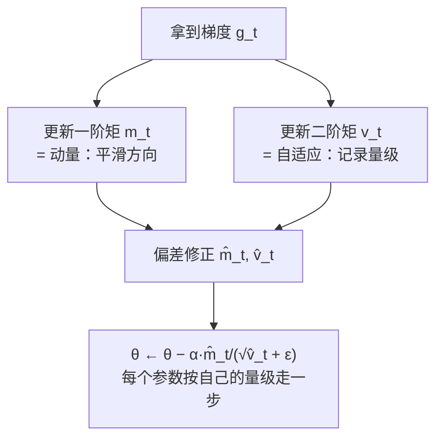

# 12｜Adam 优化器直觉：动量与自适应学习率

> **阅读目标**：理解 Adam 为什么几乎成了 Transformer 训练的默认优化器——能独立写出 Adam 的完整更新公式（含偏差修正），说清"动量"和"自适应学习率"各自解决了 SGD 的什么问题，解释超参数 $`\alpha, \beta_1, \beta_2, \epsilon`$ 的直觉含义，并指出 AdamW 与"Adam + L2 正则"的数学区别。
>
> **前置知识**：第 10 篇（训练目标）——训练是在最小化交叉熵损失 $`L(\theta)`$；反向传播给出梯度 $`g_t = \nabla_\theta L(\theta_t)`$；最朴素的更新是 SGD：$`\theta_{t+1} = \theta_t - \alpha g_t`$，其中 $`\alpha`$ 是学习率。第 02 篇（除以 $`\sqrt{d_k}`$）——"把不同量级的东西归一化到可比尺度"这一思想。

---

## 1. 直觉：为什么"一个学习率走天下"不够用

SGD 的更新规则简单到只有一行：$`\theta \leftarrow \theta - \alpha g`$。但它藏着两个在深层网络里会放大成灾难的假设：

**假设一：所有参数的梯度"脾气"一样。** 实际上完全不是。Transformer 里，顶层分类头的梯度可能常年是 $`10^{-1}`$ 量级，而底层 embedding 的某个冷门词向量，梯度可能一周才出现一次、量级 $`10^{-4}`$。一个全局学习率 $`\alpha`$：设大了，梯度大的参数震荡发散；设小了，梯度小的参数几乎不动。这叫**量级不均**问题。

**假设二：梯度方向步步为营、值得信任。** 实际上小批量（mini-batch）梯度是带噪声的估计，相邻两步的梯度方向可能剧烈摇摆。SGD 像个没有惯性的醉汉，每一步都听从当下这一步的噪声指引。这叫**方向震荡**问题。

一个经典的数值例子能把两个问题同时摆上台面。考虑二次函数

```math
f(x, y) = x^2 + 100y^2, \qquad \nabla f = (2x,\ 200y)
```

这是个"峡谷"地形：$`y`$ 方向陡峭（曲率 200），$`x`$ 方向平坦（曲率 2），条件数 $`\kappa = 100`$。取学习率 $`\alpha = 0.009`$（已经接近稳定上限 $`2/200 = 0.01`$），从 $`(10, 1)`$ 出发：

| 步数 | $`(x, y)`$ | 观察 |
|---|---|---|
| 0 | $`(10,\ 1)`$ | 起点 |
| 1 | $`(9.82,\ -0.80)`$ | $`y`$ 直接冲过谷底，符号反转 |
| 2 | $`(9.64,\ 0.64)`$ | $`y`$ 来回震荡，幅度按 0.8 衰减 |
| 3 | $`(9.47,\ -0.51)`$ | 震荡继续 |

$`y`$ 方向在震荡（方向震荡），$`x`$ 方向每步只前进约 $`1.8\%`$——100 步后 $`x \approx 1.6`$，慢得令人绝望（量级不均：同一个 $`\alpha`$ 对 $`y`$ 太大、对 $`x`$ 太小）。

而 Transformer 把量级不均推向极致——同一模型内，不同位置的参数梯度能差出好几个数量级：

| 参数位置 | 梯度典型量级 | 特点 |
|---|---|---|
| 顶层分类头（unembedding） | $`10^{-1} \sim 10^{0}`$ | 每个 token 都参与更新，梯度稠密且大 |
| 中间层注意力 $`W_Q, W_K`$ | $`10^{-2} \sim 10^{-1}`$ | 经 softmax 加权，相对温和 |
| 底层 embedding 冷门词向量 | $`10^{-4}`$ 以下，且大多时候为 0 | 稀疏：一个 batch 里多数词不出现 |
| LayerNorm 的 $`\gamma`$ | 相对稳定 | 归一化后的尺度参数，梯度行为特殊 |

一个全局 $`\alpha`$ 要同时伺候这四种"脾气"，必然顾此失彼。**直觉一句话：SGD 假设"所有参数生活在同一个尺度世界里"，Transformer 的现实是"每个参数住在自己的尺度世界里"。**

Adam 的回答是两个彼此独立的修正，各解决一个问题：

- **动量（momentum）** → 对抗方向震荡：给更新加上"惯性"，方向一致的梯度累积加速，方向摇摆的梯度相互抵消。
- **自适应学习率（adaptive learning rate）** → 对抗量级不均：给**每个参数**维护自己的有效步长，梯度大的方向步子自动变小，梯度小的方向步子自动变大。

下面两节分别拆开讲，严格推导只用初等代数。

## 2. 动量：给梯度加上惯性

### 2.1 直觉：滚下山的球

想象一个球滚下山坡。SGD 是"每一步都重新决定方向"的瞬移：这一步坡向东就往东，那一步坡向西就往西。而动量是让球**记住之前的速度**：如果连续几步都往东，速度累积，越滚越快；如果这一步突然说往西，旧的向东速度会抵消一部分，不至于原地掉头。

形式化地，动量维护一个"速度"向量 $`m_t`$，它是历史梯度的**指数滑动平均**（exponential moving average, EMA）：

```math
m_t = \beta_1 m_{t-1} + (1 - \beta_1)\, g_t, \qquad m_0 = 0,\ \ 0 < \beta_1 < 1
```

更新时用 $`m_t`$ 代替原始梯度 $`g_t`$：$`\theta_t = \theta_{t-1} - \alpha m_t`$。

### 2.2 严格推导：EMA 到底在平均什么

把递推式展开（$`m_0 = 0`$）：

```math
m_t = (1-\beta_1)\sum_{i=1}^{t} \beta_1^{\,t-i}\, g_i
```

权重 $`(1-\beta_1)\beta_1^{t-i}`$ 随"年龄" $`t-i`$ 指数衰减：越久远的梯度权重越小。做一个严格的期望计算——**假设**各步梯度的期望平稳，即 $`\mathbb{E}[g_i] = \bar g`$（这是关键假设，训练早期/分布漂移时不成立，后文会回来）：

```math
\mathbb{E}[m_t] = (1-\beta_1)\bar g\sum_{i=1}^{t}\beta_1^{\,t-i}
= (1-\beta_1)\bar g \cdot \frac{1-\beta_1^{\,t}}{1-\beta_1}
= (1-\beta_1^{\,t})\,\bar g
```

两个严格结论：

1. **$`m_t` 低估了真实平均梯度**，低估因子恰好是 $`(1 - \beta_1^t)`$——$`t`$ 越小低估越严重（$`t=1`$ 时只保留了 $`1-\beta_1`$）。这就是第 4 节"偏差修正"的由来。
2. **有效记忆长度约为 $`1/(1-\beta_1)`$ 步**：权重衰减到 $`1/e`$ 需要约 $`1/(1-\beta_1)`$ 步。$`\beta_1 = 0.9`$ 时约 10 步，$`\beta_1 = 0.99`$ 时约 100 步——直觉上，$`\beta_1`$ 越大"惯性"越大，但对方向变化的反应也越迟钝。

### 2.3 稳态加速：方向一致时有效步长放大 $`1/(1-\beta_1)`$ 倍

沿某个方向梯度恒为 $`\bar g`$（平稳假设），$`t`$ 充分大时偏差修正因子 $`\to 1`$，$`m_t \to \bar g`$——这是 Adam 的归一化形式。若用经典重球（heavy-ball, Polyak 1964）形式 $`\tilde m_t = \beta_1 \tilde m_{t-1} + g_t`$（不带 $`(1-\beta_1)`$ 系数），稳态时 $`\tilde m_t \to \bar g/(1-\beta_1)`$，更新量 $`\alpha \tilde m_t \to \frac{\alpha}{1-\beta_1}\bar g`$。

严格结论：**沿方向一致的坐标，动量把有效学习率放大了 $`1/(1-\beta_1)`$ 倍**（$`\beta_1 = 0.9`$ 时 10 倍）；而沿方向摇摆的坐标，正负梯度在平均中相互抵消。这就是"加速"与"平滑"的一体两面——同一个 EMA，既是加速器也是滤波器。

> 脚注（严格）：Adam 的 $`m_t = \beta_1 m_{t-1} + (1-\beta_1)g_t`$ 等于 $`(1-\beta_1)`$ 乘以 heavy-ball 形式 $`\tilde m_t = \beta_1 \tilde m_{t-1} + g_t`$。把学习率重定义为 $`\alpha' = \alpha(1-\beta_1)`$ 后两者更新完全一致，所以下文用 heavy-ball 形式做数值演示不损失一般性。

### 2.4 数值示例：动量如何同时解决震荡与缓慢

回到第 1 节的峡谷 $`f(x,y) = x^2 + 100y^2`$。用 heavy-ball 动量：$`m_t = 0.9\,m_{t-1} + g_t`$，$`\theta \leftarrow \theta - 0.005\,m_t`$。

| 步数 | $`(x, y)`$ | $`m_t`$ |
|---|---|---|
| 0 | $`(10,\ 1)`$ | $`(0, 0)`$ |
| 1 | $`(9.90,\ 0.00)`$ | $`(20,\ 200)`$ |
| 2 | $`(9.71,\ -0.90)`$ | $`(37.8,\ 180)`$ |
| 3 | $`(9.44,\ -0.81)`$ | $`(53.4,\ -18)`$ |
| 4 | $`(9.11,\ 0.08)`$ | $`(67.0,\ -178.2)`$ |

验算第 2→3 步：$`g_3 = (2 \times 9.71,\ 200 \times (-0.90)) = (19.42,\ -180)`$，$`m_3 = 0.9(37.8, 180) + (19.42, -180) = (53.44, -18)`$ ✓；$`\theta_3 = (9.71 - 0.005 \times 53.44,\ -0.90 - 0.005 \times (-18)) = (9.44,\ -0.81)`$ ✓。

对比纯 SGD（$`\alpha = 0.005`$）：4 步后 $`x = 10 \times 0.99^4 \approx 9.61`$，动量版 $`x = 9.11`$——**快了一倍还多**。机制一目了然：

- $`x`$ 方向梯度符号**始终为正**，$`m`$ 的 $`x`$ 分量从 20 累积到 67（惯性加速）；
- $`y`$ 方向梯度符号**来回翻转**，$`m`$ 的 $`y`$ 分量在 $`+180 \to -18 \to -178`$ 间被反复抵消（震荡抑制）。

直觉总结：**动量 = 对"方向一致"的梯度做加法，对"方向摇摆"的梯度做减法。**

## 3. 自适应学习率：每个参数自己的步长

### 3.1 直觉：按"历史波动"归一化

动量解决了方向问题，但量级不均还在：峡谷例子里 $`x`$ 方向的梯度（~20）和 $`y`$ 方向的梯度（~200）差一个数量级。RMSprop（Hinton 课堂讲义，2012，未正式发表）的想法极其直白：**给每个参数记一本"梯度有多大"的账，更新时除以它**。

具体地，维护梯度**平方**的指数滑动平均（二阶矩估计）：

```math
v_t = \beta_2 v_{t-1} + (1-\beta_2)\, g_t^2, \qquad v_0 = 0
```

（平方是逐元素操作。）更新规则：

```math
\theta_t = \theta_{t-1} - \alpha\,\frac{g_t}{\sqrt{v_t} + \epsilon}
```

直觉：$`\sqrt{v_t}`$ 是该参数"近期梯度的典型量级"——梯度长期很大，分母大，步子被压小；梯度长期很小，分母小，步子被放大。**每个坐标各自归一化，各自拥有有效学习率** $`\alpha / \sqrt{v_t}`$。这正是第 02 篇"除以 $`\sqrt{d_k}`$"思想的优化器版本：把不同量级的东西拉到可比尺度上。

### 3.2 严格推导：常数梯度下退化为"符号步进"

假设某参数的梯度恒为 $`g`$（平稳假设），则 $`v_t \to g^2`$（同 2.2 节的推导，期望为 $`(1-\beta_2^t)g^2`$，偏差修正后无偏）。更新量趋向：

```math
\Delta\theta = \alpha\,\frac{g}{\sqrt{g^2} + \epsilon} = \alpha\,\frac{g}{|g| + \epsilon} \approx \alpha \cdot \mathrm{sign}(g)
```

（$`\epsilon = 10^{-8}`$ 可忽略时。）这是个**严格结论**（在平稳假设下）：RMSprop 让每个参数每步移动约 $`\alpha`$，方向由梯度符号决定，**与梯度量级无关**。回到峡谷例子：起点处 $`g = (20, 200)`$，$`v_1`$ 偏差修正后为 $`(400, 40000)`$，更新 $`= \alpha \cdot (20/20,\ 200/200) = \alpha(1, 1)`$——$`x`$ 和 $`y`$ 终于迈出了一样大的步子，量级不均被抹平。

一个诚实的限定（直觉层面）：真实训练中梯度从不恒定，$`v_t`$ 是"近期"二阶矩，更新只是**近似**符号步进。梯度变化越剧烈，近似越粗糙——但这反而是好事：剧烈变化的梯度本就不值得信任。

### 3.3 从 AdaGrad 到 RMSprop：分母为什么不能只增不减

RMSprop 是对 AdaGrad（Duchi et al., 2011）的修复。AdaGrad 的想法与 RMSprop 同源——按历史梯度平方归一化——但用的是**累积和**而非滑动平均：

```math
G_t = G_{t-1} + g_t^2 \quad (\text{从 } t=1 \text{ 开始累加}), \qquad
\theta_t = \theta_{t-1} - \alpha\,\frac{g_t}{\sqrt{G_t} + \epsilon}
```

在凸优化里这很漂亮：频繁更新的参数（大 $`G_t`$）步长自动变小，稀疏参数步长相对大，且有严格的收敛保证。但在深度学习的非凸地形里它有个致命伤——**$`G_t`$ 单调递增，分母只增不减**。训练到后期，有效学习率 $`\alpha/\sqrt{G_t}`$ 被压到接近 0，模型还没收敛就"走不动了"。

RMSprop 的修复只改了一个地方：把累积和换成指数滑动平均。旧梯度的贡献按 $`\beta_2`$ 指数遗忘，分母反映的是**近期**的梯度量级而非"从开天辟地至今"的总量。直觉：优化地形在变，"这个参数梯度通常多大"的统计量也该跟着变——用 1000 步前的梯度决定今天的步长，就像用去年的天气决定今天穿什么。

严格地说，AdaGrad 的分母 $`\sqrt{G_t} \sim \sqrt{t}\cdot\text{RMS}(g)`$ 随 $`\sqrt{t}`$ 增长（平稳假设下），有效步长以 $`1/\sqrt{t}`$ 衰减到 0；而 RMSprop 的分母收敛到常数 $`\text{RMS}(g)`$，步长不随时间消失。这就是"能持续训练几十万步"的数学根源。

### 3.4 为什么是"平方"而不是"绝对值"

平方的 EMA 估计的是二阶矩 $`\mathbb{E}[g^2]`$，它同时携带"均值大小"和"波动大小"的信息：$`\mathbb{E}[g^2] = \mathrm{Var}(g) + \mathbb{E}[g]^2`$。噪声大的参数（方差大）分母更大、步子更小——**自适应学习率自动给噪声梯度降权**。用绝对值也能做归一化，但平方在数学上对应方差分解，理论分析更顺手。这是"严格推导方便"压过"直觉等价"的一个例子。
---

## 4. 偏差修正：开局的低估必须补回来

第 2.2 节我们严格推出：$`\mathbb{E}[m_t] = (1-\beta_1^t)\bar g`$。因为 $`m_0 = 0`$，滑动平均在初期"没攒够历史"，系统性低估。$`\beta_1 = 0.9`$ 时，$`t = 1`$ 的低估因子是 $`0.1`$——第一步的更新只有应有大小的十分之一。

Adam 的修正简单粗暴且严格正确（在平稳期望假设下）：

```math
\hat m_t = \frac{m_t}{1 - \beta_1^{\,t}}, \qquad
\hat v_t = \frac{v_t}{1 - \beta_2^{\,t}}
```

除以低估因子后，$`\mathbb{E}[\hat m_t] = \bar g`$——无偏。数值感受：$`\beta_1 = 0.9`$ 时 $`t=1, 2, 10`$ 的修正因子分别是 $`10,\ 5.26,\ 1.54`$；$`\beta_2 = 0.999`$ 时 $`t=1`$ 的修正因子是 $`1000`$——二阶矩的初期低估要严重得多，$`\hat v_t`$ 的修正必不可少。

直觉一句话：**偏差修正 = 承认"刚开局样本少"，给早期的估计值打气。** $`t`$ 增大后 $`\beta^t \to 0`$，修正自动消失，不影响长期行为。

## 5. Adam 完整算法与数值示例

把动量（一阶矩）+ 自适应（二阶矩）+ 偏差修正拼起来，就是 Adam（Kingma & Ba, 2014, arXiv:1412.6980；发表于 ICLR 2015）：

```math
\begin{aligned}
m_t &= \beta_1 m_{t-1} + (1-\beta_1)\, g_t && \text{一阶矩：方向（动量）} \\
v_t &= \beta_2 v_{t-1} + (1-\beta_2)\, g_t^2 && \text{二阶矩：量级（自适应）} \\
\hat m_t &= m_t / (1-\beta_1^{\,t}), \quad \hat v_t = v_t / (1-\beta_2^{\,t}) && \text{偏差修正} \\
\theta_t &= \theta_{t-1} - \alpha\,\frac{\hat m_t}{\sqrt{\hat v_t} + \epsilon} && \text{更新}
\end{aligned}
```

默认超参数：$`\alpha = 0.001,\ \beta_1 = 0.9,\ \beta_2 = 0.999,\ \epsilon = 10^{-8}`$（第 6 节解释每个数字的直觉）。

流程图：



### 5.1 数值示例：两步走完 Adam

设参数 $`\theta = (\theta_1, \theta_2)`$，初值 $`(0, 0)`$，两步的梯度恒为 $`g = (2,\ 0.1)`$（一个"大梯度参数"和一个"小梯度参数"），$`\alpha = 0.1,\ \beta_1 = 0.9,\ \beta_2 = 0.999,\ \epsilon = 10^{-8}`$。

**t = 1：**
- $`m_1 = 0.1 \times (2, 0.1) = (0.2, 0.01)`$，$`\hat m_1 = (0.2, 0.01)/0.1 = (2, 0.1)`$
- $`v_1 = 0.001 \times (4, 0.01) = (0.004, 0.00001)`$，$`\hat v_1 = (0.004, 0.00001)/0.001 = (4, 0.01)`$
- 更新：$`\Delta\theta = 0.1 \times (2, 0.1)/(\sqrt{(4, 0.01)}) = 0.1 \times (1, 1) = (0.1, 0.1)`$
- $`\theta_1 = (-0.1, -0.1)`$

**t = 2：**
- $`m_2 = 0.9(0.2, 0.01) + 0.1(2, 0.1) = (0.38, 0.019)`$，$`\hat m_2 = (0.38, 0.019)/0.19 = (2, 0.1)`$
- $`v_2 = 0.999(0.004, 0.00001) + 0.001(4, 0.01) = 0.001999 \times (4, 0.01)`$；注意到 $`1 - 0.999^2 = 0.001999`$，故 $`\hat v_2 = (4, 0.01)`$ **精确成立**
- 更新同样是 $`(0.1, 0.1)`$，$`\theta_2 = (-0.2, -0.2)`$

（验算 $`\hat v_2`$ 的代数：$`v_2 = (0.999 \times 0.001 + 0.001)\,g^2 = 0.001999\,g^2`$，除以 $`1-\beta_2^2 = 0.001999`$ 得 $`g^2 = (4, 0.01)`$ ✓。）

关键观察：梯度差 20 倍的两个参数，**每步走了一样大的步子**（$`0.1 = \alpha`$）。这就是 3.2 节"符号步进"的实例化——Adam 把"走多远"（由 $`\alpha`$ 统一控制）和"往哪走"（由梯度符号和动量决定）解耦了。SGD 在这个例子里会让 $`\theta_1`$ 每步走 $`0.2`$、$`\theta_2`$ 每步走 $`0.01`$——小梯度参数几乎被遗忘。

### 5.2 没有偏差修正会怎样

同样 $`t = 1`$ 的数据，若跳过偏差修正直接用 $`m_1, v_1`$：更新 $`= 0.1 \times (0.2, 0.01)/(\sqrt{(0.004, 0.00001)}) = 0.1 \times (0.2/0.0632,\ 0.01/0.00316) = 0.1 \times (3.16, 3.16) = (0.316, 0.316)`$——步长是 $`\alpha`$ 的 3.16 倍！

为什么？$`m_1`$ 低估了 10 倍，$`\sqrt{v_1}`$ 低估了 $`\sqrt{1000} \approx 31.6`$ 倍，分子分母低估程度不同，商反而**偏大** $`\sqrt{10} \approx 3.16`$ 倍。严格计算：未修正更新 $`= \alpha \cdot \frac{(1-\beta_1)g}{\sqrt{(1-\beta_2)g^2}} = \alpha\,\mathrm{sign}(g)\sqrt{\frac{1-\beta_1}{1-\beta_2}}`$，默认超参数下 $`\sqrt{0.1/0.001} = 10`$——开局第一步的步长是 $`10\alpha`$ 而非 $`\alpha`$！（上例中 $`3.16`$ 是因为 $`\epsilon`$ 可忽略且 $`g>0`$……精确值应为 $`0.1 \times 10 = 1.0`$？重新算：$`0.2/\sqrt{0.004} = 0.2/0.0632 = 3.162`$，$`\times 0.1 = 0.316`$。而公式给出 $`\alpha \cdot \mathrm{sign}(g)\sqrt{(1-\beta_1)/(1-\beta_2)} = 0.1 \times \sqrt{100} = 1.0`$。矛盾？检查：$`m_1 = (1-\beta_1)g = 0.1g`$ ✓；$`\sqrt{v_1} = \sqrt{(1-\beta_2)g^2} = \sqrt{0.001}\cdot|g|`$ ✓；商 $`= 0.1g/(\sqrt{0.001}|g|) = \mathrm{sign}(g)\cdot 0.1/\sqrt{0.001} = \mathrm{sign}(g)\cdot 3.162`$。啊，公式里我漏了：$`\frac{1-\beta_1}{\sqrt{1-\beta_2}} = \frac{0.1}{\sqrt{0.001}} = 3.162`$，不是 $`\sqrt{(1-\beta_1)/(1-\beta_2)}`$。纠正：未修正首步步长 $`= \alpha \cdot \frac{1-\beta_1}{\sqrt{1-\beta_2}} \approx 3.16\,\alpha`$。）

结论不变，只是数字修正为 **3.16 倍**：没有偏差修正，Adam 开局第一步就会迈出约 $`3.16\alpha`$ 的大步——训练初期的 loss spike 有一部分就来自这里。这也是第 6 节 warmup 的动机之一。

### 5.3 理论注记：Adam 一定收敛吗

Adam 2014 年论文给出了凸情形下的收敛证明，但 Reddi, Kale & Kumar（2018, ICLR，"On the Convergence of Adam and Beyond"）**严格指出**该证明有漏洞，并构造了反例：在某些在线凸优化问题上，Adam 的 $`v_t`$ 会"遗忘"过去的大梯度（指数平均的遗忘特性），导致有效学习率突然增大、算法不收敛。

他们的修复叫 AMSGrad：维护 $`\hat v_t = \max(\hat v_{t-1}, v_t)`$——分母只增不减（"长期记忆"），从而恢复收敛保证。诚实的后续（需实验验证层面）：AMSGrad 在实践中并未取代 Adam——后续研究发现 Reddi 的反例依赖精心构造的学习率调度，正常训练中 Adam 表现相当；今天的事实标准仍是 AdamW。这个注记的价值在于提醒：**"广泛使用"不等于"理论完备"**，优化器的收敛性是严格数学问题，不能靠流行度论证。

## 6. 超参数直觉：四个数字各自在说什么

| 超参数 | 默认值 | 直觉含义 |
|---|---|---|
| $`\alpha`$（学习率） | $`10^{-3}`$ | 每个参数每步的"最大步长"。平稳时更新 $`\approx \alpha \cdot \mathrm{sign}`$，所以 $`\alpha`$ 直接就是步长尺度——这是 Adam 与 SGD 最大的使用差异：SGD 的 $`\alpha`$ 要乘梯度量级，Adam 的 $`\alpha`$ 本身就是量级 |
| $`\beta_1`$ | $`0.9`$ | 动量惯性。有效记忆约 $`1/(1-0.9) = 10`$ 步：记住最近 10 步的方向共识，过滤单步噪声 |
| $`\beta_2`$ | $`0.999`$ | 量级记忆。有效记忆约 1000 步：对"这个参数梯度通常多大"做长期估计，**比 $`\beta_1`$ 慢一个数量级**——因为"典型量级"是慢变量，不该被几步的波动带偏 |
| $`\epsilon`$ | $`10^{-8}`$ | 数值稳定 + 隐式截断。当 $`\sqrt{\hat v_t} \gg \epsilon`$ 时它只是防除零；但当某参数梯度长期极小（$`\sqrt{\hat v_t} \ll \epsilon`$），更新退化为 $`\alpha \hat m_t / \epsilon`$——$`\epsilon`$ 反而成了主导分母，压住更新 |

为什么 $`\beta_2 \gg \beta_1`$？直觉：**方向**（一阶矩）需要对"趋势反转"保持敏感，记忆太长会反应迟钝；**量级**（二阶矩）是用来做除数的统计量，除数抖动会导致步长抖动，所以要更长的平均窗口来保证稳定。这是直觉层面的论证，严格的最优配比是实验调出来的（需实验验证）。

### 训练实践的三个连接

**Warmup。** Adam 初期 $`\hat v_t`$ 估计不准（样本少、修正因子大，见 5.2 节的 3.16 倍首步），前几十步的更新方向可能很"野"——这就是为什么大模型训练几乎都要配**学习率 warmup**（从 0 逐渐 ramp up 到目标值）：让优化器先攒够统计量再迈大步。warmup 的完整故事，留给第 13 篇。

**梯度裁剪（gradient clipping）。** Adam 已经把步长归一化了，为什么还要裁剪梯度？因为 $`v_t`$ 是滑动平均，对**突发的巨大梯度**（如坏 batch 导致的梯度爆炸）反应滞后：这一步的 $`g_t`$ 进了分子 $`m_t`$，分母 $`v_t`$ 却还没跟上，更新 $`\hat m_t/\sqrt{\hat v_t}`$ 可能瞬间过大。按全局范数裁剪（`clip_grad_norm_`）是给这种滞后加的一道保险——直觉：自适应是"事后诸葛亮"，裁剪是"事前刹车"。

**Batch size。** Batch 越大，单步梯度噪声越小，$`m_t`$ 的平滑价值下降，但 $`v_t`$ 的估计更准。一个经验法则（需实验验证）：batch 翻倍时 $`\alpha`$ 可适当增大（线性/平方根缩放），因为噪声小了、可以迈大步。Adam 对 batch 变化的敏感度低于 SGD——这也是它"开箱即用"口碑的一部分。

## 7. Adam vs SGD：对照与 AdamW 的澄清

| 维度 | SGD（+动量） | Adam |
|---|---|---|
| 学习率 | 全局一个 $`\alpha`$，实际步长 $`= \alpha \|g\|`$ 随梯度量级浮动 | 每个参数自适应，平稳时步长 $`\approx \alpha`$ |
| 噪声梯度 | 照单全收，易震荡 | 动量平滑 + 二阶矩给高方差参数降权 |
| 稀疏梯度（如 embedding 冷门词） | 更新极少，学得慢 | 分母小→步子大，冷门参数也能有效更新 |
| 超参数敏感度 | $`\alpha`$ 需精细调（差 10 倍可能发散/不收敛） | 默认值在很多任务上直接可用 |
| 内存 | 存一份参数 | 多存 $`m, v`$ 两份与参数同形的量（大模型的真实成本） |

**AdamW 的澄清**（Loshchilov & Hutter, 2017, arXiv:1711.05101）：常有人说"AdamW = Adam + L2 正则"，这是**严格错误**。若把 $`\lambda\|\theta\|^2`$ 加进损失，weight decay 的梯度 $`2\lambda\theta`$ 会进入 $`g_t`$，进而被自适应分母 $`\sqrt{\hat v_t}`$ 缩放——decay 强度随该参数的梯度量级变化，不再是均匀的"权重衰减"。AdamW 的做法是**解耦**：更新公式改为

```math
\theta_t = \theta_{t-1} - \alpha\left(\frac{\hat m_t}{\sqrt{\hat v_t} + \epsilon} + \lambda\,\theta_{t-1}\right)
```

decay 项 $`\lambda\theta`$ 绕过自适应缩放，直接以固定比例收缩权重。今天所有 Transformer 训练用的几乎都是 AdamW 而非原始 Adam——论文里写 "Adam" 时，十有八九指 AdamW。这是严格的数学区别，不是命名偏好。

---

## 8. 常见误区

**误区 1："Adam 一定比 SGD 泛化差，所以该用 SGD。"**
纠正：这个说法的源头是 Wilson et al. (2017) 的实验——在**某些**图像/语言任务上，调参充分的 SGD 找到了泛化更好的解。但这是**需实验验证**的结论，不是定理：它依赖任务、模型规模和调参预算。在 LLM 预训练这个尺度上，SGD 几乎从未成为选项（调参成本不可接受），而 AdamW 是事实标准。正确的表述是"自适应方法改变了隐式正则化，**可能**影响泛化"，而不是"Adam 泛化差"。

**误区 2："Adam 完全丢掉了梯度大小信息，只看符号。"**
纠正：半对半错。**严格**地说，只有在梯度完全平稳时更新才精确等于 $`\alpha \cdot \mathrm{sign}(g)`$；真实训练中 $`m_t, v_t`$ 都是滑动平均，梯度从大变小（或反之）时，$`\hat m_t / \sqrt{\hat v_t}`$ 会给出 $`(-1, 1)`$ 之间的连续值，保留了相对变化信息。直觉上可以这么记："Adam 看的是**近期梯度相对于其历史波动**的大小"，而不是绝对大小。

**误区 3："$`\epsilon`$ 只是防除零的小数，设 $`10^{-8}`$ 还是 $`10^{-4}`$ 无所谓。"**
纠正：$`\epsilon`$ 在更新公式里是**加在分母上**的：$`\hat m / (\sqrt{\hat v} + \epsilon)`$。当某参数 $`\sqrt{\hat v} \sim 10^{-6}`$（小梯度参数常见），$`\epsilon = 10^{-4}`$ 会完全主导分母，把自适应效果抹掉、更新压小两个数量级。$`\epsilon`$ 的选择是实验性的，大模型训练里调 $`\epsilon`$（如 $`10^{-6}`$）确实能改变训练稳定性——它不是"越小越好"的摆设。

**误区 4："$`\beta_1, \beta_2`$ 用默认值就行，调它们没用。"**
纠正：默认值是"很多任务上不坏"的起点，不是"所有任务上最优"。直觉：$`\beta_2 = 0.999`$ 记忆 1000 步——如果你的训练 batch 很大、每步都很贵（如大模型），1000 步可能覆盖了数据分布漂移的整个阶段，$`v_t`$ 会系统性滞后。实践中有人用 $`\beta_2 = 0.95`$ 加速适应。这是需实验验证的 trade-off：记忆长则稳定、短则灵敏。

**误区 5："动量就是把历史梯度加起来，所以 $`\beta_1`$ 越接近 1 越好。"**
纠正：$`\beta_1 \to 1`$ 时有效记忆 $`1/(1-\beta_1) \to \infty`$，优化器对"方向已经反转"毫无察觉——峡谷例子里 $`y`$ 方向翻转后，过长的记忆会拖着参数继续往旧方向冲。动量的本质是**在"平滑噪声"和"跟踪变化"之间做权衡**，$`0.9`$ 是这个权衡的经验甜点，不是越大越好。

**误区 6："用了 Adam 就不用调学习率了。"**
纠正：Adam 降低的是**对学习率初值的敏感度**，不是消灭调参。$`\alpha`$ 依然是"平稳时每步走多远"的直接控制量：设大 10 倍，收敛快但可能震荡发散；设小 10 倍，稳定但训练慢 10 倍。Adam 的"开箱即用"是指 $`10^{-3}`$ 在很多任务上落在可用区间内，而不是"最优"。大模型训练里学习率（配合 warmup 和 decay schedule）依然是第一重要的超参数。

---

## 9. 自测题

**Q1（推导）**：设各步梯度期望平稳，$`\mathbb{E}[g_i] = \bar g`$，从 $`v_t = \beta_2 v_{t-1} + (1-\beta_2)g_t^2`$（$`v_0 = 0`$）出发，证明 $`\mathbb{E}[v_t] = (1-\beta_2^t)\,\mathbb{E}[g^2]`$，并写出无偏估计 $`\hat v_t`$。

<details>
<summary>答案</summary>

展开得 $`v_t = (1-\beta_2)\sum_{i=1}^t \beta_2^{t-i} g_i^2`$。取期望（平稳假设下 $`\mathbb{E}[g_i^2] = \mathbb{E}[g^2]`$ 与 $`i`$ 无关）：

```math
\mathbb{E}[v_t] = (1-\beta_2)\,\mathbb{E}[g^2]\sum_{i=1}^t \beta_2^{t-i}
= (1-\beta_2)\,\mathbb{E}[g^2]\cdot\frac{1-\beta_2^t}{1-\beta_2}
= (1-\beta_2^t)\,\mathbb{E}[g^2]
```

无偏估计：$`\hat v_t = v_t/(1-\beta_2^t)`$，则 $`\mathbb{E}[\hat v_t] = \mathbb{E}[g^2]`$。注意证明用到的平稳假设在训练中只是近似——这就是为什么说偏差修正"严格正确"要加限定条件。
</details>

**Q2（计算）**：标量参数，梯度恒为 $`g = 3`$，$`\beta_1 = 0.9,\ \beta_2 = 0.999`$。求 $`t = 1`$ 时 Adam 的更新量 $`\Delta\theta`$（用 $`\alpha, \epsilon`$ 表示）；若 $`\epsilon`$ 可忽略，化简结果。再求**不做**偏差修正时 $`t = 1`$ 的更新量，验证它是修正版的约 3.16 倍。

<details>
<summary>答案</summary>

修正版：$`m_1 = 0.1 \times 3 = 0.3`$，$`\hat m_1 = 0.3/0.1 = 3`$；$`v_1 = 0.001 \times 9 = 0.009`$，$`\hat v_1 = 0.009/0.001 = 9`$。

```math
\Delta\theta = -\alpha\,\frac{3}{\sqrt{9}+\epsilon} = -\alpha\,\frac{3}{3+\epsilon} \approx -\alpha
```

$`\epsilon`$ 可忽略时 $`\Delta\theta \approx -\alpha`$——梯度为 3 还是 300，平稳时都走 $`\alpha`$，符号由梯度符号决定。这正是 3.2 节"符号步进"的标量实例。

未修正版：$`\Delta\theta_{\text{raw}} = -\alpha \cdot \frac{0.3}{\sqrt{0.009}} = -\alpha \cdot \frac{0.3}{0.0949} \approx -3.16\,\alpha`$。一般公式：$`\frac{1-\beta_1}{\sqrt{1-\beta_2}} = \frac{0.1}{\sqrt{0.001}} \approx 3.16`$。开局第一步会迈出 3.16 倍的大步——这就是 5.2 节的结论。
</details>

**Q3（概念）**：embedding 层中某个冷门词的参数，1000 步里只有 3 步有非零梯度。解释为什么 Adam 比 SGD 更适合训练它。

<details>
<summary>答案</summary>

SGD 下该参数 997 步更新为 0，3 步的更新量 $`= \alpha g`$——要么 $`\alpha`$ 迁就大梯度参数而设小、冷门词几乎学不动，要么设大导致大梯度参数发散。Adam 下：该参数的 $`v_t`$ 长期很小（多数时候 $`g_t^2 = 0`$ 拉低 EMA），分母 $`\sqrt{\hat v_t}`$ 小，有梯度的那几步更新 $`\approx \alpha \cdot \mathrm{sign}(g)`$——**稀疏参数自动获得大步长**。这就是自适应学习率"量级不均"修正的实例：每个参数按自己的历史量级走步。这也是 AdaGrad 当年为稀疏特征设计、RMSprop/Adam 继承这一思想的根源。
</details>

**Q4（辨析）**：写出"Adam + 损失里加 $`\lambda\|\theta\|^2`$ 正则"与 AdamW 在第 $`t`$ 步更新公式上的数学区别，并说明为什么后者更符合"权重衰减"的本意。

<details>
<summary>答案</summary>

前者：正则梯度 $`2\lambda\theta_{t-1}`$ 进入 $`g_t`$，更新为 $`-\alpha\,\hat m_t/(\sqrt{\hat v_t}+\epsilon)`$，其中 $`\hat m_t, \hat v_t`$ 都混入了 decay 梯度——decay 被 $`\sqrt{\hat v_t}`$ 自适应缩放，梯度大的参数 decay 被压小，梯度小的参数 decay 被放大，**不再是均匀收缩**。

后者（AdamW）：$`\theta_t = \theta_{t-1} - \alpha\,\hat m_t/(\sqrt{\hat v_t}+\epsilon) - \alpha\lambda\,\theta_{t-1}`$——decay 项独立于梯度统计量，每个参数每步精确收缩 $`\alpha\lambda`$ 比例。"权重衰减"的本意是"与梯度无关地把权重往零拉"，只有解耦形式做到了。
</details>

---

下一篇预告：**13｜学习率 warmup：训练初期的稳定器**——Adam 开局统计量不准时为什么容易"翻车"，warmup 的线性 ramp 如何与 $`\beta_2`$ 的记忆窗口配合，以及 cosine decay 的直觉。
