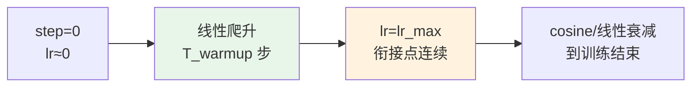

# 13｜学习率 warmup：为什么训练开头要用小学习率？

> **阅读目标**：能解释训练初期为什么必须把学习率从一个很小的值慢慢"热"起来——独立推导出 Adam 在 $`t=1`$ 时的有效步长（几乎只认方向、不认大小），估算第一步在参数空间中的总位移量级，写出 Vaswani 等人（2017）的 warmup 学习率公式，并说清 warmup 长度选择的经验法则与适用边界。
>
> **前置知识**：第 12 篇（Adam）——含偏差修正的完整更新公式；第 10 篇（训练目标）——交叉熵损失与梯度 $`g_t`$；第 02 篇的思想——"把不同量级的东西归一化到可比尺度"，在本篇恰恰是麻烦的来源。

---

## 1. 直觉：刚发动就踩油门，车会打滑

训练一个 Transformer，很像开一辆刚组装好的车上路：

- **车是"盲"的**：参数是随机初始化的，模型对数据一无所知，前几个 mini-batch 的梯度与其说是"指路牌"，不如说是"噪声"。
- **油门是"自适应"的**：Adam 会根据梯度历史自动调整每个参数的步长——但在训练开头，它用来做判断的历史只有一两个样本，相当于让一个刚上车、只看了一眼后视镜的新手司机决定踩多深的油门。

warmup 的做法简单到有点"笨"：**前 $`T_{\text{warmup}}`$ 步，学习率从接近 0 开始线性爬升到目标值，之后再正常衰减**。它不解决"方向错了"的问题——方向错了本来就该慢慢纠正；它解决的是"第一脚油门太大，一把冲出跑道"的问题。

先给一个直觉锚点：warmup 是**保险**，不是**动力**。它不让模型学得更快，它让模型在"最脆弱的开头"不翻车。这个结论成立的条件是：优化器带自适应步长（Adam 类）、模型深、batch 相对大——恰好是 Transformer 训练的标配。小模型 + SGD + 小学习率的 setup 里，warmup 经常可有可无（第 6 节误区 5 会展开）。

## 2. 推导一：Adam 的第一步到底走了多远？

把第 12 篇的 Adam 公式原样搬过来：

```math
m_t = \beta_1 m_{t-1} + (1-\beta_1) g_t, \quad v_t = \beta_2 v_{t-1} + (1-\beta_2) g_t^2
```

```math
\hat{m}_t = \frac{m_t}{1-\beta_1^t}, \quad \hat{v}_t = \frac{v_t}{1-\beta_2^t}, \quad \theta_{t+1} = \theta_t - \alpha \frac{\hat{m}_t}{\sqrt{\hat{v}_t}+\epsilon}
```

现在看**第一步**（$`t=1`$，$`m_0 = v_0 = 0`$），逐坐标计算。注意这是逐坐标的标量运算：

```math
m_1 = (1-\beta_1) g_1 \;\Rightarrow\; \hat{m}_1 = \frac{(1-\beta_1) g_1}{1-\beta_1} = g_1
```

```math
v_1 = (1-\beta_2) g_1^2 \;\Rightarrow\; \hat{v}_1 = \frac{(1-\beta_2) g_1^2}{1-\beta_2} = g_1^2
```

于是第一步的更新量是：

```math
\Delta\theta_1 = -\alpha \frac{g_1}{\sqrt{g_1^2}+\epsilon} = -\alpha \frac{g_1}{|g_1|+\epsilon} \approx -\alpha \cdot \mathrm{sign}(g_1)
```

（$`\epsilon = 10^{-8}`$ 可忽略，$`g_1 = 0`$ 的坐标步长为 0。）

**结论：Adam 的第一步，每个非零坐标都恰好走 $`\pm\alpha`$——梯度的大小信息被完全"归一化"掉了，只剩方向。** 这正是第 02 篇"除以 $`\sqrt{d_k}`$"思想的另一面：归一化让不同量级可比，但在这里，它把"这个梯度值不值得信任"的大小信息也一起抹掉了。

数值例子（$`\alpha = 10^{-3}`$，忽略 $`\epsilon`$）：

| 参数 | $`g_1`$ | SGD 第一步步长 | Adam 第一步步长 |
|---|---|---|---|
| $`w_a`$ | $`10`$ | $`0.01`$ | $`\approx 10^{-3}`$ |
| $`w_b`$ | $`10^{-4}`$ | $`10^{-7}`$ | $`\approx 10^{-3}`$ |

SGD 的步长与梯度大小成正比：梯度 $`10^{-4}`$ 的参数只挪 $`10^{-7}`$，很"谨慎"；Adam 对两个参数一视同仁，各走 $`10^{-3}`$。

更吓人的是**总量**。设模型有 $`d`$ 个参数，第一步的 L2 位移约为：

```math
\|\Delta\theta_1\|_2 \approx \alpha \sqrt{d}
```

取一个 1 亿参数的模型、$`\alpha = 10^{-3}`$：位移 $`\approx 10^{-3} \times 10^4 = 10`$。**一次更新，在参数空间里跳了 10 个单位**——而这一步的方向，来自初始化状态下第一个 mini-batch 的噪声梯度（第 3 节会说明它有多不可信）。这就是训练初期 loss 经常"炸"一下的数学根源之一。

warmup 把它直接按住了：warmup 阶段 $`\alpha_t = \alpha_{\max} \cdot t / T_{\text{warmup}}`$，第一步的有效学习率只有 $`\alpha_{\max}/T_{\text{warmup}}`$。取 $`T_{\text{warmup}} = 1000`$，第一步位移从 10 降到 0.01——车从"弹射起步"变成了"松离合"。

## 3. 推导二：为什么初期的梯度特别"不可信"

上一节说明了"第一脚油门有多大"，这一节说明"第一眼后视镜有多瞎"。三个层面的原因：

**（1）随机初始化 → 梯度天然就大。** 训练刚开始，logits 是随机的，softmax 输出接近均匀分布：真实类别的概率只有约 $`1/V`$（$`V`$ 是词表大小）。交叉熵对 logits 的梯度是 $`\delta = p - y`$（one-hot 标签），每个分量都是 $`O(1)`$ 量级——而训练后期 $`p`$ 接近 $`y`$，$`\delta`$ 接近 0。也就是说，**初期梯度在"大"和"方向随机"两个意义上都不可信**：大，来自模型全错；随机，来自初始化。

**（2）mini-batch 噪声。** 小批量梯度是全量梯度的带噪估计，相邻两步的方向可能剧烈摇摆（第 12 篇的"方向震荡"问题）。batch 越小，噪声越大——这是直觉。但有一个反直觉的实验结论：Popel & Bojar（2018，《Training Tips for the Transformer Model》）发现，**batch 越大，Transformer 反而越需要 warmup**。原因是大 batch 允许用更大的学习率，而更大的 $`\alpha`$ 按上一节的 $`\alpha\sqrt{d}`$ 公式，恰恰放大了"第一步跳太远"的风险。注意：这条是他们实验设置下的结论，归入"需实验验证"，不要当成普适定理。

**（3）自适应学习率的早期方差极大。** Liu 等人（2020，RAdam 论文《On the Variance of the Adaptive Learning Rate and Beyond》）从理论上分析了：Adam 的自适应步长 $`\alpha / \sqrt{\hat{v}_t}`$ 在训练早期的**方差**非常大——$`\hat{v}_t`$ 只累积了一两个样本的平方梯度，分母忽大忽小，步长极不稳定。他们的解法是给更新乘一个方差修正系数（RAdam），效果上等价于一种"自适应的 warmup"。这给了 warmup 一个更扎实的注脚：**warmup 就是"在自适应步长方差最大的时候，先别走大步"的工程近似。**（论文结论，实验验证过；warmup≈方差控制是直觉层面的对应，不是严格等价。）

三者叠加：方向噪声大 × 步长方差大 × 第一步位移 $`\alpha\sqrt{d}`$ ——训练开头的 loss 尖峰（spike）就从这里来。

## 4. 标准做法：线性热身 + 衰减

warmup 的"教科书"形式来自 Vaswani 等人（2017，《Attention Is All You Need》）：

```math
\mathrm{lrate} = d_{\mathrm{model}}^{-0.5} \cdot \min\left(\mathrm{step}^{-0.5},\ \mathrm{step} \cdot \mathrm{warmup\_steps}^{-1.5}\right), \quad \mathrm{warmup\_steps} = 4000
```

读一下这个公式：

- 当 $`\mathrm{step} < 4000`$ 时，$`\mathrm{step} \cdot \mathrm{warmup\_steps}^{-1.5} < \mathrm{step}^{-0.5}`$（两边同乘 $`\mathrm{step}^{0.5}`$ 即得 $`(\mathrm{step}/\mathrm{warmup\_steps})^{1.5} < 1`$），$`\min`$ 取前者——**学习率随 step 线性增长**，斜率为 $`\mathrm{warmup\_steps}^{-1.5}`$。
- 当 $`\mathrm{step} > 4000`$ 时取后者——按 $`\mathrm{step}^{-0.5}`$ 衰减。
- 在衔接点 $`\mathrm{step} = 4000`$ 处两项恰好相等（都是 $`4000^{-0.5}`$），曲线连续，没有跳变。

现代训练一般把"warmup"和"衰减"解耦成两个独立选择：warmup 阶段线性爬升（偶尔用 cosine 爬升），之后接 cosine decay、linear decay 或逆平方根衰减。整体形状如下：



**warmup 多长？** 经验法则（直觉 + 社区实践，需在自己的任务上验证）：

| 场景 | 常见 warmup 长度 |
|---|---|
| 原始 Transformer（Vaswani 2017） | 4000 步 |
| BERT 预训练 | 约总步数的 1%（1M 步中 10k） |
| 大模型预训练（GPT-3 量级） | 几亿 tokens（占总 token 的约 0.1%） |
| 小模型微调 | 几百步，或直接省略 |

规律是：**模型越大、batch 越大、学习率目标值越高，warmup 越要长**——因为这三者都放大了第 2 节的 $`\alpha\sqrt{d}`$ 风险。反过来，小模型微调时，"车"本来就不快，"路"（数据分布）也熟，热不热车区别不大。

## 5. 常见误区

**误区 1："warmup 就是开头慢一点，随便设 100 步就行。"**
纠正：warmup 对冲的是两个具体的数学机制——Adam 初期步长不可靠（第 2 节）+ 梯度噪声大（第 3 节）。设得太短，等于在模型还没走出随机初始化区域时就踩了油门。长度要覆盖"梯度从噪声主导过渡到信号主导"的阶段，一般至少几百步。

**误区 2："Adam 有偏差修正，初期问题已经解决了，不需要 warmup。"**
纠正：偏差修正修的是**期望的偏差**——除以 $`1-\beta^t`$ 让 $`E[\hat{m}_t] = E[g]`$（在梯度平稳的假设下）；它不修**方差**。$`\hat{v}_t`$ 在 $`t`$ 很小时仍是基于一两个样本的估计，方差极大（Liu 等 2020）。期望对了 ≠ 步子稳了。

**误区 3："warmup 越长，训练越稳定、收敛越好。"**
纠正：warmup 是保险不是动力。太长的 warmup 只是在浪费算力：模型在小学习率下爬行，收敛变慢，还可能错过早期的"快速下降窗口"。保险买够就行，买多了是负担。

**误区 4："加了 warmup，训练就不会发散了。"**
纠正：warmup 只解决"初期步子太大"这一类发散。梯度爆炸要靠梯度裁剪，初始化不当要修初始化，数据里有坏样本要清数据。把 warmup 当万能药，等于车打滑只怪没热车、不看轮胎。

**误区 5："所有训练都必须 warmup。"**
纠正：warmup 的必要性取决于风险大小——自适应优化器 + 深模型 + 大 batch + 大目标学习率，风险高；小模型 + SGD + 小学习率微调，风险低，后者经常省略 warmup 也很稳定。结论成立的条件要看第 1 节的清单。

## 6. 自测题

**Q1.** 取 $`\beta_1 = 0.9`$、$`\beta_2 = 0.999`$、$`\alpha = 2\times 10^{-3}`$，某参数第一步梯度 $`g_1 = 5`$。忽略 $`\epsilon`$，写出 Adam 第一步对该参数的更新量。

<details>
<summary>答案</summary>

$`\hat{m}_1 = g_1 = 5`$，$`\hat{v}_1 = g_1^2 = 25`$，更新量 $`= -\alpha \cdot 5/\sqrt{25} = -2\times 10^{-3}`$。注意结果与 $`g_1 = 5`$ 的具体数值无关（只要 $`|g_1| \gg \epsilon`$），只与符号有关——这就是"只认方向不认大小"。
</details>

**Q2.** 某模型有 $`2.5\times 10^7`$ 个参数，目标学习率 $`\alpha_{\max} = 10^{-3}`$。估算不用 warmup 时 Adam 第一步的 L2 位移量级；若 warmup $`T_{\text{warmup}} = 1000`$，第一步位移变为多少？

<details>
<summary>答案</summary>

位移 $`\approx \alpha\sqrt{d} = 10^{-3}\times\sqrt{2.5\times 10^7} \approx 10^{-3}\times 5000 = 5`$。warmup 下第一步有效学习率 $`\alpha_1 = 10^{-3}/1000 = 10^{-6}`$，位移 $`\approx 10^{-6}\times 5000 = 0.005`$，缩小为原来的千分之一。
</details>

**Q3.** 解释这句话："Adam 的偏差修正修的是期望的偏差，不是方差；warmup 处理的是方差问题。"

<details>
<summary>答案</summary>

偏差修正除以 $`1-\beta^t`$，使得在梯度分布平稳的假设下 $`E[\hat{m}_t]=E[g_t]`$、$`E[\hat{v}_t]=E[g_t^2]`$——修正的是"系统性低估"（期望偏差）。但 $`\hat{v}_t`$ 在 $`t`$ 很小时只累积了一两个样本，估计量的方差仍然极大，导致自适应步长 $`\alpha/\sqrt{\hat{v}_t}`$ 忽大忽小。warmup 通过压低早期的 $`\alpha`$，对冲的正是这个方差风险（参见 Liu 等 2020 的分析）。
</details>

**Q4.**（开放）在 Vaswani（2017）的公式里，warmup 阶段学习率随 step **线性**增长。为什么是线性，而不是指数增长？

<details>
<summary>参考答案</summary>

两点。第一，线性是最简单的"从 0 连续爬到目标值"的方案：指数增长初期太慢（前几百步几乎不动，浪费）、后期太陡（接近衔接点时斜率大，仍有"一脚油门"的风险）。第二，衔接的连续性：线性段在 $`\mathrm{step}=\mathrm{warmup\_steps}`$ 处的值恰好等于衰减段 $`\mathrm{step}^{-0.5}`$ 的值，曲线无缝衔接；换成指数增长，衔接点需要额外调参才能连续。当然，"线性最优"本身是工程选择而非定理——cosine warmup 等变体也存在，效果差异需实验验证。
</details>

---

**下一篇预告**：14｜FlashAttention 直觉：IO 才是注意力的真正瓶颈——注意力计算的瓶颈不在 FLOPs 而在显存读写，FlashAttention 如何用分块和在线 softmax 把 HBM 访问量降下来。
