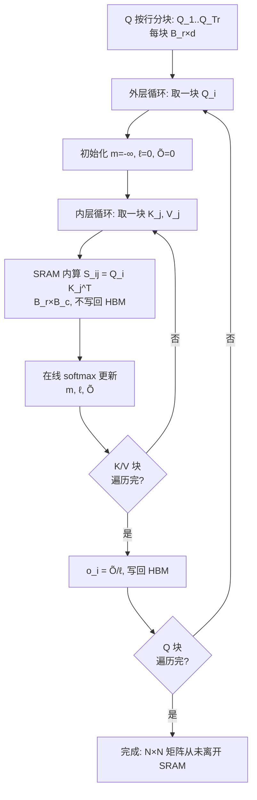

# 14｜FlashAttention 直觉：IO 才是注意力的真正瓶颈

> **阅读目标**：能独立算出标准注意力的 HBM 访问量（$\Theta(N^2)$ 从哪来），推导在线 softmax 的分块更新公式并用数字验证，画出分块注意力计算的内外层循环，说清反向传播为什么"重算比存下来"划算，并能反驳"FlashAttention 是近似算法""FLOPs 降了所以快"等误区。
>
> **前置知识**：第 02 篇（缩放点积注意力：softmax 的定义与数值稳定技巧）；第 08 篇（KV Cache：推理时的显存视角）；第 09 篇（GQA/MQA：显存优化的动机）。本篇会用到一点 GPU 存储层次知识，文中会现讲现用。

---

## 1. 直觉：注意力慢，不是因为算得多，而是因为"搬"得多

先建立 GPU 的存储画面。GPU 上有两级存储：

- **HBM（高带宽显存）**：容量大（几十 GB），但在芯片之外，访问慢；
- **SRAM（片上高速缓存）**：在计算单元旁边，访问快一个数量级以上，但容量极小（A100 每个 SM 约 192KB，还要被多个线程块分）。

标准注意力的计算流程是：

```
读 Q、K → 算 S = QK^T → 写回 HBM
读 S → softmax → 写 P 回 HBM
读 P、V → 算 O = PV → 写回 HBM
```

中间那个 $N \times N$ 矩阵 S 和 P，在 HBM 里被**写了又读、读了又写**。这就像做饭：食材在楼下仓库（HBM），灶台（SRAM）一次只能放一点，你每做一步都下楼跑一趟——时间都花在上下楼，而不是切菜。

**核心直觉**：FlashAttention 不改变任何数学结果，它只是把"下楼"的次数砍掉——每次从 HBM 搬一块数据上 SRAM，就在这块数据上把能算的全算完（这叫**算子融合**与**分块**），$N \times N$ 矩阵从头到尾只存在于 SRAM 里，从不写回 HBM。

可以把"访存主导"算得更死。用 roofline 模型的**运算强度**（operational intensity = FLOPs / 访存字节数）：第 2 节的例子里，forward 的 FLOPs 是 34 GFLOP，HBM 流量是 520MB，运算强度 ≈ $34\text{G}/0.52\text{G} \approx 65$ FLOP/byte。而 A100 的"岭点"（算力 ÷ 带宽）≈ 312 TFLOPS / 1.5TB/s ≈ 208 FLOP/byte。65 < 208，落在岭点左边——**memory-bound，实锤**。FlashAttention 做的事，就是分子（FLOPs）基本不动、把分母（字节数）砍掉，让运算强度往岭点右边搬。注意这是"端到端流程"的 roofline 位置：单个 QK^T 矩阵乘可能接近 compute-bound，但把 softmax 串进来、中间矩阵落 HBM 的**整体**是 memory-bound——优化的单位是"融合后的整体"，不是单个算子。

这个结论成立的条件：序列 $N$ 大到 $N^2$ 矩阵远超 SRAM 容量时（这正是长序列场景）。$N$ 很小（如几百）时，kernel 启动开销主导，FlashAttention 的优势不明显——这是工程层面的边界，需在自己的硬件上验证。

## 2. 先算一笔账：标准注意力的 HBM 访问量

### 2.1 IO 记账（严格推导）

记序列长 $N$，单头维度 $d$，fp16（2 字节）。标准注意力 forward 的 HBM 流量：

| 步骤 | 读 | 写 |
|---|---|---|
| 读 Q、K | $2Nd$ 个元素 | — |
| 算 $S = QK^T$ | — | $N^2$ 个元素 |
| softmax | $N^2$（读 S） | $N^2$（写 P） |
| 算 $O = PV$ | $N^2 + Nd$（读 P、V） | $Nd$（写 O） |

总量 $\Theta(N^2 + Nd)$——当 $N \gg d$ 时就是 $\Theta(N^2)$。而 FLOPs 是 $2N^2d$（QK^T）$+ 2N^2d$（PV）$= \Theta(N^2d)$。注意：**FLOPs 里有个 $d$，IO 里没有**——这意味着序列越长，访存相对计算越占主导。

### 2.2 数值例子：N=8192，d=128

- Q、K、V：各 $8192 \times 128 \times 2\text{B} = 2\text{MB}$
- S、P：各 $8192^2 \times 2\text{B} = 128\text{MB}$
- forward HBM 流量 ≈ $4 + 128 + 256 + 130 + 2 \approx 520\text{MB}$**每头**
- FLOPs ≈ $4 \times 8192^2 \times 128 \approx 34\text{ GFLOP}$ 每头

在 A100 上（fp16 算力约 312 TFLOPS，HBM 带宽约 1.5TB/s，均为量级数）：

- 计算时间 ≈ $34\text{G} / 312\text{T} \approx 0.11\text{ms}$
- 搬运时间 ≈ $520\text{MB} / 1.5\text{TB/s} \approx 0.35\text{ms}$

**搬运时间是计算时间的 3 倍**——这就是"注意力是 memory-bound（访存密集）"的定量含义（roofline 模型的语言：运算强度 = FLOPs / 访存字节数太低，性能被带宽封顶）。32 个头、几十层叠起来，每层 forward 仅注意力就要搬运十几 GB。

（以上带宽/算力取 A100 公开规格的量级，结论"访存主导"对 H100 等同样成立，具体倍数随硬件变。）

### 2.3 反向的账更吓人

训练还要算 backward。标准反向需要读 $P$（128MB/头）、$dO$、$O$、$V$，写 $dQ$、$dK$、$dV$——光"读 P"一项就 128MB/头。forward（520MB）+ backward（约 200MB）全套约 700MB/头/层，32 个头就是约 22GB/层的 HBM 流量。

更糟的是**常驻显存**：$P$ 必须在 forward 存下来、等到 backward 才用，128MB/头 × 32 头 = **4GB/层**躺在显存里睡觉。长序列训练 OOM，很多时候是 $P$ 的锅，不是参数的锅——这正是第 5 节要解决的问题。

## 3. 推导一：在线 softmax——不用看完全部，就能开始归一化

分块的最大障碍是 softmax：标准 softmax 要先看到**整行**才能求 max（数值稳定要求），似乎天然反分块。在线 softmax（Milakov & Gimelshein，2018，《Online Normalizer Calculation for Softmax》）解决了它。

对一行 scores $s = (s_1, \dots, s_N)$，数值稳定的 softmax 是：

```math
\mathrm{softmax}(s)_i = \frac{e^{s_i - m}}{\sum_j e^{s_j - m}}, \quad m = \max_j s_j
```

把行切成块，维护两个"running 统计量"：已处理部分的最大值 $m$，和 $\ell = \sum e^{s - m}$。处理新块时：

```math
m_{\text{new}} = \max(m_{\text{old}},\, \max(\text{新块}))
```

多说一句**为什么非减 max 不可**，尤其是在 fp16 下：fp16 最大只表示到 65504，而 $e^{11} \approx 59874$、$e^{12}$ 就溢出了。注意力打分 $s_i = q\cdot k/\sqrt{d}$ 经常达到几十——不减 max 直接 exp，fp16 下必溢出。所以"跟踪 max"不是可选的优化，是**正确性要求**；在线 softmax 的巧妙之处在于：它在分块的同时，顺手维护了这个正确性要求（每块的局部 max → 全局 max），没有为数值稳定多付任何 HBM 代价。顺带一提，rescale 因子 $e^{m_{\text{old}} - m_{\text{new}}} \le 1$（因为 $m_{\text{new}} \ge m_{\text{old}}$），旧统计量只会被缩小、不会上溢，数值上是安全的。

```math
\ell_{\text{new}} = \ell_{\text{old}} \cdot e^{m_{\text{old}} - m_{\text{new}}} + \sum_{\text{新块}} e^{s - m_{\text{new}}}
```

关键验证——旧统计量 rescale 的那一项恰好等于"旧块按新 max 重新归一化"：

```math
\ell_{\text{old}} \cdot e^{m_{\text{old}} - m_{\text{new}}} = \left(\sum_{\text{旧块}} e^{s - m_{\text{old}}}\right) e^{m_{\text{old}} - m_{\text{new}}} = \sum_{\text{旧块}} e^{s - m_{\text{new}}}
```

于是 $\ell_{\text{new}} = \sum_{\text{已处理}} e^{s - m_{\text{new}}}$——**不变式成立**：任何时候 $\ell$ 都是"已处理部分按当前 max 归一的分母"。这是严格推导，成立条件只有一个：浮点舍入误差范围内。

输出也一样维护。记 $\tilde{O} = \sum_{\text{已处理}} e^{s - m} v$（未归一的输出），更新：

```math
\tilde{O}_{\text{new}} = \tilde{O}_{\text{old}} \cdot e^{m_{\text{old}} - m_{\text{new}}} + \sum_{\text{新块}} e^{s - m_{\text{new}}} v
```

全部块处理完，$o = \tilde{O}/\ell$——与标准 softmax 注意力**完全相同**的结果。

### 数值验证

scores $s = (1, 3, 2, 5)$，块大小 2，V 的行向量为 $v_1 = (1,0)$、$v_2 = (0,1)$、$v_3 = (1,1)$、$v_4 = (2,0)$。

**块 1**（scores 1, 3）：$m_1 = 3$，
$\ell_1 = e^{1-3} + e^{3-3} = e^{-2} + 1 \approx 1.1353$，
$\tilde{O}_1 = e^{-2}(1,0) + 1\cdot(0,1) \approx (0.1353,\ 1)$。

**块 2**（scores 2, 5）：$m_2 = \max(3, 5) = 5$，rescale 因子 $e^{3-5} = e^{-2} \approx 0.1353$，
$\ell_2 = 1.1353 \times 0.1353 + e^{2-5} + e^{5-5} \approx 0.1536 + 0.0498 + 1 = 1.2034$，
$\tilde{O}_2 = (0.1353,\ 1) \times 0.1353 + e^{-3}(1,1) + 1\cdot(2,0) \approx (2.0681,\ 0.1851)$。

最终 $o = \tilde{O}_2/\ell_2 \approx (1.7185,\ 0.1538)$。直接算 softmax$(1,3,2,5)$ 得概率 $(0.0152, 0.1125, 0.0414, 0.8309)$，加权 V 得 $(1.7185,\ 0.1538)$——**一致**（末位为舍入误差）。分块没有改变任何数学。

## 4. 推导二：分块——把 N×N 矩阵"切碎"，在片上算完

有了在线 softmax，分块水到渠成。把 Q 按行切成 $B_r \times d$ 的块 $Q_1, \dots, Q_{T_r}$，K、V 切成 $B_c \times d$ 的块。对每个 $Q_i$ 维护行向量组 $(m, \ell, \tilde{O})$（每行一个）：



**为什么外层是 Q、内层是 K/V，不能反过来？** 因为 softmax 是按 query 的**行**归一化的：$(m, \ell, \tilde{O})$ 这组 running 状态天然属于"一行 query"。让 $Q_i$ 常驻 SRAM、$K_j/V_j$ 流过去，每行 query 的状态连续累积、一次成型；反过来（K/V 常驻、Q 块轮流进）则每块 $Q$ 都要把 $(m, \ell, \tilde{O})$ 读写一次，状态在 HBM 里进进出出，省掉的 IO 又吐回去一半。循环顺序不是任意的，是被 softmax 的"按行归一"结构锁死的。

**块大小谁定？SRAM。** 每个内层 step 需要同时放下 $Q_i$、$K_j$、$V_j$、$S_{ij}$、$\tilde{O}_i$，总量不能超过片上 SRAM（A100 每 SM 约 192KB，还要分给多个线程块）——所以实际实现中 $B_r, B_c$ 取几十到一百多，由 SRAM 容量反推。这是工程约束，不是数学自由。

### IO 复杂度（严格推导的量级）

- $Q$ 每块只读一次：$Nd$
- $K$、$V$ 的每块被重复加载 $T_r = N/B_r$ 次：$2Nd \cdot N/B_r = 2N^2d/B_r$（主导项）
- $\tilde{O}$ 在内外层循环间也要读写：同量级

取 $B_r$ 为 SRAM 约束允许的量级（$B_r \cdot d \lesssim M$，即 $B_r \sim M/d$，差一个常数因子），总量为 $\Theta(N^2d^2/M)$——这是 Dao 等人（2022，FlashAttention 论文《FlashAttention: Fast and Memory-Efficient Exact Attention with IO-Awareness》，NeurIPS 2022）证明的界。相对标准版的 $\Theta(N^2)$，省了约 $M/d^2$ 倍；在 A100 量级上约 6 倍。呼应第 2 节的例子：每头 520MB 的 HBM 流量降到约 70–90MB（量级估计）。

两个附带好处：**causal mask** 下 $j > i$ 的块（完全在对角线上方）直接跳过，连加载都省了；**dropout** 不需要存 $N \times N$ 的 mask，只存随机种子即可复现。

**后续演进一句话**：FlashAttention-2（Dao，2023）主要改进了 GPU 上的并行分工（减少非矩阵乘开销、更好的 warp 调度），在 A100 上相对 FA1 又有约 2 倍加速；思路（分块 + 在线 softmax）没变，变的是"块内怎么排"。本篇讲通 FA1，FA2 是工程深化——知道存在即可，细节需读论文。

（"约 6 倍"是量级估计；论文报告的端到端加速在 GPT-2 训练上为 2–4 倍量级——kernel 融合的其他开销会吃掉一部分理论收益，属需实验验证的实测数据。）

## 5. 反向传播：用"重算"换显存

forward 省了 IO，backward 省的是**显存占用**——而这往往是更致命的。标准反向要存下 $P$（$N \times N$，第 2 节例子里 128MB/头）用于求梯度，长序列下这就是 OOM 的真凶之一。

FlashAttention 的做法：**不存 $P$，只存每行的 $(m, \ell)$**（$O(N)$ 个浮点数，每行两个）**和 dropout 种子**；反向时把 forward 的分块重算一遍，现场算出 $S_{ij}$、$P_{ij}$ 再求梯度。

梯度公式本身是标准的（严格推导）。记上游梯度 $dO$，先有 $dP = dO\,V^T$，再过 softmax 的反向：

```math
dS_{ij} = P_{ij}\,\big(dP_{ij} - \sum_k P_{ik}\,dP_{ik}\big)
```

其中 $\sum_k P_{ik}\,dP_{ik} = dO_i \cdot o_i$（即 $\mathrm{rowsum}(dO \odot O)$ 的第 $i$ 行——验证：$\sum_k P_{ik}(dO_i \cdot v_k) = dO_i \cdot \sum_k P_{ik} v_k = dO_i \cdot o_i$ ✓）。然后 $dQ_i \mathrel{+}= dS_{ij}K_j$、$dK_j \mathrel{+}= dS_{ij}^T Q_i$、$dV_j \mathrel{+}= P_{ij}^T dO_i$，都在 SRAM 内完成。

维度验算（$Q_i: B_r \times d$，$K_j, V_j: B_c \times d$，$S_{ij}, P_{ij}: B_r \times B_c$，$dO_i: B_r \times d$）：$dS_{ij}K_j$ 为 $(B_r \times B_c)(B_c \times d) = B_r \times d$ ✓；$dS_{ij}^T Q_i$ 为 $(B_c \times B_r)(B_r \times d) = B_c \times d$ ✓；$P_{ij}^T dO_i$ 为 $(B_c \times B_r)(B_r \times d) = B_c \times d$ ✓——三者恰好落回 $dQ_i$、$dK_j$、$dV_j$ 的形状。

**为什么划算？** 重算多花的只是 FLOPs（第 2 节：QK^T 那 17 GFLOP/头，在 A100 上约 0.05ms），而省掉的是 128MB/头的 HBM 写入 + 常驻显存 + 反向读出。FLOPs 便宜、带宽和显存贵——这笔账在"访存主导"的前提下永远划算。这个"划算"是工程结论，成立条件是第 2 节算出的 roofline 位置；如果哪天算力相对带宽更稀缺，结论要重算。

### 一张表总结

| | 标准注意力 | FlashAttention |
|---|---|---|
| forward HBM 流量 | $\Theta(N^2)$（第 2 节：约 520MB/头） | $\Theta(N^2d^2/M)$（约 70–90MB/头，量级估计） |
| backward 常驻显存 | $O(N^2)$（存 $P$，128MB/头） | $O(N)$（只存每行 $m, \ell$） |
| FLOPs | $\Theta(N^2d)$ | forward 不变，backward 略增（重算） |
| 数学结果 | — | **完全一致**（exact，舍入误差内） |

## 6. 常见误区

**误区 1："FlashAttention 是近似算法，牺牲精度换速度。"**
纠正：它是 **exact attention**——第 3 节的数值验证展示了分块结果与标准 softmax 在舍入误差内完全一致。近似的是 sparse attention、Linformer、低秩近似那一路；FlashAttention 走的是 IO 优化路线，数学上零近似。

**误区 2："FLOPs 降了，所以变快了。"**
纠正：FLOPs 一点没降（反向还因为重算**增加**了）。变快的是 HBM 访问量少了。用 roofline 的语言：它把注意力的运算强度（FLOPs/字节）抬高，把瓶颈从"访存墙"往"算力墙"方向搬。只看 FLOPs 会得出完全反的结论。

**误区 3："块越大越好，一次全放 SRAM 里最快。"**
纠正：SRAM 容量是硬约束（A100 每 SM 约 192KB）。块大小是"在 SRAM 放得下"的前提下尽量大，是约束优化的结果，不是越大越好。放不下就只能溢出到 HBM，前功尽弃。

**误区 4："FlashAttention 只加速了 forward。"**
纠正：backward 也被重写了，而且收益可能更大——省掉了存 $N \times N$ 矩阵的 $O(N^2)$ 显存。很多长序列训练从"跑不起来"到"跑得起来"，靠的是 backward 的显存节省，不只是 forward 的加速。

**误区 5："用了 FlashAttention，context 想加多长加多长。"**
纠正：KV Cache（第 08 篇）仍是 $O(N)$ 的显存增长，GQA（第 09 篇）省的也是 KV 的常数。FlashAttention 把注意力的常数压小了，但线性增长的趋势没变——瓶颈只是从"注意力矩阵"转移到了"KV 缓存"。

## 7. 自测题

**Q1.** 取 $N = 4096$、$d = 64$、fp16。标准注意力 forward 在 HBM 里对 $N \times N$ 中间矩阵一共写/读了多少 MB？

<details>
<summary>答案</summary>

$N^2 = 4096^2 = 16{,}777{,}216$，fp16 下 $= 32\text{MB}$。写 S（32MB）＋ 读 S（32MB）＋ 写 P（32MB）＋ 读 P（32MB）$= 128\text{MB}$。注意这还不含 Q、K、V、O 本身的流量。
</details>

**Q2.** scores $s = (0, 2)$，块大小为 1（每块一个元素），V 的行向量 $v_1 = (1,1)$、$v_2 = (3,1)$。逐步算出 $m, \ell, \tilde{O}$，验证与直接 softmax 一致。

<details>
<summary>答案</summary>

块 1（$s = 0$）：$m_1 = 0$，$\ell_1 = e^0 = 1$，$\tilde{O}_1 = 1 \cdot (1,1) = (1,1)$。
块 2（$s = 2$）：$m_2 = 2$，rescale 因子 $e^{0-2} = e^{-2} \approx 0.1353$；$\ell_2 = 1 \times 0.1353 + e^{2-2} = 1.1353$；$\tilde{O}_2 = (1,1) \times 0.1353 + 1 \cdot (3,1) = (3.1353,\ 1.1353)$。
$o = \tilde{O}_2/\ell_2 \approx (2.7616,\ 1.0)$。直接算：softmax$(0,2) = (0.1192,\ 0.8808)$，$o = 0.1192(1,1) + 0.8808(3,1) = (2.7616,\ 1.0)$ ✓。
</details>

**Q3.** 用第 2 节的数字解释：反向时"重算 S、P 分块"为什么比"直接存下 P"划算？

<details>
<summary>答案</summary>

存 P：forward 多一次 128MB/头的 HBM 写入，反向再读 128MB，且 128MB 常驻显存挤占 batch/层数。重算：每块 $S_{ij}$ 在 SRAM 内现场算、用完即弃，HBM 零额外流量；多花的只是 QK^T 的约 17 GFLOP/头（A100 上约 0.05ms）。在"访存主导"的 roofline 位置下，用便宜的 FLOPs 换贵的带宽与显存，划算。
</details>

**Q4.**（开放）FlashAttention 把 HBM 访问从 $\Theta(N^2)$ 降到 $\Theta(N^2d^2/M)$。换一块 SRAM 翻倍（$2M$）的 GPU，加速比会翻倍吗？为什么？

<details>
<summary>参考答案</summary>

不会严格翻倍。公式上 IO 减半没错，但端到端时间服从 roofline 结构（≈ max(计算时间, 访存时间)）：访存降到与计算相当后，瓶颈转移到计算和其他 kernel 开销，加速比饱和。此外块大小还受寄存器数量、并行度、tensor core 对齐等约束，不只是 SRAM。"翻倍 SRAM ⇒ 翻倍加速"是直觉外推，需实验验证，不可当定理用。
</details>

---

**下一篇预告**：15｜混合精度训练：FP16/BF16 为什么能省显存又不炸——半精度到底省了哪里、会在哪里炸，loss scaling 与 BF16 各自的取舍。
