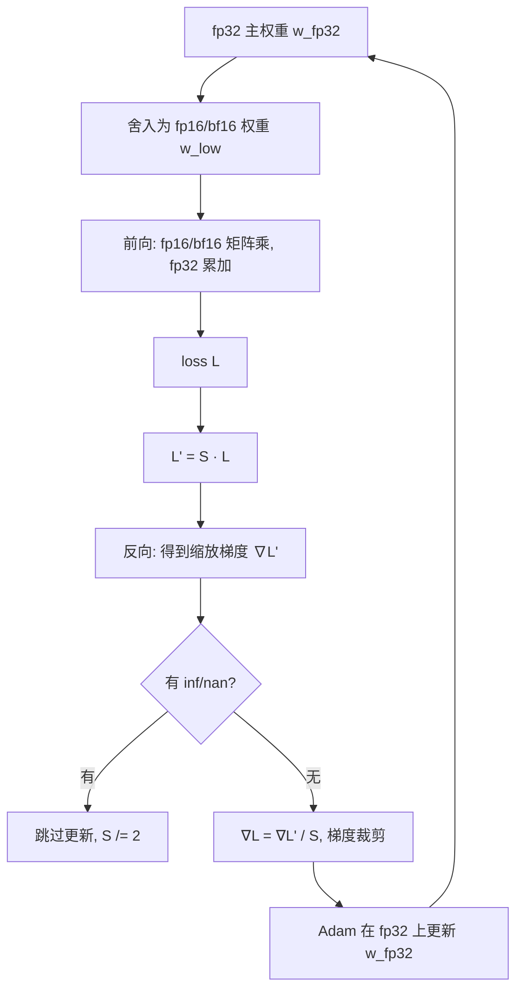

# 15｜混合精度训练：用一半的位数，保住全部的精度

> **阅读目标**：能说清 fp16 / bf16 / fp32 三种格式的位数分配与表示范围，算出"小更新被舍入吃掉"的临界条件，推导 loss scaling 为什么能救回下溢的梯度、又在什么情况下必须跳过更新，并画出带主权重（master weights）的混合精度训练流程；能反驳"混合精度就是精度减半""bf16 不需要任何额外处理"等误区。
>
> **前置知识**：第 02 篇（缩放点积注意力：softmax 与数值稳定）；第 06 篇（残差连接、LayerNorm 与前馈网络：为什么归一化层对数值敏感）；第 12 篇（Adam 优化器：动量与自适应学习率的更新公式）；第 13 篇（学习率 warmup：训练初期的数值脆弱性）。本篇会用到浮点数的基本结构，文中现讲现用。

---

## 1. 直觉：训练想要两样互相冲突的东西

训练一个 Transformer 时，我们同时想要两样东西：

- **算得快、占得少**：矩阵乘法是训练的主体成本，半精度（16 位）矩阵乘在 Tensor Core 上比 fp32 快数倍，权重和激活占用的显存也直接减半；
- **算得准**：优化器每一步的更新量往往很小，梯度里又同时存在很大和很小的值——位数一少，大的会溢出、小的会消失。

纯 fp32 训练满足第二点、牺牲第一点；纯 fp16 训练满足第一点、却会在第二点上翻车。混合精度训练的思路不是"折中取一个中间精度"，而是**分工**：让 fp16 / bf16 干它擅长的大规模矩阵乘，让 fp32 守住它必须守的三个地方——权重更新、优化器状态、数值敏感的算子。

这个分工成立的前提要先说清楚：它成立，是因为训练中**计算量最大的部分（矩阵乘）对舍入相对不敏感，而数值最脆弱的部分（权重更新、梯度缩放）占的计算量很小**。如果反过来——比如你的模型瓶颈在逐元素的递推求和上——混合精度的收益会大打折扣。这是一个工程结论，不是数学定理：具体收益要在自己的模型和硬件上测。

## 2. 先把三种格式的硬指标摆出来

一个浮点数由三部分组成：1 位符号位、若干位指数位、若干位尾数位。指数位决定**能表示多大的范围**，尾数位决定**表示得多精细**。

| 格式 | 符号 / 指数 / 尾数 | 最大值（约） | 最小正规格化数（约） | 相对精度（约） |
|---|---|---|---|---|
| fp32 | 1 / 8 / 23 | $3.4 \times 10^{38}$ | $1.2 \times 10^{-38}$ | $2^{-24} \approx 6.0 \times 10^{-8}$ |
| fp16 | 1 / 5 / 10 | 65504 | $6.1 \times 10^{-5}$ | $2^{-11} \approx 4.9 \times 10^{-4}$ |
| bf16 | 1 / 8 / 7 | $3.4 \times 10^{38}$ | $1.2 \times 10^{-38}$ | $2^{-8} \approx 3.9 \times 10^{-3}$ |

这张表已经讲出了全部故事的一大半：

- **fp16 的问题在范围**：指数只有 5 位，最大值才 65504，最小正规格化数却高达 $6.1 \times 10^{-5}$。梯度小于这个量级时，要么变成非规格化数（精度进一步丢失），要么直接下溢成 0。
- **bf16 的问题在精度**：指数和 fp32 一样宽，范围完全不是问题；但尾数只有 7 位，相对精度约 $3.9 \times 10^{-3}$——同一个数，bf16 的刻度比 fp16 粗约 8 倍。
- **fp32 两者都不缺**，代价是 4 字节、算得慢。

所以"半精度"不是一种东西，而是两种取舍相反的东西：fp16 保精度、丢范围；bf16 保范围、丢精度。选哪一种，决定了后面要补什么手续：fp16 需要 loss scaling 救范围，bf16 需要主权重救精度。两者都需要主权重，但原因的轻重不同——第 7 节会展开。

补充一个容易被忽略的细节：**非规格化数（subnormal）**。当数值小于最小正规格化数时，fp16 并不会立刻变成 0，而是进入非规格化表示：指数固定、靠尾数前导零来表示更小的数，最小可以到约 $6.0 \times 10^{-8}$。代价是有效尾数位数随数值变小而减少——数值每小一半，就少一位有效精度，这叫"渐进下溢"。所以梯度从 $10^{-5}$ 滑向 $10^{-7}$ 的过程不是"突然消失"，而是"精度先被掏空、最后才归零"。这对第 4 节的结论没有本质影响（该救还是要救），但解释了一个实测现象：不开 loss scaling 的 fp16 训练，loss 往往不是立刻变 nan，而是先变得"迟钝"——小梯度层更新越来越弱，模型像被冻住了一部分。

## 3. 推导一：小更新为什么会被"吃掉"

这是混合精度里最值得亲手算一次的结论。先定义一个概念：

> **ulp（unit in the last place）**：在某个数量级上，相邻两个可表示浮点数之间的间距。对于尾数 $p$ 位的格式，数值 $x$ 落在 $[2^e, 2^{e+1})$ 区间时，间距为 $2^{e-p}$。

fp16 的尾数是 10 位，所以间距公式是：

```math
\text{ulp}_{\text{fp16}}(x) = 2^{e-10}, \quad x \in [2^e, 2^{e+1})
```

现在算一个真实的权重更新。设某权重当前值 $w = 1.0$，Adam 给出的更新量 $\Delta = 1.0 \times 10^{-4}$（学习率 $10^{-4}$ 量级乘以归一化后的更新方向，这在训练后期非常典型）：

- $w = 1.0$ 落在 $[2^0, 2^1)$，$e = 0$，间距 $\text{ulp} = 2^{-10} \approx 9.77 \times 10^{-4}$；
- 按"就近舍入"规则，舍入的临界点是半个间距：$\text{ulp} / 2 \approx 4.88 \times 10^{-4}$；
- 更新量 $\Delta = 1.0 \times 10^{-4} < 4.88 \times 10^{-4}$，于是：

```math
\text{fl}_{\text{fp16}}(1.0 + 0.0001) = 1.0
```

**这一步更新被完整地吃掉了，权重纹丝不动。** 而且这不是偶然：只要 $|\Delta| < \text{ulp}(w)/2$，更新就恒等于零。权重越大、间距越大，被吃掉的概率越高——$w = 100$ 时，$100 \in [64, 128)$，$e = 6$，间距 $2^{-4} = 0.0625$，连 $0.01$ 量级的更新都会凭空消失。

结论的条件要讲清楚：这个推导假设"就近舍入"（round-to-nearest-even，硬件默认）。如果改用**随机舍入**（stochastic rounding：以与距离成正比的概率舍入到相邻两个可表示数之一），小更新就不会被系统性吃掉，而是以概率 $|\Delta|/\text{ulp}$ 生效、期望上无偏——但这需要硬件或软件特殊支持，不是默认行为，属于"进阶手段，需实验验证"，不在本篇的默认流程里。

**主权重就是对这个问题的直接回答**：权重更新这一步，永远在 fp32 副本上做：

```math
w_{\text{fp32}} \leftarrow w_{\text{fp32}} - \eta \cdot \frac{\hat{m}}{\sqrt{\hat{v}} + \epsilon}
```

然后每步把 $w_{\text{fp32}}$ 舍入成 fp16 / bf16，供下一步前向计算使用。前向用的低精度权重可以有舍入误差——那只是给计算加了一点噪声；但**更新的累积过程**必须在 fp32 里进行，因为成千上万步的小更新累积起来才是训练本身。区分"单步计算的噪声"和"更新累积的丢失"，是理解主权重的关键。

## 4. 推导二：loss scaling——把梯度整体"抬"进可表示范围

主权重解决了更新丢失，但还有第二个问题：**梯度本身在 fp16 里下溢**。反向传播算出的梯度常常在 $10^{-6}$ 量级以下，低于 fp16 的最小正规格化数 $6.1 \times 10^{-5}$，直接变成 0 或非规格化数——参数还没更新，梯度已经先没了。

Loss scaling 的做法看起来像个"作弊"：把 loss 先乘一个大系数 $S$，再反向传播：

```math
L' = S \cdot L, \quad \nabla L' = S \cdot \nabla L
```

第二式成立的唯一原因是**求导是线性运算**：常数 $S$ 可以穿过求导符号。于是反向传播得到的梯度整体放大了 $S$ 倍：原来 $10^{-6}$ 量级的梯度，取 $S = 2^{16} = 65536$ 后变成 $6.5 \times 10^{-2}$，舒舒服服地落在 fp16 的可表示范围里。优化器更新之前，再把梯度除以 $S$ 还原：

```math
\nabla L = \frac{\nabla L'}{S}
```

整个过程数学上是恒等变换——**只要中间没有溢出或下溢，loss scaling 对训练结果没有任何影响**。这句话的"只要"就是全部工程难度的来源：

- **$S$ 太小**：小梯度仍然下溢，等于没加；
- **$S$ 太大**：大梯度乘上 $S$ 后超过 65504，溢出成 inf，整步更新被污染；
- **动态 loss scaling**就是为此而生的自适应策略：每一步检查缩放后的梯度有没有 inf / nan；没有，就连续若干步（典型值 2000 步）后把 $S$ 翻倍，试探更大的安全空间；一旦出现 inf / nan，**跳过这一步更新**，并把 $S$ 减半。跳过更新是必要的：被 inf 污染的梯度一旦进入 Adam 的动量 $m$ 和 $v$，会被记住很多步——第 12 篇讲过，$m$ 和 $v$ 是历史梯度的指数滑动平均，污染不会随一步过去而消失。

两个容易错的细节：

1. **梯度裁剪必须在"除以 $S$ 还原之后"做**。裁剪阈值（比如全局范数 1.0）是针对真实梯度定义的；如果在缩放后的梯度上裁剪，相当于把阈值也放大了 $S$ 倍，裁剪就形同虚设。
2. **loss scaling 只救"范围"问题，不救"精度"问题**。它把梯度搬进可表示区间，但不增加尾数位数：两个相差 $10^{-7}$ 的梯度，放大后仍然可能落在同一个 fp16 刻度上。精度问题要靠主权重和 fp32 优化器状态解决，两者分工不同，不能互相替代。

## 5. 完整流程：一次混合精度训练步长什么样

把上面的零件组装起来，标准流程（PyTorch AMP 的 autocast + GradScaler 就是它的实现）是：



流程里有三个"fp32 钉子户"，值得单独说明为什么它们不能降精度：

| 钉在 fp32 的部分 | 原因 |
|---|---|
| 主权重与 Adam 的 $m$、$v$ | 第 3 节的更新丢失问题；$m$、$v$ 是跨步累积量，舍入误差会复利 |
| softmax、loss、LayerNorm 等归约算子 | 归约是对大量数求和/求均值，中间量的动态范围大、精度要求高；autocast 会自动把这些算子留在 fp32 |
| 矩阵乘的累加器 | Tensor Core 做 fp16 矩阵乘时，乘法用半精度、累加用 fp32——累加成千上万项时，fp16 累加器的舍入误差会随项数线性增长 |

注意最后一行：**"fp16 训练"这个说法本身就不精确**——即使是纯 fp16 流程，矩阵乘内部的累加也是 fp32。硬件早就替你做了混合，AMP 只是把这种混合推广到了整个训练流程。

## 6. 数值例子：显存账与更新账各算一笔

### 6.1 显存账：省在哪，不省在哪

先算一个容易误解的账。设参数量为 $P$，只看权重、梯度、优化器状态三项（不含激活）：

| 方案 | 权重 | 梯度 | Adam 的 $m$、$v$ | 合计 |
|---|---|---|---|---|
| 纯 fp32 | $4P$ | $4P$ | $8P$ | $16P$ |
| 混合精度（fp16 + fp32 主权重） | $2P$（计算用）$+ 4P$（主权重） | $2P$ | $8P$ | $16P$ |

**只看这三项，混合精度一字节都没省。** 这就是"混合精度让显存减半"这个说法的边界：省下来的显存主要在**激活**上——激活是每层、每个 token 都要存的中间量（反向传播要用），且不参与跨步累积，降精度没有复利代价。

举个具体数：batch 为 8、序列长 2048、隐藏维度 4096 的一层激活，单个张量 fp32 占 $8 \times 2048 \times 4096 \times 4\text{B} = 256\text{MB}$，fp16 占 128MB。几十层、多个张量（注意力分数、FFN 中间层等）叠加后，激活往往是训练显存的大头——这部分减半，才是混合精度的显存收益。至于"到底省多少"，取决于模型结构和 batch 设置，没有放之四海而皆准的百分比，实测为准。

### 6.2 更新账：主权重到底救了多少步

回到第 3 节的例子：$w = 1.0$，每步更新 $\Delta = 1.0 \times 10^{-4}$。纯 fp16 更新：每步都被吃掉，1000 步后权重仍然是 1.0——**训练在这些参数上等于停滞**。主权重 fp32 更新：fp32 在 1.0 附近的间距是 $2^{-23} \approx 1.2 \times 10^{-7}$，半间距 $6.0 \times 10^{-8} \ll 1.0 \times 10^{-4}$，每步更新都被精确记录，1000 步后权重变为 $1.0 - 1000 \times 10^{-4} = 0.9$（假设更新方向恒定，仅为示意）。然后舍入成 fp16 供前向使用时，0.9 的 fp16 表示误差约 $4.9 \times 10^{-4}$——这是**单步的表示噪声**，下一步更新仍在 fp32 副本上继续累积，不会被这层噪声打断。

这个对比揭示了一个更一般的原则：**累积量必须用高精度存，单步量可以用低精度算**。权重、动量、方差估计是累积量；一次矩阵乘、一次激活是单步量。混合精度训练的全部设计，都是这条原则在不同位置的展开。

## 7. fp16 还是 bf16：怎么选

| 维度 | fp16 + loss scaling | bf16（通常不用 loss scaling） |
|---|---|---|
| 范围风险 | 高：需要动态 loss scaling 兜底 | 低：指数范围与 fp32 相同，梯度几乎不会溢出/下溢 |
| 精度风险 | 低：10 位尾数，更新丢失相对温和 | 高：7 位尾数，$w=1.0$ 处间距 $2^{-7} \approx 7.8 \times 10^{-3}$，小更新更容易被吃掉 |
| 主权重 | 必须 | 更必须（精度更粗，fp32 主权重的作用更大） |
| 典型硬件 | 较老的 GPU（V100、T4 等） | A100 之后的支持 bf16 的硬件（Ampere 及更新架构） |

选择逻辑可以总结成一句话：**范围问题可以用 loss scaling 修，精度问题只能用主权重扛**。bf16 把范围问题从根上拿掉，代价是精度更差——但精度问题本来就有主权重这个解法，所以在支持 bf16 的硬件上，bf16 往往是更省心的默认选择。这也是近年来大模型训练普遍转向 bf16 的原因：少了一个动态调 $S$ 的活动部件，就少了一类训练中途 loss 变 nan 的故障模式。

但"bf16 不需要 loss scaling"不等于"bf16 不需要任何处理"：主权重、fp32 优化器状态、fp32 归约算子一个都不能少。把 bf16 当成"直接替换 fp32 就能用的格式"，是实践中最常见的翻车方式之一。

## 8. 实战：loss 突然变 nan，先查什么

理论讲完，落到真实训练里最常见的一幕是：训得好好的，某一步 loss 突然变成 nan，之后再也回不来。混合精度引入之后，排查要多问一层——这个 nan 是"模型本身发散"，还是"半精度表示先扛不住"？按下面这个顺序查，可以少走很多弯路：

**第一步：看 GradScaler 的状态，而不是先调学习率。** 动态 loss scaling 在溢出时会跳过更新并把 $S$ 减半。如果你发现训练日志里频繁出现"跳过更新"，说明缩放后的梯度反复撞上 65504 的天花板——问题大概率在数值表示，不在优化器。反过来，如果 $S$ 一路稳定增长、从未触发跳过，而 loss 依然变 nan，那更可能是学习率过大或数据里有异常样本，应该按纯 fp32 训练的常规思路排查。

**第二步：检查有没有"漏网"的自定义算子。** autocast 只认识它白名单里的算子；自己写的自定义 kernel、或者从别的库搬来的特殊层（比如某些归一化变体、带指数运算的门控），可能绕过了 autocast，直接在 fp16 下计算。指数、对数、除法这类对动态范围敏感的运算一旦落在 fp16 里，中间量很容易先溢出——症状是 loss 在某个特定层、某种特定输入分布下才变 nan，而不是全程随机出现。定位方法是：把可疑层单独固定在 fp32 下跑，看 nan 是否消失；消失了，就是它。

**第三步：区分"溢出"和"下溢"两种 nan 的来源。** 溢出产生的 inf 会顺着反向传播污染所有参数，表现为全模型梯度同时变 inf；下溢则相反，表现为某些层（通常是深层、梯度本来就小的层）的梯度悄悄归零，loss 不 nan、但训练停滞。两者症状不同，处理也不同：前者调小 $S$ 的增长速度或换 bf16，后者检查 loss scaling 是否生效、以及这些层的梯度量级是不是本来就低于 fp16 的表示下限。

**第四步：再看梯度累积的设置。** 用梯度累积（gradient accumulation）模拟大 batch 时，多个 micro-batch 的梯度要先加起来再更新。累积用的缓冲如果也是 fp16，多步小梯度相加时会重复遭遇第 3 节的舍入问题——正确的做法是累积缓冲保持 fp32，或者让 GradScaler 在累积结束、真正更新的那一步才做 unscale。很多框架默认已经这样处理，但自己手写训练循环时很容易在这里漏掉一步，导致"同样的超参数，别人能训、我一训就崩"。

**最后一条经验性的判断标准**：如果同一份代码、同一组超参数，纯 fp32 能训、混合精度不能训，问题几乎一定出在上面四步里的某一步——因为第 4 节已经证明，手续齐全的混合精度在数学上是恒等变换，不应该凭空多出一种发散模式。反过来，如果纯 fp32 也训崩，那就不是混合精度的问题，别在精度上浪费时间，回去查学习率、数据和模型结构。

## 9. 常见误区

**误区一："混合精度就是把精度减半，模型效果会变差。"**

纠正：混合精度不是均匀降精度，而是分工。数学上，loss scaling 是恒等变换（第 4 节）；主权重保证更新累积无损（第 3 节）；fp32 累加器保证矩阵乘的求和精度（第 5 节）。在这些手续齐全的前提下，混合精度与纯 fp32 的最终效果差异通常在随机噪声量级——但"手续齐全"是条件，不是免费午餐。缺了主权重或 loss scaling，效果变差是真实会发生的，不是理论风险。

**误区二："bf16 范围和 fp32 一样，所以 bf16 训练不需要主权重。"**

纠正：范围和精度是两个独立维度。bf16 的范围没问题，但尾数只有 7 位，$w = 1.0$ 处的舍入间距是 fp16 的 8 倍。没有主权重，小更新被吃掉的速度比 fp16 更快。范围问题解决了，精度问题反而更严重了。

**误区三："loss scaling 的 $S$ 越大越好，反正最后要除回来。"**

纠正：除回来之前，缩放后的梯度要先在 fp16 里走一遭。$S$ 太大，大梯度先溢出成 inf，这一步更新只能跳过；频繁跳过等于有效 batch 在缩水，训练会变慢甚至不稳定。动态 loss scaling 的存在，正是因为不存在一个对所有步都合适的固定 $S$。

**误区四："混合精度训练的显存一定是纯 fp32 的一半。"**

纠正：第 6.1 节的账算得很清楚：权重 + 梯度 + 优化器状态三项合计都是 $16P$，省下来的主要是激活。实际节省比例取决于激活占总显存的份额——batch 越大、序列越长，激活占比越高，收益越大；小 batch 训练可能几乎省不下来。报收益时不提 batch 设置的数字，都是耍流氓。

**误区五："fp16 矩阵乘快，所以所有算子降精度都能加速。"**

纠正：加速只发生在 Tensor Core 能接管的矩阵乘（以及部分逐元素算子）上。归约类算子（softmax、LayerNorm、loss）降精度不仅不加速，还可能因数值问题需要额外处理——这就是 autocast 把它们留在 fp32 的原因。混合精度的加速比，取决于你的模型里矩阵乘占多大比重。

## 10. 自测题

**1. 某权重 $w = 8.0$，fp16 更新量 $\Delta = 2.0 \times 10^{-3}$。这一步更新会被吃掉吗？**

<details>
<summary>答案</summary>

$8.0 \in [8, 16)$，$e = 3$，fp16 间距 $2^{3-10} = 2^{-7} \approx 7.8 \times 10^{-3}$，半间距 $\approx 3.9 \times 10^{-3}$。$\Delta = 2.0 \times 10^{-3} < 3.9 \times 10^{-3}$，按就近舍入会被吃掉，权重保持 8.0 不变。

</details>

**2. 某层梯度的典型量级是 $10^{-7}$，你用 fp16 训练且不做 loss scaling。会发生什么？如果取 $S = 2^{20}$，缩放后的梯度量级是多少？**

<details>
<summary>答案</summary>

不做 loss scaling：$10^{-7}$ 低于 fp16 最小正规格化数 $6.1 \times 10^{-5}$，梯度下溢成 0 或非规格化数（精度严重丢失），这层参数得不到有效更新。取 $S = 2^{20} \approx 1.05 \times 10^{6}$ 后，缩放梯度量级约为 $10^{-7} \times 10^{6} = 10^{-1}$，落在 fp16 可表示范围内；优化器更新前除以 $S$ 还原。但同时要检查：该层有没有量级较大的梯度被 $S$ 推过 65504 而溢出——这正是动态 loss scaling 要监控的事。

</details>

**3. 为什么梯度裁剪要在"除以 $S$ 还原之后"做？如果在缩放后的梯度上裁剪，相当于发生了什么？**

<details>
<summary>答案</summary>

裁剪阈值是针对真实梯度定义的。设阈值为 $C$，在缩放梯度 $\nabla L' = S \cdot \nabla L$ 上按 $C$ 裁剪，相当于对真实梯度按 $S \cdot C$ 裁剪——阈值被放大了 $S$ 倍（$S$ 常取 $10^4$–$10^5$ 量级），裁剪几乎永远触发不了，等于没裁剪。正确顺序：先除以 $S$ 还原，再裁剪，再更新。

</details>

**4. 同一个模型，A 用纯 fp32 训练，B 用混合精度训练。B 的权重 + 梯度 + 优化器状态显存与 A 相同，但总显存仍然明显更小。为什么？**

<details>
<summary>答案</summary>

因为省下来的部分是激活，不是权重/梯度/优化器状态（第 6.1 节的表：两者都是 $16P$）。激活在混合精度下以 fp16 存储，直接减半；且激活量随 batch、序列长、层数增长，在大 batch / 长序列训练中往往是显存大头，所以总显存仍然明显更小。小 batch 时激活占比低，收益就小——这正是"显存减半"说法需要附加条件的原因。

</details>

---

下一篇预告：16｜梯度检查点：用时间换显存
