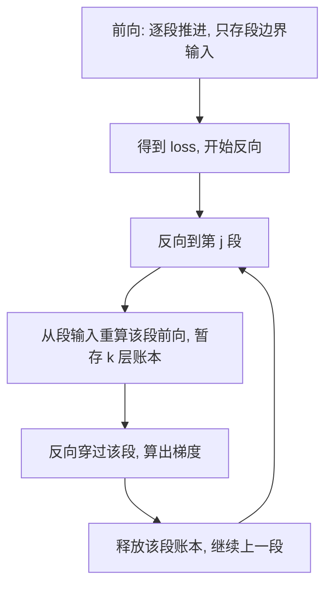

# 16｜梯度检查点：用时间换显存

> **阅读目标**：能说清反向传播为什么必须存下每层的中间激活，推导标准训练的显存为什么随层数线性增长、分段检查点为什么能把它压到 $O(\sqrt{n})$、以及这笔交易要多付多少计算；能算出"每 $k$ 层存一个检查点"在不同 $k$ 下的显存峰值，并反驳"检查点会改变梯度""检查点能省权重和优化器显存"等误区。
>
> **前置知识**：第 06 篇（残差连接、LayerNorm 与前馈网络：每层的前向计算长什么样）；第 10 篇（训练目标：交叉熵与 teacher forcing：梯度从 loss 往回流）；第 14 篇（FlashAttention：注意力分数矩阵的显存问题）；第 15 篇（混合精度训练：权重、梯度、优化器状态各占多少显存）。本篇的"层"指一个 Transformer block（含自注意力 + FFN），记层数为 $n$。

---

## 1. 直觉：反向传播是一场需要"记账"的计算

先问一个最基本的问题：训练时，前向传播算完、得到 loss 之后，为什么不能直接把中间结果全扔掉、只留 loss 去算梯度？

因为链式法则要"回头看"。以最简单的一层线性变换为例：

```math
y = Wx, \quad L = f(y)
```

$y$ 对 $W$ 的梯度是：

```math
\frac{\partial L}{\partial W} = \frac{\partial L}{\partial y} x^T
```

注意右边的 $x$：算梯度需要**前向时的输入**。再看激活函数，以逐元素的 $a = \sigma(z)$ 为例：

```math
\frac{\partial L}{\partial z} = \frac{\partial L}{\partial a} \odot \sigma'(z)
```

算梯度需要前向时的 $z$。一般规律是：**每一层的反向计算，都要用到该层前向时的输入或中间量**。这些量就叫**激活（activation）**，反向传播开始之前必须全部在场。

于是标准训练流程有一个隐含的代价：前向传播时，每一层算出的中间量都不能释放，要一路存到反向传播用完它为止。层数越多、batch 越大、序列越长，存的账本就越厚。这就是本篇要解决的问题：**能不能不把整本账都存下来，而是只存几个关键页码，需要时再把中间页重新算出来？**

这个想法的名字就是**梯度检查点（gradient checkpointing）**，也叫**激活检查点（activation checkpointing）**，原始论文是 Chen 等人 2016 年的《Training Deep Nets with Sublinear Memory Cost》。它的交易条件一句话就能说清：**多做一次前向计算，换显存从线性降到平方根**。下面把这句话拆成账算清楚。

## 2. 推导一：标准训练的显存账——为什么是 $O(n)$

先把一层的账本结构固定下来。记：

- $a$：一个隐藏状态张量（hidden state）的显存，比如 batch 为 $B$、序列长为 $T$、隐藏维度为 $d$ 时，一个 $B \times T \times d$ 的张量；
- $A$：一层前向时**必须存下来供反向使用**的全部中间量，单位同样用 $a$ 的倍数表示。

一层里要存的东西不止输出一个隐藏状态：注意力部分的 Q、K、V、注意力输出，FFN 部分的中间层（维度通常是 $4d$，见第 06 篇），再加上 LayerNorm 的输入，等等。所以一般有 $A \gg a$，即**一层的账本比一个隐藏状态厚得多**。这个不等式是后面所有节省的前提，记下来。

标准训练（不做检查点）时，前向传播逐层推进，每层存下自己的 $A$：

```math
\text{显存}_{\text{标准}} = n \cdot A
```

随层数 $n$ **线性增长**。这就是第 14、15 篇里反复出现的局面：权重、梯度、优化器状态合计是 $16P$（$P$ 为参数量，与层数无关的固定开销），而激活是随层数、batch、序列长一起膨胀的变量——模型越深、batch 越大，激活越先撞上显存墙。

注意这个账的边界：$n \cdot A$ 只算激活。权重、梯度、优化器状态不在这笔账里，后面会看到，检查点一分钱也省不了它们。

## 3. 推导二：分段检查点——把账本换成"目录 + 现算"

检查点的做法是**分段**：把 $n$ 层切成若干段，每段 $k$ 层；前向时只存每段的**输入**（即段边界上的隐藏状态，大小为 $a$），段内部的中间量算完就扔；反向传播到某一段时，再以该段的输入为起点，**把这一段的前向重算一遍**，重算过程中暂存该段的 $k$ 层账本，然后反向穿过这一段、用完即释放。

画成流程图：



现在算峰值显存。反向进行到某一段时，内存里同时有两样东西：

- 全部段边界：共 $n/k$ 个，每个 $a$，合计 $(n/k) \cdot a$；
- 正在重算的那一段的账本：$k$ 层，每层 $A$，合计 $k \cdot A$。

```math
\text{显存}_{\text{检查点}}(k) = \frac{n}{k} \cdot a + k \cdot A
```

这是一个关于 $k$ 的权衡函数：$k$ 越大，边界越少、但重算的段越厚；$k$ 越小，段越薄、但边界越多。对 $k$ 求导找最小值（把 $k$ 看成连续变量）：

```math
\frac{d}{dk}\left( \frac{n a}{k} + k A \right) = -\frac{n a}{k^2} + A = 0
\quad \Longrightarrow \quad
k^* = \sqrt{\frac{n a}{A}}
```

代回原式，最小峰值是：

```math
\text{显存}_{\min} = 2\sqrt{n \cdot a \cdot A} = O(\sqrt{n})
```

这就是论文标题里"次线性（sublinear）"的来源：**显存从 $O(n)$ 降到了 $O(\sqrt{n})$**。注意这个结论成立的条件：各层账本大小相近（Transformer 的 block 结构天然满足）、且 $A \gg a$（第 2 节的不等式）。如果某层的账本和隐藏状态一样大（$A = a$），最优 $k^* = \sqrt{n}$，最小峰值 $2\sqrt{n} \cdot a$，结论依然成立，只是节省倍数变小。

再算计算账。记一次前向的计算量为 $1$ 份，反向约为 $2$ 份（反向要算对输入和对参数两组梯度，还要多做几次矩阵乘，2 倍是常用的经验估计，不是精确值）。标准训练总计算量约 $1 + 2 = 3$ 份；检查点多做一次前向，总量约 $1 + 1 + 2 = 4$ 份：

```math
\text{计算开销} \approx \frac{4 - 3}{3} = 33\%
```

这就是交易的另一面：**显存压到平方根量级，代价是多约三分之一的计算**。注意"约"字：真实比例取决于前向/反向的实际耗时比，以及重算段是否命中缓存、是否和反向流水线重叠——不同硬件和框架下实测值会在 30% 上下浮动，但量级就是这个。

## 4. 数值例子：24 层模型，检查点省多少

取一个具体模型算账，数字均为示意（为讲清比例而设，不代表某个真实模型的实测值）：

- 层数 $n = 24$；
- 一个隐藏状态 $a = 1$ 单位；
- 一层账本 $A = 4a$（注意力中间量 + FFN 的 $4d$ 中间层 + 归一化输入，合起来约 4 个隐藏状态）。

标准训练：$24 \times 4a = 96a$。

检查点，取几种 $k$ 对比：

| 方案 | 边界 $(n/k)\cdot a$ | 重算段 $k \cdot A$ | 峰值 | 相对标准 |
|---|---|---|---|---|
| 不检查点 | — | — | $96a$ | 100% |
| 每 6 层一段（$k=6$） | $4a$ | $24a$ | $28a$ | 29% |
| 每 3 层一段（$k=3$） | $8a$ | $12a$ | $20a$ | 21% |
| 每 2 层一段（$k=2$） | $12a$ | $8a$ | $20a$ | 21% |
| 每 1 层一段（$k=1$） | $24a$ | $4a$ | $28a$ | 29% |

对照第 3 节的公式：$k^* = \sqrt{24 \times 1 / 4} = \sqrt{6} \approx 2.45$，所以 $k = 2$ 或 $3$ 时峰值最小（$20a$），与公式一致。

这个表里最值得注意的是最后一行：**实践中最常见的设置就是 $k = 1$，即每层都设检查点**（Hugging Face 的 `gradient_checkpointing_enable()` 默认就是按层切分）。它不是理论最优，但它省掉了调 $k$ 的麻烦，而且节省已经很大（$96a \to 28a$，约 71%）——因为它的本质是：**原来每层要存 $4a$ 的账本，现在每层只存 $1a$ 的边界**。$A \gg a$ 这个不等式越悬殊，按层切分就越划算。这也是为什么检查点和第 14 篇的 FlashAttention 是互补的：FlashAttention 干掉了 $T \times T$ 的注意力分数矩阵（账本里最大的一块之一），检查点再把剩下的每层账本换成边界，两者省的是账本的不同部分。

## 5. 三个容易被忽略的细节

**细节一：为什么不能只存模型输入、反向时整网重算？**

这是 $k = n$ 的极端情况：边界只有一个（模型输入），但反向时重算整网会把全部 $n$ 层账本一次性暂存起来，峰值回到 $n \cdot A$，等于没省。分段的意义正在于：**重算的粒度必须小于整网**，让"边界"和"重算段"两项都不大。任何一端失控，交易就失败。

**细节二：重算必须和第一次算出完全相同的结果——随机性是隐患。**

如果层里有 dropout（第 06 篇提过的前向随机失活），第一次前向和重算时的 dropout mask 必须一致，否则重算出的账本对应的是另一条前向路径，梯度就错了。框架的解法是：**在进入检查点段时保存随机数生成器（RNG）的状态，重算前恢复它**，让两次前向掷出同样的骰子。推论：如果你在检查点段里用了框架管不到的随机来源（比如自己调了外部随机库、或者用了带随机性的自定义算子），重算结果可能悄悄偏离——症状是 loss 曲线和不开检查点时对不上，且难以定位。这是检查点唯一的"正确性风险"，不是性能问题。

**细节三：检查点省的是激活，不是全部显存。**

回到第 15 篇的账：权重 + 梯度 + Adam 的 $m$、$v$ 合计 $16P$，检查点对它们毫无影响。如果你开检查点之前显存爆掉的原因是优化器状态（比如全参数微调一个很大的模型），检查点救不了你——那要靠第 15 篇的混合精度、或者参数高效微调、优化器状态分片这类手段。反过来，如果爆掉的原因是 batch 大、序列长、层数深带来的激活，检查点就是最直接的解法。**先分清显存花在哪，再决定开什么**，这是排查显存问题时的第一步。

## 6. 实战：什么时候开，什么时候不开

**开检查点的典型场景**：显存不够、又不想缩小 batch 或截断序列时。检查点换来的是"同样的硬件、更大的 batch / 更长的序列 / 更深的模型"，代价是训练时间增加约三分之一。实践中还有两个常见组合：

- **检查点 + 梯度累积**：batch 实在放不下时，先用检查点把单步 batch 撑大，再用梯度累积拼出目标有效 batch，两者解决的是不同层次的 batch 瓶颈；
- **检查点 + 混合精度（第 15 篇）**：混合精度把账本里每个数的字节数减半，检查点把账本的层数维度压到平方根，两者相乘，显存收益叠加。

**不开检查点的场景**：显存本来就够用时。检查点的三分之一计算开销是实打实的，显存不紧张就没必要付。还有一种情况要小心：**推理时不需要检查点**——推理只有前向、没有反向，根本不存在"存账本"的问题；推理的显存优化是第 08 篇的 KV Cache，不是检查点。把训练手段搬到推理上，是概念错位。

另外一个实践提示：**选择性检查点（selective checkpointing）**。不是所有层都值得重算：有些层账本小、重算却不便宜，或者账本里主要是便宜的逐元素操作。进阶做法是只对账本厚、重算便宜的层（典型就是 Transformer block）设检查点，跳过薄层——省的显存差不多，付的计算更少。但这属于"需实验验证"的调优：省多少、慢多少，取决于具体模型结构，照搬别人的配置不一定最优。

## 7. 常见误区

**误区一："检查点会改变梯度，模型效果会变差。"**

纠正：数学上，重算得到的前向结果和第一次完全相同（细节二的 RNG 条件满足时），梯度也完全相同。检查点是**精确的**显存-计算交换，不是近似——和第 15 篇的混合精度（有舍入）不同，它不引入任何数值误差。如果开了检查点后 loss 曲线变了，先查 RNG 和自定义算子，不要怀疑检查点本身。

**误区二："检查点能让显存减半 / 省掉优化器显存。"**

纠正：检查点只压激活这一项（从 $O(n)$ 到 $O(\sqrt{n})$），权重、梯度、优化器状态一分不动。第 4 节的例子里激活从 $96a$ 降到 $20a$，但如果你的显存大头本来就是 $16P$ 的权重+优化器，总显存下降比例会远小于激活的下降比例。报收益时不说清分母，是耍流氓——和第 15 篇"显存减半"的误区是同一个道理。

**误区三："检查点段越长越好，存的边界越少嘛。"**

纠正：第 3 节的公式里，峰值是两项之和：边界 $(n/k)\cdot a$ 随 $k$ 增大而减小，但重算段 $k \cdot A$ 随 $k$ 增大而增大。$k = n$ 时峰值回到 $n \cdot A$，等于没省。最优在 $k^* = \sqrt{na/A}$ 附近，实践中按层切分（$k = 1$）往往已接近最优——因为 $A \gg a$ 时，边界那一项本来就不贵。

**误区四："推理时开检查点能省显存。"**

纠正：推理没有反向传播，不需要存账本，检查点无事可做。推理的显存瓶颈是权重和第 08 篇的 KV Cache。训练和推理的显存优化手段各有分工，混用是概念错误。

**误区五："检查点是免费午餐，反正计算便宜。"**

纠正：三分之一的额外计算在长时间训练里是真金白银——训一个月的任务要多花十天。检查点只在"显存是瓶颈、计算不是"时划算；如果你的任务本来就受计算限制、显存绰绰有余，开检查点就是纯亏损。先判断瓶颈在哪，再决定付不付这笔时间。

## 8. 自测题

**1. 一个 36 层的模型，每层账本 $A = 9a$（$a$ 为一个隐藏状态）。用检查点，最优段长 $k^*$ 约为多少？最小峰值约为多少？（用第 3 节公式）**

<details>
<summary>答案</summary>

$k^* = \sqrt{na/A} = \sqrt{36 \times 1 / 9} = \sqrt{4} = 2$。最小峰值 $= (n/k^*)\cdot a + k^* \cdot A = 18a + 18a = 36a$。标准训练是 $36 \times 9a = 324a$，检查点把激活压到了约 11%。注意这里 $A = 9a$ 越大，最优段长越小——因为重算一段的代价贵，段就该切得薄。

</details>

**2. 某模型不开检查点时激活占 40GB、其余（权重+梯度+优化器）占 60GB。开了检查点后激活降到 10GB。问：总显存下降了百分之几？这说明什么？**

<details>
<summary>答案</summary>

原来总计 100GB，现在 $10 + 60 = 70$GB，下降 30%。激活本身降了 75%，但总显存只降 30%——因为检查点不动的那 60GB 是分母里的大头。这正是误区二的数字版：评估检查点收益时，要看它在总显存里的占比，不能只看激活一项的降幅。

</details>

**3. 开了检查点后，你发现 loss 曲线和不开时对不上，但模型结构、超参数、数据顺序都相同。按第 5 节的细节二，最可能的原因是什么？怎么验证？**

<details>
<summary>答案</summary>

最可能是检查点段内的随机性在重算时没有复现：dropout mask 或其他随机操作两次前向不一致，导致重算账本对应了另一条前向路径，梯度被算错。验证方法：把 dropout 关掉（或固定随机种子、设模型为 eval 模式跑一次确定性前向）再对比——如果曲线对上了，就是 RNG 问题；如果还对不上，再查自定义算子或框架版本。

</details>

**4. 你的任务显存充足、但训练时间已经是瓶颈；同事建议开检查点"反正能省显存"。你开还是不开？为什么？如果反过来，显存爆了、但时间充裕呢？**

<details>
<summary>答案</summary>

显存充足、时间是瓶颈：不开。检查点省的是你不缺的显存，付的是你正缺的计算（约 +33%），是纯亏损。显存爆了、时间充裕：开。此时显存是硬约束（爆了就训不动），时间是软约束（多花三分之一可以接受），交易成立。判断标准永远是：**瓶颈资源是什么，就优化什么；不缺的资源换不缺的资源，没有意义**。

</details>

---

下一篇预告：17｜指令微调：预训练模型如何学会"听话"？
