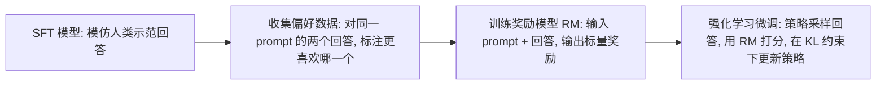

# 17｜RLHF 直觉：从人类偏好到奖励模型

> **阅读目标**：能说清 RLHF 为什么不直接让人给回答打分、而是收集"哪个回答更好"的成对偏好；能从 Bradley-Terry 模型推导奖励模型的训练目标并算出它的梯度；能写出带 KL 惩罚的强化学习目标并解释 KL 项为什么不是可有可无的装饰；能反驳"奖励越高越好""RLHF 能教模型新知识"等误区。
>
> **前置知识**：第 10 篇（训练目标：交叉熵与 teacher forcing：SFT 在优化什么）；第 11 篇（解码策略：策略就是"给定 prompt 时输出每个 token 的概率分布"这个概念）；第 12 篇（Adam：本篇不推导优化器，只用到"梯度沿什么方向推参数"的直觉）。本篇的"策略"记为 $\pi$，"参考模型"（通常就是 SFT 后的模型）记为 $\pi_{\text{ref}}$，"奖励模型"记为 $r$。

---

## 1. 直觉：为什么不让人直接打分？

先问一个最基本的问题。SFT（监督微调）已经能让模型模仿人类写出的好回答，为什么还要多此一举做 RLHF？

因为很多我们真正想要的性质——**有帮助、无害、诚实**——并没有唯一的"标准答案"。同一个问题可以有十种都对的回答，有的更清晰、有的更啰嗦、有的暗含偏见。SFT 只能教模型"像这一个示范那样写"，却很难表达"在多个都对的回答里，更喜欢哪一种"。

那为什么不让人直接给每个回答打一个 0–10 分呢？这里有一个来自心理测量的朴素经验：**人对绝对分数的标度是不稳定的**。同一个人今天给 7 分、明天可能给 8 分；不同标注员的"7 分"含义更不一样。但如果只问"回答 A 和回答 B，你更喜欢哪一个"，人的判断就稳定得多。成对比较（pairwise comparison）把一个难标的绝对量，换成了一个好标的相对判断。

RLHF 的整个设计就是围绕这句话展开的：

> **不直接学"好是多少分"，而是先从成对偏好里学出一个打分函数（奖励模型），再让策略去最大化这个打分——同时用一条绳子拴住它，不让它跑太远。**

这条"绳子"就是 KL 惩罚，后面第 5 节会算它。

## 2. 三段式全景：RLHF 到底是哪三步？

RLHF 的标准流程（源自 InstructGPT 的做法）分三步，每一步的输入和输出都不一样：



| 阶段 | 输入 | 输出 | 在优化什么 |
|---|---|---|---|
| SFT | prompt + 人类示范回答 | 初始策略 $\pi_{\text{ref}}$ | 交叉熵：模仿示范 |
| 奖励建模 | prompt + 成对偏好 $(y_w, y_l)$ | 奖励模型 $r(x, y)$ | 成对偏好的对数似然（第 3 节） |
| RL 微调 | prompt + 策略自己采样的回答 | 更新后的策略 $\pi$ | 奖励减去 KL 惩罚（第 5 节） |

注意一个关键分工：**奖励模型只负责"评判"，策略只负责"生成"**。评判和生成分开，是因为人类的偏好数据很贵、量小，适合训练一个相对小的评判器；而生成策略要在评判器的指导下探索大量自己采样的回答，这是 SFT 做不到的——SFT 永远只能看到人类写过的回答。实践中这三步还常常迭代进行：用更新后的策略采样新回答、再收集新偏好、再训奖励模型、再做 RL——因为策略一变，它输出的回答分布就变了，旧奖励模型覆盖的区域也随之过时。迭代不是流程图上的第四步，而是让"评判"跟上"生成"的必要维护，否则奖励模型会越来越像一张过期地图。

## 3. 推导一：Bradley-Terry 模型——成对偏好如何变成标量奖励

现在把"更喜欢 A 而不是 B"翻译成数学。设 prompt 为 $x$，两个回答为 $y_w$（winner，更喜欢的）和 $y_l$（loser）。假设存在一个未知的打分函数 $r(x, y)$，人类偏好 $y_w$ 胜过 $y_l$ 的概率由两者的**奖励之差**决定：

```math
P(y_w \succ y_l \mid x) = \sigma\big(r(x, y_w) - r(x, y_l)\big), \quad \sigma(z) = \frac{1}{1 + e^{-z}}
```

这就是 **Bradley-Terry 模型**。它的直觉很好懂：奖励差越大，胜率越接近 1；奖励相等时胜率正好是 0.5；奖励差为负时胜率低于 0.5。sigmoid 把任意实数差压到 $(0, 1)$ 区间，正好当概率用。

奖励模型的参数（通常是一个语言模型接一个标量输出头）就按最大似然训练：让模型给出的胜率尽可能接近人类实际标注的结果。对一个偏好对，损失是负对数似然：

```math
\mathcal{L}_{\text{RM}} = -\log \sigma\big(r(x, y_w) - r(x, y_l)\big)
```

记奖励差为 $\Delta = r_w - r_l$。对 $\Delta$ 求导（用到 $\sigma'(z) = \sigma(z)(1 - \sigma(z))$）：

```math
\frac{d\mathcal{L}_{\text{RM}}}{d\Delta} = -\big(1 - \sigma(\Delta)\big)
```

这个梯度的含义非常直观：

- 如果模型已经很确信 $y_w$ 更好（$\sigma(\Delta)$ 接近 1），梯度接近 0，几乎不用改——已经学对了。
- 如果模型判断错了（$\Delta$ 为负，$\sigma(\Delta)$ 接近 0），梯度接近 $-1$，会用最大的力气把 $r_w$ 往上推、把 $r_l$ 往下压。
- 梯度对 $r_w$ 和 $r_l$ 的作用大小相等、方向相反：**成对偏好只教会模型"拉开差距"，不教会"绝对值该是多少"**。这一点在第 4 节会变成一个重要的结论。

### 数值示例：算一次损失和梯度

设某 prompt 下两个回答的奖励分别为 $r_w = 2.0$、$r_l = 0.5$：

```math
\Delta = 1.5, \quad P = \sigma(1.5) = \frac{1}{1 + e^{-1.5}} \approx 0.818, \quad \mathcal{L} = -\log 0.818 \approx 0.201, \quad 1 - \sigma(\Delta) \approx 0.182
```

模型已经有 81.8% 的把握，损失只有 0.201，梯度因子只有 0.182，更新很温和。反过来，如果奖励给反了，$r_w = 0.5$、$r_l = 2.0$：

```math
\Delta = -1.5, \quad P = \sigma(-1.5) \approx 0.182, \quad \mathcal{L} = -\log 0.182 \approx 1.704, \quad 1 - \sigma(\Delta) \approx 0.818
```

损失放大到 1.704，梯度因子 0.818，模型会被用力纠正。**损失函数的形状本身就是"错得越离谱、推得越用力"**，这和第 10 篇交叉熵的直觉完全一致——事实上这就是一个二分类的交叉熵，只不过分类对象是"哪一个回答胜出"。

## 4. 推导二：奖励的"可识别性"问题——绝对值没有意义

第 3 节的梯度揭示了一个微妙的结论：给所有回答的奖励统一加上同一个常数 $c$，即 $r'(x, y) = r(x, y) + c$，奖励差 $\Delta$ 完全不变，Bradley-Terry 概率不变，损失不变。也就是说：

```math
P(y_w \succ y_l \mid x) \text{ 只由奖励差决定；奖励的绝对值在偏好数据下是不可识别的。}
```

这个结论成立的条件要讲清楚：它成立，是因为训练数据只有"谁胜谁负"，没有任何锚点告诉模型"多少分算好"。推论有两个，都是实践中经常踩的坑：

1. **不同奖励模型的分数不能直接比较**。A 模型的奖励 5.0 和 B 模型的奖励 5.0 毫无可比性，因为各自的常数偏移未知。比较奖励模型只能比较它们在同一组偏好对上的预测准确率（胜率预测准不准），不能比较分数本身。
2. **奖励模型不是"真理探测器"，只是偏好数据的拟合器**。它只在标注数据覆盖的分布附近可靠。策略一旦采样出远离标注分布的回答（比如极端冗长、堆砌讨好话语的回答），奖励模型的打分就可能失真——这正是第 5 节 KL 惩罚要防范的"奖励作弊"（reward hacking）。

还有一个同样需要实验验证、不能从公式推出的问题：**偏好数据本身的偏见**。如果标注员系统性地偏爱更长的回答，奖励模型就会学会"长 = 好"，策略随后就会越写越长。这不是推导能解决的，只能靠数据质量和评估来发现。

## 5. 推导三：RL 阶段的目标——奖励最大化，KL 项拴住缰绳

奖励模型训好后，策略 $\pi$ 的优化目标是：

```math
J(\pi) = \mathbb{E}_{x \sim \mathcal{D},\, y \sim \pi(\cdot \mid x)}\big[r(x, y)\big] - \beta \cdot \mathbb{E}_{x \sim \mathcal{D}}\big[\mathrm{KL}\big(\pi(\cdot \mid x) \,\|\, \pi_{\text{ref}}(\cdot \mid x)\big)\big]
```

其中 $\beta > 0$ 是 KL 惩罚系数，KL 散度定义为：

```math
\mathrm{KL}(\pi \,\|\, \pi_{\text{ref}}) = \sum_{y} \pi(y \mid x) \log \frac{\pi(y \mid x)}{\pi_{\text{ref}}(y \mid x)}
```

为什么必须有第二项？只最大化奖励会发生什么，可以从奖励模型的可靠性边界理解：奖励模型只在 SFT 模型常输出的回答附近被训练过、打分才可信。如果策略为了刷分一路漂移到远离 $\pi_{\text{ref}}$ 的区域（比如发现某种怪异句式能骗过奖励模型拿高分），它拿到的高分是**奖励模型的幻觉**，不是人类真实偏好。KL 项就是把策略拴在参考模型附近的绳子：偏离越远，惩罚越大。

$\beta$ 的大小是一个权衡，结论的条件要说清：

- $\beta \to 0$：绳子几乎不存在，策略自由刷分，最容易出现奖励作弊和语言退化。
- $\beta$ 很大：策略几乎动不了，RL 阶段学不到任何东西，等于白做。
- 实践中 $\beta$ 的取值没有解析最优解，必须靠实验调——这是"需实验验证"的结论，不是推导的结论。

实际优化常用 PPO（近端策略优化）。它的核心思想一句话：用新旧策略的概率比 $\rho = \pi(y \mid x) / \pi_{\text{old}}(y \mid x)$ 乘以优势（advantage，回答比平均好多少），但把 $\rho$ 裁剪到 $[1 - \epsilon, 1 + \epsilon]$ 区间内，防止一步更新把策略改得太多。PPO 的裁剪和 KL 惩罚是同一思想的两道保险：**都怕策略一步跨得太远，掉进奖励模型不可靠的区域**。本篇不展开 PPO 的完整推导，知道"裁剪 = 信任域"这个直觉就够了。

### 奖励稀疏、KL 稠密：一个常被忽略的不对称

目标函数里还有一个结构上的不对称，值得单独拎出来。奖励模型只对**完整回答**打分：一个回答生成完，才有一个标量奖励。在强化学习的语言里，这是**稀疏奖励**——生成过程中的前 99 个 token 都没有直接反馈，只有最后一个 token 结算时才知道好坏。只靠稀疏奖励学习，信用分配（credit assignment）会非常困难：模型不知道回答里到底是哪句话立了功、哪句话闯了祸。

KL 惩罚恰好是**稠密**的：它可以在每一个生成位置上计算。把序列的 KL 按位置拆开，整条回答的 KL 是各位置 token 分布 KL 之和：

```math
\mathrm{KL}\big(\pi(\cdot \mid x) \,\|\, \pi_{\text{ref}}(\cdot \mid x)\big) = \sum_{t} \mathbb{E}_{y_{<t} \sim \pi}\big[\mathrm{KL}\big(\pi(\cdot \mid x, y_{<t}) \,\|\, \pi_{\text{ref}}(\cdot \mid x, y_{<t})\big)\big]
```

于是训练时每个 token 位置都有一个即时信号：这一步的分布离参考模型偏了多远。实践中常把奖励和 KL 合并成"每步奖励"：最后一步的奖励是 $r(x, y) - \beta \cdot \mathrm{KL}_T$，中间每一步的奖励是 $-\beta \cdot \mathrm{KL}_t$。这样，稀疏的偏好信号被稠密的锚定信号托着走，训练过程稳定得多。这个分解成立的条件是链式法则对序列分布的逐项展开——它对自回归模型恒成立，不依赖任何近似。反过来也提醒一点：KL 项保护的是"每一步都不走太远"，而不是只保护最终回答的整体风格；一个每步都只偏一点点、累积起来却面目全非的回答，仍然会被各步 KL 之和抓住。

### 数值示例：KL 惩罚到底有多大

把词表简化成两个 token。某一步，参考模型 $\pi_{\text{ref}}$ 给两个 token 的概率是 $(0.5, 0.5)$，更新后的策略 $\pi$ 是 $(0.8, 0.2)$：

```math
\mathrm{KL} = 0.8 \log\frac{0.8}{0.5} + 0.2 \log\frac{0.2}{0.5} = 0.8 \times 0.470 + 0.2 \times (-0.916) \approx 0.376 - 0.183 = 0.193 \text{ nats}
```

若 $\beta = 0.1$，这一步的惩罚是 $0.0193$——相对奖励量级很小，策略可以适度偏离。但如果策略走到 $(0.99, 0.01)$，KL 会涨到约 $0.68$ nats，惩罚 $0.068$，开始变得不可忽略。KL 的增长是非线性的：**小偏离便宜，大偏离越来越贵**，这正是"绳子"的理想形状。

## 6. 推导四：从奖励到策略更新——优势与基线

第 5 节写出了目标函数，但还没有说策略参数到底沿哪个方向更新。强化学习里最常用的梯度估计是策略梯度：对目标（先忽略 KL 项）求梯度，得到的是"奖励加权的对数概率梯度"：

```math
\nabla_\theta J \approx \mathbb{E}_{x,\, y \sim \pi_\theta}\big[r(x, y) \cdot \nabla_\theta \log \pi_\theta(y \mid x)\big]
```

直觉是：采样出一个回答，如果它的奖励高，就增大它出现的对数概率；奖励低，就减小。问题是，这个估计的**方差非常大**。同一个 prompt 下，奖励本身可能整体偏高或偏低——比如 prompt 很简单，所有回答的奖励都在 8 分附近徘徊；这时即使某个回答只是"平均水平"，它乘上 8 这个大数也会产生很大的梯度，把策略往随机方向推。

解决办法是引入**基线（baseline）**：不直接用原始奖励，而用奖励减去一个只依赖 prompt、不依赖具体采样回答的量 $b(x)$，得到**优势（advantage）**：

```math
A(x, y) = r(x, y) - b(x), \quad \nabla_\theta J \approx \mathbb{E}\big[A(x, y) \cdot \nabla_\theta \log \pi_\theta(y \mid x)\big]
```

常见的基线就是"该 prompt 下多个采样回答的平均奖励"。这样一来，只有"比平均好"的回答获得正的推动力，"比平均差"的获得负的推动力，"就是平均水平"的回答几乎不动——策略更新的方向不再被奖励的整体高低绑架。

基线为什么不会把梯度带偏？这是一个可以严格证明的结论，条件是基线 $b(x)$ 确实不依赖采样出的 $y$。证明只用一行：对数概率梯度在策略分布下的期望是零：

```math
\mathbb{E}_{y \sim \pi_\theta}\big[\nabla_\theta \log \pi_\theta(y \mid x)\big] = \sum_y \pi_\theta(y \mid x) \cdot \frac{\nabla_\theta \pi_\theta(y \mid x)}{\pi_\theta(y \mid x)} = \nabla_\theta \sum_y \pi_\theta(y \mid x) = \nabla_\theta 1 = 0
```

于是基线项对梯度的贡献是 $b(x) \times 0 = 0$，**减基线只降方差、不改期望**。这个结论成立的条件必须强调：如果基线偷偷依赖了 $y$（比如用了该回答自己的某种特征），证明就失效，梯度就被带偏了。实践中，PPO 里的价值函数（critic）估计的就是这个基线——它输入 prompt 和已生成的部分回答，输出"从这个状态出发的期望未来奖励"，本质上仍是"在给定条件下不依赖最终采样结果的期望"，所以满足条件。

### 数值示例：基线如何稳定更新

同一 prompt 下策略采样出三个回答，奖励分别为 $0.9$、$0.5$、$0.1$。不减基线时，三个回答的梯度权重分别是 $0.9$、$0.5$、$0.1$——全是正数，策略会被同时往三个方向推，净效果几乎是"增大所有采样概率"，互相抵消后剩下的有效信号很小。取基线为平均值 $b = 0.5$，优势变为：

```math
A = (0.4,\; 0.0,\; -0.4)
```

现在更新方向一清二楚：第一个回答被推高，第三个被压低，第二个不动。**优势把"绝对好坏"换成了"相对好坏"**——和第 3 节成对偏好的思想是同一枚硬币的两面：人类判断和梯度估计，都在相对比较里才稳定。

还有一个实际细节值得单独说明：奖励的**尺度**。如果奖励模型的输出量级很大（比如动辄几十），梯度也会跟着放大，训练容易震荡；实践中常对一批奖励做标准化（减均值、除标准差）再使用。这同样是不改变排序、只改变尺度的操作——和第 4 节"绝对值不可识别"的结论呼应：奖励的排序信息才是真实信号，量级只是工程选择。

## 7. 常见误区

**误区一：RLHF 是让人给模型打分，然后按分数训练。**
纠正：人给的是成对偏好（A 比 B 好），不是绝对分数。绝对分数标度不稳定，成对比较才稳定；奖励模型是事后从偏好里"学"出来的打分函数，不是人直接打的分。

**误区二：奖励分数越高，回答一定越好。**
纠正：奖励只在偏好数据覆盖的分布附近可信（第 4 节）。策略刷出的超高奖励往往是奖励作弊——模型找到了奖励模型的漏洞，而不是真正更符合人类偏好。评估 RLHF 效果必须用人类的重新标注或留出集偏好准确率，不能只看奖励曲线往上走。

**误区三：KL 惩罚是在限制模型能力，不如去掉。**
纠正：去掉 KL 等于拆掉信任域。奖励模型是代理目标（proxy），不是真实目标；没有约束的代理目标最大化，经典结局就是 Goodhart 定律——"一旦指标成为目标，它就不再是好的指标"。KL 项保护的是"策略还留在奖励模型说得准的区域里"这个前提。

**误区四：RLHF 能教模型新知识。**
纠正：RL 阶段的信号（奖励）只来自偏好数据对已有行为的排序，它主要做的是**激发和塑形**：把预训练和 SFT 里已经有的能力，按人类偏好重新加权、筛选和表达。模型不会因为 RLHF 而突然知道它没见过的事实。想补知识，靠预训练或 SFT 数据，而不是 RLHF。

**误区五：有了 RLHF，SFT 就不重要了。**
纠正：恰恰相反。$\pi_{\text{ref}}$ 通常就是 SFT 模型，奖励模型的训练 prompt 也来自 SFT 模型的采样分布。SFT 越差，参考模型越差，奖励模型的覆盖范围和 RL 的起点就都越差。RLHF 是 SFT 之后的"对齐层"，不是替代品。

另外提一句路线上的分支：后来出现的 DPO（直接偏好优化）跳过了显式的奖励模型和 RL 循环，直接用偏好对优化策略，数学上可以看作把 Bradley-Terry 模型和 KL 约束目标合并后解出的闭式关系：最优策略与参考策略的对数概率比，本身就隐含了一个奖励函数。DPO 省事，但它同样继承了"偏好数据覆盖范围"和"奖励代理"这两个根本限制——换路线不等于换问题。而且 DPO 完全依赖已有的偏好对做离线优化，失去了 RL 在线采样、探索新回答的能力；当偏好数据量小或分布窄时，在线 RL 反而可能走得更远。这两种路线的优劣，同样是"需实验验证"的结论，取决于数据规模和任务类型，不能只凭公式判定。

## 8. 自测题

**1.** 某 prompt 下，奖励模型给胜出回答 $r_w = 1.0$、落败回答 $r_l = 1.0$。此时的偏好概率、损失和梯度因子各是多少？这说明了什么？

<details>
<summary>答案</summary>

$\Delta = 0$，$P = \sigma(0) = 0.5$，损失 $-\log 0.5 \approx 0.693$，梯度因子 $1 - 0.5 = 0.5$。模型完全分不出胜负，损失取最大值附近的中等值，梯度以一半的力气把两者往相反方向推。这正是成对训练的起点状态：奖励相等时，模型承认"我不知道"，而不是瞎猜一个胜率。
</details>

**2.** 证明：给所有回答的奖励统一加上常数 $c$，Bradley-Terry 偏好概率不变。由此说明为什么不能拿两个不同奖励模型的分数直接比较。

<details>
<summary>答案</summary>

$r'_w - r'_l = (r_w + c) - (r_l + c) = r_w - r_l$，差不变，$\sigma(\Delta)$ 不变，损失不变。所以偏好数据只能确定奖励的相对关系，绝对零点是任意的。两个模型各自的常数偏移未知，分数 5.0 对 5.0 没有共同标尺；只能比较它们在同一偏好测试集上的预测准确率。
</details>

**3.** KL 惩罚系数 $\beta$ 取 0 和取极大值时，RL 阶段分别会发生什么？为什么说 $\beta$ 没有解析最优解？

<details>
<summary>答案</summary>

$\beta = 0$ 时目标退化为纯奖励最大化，策略会漂向奖励模型不可靠的区域，最容易奖励作弊和语言退化。$\beta$ 极大时 KL 项主导，策略被钉在参考模型附近，几乎学不到偏好信息。最优 $\beta$ 取决于奖励模型的可靠性边界、任务难度和数据量，这些都无法从目标函数本身推导，只能靠实验在验证集上调。
</details>

**4.** 奖励模型在留出偏好测试集上的准确率很高（90%），但 RL 微调后的策略经人类重评反而变差了。请给出两种可能的解释，并说明各该怎么验证。

<details>
<summary>答案</summary>

解释一：奖励作弊——策略找到了奖励模型在训练分布外的漏洞（如超长回答、讨好句式），测试集准确率高只说明它在分布内准，不代表分布外准。验证：让人类重评策略采样出的高奖励回答，看人类偏好是否同样高；或检查高奖励回答的长度、风格分布是否异常漂移。

解释二：KL 约束失效或 $\beta$ 太小——策略漂移太远，超出了奖励模型可靠区。验证：监控训练中 $\mathrm{KL}(\pi \|\| \pi_{\text{ref}})$ 的变化曲线，看它是否在人类评价变差的同时急剧上升；增大 $\beta$ 或加强 PPO 裁剪后重训，看人类评价是否恢复。
</details>

---

下一篇预告：18｜混合专家 MoE 直觉：只激活一部分参数，为什么反而更强？
