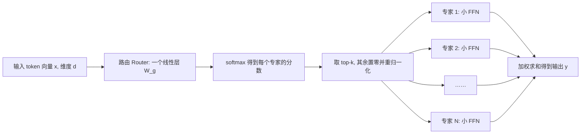

# 18｜混合专家 MoE 直觉：只激活一部分参数，为什么反而更强？

> 阅读目标：理解混合专家（Mixture of Experts，MoE）为什么能让总参数量变大、每步计算量却不跟着爆炸；掌握路由、top-k 选择和负载均衡损失的计算；并看清 MoE 在推理部署上付出的真实代价。
>
> 前置知识：前馈网络（第 06 篇）、缩放点积注意力（第 02 篇）、Adam 与训练稳定性（第 12、13 篇）。本篇的结论分三类标注：【直觉】表示帮助理解的比喻，【推导】表示可以从公式直接算出的结论，【需实验验证】表示依赖具体模型和数据的经验结论，不要把它当成定理。

## 1. 一个反直觉的承诺：参数越多，算得不一定越多

dense 模型里有一个默认假设：模型有多少参数，推理时就要用多少参数。输入一个 token，它要穿过每一层注意力和前馈网络（Feed-Forward Network，FFN），所有权重都被激活一次。想让模型更强，通常只能把模型做大，于是每步计算也跟着变大。

MoE 打破的就是这个绑定。它的承诺是：

> 把一层 FFN 换成很多个小 FFN（叫“专家”，expert），每个 token 只走其中一两个专家。模型总参数可以很大，但每个 token 实际激活的参数只相当于原来的一层。

【直觉】可以把 dense FFN 想成一位全科医生：什么病都看，但精力有限。MoE 则像一家医院：有内科、外科、儿科等多个专科医生，病人来了先由分诊台（路由）决定去哪一两个科室。医院总人数很多，但每个病人只占用一两个医生的时间。医院的“总规模”和“单个病人的花费”就此分开了。

但这个比喻只能走到这里。后面会看到，真实模型里的专家并不一定按人类理解的“学科”分工，分诊也可能失灵，医院还可能因为科室之间来回传病人而堵在走廊上。这些都是 MoE 必须用机制解决的问题，而不是比喻自动保证的好处。

## 2. MoE 层长什么样：路由加专家

标准 Transformer 的一层里，FFN 长这样（第 06 篇）：先把维度从 $`d`$ 升到 $`d_{\mathrm{ff}}`$，过激活函数，再降回 $`d`$。MoE 层把这个 FFN 整个替换掉，结构如下：



关键点有三个。第一，专家本身就是普通的 FFN，只是尺寸通常比 dense 模型里的 FFN 小。第二，路由只是一个线性层加 softmax，参数量相对专家可以忽略不计。第三，注意力部分通常不动：MoE 替换的一般是 FFN，Q、K、V 投影和注意力计算还是 dense 的（第 08 篇的 KV Cache 逻辑也因此不受影响）。所以“MoE 模型”准确的说法是“FFN 被 MoE 化的 Transformer”，而不是“处处都是专家的模型”。

【推导】记专家个数为 $`N`$，每个 token 激活的专家数为 $`k`$（通常 $`k=1`$ 或 $`2`$）。如果单个专家的参数量是 $`P_{\mathrm{exp}}`$，那么：

```math
\text{总参数（MoE 层）} = N \cdot P_{\mathrm{exp}}
```

```math
\text{每 token 激活参数（MoE 层）} \approx k \cdot P_{\mathrm{exp}} + \text{路由参数}
```

路由参数是 $`N \cdot d`$，而专家参数是 $`2 \cdot d \cdot d_{\mathrm{exp}}`$ 的量级（升维和降维两个矩阵），只要 $`d_{\mathrm{exp}}`$ 不太小，路由参数就可以忽略。于是总参数与激活参数之比大约是 $`N/k`$：8 个专家、每 token 走 2 个，容量就是同等激活量 dense 层的约 4 倍。这就是 MoE 的核心算术，后面第 4 节会用具体数字算一遍。

## 3. 路由的数学：打分、top-k、重归一化

路由的计算分三步，每一步都有明确的理由。

第一步，线性打分。输入向量 $`x \in \mathbb{R}^{d}`$ 乘上路由矩阵 $`W_g \in \mathbb{R}^{N \times d}`$，得到 $`N`$ 个分数：

```math
s = W_g x, \qquad s_i = w_i^{\top} x
```

第二步，softmax 归一化，把分数变成“每个专家应该分到多少权重”的概率分布：

```math
p_i = \frac{\exp(s_i)}{\sum_{j=1}^{N} \exp(s_j)}
```

第三步，top-k 选择：只保留最大的 $`k`$ 个 $`p_i`$，其余置零，再把保留下来的重新归一化，使它们之和为 1。设选中的专家集合为 $`\mathcal{T}`$，则最终门控权重为：

```math
g_i = \begin{cases}
\dfrac{p_i}{\sum_{j \in \mathcal{T}} p_j}, & i \in \mathcal{T} \\
0, & i \notin \mathcal{T}
\end{cases}
```

MoE 层的输出就是被选中专家的加权和：

```math
y = \sum_{i=1}^{N} g_i \cdot E_i(x) = \sum_{i \in \mathcal{T}} g_i \cdot E_i(x)
```

其中 $`E_i(x)`$ 是第 $`i`$ 个专家对 $`x`$ 的 FFN 输出。

为什么需要重归一化？【推导】如果不重归一化，输出的幅度会随 top-k 概率之和波动：有的 token 选中的两个专家概率和是 0.9，有的只有 0.4，输出向量的尺度就不稳定，后面的残差连接和 LayerNorm（第 06 篇）就要替这种波动买单。重归一化后，无论选中哪几个专家，权重之和恒为 1，输出幅度只取决于专家本身的输出，这是保持训练稳定的一个小但关键的设计。

**数值示例。** 设 $`N=4`$，$`k=2`$，某个 token 的路由概率为 $`p = [0.50, 0.30, 0.15, 0.05]`$。top-2 选中专家 1 和专家 2，概率和为 $`0.50 + 0.30 = 0.80`$。重归一化后：

```math
g_1 = \frac{0.50}{0.80} = 0.625, \qquad g_2 = \frac{0.30}{0.80} = 0.375, \qquad g_3 = g_4 = 0
```

输出为 $`y = 0.625 \cdot E_1(x) + 0.375 \cdot E_2(x)`$。注意专家 3、专家 4 对这个 token 完全没有贡献：它们的参数虽然存在于模型里，但这次前向没有被计算，也没有梯度（至少在这一层、这一步没有）。这就是“条件计算”（conditional computation）：计算图随输入而变，不是每个 token 都走同一张图。

【需实验验证】top-k 里的 $`k`$ 取 1 还是 2，没有普适最优解。$`k=1`$ 时路由的决策更“硬”，训练更不稳定，但推理最省；$`k=2`$ 时每个 token 有两个专家“商量”，梯度信号更平滑，但激活量翻倍。公开模型里两种选择都有，这说明它是一个工程权衡，而不是数学定理。

## 4. 算一笔账：总参数与激活参数

用一组小数字把第 2 节的公式算到底。设模型维度 $`d = 512`$。

先算 dense 基线：FFN 隐藏层 $`d_{\mathrm{ff}} = 2048`$，两个矩阵的参数量为：

```math
P_{\mathrm{dense}} = d \cdot d_{\mathrm{ff}} + d_{\mathrm{ff}} \cdot d = 2 \times 512 \times 2048 = 2{,}097{,}152
```

约 210 万参数。前向计算量大约是参数量的 2 倍（一次乘法加一次加法），即约 420 万次浮点运算，忽略偏置和激活函数。

再算 MoE 版本：$`N = 8`$ 个专家，每个专家的隐藏层 $`d_{\mathrm{exp}} = 1024`$（只有 dense 的一半），单个专家参数量为：

```math
P_{\mathrm{exp}} = 2 \times 512 \times 1024 = 1{,}048{,}576
```

| | 总参数 | 每 token 激活参数 | 前向浮点运算（约） |
|---|---:|---:|---:|
| dense FFN（隐藏层 2048） | 约 210 万 | 约 210 万 | 约 420 万 |
| MoE（8 专家 × 隐藏层 1024，top-2） | 约 840 万 | 约 210 万 | 约 420 万 |
| MoE 的路由（8×512） | 约 0.4 万 | 约 0.4 万 | 约 0.8 万 |

【推导】MoE 版本的总参数是 dense 的 4 倍，但每 token 的激活参数和计算量几乎完全相同。换句话说，在不增加单步计算预算的前提下，模型“记住的东西”和“能调用的变换种类”变成了 4 倍。这就是 MoE 在 scaling law 意义上吸引人的地方：同样算力，塞进更多容量。

一个更接近真实规模的参照：公开的 8 专家、top-2 架构（例如 Mixtral 式设计）总参数约 470 亿，但每个 token 实际激活的只有约 130 亿（其余是注意力等 dense 部分和未被选中的专家）。“470 亿参数的模型”这个说法本身没错，但如果把它理解成“每个 token 都用了 470 亿参数”，那就错了——激活量才是决定单步速度和单步成本的量。

【需实验验证】容量变大是否等于能力变强，取决于路由能不能把合适的 token 送到合适的专家，以及训练数据是否足够让每个专家都学到东西。容量只是上限，不是保证。下一节和第 6 节讲的正是这两个条件。

## 5. 为什么这样能更强：三个机制，一个前提

**机制一：容量换算力。** 第 4 节已经算过：固定计算预算下，MoE 能装下更多参数。Scaling law（第 12 篇附近提到的经验规律：更多参数、更多数据通常带来更低的损失）的受益面变宽了，因为参数不再被计算预算卡死。

**机制二：专业化分工。** 不同的专家可以在训练中逐渐擅长不同的输入模式：有的对代码符号敏感，有的对长句结构敏感，有的处理数字推理。这比一个 FFN 被迫“什么都学”更符合分工直觉。但要严格表述：真实模型里专家分工的形态往往并不干净。研究者经常发现，某些专家按 token 类型（如标点、数字）分工，而不是按人类理解的主题分工；也有专家几乎什么都接一点。【需实验验证】分工是训练中涌现的倾向，不是设计者事先分配的岗位说明书。把“专家擅长某领域”当成既定事实来解释模型行为，是过度解读。

**机制三：稀疏带来的正则化意味。** 每个 token 只更新它走过的专家（加上路由），而不是所有参数都被每个样本推一把。这在直觉上类似一种结构化的“分工学习”，但它不是 dropout，也不是严格的正则化项：被选中专家的梯度是完整的，没有被随机丢弃。不要把条件计算和正则化混为一谈。

**一个前提：数据量要跟得上。** MoE 的总参数多了，意味着每个专家平均分到的数据变少了。如果数据总量不变，8 个专家每个只看到约 $`1/8`$ 的“有效训练信号”（粗略估计，实际取决于路由分布），专家可能反而学不扎实。实践中 MoE 模型往往需要更多训练 token 才能兑现容量优势。这也是 MoE 更适合大算力、大数据场景的原因：它不是“小数据省钱的技巧”，而是“大算力换容量的架构”。

**补充一：共享专家。** 有些架构会在路由专家之外，再加一个“共享专家”（shared expert）：它对每个 token 都激活，不经过路由，输出直接与路由专家的加权和相加：

```math
y = E_{\mathrm{shared}}(x) + \sum_{i \in \mathcal{T}} g_i \cdot E_i(x)
```

【直觉】共享专家负责所有 token 都需要的通用变换，比如基本的句法结构和常见搭配；路由专家则负责更专门的部分。这样路由专家就不必在每个 token 上重复学习通用知识，可以把容量留给差异化内容。但共享专家本身就是 dense 计算：它让每 token 的激活量固定增加了一块，设计时要把这块算进激活预算里，不能只算路由部分就宣称“激活量不变”。

**补充二：细粒度专家与组合数。** 把一个大专家拆成几个小专家，专家总数 $`N`$ 变大、每个专家变小，路由可选的组合数会急剧上升。$`N = 8`$、$`k = 2`$ 时，不同的专家对只有 $`\binom{8}{2} = 28`$ 种；如果拆成 $`N = 32`$ 个小专家、每 token 选 $`k = 4`$ 个，组合数是 $`\binom{32}{4} = 35{,}960`$ 种。组合数本身不是能力，但它说明了细粒度路由的表达空间：不同的 token 可以走出差异更大的“专家组合指纹”，而不是在 28 种固定搭配里轮换。当然，专家变小、变多也会让路由学习更难、负载均衡更难做，这又回到了第 6 节的权衡：表达空间的扩大必须用训练稳定性和系统成本来换。

【需实验验证】共享专家和细粒度专家在公开模型里都取得过效果，但它们的收益高度依赖具体配置（共享专家的尺寸、细粒度拆分的程度、路由的 $`k`$ 值），不能从组合数公式直接推出“一定更好”。组合数算的是可能性上限，不是实际学到的分工质量。

## 6. 路由塌陷与负载均衡：MoE 最容易翻车的地方

MoE 有一个经典的失败模式，叫**路由塌陷**（routing collapse）：训练初期某个专家偶然表现稍好，路由就越来越多地把 token 送给它；它得到更多训练，表现更好，路由更偏爱它。如此正反馈，最后几乎所有 token 都挤向一两个专家，其余专家长期拿不到梯度，等于白占参数。模型退化成一个小 dense 模型，却背着大模型的参数量和通信成本。

解决办法是在总损失里加一项**负载均衡辅助损失**。定义两个量：$`f_i`$ 是实际被分到专家 $`i`$ 的 token 比例，$`P_i`$ 是所有 token 路由概率 $`p_i`$ 的平均值。辅助损失为：

```math
\mathcal{L}_{\mathrm{aux}} = N \sum_{i=1}^{N} f_i \cdot P_i
```

【推导】验证它的两个极端。完全均衡时，$`f_i = P_i = 1/N`$，则 $`\mathcal{L}_{\mathrm{aux}} = N \cdot N \cdot (1/N^2) = 1`$。完全塌陷时，$`f_1 = P_1 = 1`$，其余为 0，则 $`\mathcal{L}_{\mathrm{aux}} = N \cdot 1 = N`$。损失在均衡时最小（1）、塌陷时最大（$`N`$），所以最小化它就是在惩罚“某个专家独占”的状态。总损失为 $`\mathcal{L} = \mathcal{L}_{\mathrm{task}} + \alpha \cdot \mathcal{L}_{\mathrm{aux}}`$，系数 $`\alpha`$ 通常很小（如 0.01 量级）：它只需要足够阻止塌陷，不能大到让路由为了“公平”而把 token 硬塞给不合适的专家——那会损害主任务。

另一个工程机制是**容量因子**（capacity factor）和 token 丢弃。设一个 batch 有 $`T`$ 个 token，平均每个专家应接 $`T \cdot k / N`$ 个 token 任务。容量因子 $`c`$ 给每个专家设定上限：

```math
\text{每专家容量} = c \cdot \frac{T \cdot k}{N}
```

**数值示例。** $`T = 1024`$，$`k = 2`$，$`N = 8`$，则平均负载为 $`1024 \times 2 / 8 = 256`$。取 $`c = 1.25`$，容量为 320：某个专家在 batch 里被选中超过 320 次时，超出的 token 会被“丢弃”（直接走残差连接，不经过专家）。这保证了计算量可控，但丢弃的 token 在这一层等于少学了一次变换——容量因子是计算可控性和信息完整性之间的又一个权衡，没有免费午餐。

## 7. 推理与部署的真实代价：省的是算力，不是全部成本

MoE 省的是每 token 的浮点运算，但有三项成本它省不掉，甚至会变大，部署前必须算清楚。

**第一，显存。** 所有专家的权重都要加载进显存（或能被快速访问），因为下一个 token 可能选中任何一个专家。第 4 节的例子里，显存占用按总参数算（约 840 万），而不是按激活参数算（约 210 万）。真实模型里这就是“470 亿参数要全部装下”的含义：推理服务需要更多显存或更复杂的分片，哪怕单步只算 130 亿。

**第二，通信。** 专家常常分布在不同设备上（专家并行，expert parallelism）：token 要先被送到它选中的专家所在的设备，算完再送回来。这个“all-to-all”通信在 batch 较大、设备较多时可能成为瓶颈。MoE 把计算问题部分转化成了通信问题，而通信不像算力那样容易靠堆芯片解决。

**第三，小 batch 利用率低。** 批量推理时，一个 batch 里 token 越多，专家分工越均匀，设备利用率越高。反过来，单个用户、单个 token 的在线生成（batch 很小）时，很多专家设备可能空闲：你为全部专家付了显存和部署成本，却只用了其中一两个。这是 MoE 在低并发场景下性价比下降的直接原因，也是“MoE 一定更省钱”这个说法不成立的地方——省的是算力，付的是显存、通信和系统复杂度。

【推导】做一个粗略的成本对比框架：dense 模型的单步成本主要由激活参数决定；MoE 的单步成本由激活参数加通信和调度开销决定，部署成本则由总参数决定。只要通信和调度开销小于省下的算力，MoE 就划算；一旦 batch 太小、设备太多，这个不等式可能反转。具体阈值取决于硬件和系统实现，【需实验验证】，不能只从参数表推导。

## 8. 常见误区

| 误区 | 纠正 |
|---|---|
| MoE 的参数量就是它的计算量，470 亿参数一定比 130 亿慢 3 倍多 | 决定单步速度的是激活参数（约 130 亿）加通信开销，不是总参数。总参数决定显存占用和加载成本，两者要分开算 |
| MoE 是多个模型的集成（ensemble） | 集成是多个完整模型各自输出再合并；MoE 是在一层内部按 token 路由、加权求和，且所有专家共享同一层的输入输出接口和其余层。它是条件计算，不是模型投票 |
| 专家一定按主题分工，如“数学专家”“代码专家” | 分工是训练涌现的，且常常按 token 类型或浅层模式划分。人类主题标签只是事后解释，不能作为设计保证 |
| 专家越多越好，$`N`$ 越大越强 | $`N`$ 变大时，每个专家分到的数据变少、路由决策变难、通信成本上升。超过一定规模，收益递减甚至反转，同样需要实验确定 |
| MoE 让训练和推理都免费变强 | 训练要防路由塌陷、要更多数据；推理要付显存和通信成本。MoE 是用系统复杂度换算力效率，不是免费午餐 |

## 9. 自测题

**1.** 某 MoE 层有 $`N = 16`$ 个专家，每个专家参数量 $`P_{\mathrm{exp}} = 5 \times 10^{6}`$，top-$`k`$ 中 $`k = 2`$。总参数和每 token 激活参数（忽略路由）各是多少？总参数是激活参数的几倍？

<details>
<summary>答案</summary>

总参数 $`16 \times 5 \times 10^{6} = 8 \times 10^{7}`$（8000 万）。激活参数 $`2 \times 5 \times 10^{6} = 1 \times 10^{7}`$（1000 万）。倍数为 $`8`$，即 $`N/k = 16/2 = 8`$。路由参数 $`16 \cdot d`$ 相对专家可忽略，结论不变。
</details>

**2.** 某个 token 的路由概率为 $`p = [0.40, 0.25, 0.20, 0.15]`$，取 top-2。写出重归一化后的门控权重，并说明为什么不重归一化会让输出幅度不稳定。

<details>
<summary>答案</summary>

选中专家 1、2，概率和 $`0.65`$。$`g_1 = 0.40/0.65 \approx 0.615`$，$`g_2 = 0.25/0.65 \approx 0.385`$，$`g_3 = g_4 = 0`$。不重归一化时，不同 token 的选中概率和不同（如 0.65 对 0.90），输出向量幅度随之波动，后续的残差和 LayerNorm 就要吸收这种与内容无关的尺度变化；重归一化后权重和恒为 1，幅度只取决于专家输出本身。
</details>

**3.** 用负载均衡损失公式证明：$`N = 4`$ 时，完全塌陷（所有 token 都去专家 1）的辅助损失是完全均衡时的 4 倍。

<details>
<summary>答案</summary>

均衡时 $`f_i = P_i = 1/4`$，$`\mathcal{L}_{\mathrm{aux}} = 4 \times 4 \times (1/16) = 1`$。塌陷时 $`f_1 = P_1 = 1`$，其余为 0，$`\mathcal{L}_{\mathrm{aux}} = 4 \times 1 = 4`$。比值为 4。注意 $`f_i`$ 和 $`P_i`$ 的定义不同：一个是实际分配比例（不可微的计数），一个是路由概率均值（可微），损失把两者相乘，路由梯度通过 $`P_i`$ 这一项获得。
</details>

**4.** 一个在线服务一次只生成 1 个 token，却部署了一个 8 专家 MoE 模型。请从显存、通信、利用率三个角度说明：为什么它“每 token 算得少”不等于“部署一定便宜”？

<details>
<summary>答案</summary>

显存：8 个专家的权重都要常驻显存，成本按总参数算。通信：token 仍需被送到选中专家所在的设备并返回，单 token 的通信开销占比反而更高。利用率：其余未被选中的专家设备在这一刻空闲，部署的算力没有被充分使用。结论是 MoE 的优势在批量较大、能摊薄通信和显存成本时最明显；低并发场景下要重新算账。
</details>

---

下一篇预告：19｜直接偏好优化 DPO：跳过奖励模型，偏好对齐能不能一步到位？
