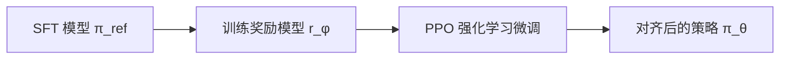
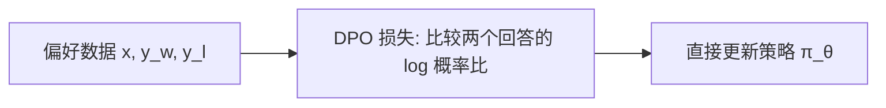

# 19｜DPO 直觉：不用奖励模型，怎么直接从偏好学对齐？

> 阅读目标：理解 DPO（Direct Preference Optimization，直接偏好优化）如何绕过奖励模型和 PPO，用一个分类损失直接完成偏好对齐；掌握“最优策略本身就是奖励模型”这一关键推导；并看清 DPO 省掉了什么、又没有省掉什么。
>
> 前置知识：RLHF 的三段流程与 Bradley-Terry 偏好模型（第 17 篇）、交叉熵与 teacher forcing（第 10 篇）、KL 散度的基本含义。本篇的结论分三类标注：表示帮助理解的比喻，表示可以从公式直接算出的结论，表示依赖具体模型和数据的经验结论，不要把它当成定理。

## 1. 先回到 RLHF：三段流程里，到底哪一段最让人头疼？

第 17 篇讲过，经典 RLHF 分三步走：



第一步，拿人类标注的成对偏好数据（同一个提示 x，两个回答 y_w 和 y_l，人类说 y_w 更好）训练奖励模型。偏好模型用的是 Bradley-Terry 假设：人类选 y_w 而不是 y_l 的概率，只取决于两个回答的奖励之差：

```math
P(y_w \succ y_l \mid x) = \sigma(r(x, y_w) - r(x, y_l))
```

其中 $\sigma$ 是 sigmoid 函数。第二步，用 PPO 最大化奖励，同时加一个 KL 惩罚，不让新策略离 SFT 模型太远：

```math
\max_{\pi} \; \mathbb{E}_{y \sim \pi(\cdot \mid x)}[r(x, y)] - \beta \, D_{\mathrm{KL}}(\pi(\cdot \mid x) \parallel \pi_{\mathrm{ref}}(\cdot \mid x))
```

【直觉】这套流程像一家公司：先请评审团（奖励模型）给员工表现打分，再由 HR（PPO）根据分数调岗，还要规定“不能调得太离谱”（KL 惩罚）。问题是，评审团本身要花钱训练、可能打分不准，HR 的调岗过程（在线采样、价值网络、裁剪目标）又以不稳定著称。三个部件，个个都可能出错，而且错误会互相放大。

具体说，PPO 的不稳定有三个来源。第一，它要在训练中不断从当前策略采样新回答，采样分布一直在变，奖励模型对这些新回答的打分可能已经超出它训练数据的覆盖范围——奖励模型一错，策略就往错的方向优化，这就是奖励 hacking 的温床。第二，PPO 需要一个价值网络来估计优势（advantage），价值估计的偏差会直接传导进策略梯度。第三，PPO 的目标函数里有裁剪系数、GAE 参数、KL 系数、预训练数据混合比例等一堆超参数，调参空间很大，换一个任务往往要重新调一遍。

DPO 的问题意识就从这里来：奖励模型和 PPO，真的都是必需的吗？还是说，它们只是在迂回地求解同一个数学问题？

## 2. 关键洞见：最优策略本身就是奖励模型

先忘掉偏好数据，只看上面那个带 KL 惩罚的目标。给定一个固定的奖励函数 r，它的最优策略有没有解析解？答案是有的，而且形式非常干净。

【推导】把目标函数改写一下。记 $Z(x) = \sum_y \pi_{\mathrm{ref}}(y \mid x) \exp(r(x, y) / \beta)$ 为归一化常数（对所有可能的回答 y 求和），定义分布 $q(y \mid x) = \pi_{\mathrm{ref}}(y \mid x) \exp(r(x, y) / \beta) / Z(x)$。那么：

```math
\mathbb{E}_{y \sim \pi}[r(x, y)] - \beta \, D_{\mathrm{KL}}(\pi \parallel \pi_{\mathrm{ref}}) = \beta \log Z(x) - \beta \, D_{\mathrm{KL}}(\pi \parallel q)
```

这一步可以逐项验证。KL 散度的定义是 $D_{\mathrm{KL}}(\pi \parallel q) = \mathbb{E}_{y \sim \pi}[\log \pi(y \mid x) - \log q(y \mid x)]$，而 $\log q = \log \pi_{\mathrm{ref}} + r / \beta - \log Z(x)$。代入后：

```math
-\beta \, D_{\mathrm{KL}}(\pi \parallel q) = \mathbb{E}_{y \sim \pi}[-\beta \log \pi + \beta \log \pi_{\mathrm{ref}} + r - \beta \log Z(x)]
```

右边前两项合起来正好是 $-\beta \, D_{\mathrm{KL}}(\pi \parallel \pi_{\mathrm{ref}})$，再加上 $\mathbb{E}[r]$ 和常数 $-\beta \log Z(x)$，移项就得到上面的改写。等式左边是我们要最大化的目标，右边除了常数 $\beta \log Z(x)$ 之外，只剩一个负的 KL 项。KL 散度最小是 0，当且仅当 $\pi = q$ 时取到。所以最优策略是：

```math
\pi^*(y \mid x) = \frac{1}{Z(x)} \, \pi_{\mathrm{ref}}(y \mid x) \exp\left(\frac{r(x, y)}{\beta}\right)
```

顺便理解一下 $Z(x)$ 的含义：$Z(x) = \mathbb{E}_{y \sim \pi_{\mathrm{ref}}}[\exp(r(x, y) / \beta)]$，即在参考模型的分布下，对指数奖励求平均。如果一个提示很容易从参考模型那里采样到高奖励回答，$Z(x)$ 就大；如果参考模型怎么答都拿不到高奖励，$Z(x)$ 就小。所以 $Z(x)$ 度量的是“这个提示对参考模型来说有多好拿分”。但在偏好比较里它被消掉了——DPO 不需要知道提示的绝对难度，只需要知道两个回答的相对高下。这既是 DPO 简洁的原因，也是它丢失的信息：两个提示之间的难度差异，DPO 是看不见的。

【直觉】这个式子可以反过来读：**最优策略和奖励函数之间是一一对应的**。把上式两边取对数、解出 r：

```math
r(x, y) = \beta \log \frac{\pi^*(y \mid x)}{\pi_{\mathrm{ref}}(y \mid x)} + \beta \log Z(x)
```

这就像“价格”和“需求量”的关系：通常我们先有奖励（价格），再算出最优策略（需求）；但公式告诉我们反方向也成立——只要知道最优策略长什么样，就能反推出奖励。策略的对数概率比 $\log(\pi^* / \pi_{\mathrm{ref}})$，本质上就是奖励本身，只差一个跟 y 无关的常数 $\beta \log Z(x)$。

这个“只差一个常数”至关重要，因为下一步我们要把奖励代回偏好模型，而偏好模型只关心两个回答的奖励**之差**。

## 3. 把奖励代回偏好模型：奖励模型消失了

现在把反解出的奖励表达式代入第 1 节的 Bradley-Terry 公式：

```math
P(y_w \succ y_l \mid x) = \sigma\left(\beta \log \frac{\pi^*(y_w \mid x)}{\pi_{\mathrm{ref}}(y_w \mid x)} - \beta \log \frac{\pi^*(y_l \mid x)}{\pi_{\mathrm{ref}}(y_l \mid x)}\right)
```

注意，$\beta \log Z(x)$ 这一项在相减时被消掉了——归一化常数 Z(x) 根本不需要算出来，而它正是原来让问题难办的部分（要对所有可能的回答求和，实际算不出来）。

【推导】既然最优策略 $\pi^*$ 可以用任意策略 $\pi_\theta$ 来参数化，我们直接把 $\pi_\theta$ 代进去，用最大似然拟合人类偏好数据，就得到 DPO 损失：

```math
\mathcal{L}_{\mathrm{DPO}}(\theta) = -\mathbb{E}_{(x, y_w, y_l)} \left[ \log \sigma\left( \beta \log \frac{\pi_\theta(y_w \mid x)}{\pi_{\mathrm{ref}}(y_w \mid x)} - \beta \log \frac{\pi_\theta(y_l \mid x)}{\pi_{\mathrm{ref}}(y_l \mid x)} \right) \right]
```

这就是 DPO 的全部：一个二分类交叉熵损失，输入是成对偏好数据，模型是策略本身，参考模型 $\pi_{\mathrm{ref}}$ 在训练中保持固定。没有奖励模型，没有价值网络，没有在线采样，没有 PPO 的裁剪目标。Rafailov 等人（2023）的原话是，这“本质上是在偏好数据上解一个分类问题”。

流程图对比一下：



【直觉】RLHF 是“先学打分标准，再按标准调模型”；DPO 是“直接学‘哪个回答更好’这个判断本身”。前者像先制定 KPI 再考核，后者像直接看 A/B 对比做决定。KPI 一旦定错，后面全错；直接比对错，至少错的地方就是数据本身。

### 落到一次训练步骤里：四个前向，一次损失

一个 batch 里每条数据是一个三元组 $(x, y_w, y_l)$。训练一步要算四个量：策略模型对 $y_w$ 和 $y_l$ 的对数概率，以及参考模型对两者的对数概率。其中序列对数概率就是把回答逐 token 的对数概率加起来：

```math
\log \pi(y \mid x) = \sum_{t=1}^{|y|} \log \pi(y_t \mid x, y_{<t})
```

这正是第 10 篇 teacher forcing 下的打分方式——把真实回答喂给模型，读出每个位置上模型给真实 token 的概率，再求和取对数。策略模型的那两项要保留计算图（因为要反向更新），参考模型的那两项不需要梯度；又因为参考模型在整个训练中固定不变，它的对数概率其实可以事先算好存起来，训练时直接查表，省掉两次前向。最后把四个数代入损失：先算隐式奖励差 $u$，再算 $\log \sigma(u)$ 的负值，平均 over batch，反向传播。整个过程和训练一个二分类器没有本质区别，这就是为什么 DPO 可以直接复用普通 SFT 的训练管线，只需要把数据换成偏好三元组、把损失换成上面这个式子。

## 4. 梯度长什么样：模型在“错得越厉害的地方学得越用力”

损失函数有了，训练时梯度会推动模型往哪个方向走？对参数 $\theta$ 求导（记 $u = \beta \log \frac{\pi_\theta(y_w)}{\pi_{\mathrm{ref}}(y_w)} - \beta \log \frac{\pi_\theta(y_l)}{\pi_{\mathrm{ref}}(y_l)}$ 为“隐式奖励差”）：

```math
\nabla_\theta \mathcal{L}_{\mathrm{DPO}} = -\beta \, \mathbb{E}\left[ \sigma(-u) \cdot \left( \nabla_\theta \log \pi_\theta(y_w \mid x) - \nabla_\theta \log \pi_\theta(y_l \mid x) \right) \right]
```

【推导】梯度由两部分组成。方向部分是“拉高 chosen 回答的对数概率、压低 rejected 回答的对数概率”，这符合直觉。权重部分 $\sigma(-u)$ 更有意思：当模型已经正确区分这对偏好（u 很大）时，$\sigma(-u)$ 趋近于 0，梯度几乎消失；当模型排反了（u 为负）时，$\sigma(-u)$ 接近 1，梯度全力更新。也就是说，**DPO 自动把学习精力集中在模型目前还分不清、或分错了的样本上**，已经学会的样本不再反复刷。

换个角度看这个损失：$u$ 是模型给出的“chosen 比 rejected 好多少”的打分，$\log \sigma(u)$ 就是以 $u$ 为 logit 的二分类交叉熵。DPO 训练等价于训练一个分类器，让它在每对偏好上都判对——只不过这个分类器的 logit 不是某个线性层的输出，而是策略与参考模型的对数概率比之差。理解了这一点，$\sigma(-u)$ 的权重作用也就顺理成章：它就是逻辑回归里“样本被分错的程度”，分对且确信的样本梯度自然小，分错的样本梯度自然大。

### 数值示例：算一遍权重和损失

取 $\beta = 0.1$。某个提示 x 下，参考模型给两个回答的概率是 $\pi_{\mathrm{ref}}(y_w) = 0.30$、$\pi_{\mathrm{ref}}(y_l) = 0.25$；当前策略给出 $\pi_\theta(y_w) = 0.28$、$\pi_\theta(y_l) = 0.35$——模型目前更偏爱那个较差的回答。

先算隐式奖励（$\beta \log(\pi_\theta / \pi_{\mathrm{ref}})$）：

| 回答 | $\pi_\theta / \pi_{\mathrm{ref}}$ | $\log$ 比值 | 隐式奖励（$\beta = 0.1$） |
|---|---|---|---|
| chosen $y_w$ | $0.28 / 0.30 = 0.933$ | $-0.069$ | $-0.0069$ |
| rejected $y_l$ | $0.35 / 0.25 = 1.400$ | $0.336$ | $0.0336$ |

隐式奖励差 $u = -0.0069 - 0.0336 = -0.0405$，为负，说明模型确实排反了。此时模型“选对”的概率估计是 $\sigma(u) = \sigma(-0.0405) \approx 0.490$，损失为 $-\log(0.490) \approx 0.714$，梯度权重 $\sigma(-u) \approx 0.510$——接近满格更新。

假设训练后策略变为 $\pi_\theta(y_w) = 0.45$、$\pi_\theta(y_l) = 0.10$，则隐式奖励差变为 $0.1 \times \log(1.5) - 0.1 \times \log(0.4) = 0.0405 + 0.0916 = 0.132$，选对概率 $\sigma(0.132) \approx 0.533$，损失降到约 $0.629$，梯度权重降到约 $0.467$。

### 再算一遍：如果 β = 0.5 会怎样？

用同一组概率、把 $\beta$ 从 0.1 换成 0.5，训练前的隐式奖励差变成 $u = 0.5 \times (-0.069 - 0.336) = -0.203$，选对概率 $\sigma(u) \approx 0.450$，损失约 $0.799$，梯度权重约 $0.551$；训练后（0.45 对 0.10）则 $u = 0.5 \times (0.405 + 0.916) = 0.661$，选对概率约 $0.659$，损失约 $0.417$。对比 $\beta = 0.1$ 时训练后损失只降到 0.629，$\beta$ 越大，损失对概率比的变化越敏感，训练信号越“陡”。但这不等于效果越好：$\beta$ 大同时意味着 KL 约束强，策略被允许的活动范围更小。敏感度和活动范围，一个变大、一个变小，这就是调 $\beta$ 时真正的权衡。

【直觉】注意一个反直觉的细节：概率上模型已经从“偏爱差回答”翻转为“明显偏爱好回答”（0.45 对 0.10），但损失只从 0.714 降到 0.629。这是因为 $\beta = 0.1$ 很小，隐式奖励差被压缩了——DPO 的损失对概率比的变化并不敏感，训练需要很多步才能把差距拉大。这也是实际训练中 DPO 常常要跑多个 epoch、且 $\beta$ 的选择很关键的原因之一。

## 5. β 到底控制什么？

$\beta$ 在原 RLHF 目标里是 KL 惩罚的系数，在 DPO 损失里它同时扮演两个角色：

| $\beta$ 取值 | 含义 | 风险 |
|---|---|---|
| $\beta$ 大（如 0.5） | KL 约束强，策略被拴在参考模型附近；隐式奖励差被放大，损失对排序更敏感 | 对齐效果弱，模型“不太敢改” |
| $\beta$ 小（如 0.05） | KL 约束弱，策略可以离参考模型很远；但同样的概率比变化只产生很小的奖励差，训练信号变弱 | 偏离参考模型过远、过拟合偏好数据 |

实践中还有一个配套经验：DPO 的学习率通常比 SFT 阶段小得多。因为 DPO 的梯度同时包含“拉高 chosen”和“压低 rejected”两项，步子太大容易让策略在几步之内就大幅偏离参考模型，破坏语言本身的流畅度——而 KL 约束在 DPO 里是隐式的、靠 $\beta$ 和损失形态维持的，不像 PPO 那样每步都有显式的裁剪保护。所以小学习率在这里不只是“稳一点”，而是维持 KL 约束有效的必要条件之一。

【需实验验证】常见取值在 0.1 附近，但最优值随任务、数据量和模型规模而变，没有普适公式。调 $\beta$ 本质上是在“对齐强度”和“不偏离原模型”之间走钢丝，和 PPO 里调 KL 系数是同一笔账——DPO 没有消灭这个权衡，只是把它收敛到了一个超参数上。

## 6. DPO 与 PPO 的对比：省掉了什么，没省掉什么

| 维度 | 经典 RLHF + PPO | DPO |
|---|---|---|
| 奖励模型 | 需要单独训练一个 | 不需要（策略本身就是隐式奖励模型） |
| 训练时采样 | 需要从当前策略在线采样回答 | 不需要，只用离线的偏好数据集 |
| 价值网络 / 裁剪目标 | 需要 | 不需要 |
| 参考模型 $\pi_{\mathrm{ref}}$ | 需要（KL 惩罚用） | 仍然需要，且训练中固定 |
| 偏好数据 | 需要 | 同样需要，质量决定上限 |
| KL 约束 | 通过 PPO 目标中的惩罚项实现 | 通过 $\beta$ 和损失形式隐式实现 |

【推导】DPO 的推导成立，依赖三个条件，缺一不可：第一，偏好服从 Bradley-Terry 模型，即人类判断确实可以由“奖励之差”解释；第二，参考模型 $\pi_{\mathrm{ref}}$ 已知且固定；第三，策略族足够表达最优策略。如果真实人类偏好不满足 Bradley-Terry 假设（比如偏好不可传递、依赖上下文），DPO 拟合的就只是一个近似。

原论文的实验结论也值得一提：在控制生成文本情感倾向的任务上，DPO 的效果超过了基于 PPO 的 RLHF；在摘要和单轮对话任务上，DPO 达到或超过了 RLHF 的回答质量，同时实现和训练都简单得多。这些是论文在特定任务和模型规模上的实验结果，换到别的任务和规模上是否成立，仍需实验验证——但它至少说明，省掉奖励模型和 PPO 并没有让对齐效果打折扣。

【需实验验证】DPO 是离线算法：它只能从已有的偏好数据里学习，学不到数据分布之外的行为。模型在训练后生成的回答可能落在偏好数据的覆盖范围之外，这时隐式奖励的估计不再可靠——这就是离线方法固有的分布偏移问题，也是后来出现在线 DPO、迭代 DPO 等变体的动机。

### 一个容易忽略的代价：训练时要同时放下两个模型

DPO 省掉了奖励模型和价值网络，但没有省掉参考模型。训练时显存里要同时放策略模型和参考模型各一份——好在参考模型只需要前向、不需要梯度和优化器状态，实际代价大约是“一份模型权重”，而不是“再训练一个模型”。工程上常见的省法是：事先把参考模型对所有训练回答的对数概率算好存成表，训练时只加载策略模型；或者让参考模型以更低精度运行。理解这一点能避免一个误解：DPO 不是“零额外成本”，它的成本从“训练奖励模型 + 跑 PPO”变成了“多存一份参考模型权重”，账要这样算才公平。

### 隐式奖励的再利用：训完的策略自己就是打分器

训练完成后，$\beta \log(\pi_\theta / \pi_{\mathrm{ref}})$ 这个量并没有消失——它可以继续给任意回答打分。实际应用里，一个常见做法是：对同一个提示采样多个候选回答，用隐式奖励挑出分数最高的那个（best-of-n），而不需要再训练一个显式奖励模型。【需实验验证】这种复用在分布内通常有效，但一旦候选回答超出偏好数据的覆盖范围，隐式奖励的排序质量就没有保证，和显式奖励模型的外推问题本质上是同一个问题。

### DPO 之后：为什么还有 IPO、KTO、在线变体？

DPO 发表后，人们很快发现了它的几个短板，并由此生出一批变体，理解它们能帮你看清 DPO 的边界在哪里。第一，如果偏好数据里某对回答的胜负几乎是确定的（人类每次都选同一个），DPO 的损失会驱使隐式奖励差 $u$ 趋向无穷大——模型为了把 $\sigma(u)$ 推到 1，会不断拉大两个回答的概率比，这就是过拟合的一种形式。IPO（Identity Preference Optimization）针对这一点，在损失里加了一项，把奖励差往一个有限的目标值上拉，而不是越大越好。第二，很多真实场景拿不到成对偏好，只有“这个回答好不好”的二元反馈，KTO（Kahneman-Tversky Optimization）就是为这种单条反馈设计的，它借鉴了前景理论中“损失比收益更敏感”的不对称性。第三，针对离线分布偏移，人们做了在线或迭代式 DPO：用当前策略采样新回答、重新标注偏好、再训练一轮，让数据分布跟着策略一起往前走。这些变体都没有推翻 DPO 的核心推导，只是在它的三个假设（Bradley-Terry、固定参考模型、离线数据）上各松动了一处。

## 7. 常见误区

**误区一：“DPO 不需要奖励模型，所以没有奖励的概念了。”**

错。DPO 只是不需要“显式地、单独地”训练一个奖励模型。策略本身通过 $\beta \log(\pi_\theta / \pi_{\mathrm{ref}})$ 定义了一个隐式奖励，损失函数就是在拟合这个隐式奖励下的偏好概率。奖励没有消失，只是换了一个载体。

**误区二：“DPO 一定会提高 chosen 回答的概率。”**

不一定。损失只关心 chosen 和 rejected 的对数概率**之差**，不关心各自的绝对值。训练可能同时压低两个回答的概率，只要 rejected 降得更快，损失照样减小。【需实验验证】后续研究确实观察到，DPO 训练中 chosen 回答的概率有时也会下降——这在数学上完全合理，只是和“让好回答更可能出现”的直觉不符。

**误区三：“DPO 不需要在线采样，所以没有分布偏移问题。”**

错。正好相反：正因为 DPO 是离线的，它无法像 PPO 那样在训练中采样新回答、获得新反馈。偏好数据覆盖不到的地方，模型的行为是不受约束的。省掉采样省的是工程复杂度，不是统计上的难题。

**误区四：“$\beta$ 越小，对齐效果越好。”**

错。$\beta$ 小意味着 KL 约束弱，策略可以大幅偏离参考模型，代价是更容易过拟合偏好数据的噪声、学出奇怪的语言风格（比如为了拉大概率差而牺牲流畅度）。$\beta$ 是权衡，不是越大越好或越小越好。

**误区五：“序列的概率就是回答的质量，DPO 天然公平。”**

要小心：$\log \pi_\theta(y \mid x)$ 是对所有 token 的对数概率求和，回答越长，求和项越多、通常也越负。长度本身就可能影响隐式奖励的比较——一个冗长但平庸的回答，可能仅仅因为长度而在概率上吃亏或占便宜。【需实验验证】长度偏差是 DPO 实践中真实存在的问题，后续变体（如长度归一化）正是为此而生。

**误区六：“把 chosen 回答拿去做 SFT，就等于做了 DPO。”**

不对。SFT 只拉高 chosen 回答的概率，不管 rejected 回答怎么样，也没有参考模型锚定；DPO 优化的是 chosen 与 rejected 的概率比之差，并且处处以参考模型为锚。两者的数据形式也不同：SFT 用示范回答，DPO 用成对偏好。实践中常见的做法是先 SFT 再 DPO，两者是接力关系，不是等价关系。

## 8. 自测题

**1. DPO 推导中，归一化常数 $Z(x)$ 为什么不需要算出来？**

<details>
<summary>答案</summary>

因为偏好模型只用到两个回答的奖励之差 $r(x, y_w) - r(x, y_l)$，而反解出的奖励表达式里 $Z(x)$ 只出现在与 y 无关的项 $\beta \log Z(x)$ 中，相减时被消掉了。Z(x) 需要对所有可能回答求和，实际算不出来；DPO 的巧妙之处正在于它根本不需要这个量。
</details>

**2. 梯度权重 $\sigma(-u)$ 在什么情况下接近 0、什么情况下接近 1？各代表什么训练状态？**

<details>
<summary>答案</summary>

$u$ 是隐式奖励差。当模型已经正确区分且差距很大（$u \gg 0$）时，$\sigma(-u) \to 0$，梯度消失，说明这对样本已经学会；当模型排反（$u < 0$）时，$\sigma(-u) \to 1$，梯度全力更新。DPO 自动把精力集中在还没学会的样本上。
</details>

**3. 如果把 $\beta$ 从 0.1 调到 0.5，训练会发生什么变化？**

<details>
<summary>答案</summary>

两方面：第一，KL 约束变强，策略更难偏离参考模型，对齐效果可能变弱；第二，同样的概率比变化会产生更大的隐式奖励差，损失对排序更敏感。净效果取决于任务，需要实验确定，不存在“$\beta$ 越大越好”或“越小越好”的定理。
</details>

**4. DPO 训练后，chosen 回答的概率一定上升吗？为什么？**

<details>
<summary>答案</summary>

不一定。DPO 损失只优化 chosen 与 rejected 的对数概率之差，不约束各自的绝对水平。只要 rejected 的概率下降得比 chosen 快，损失就会减小，即使 chosen 的绝对概率也在下降。这是 DPO 只关心“相对排序”的直接后果。
</details>

---

参考：Rafailov, R., Sharma, A., Mitchell, E., Ermon, S., Manning, C. D., & Finn, C. (2023). Direct Preference Optimization: Your Language Model is Secretly a Reward Model. NeurIPS 2023. arXiv:2305.18290.

下一篇预告：20｜长上下文与位置外推：RoPE 走出训练长度会怎样？
