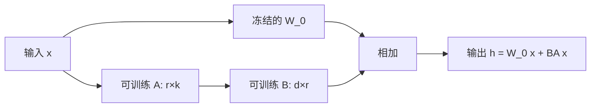

# 20｜LoRA 微调直觉：低秩更新为什么够用？

> 阅读目标：理解 LoRA（Low-Rank Adaptation，低秩适配）如何只训练一小部分参数就完成大模型微调；掌握 $W' = W_0 + BA$ 的维度、初始化与缩放设计；并看清低秩假设成立的条件，以及它在什么情况下会不够用。
>
> 前置知识：全参数微调的基本流程（第 10 篇的训练目标、第 12 篇的 Adam）、矩阵乘法与秩的基本含义、奇异值分解（SVD）的大致思想。本篇的结论分三类：表示帮助理解的比喻，表示可以从公式直接算出的结论，表示依赖具体模型和数据的实验结论，不要把它当成定理。

## 1. 先算一笔账：全参数微调贵在哪里？

假设你要微调一个 70 亿参数的模型。全参数微调（full fine-tuning）意味着每一个权重都要算梯度、都要被 Adam 更新。Adam 对每个可训练参数要额外保存两个状态：一阶矩 $m$ 和二阶矩 $v$，各占 4 字节（fp32），光是这两个状态就是每个参数 8 字节。再加上梯度本身和 fp32 主权重，全参数微调的内存账单很快就超过权重本身的好几倍。

只看一个方阵就能算清比例。取一个注意力投影矩阵 $W_0 \in \mathbb{R}^{4096 \times 4096}$，即 $d = k = 4096$：

```math
\text{全参数量} = 4096 \times 4096 = 16{,}777{,}216 \approx 1677 \text{万}
```

只算 Adam 的 $m$ 和 $v$ 两项，这个矩阵就要 $16{,}777{,}216 \times 8 \text{ 字节} \approx 134 \text{ MB}$。一层 Transformer 有好几个这样的矩阵，几十层叠加，优化器状态就以 GB 计。这还没算梯度和激活——全参数微调贵，首先贵在“每个参数都要被优化器伺候”。

于是问题变成：微调真的需要动全部参数吗？还是说，真正需要学的“变化量”本身就住在一个小得多的空间里？LoRA 的回答是后者：**冻结原始权重 $W_0$，只训练一个低秩的变化量 $\Delta W$**。



## 2. LoRA 的结构：一个乘积，两种角色

LoRA 把权重更新写成两个小矩阵的乘积：

```math
W' = W_0 + \Delta W, \quad \Delta W = \frac{\alpha}{r} BA
```

其中 $B \in \mathbb{R}^{d \times r}$，$A \in \mathbb{R}^{r \times k}$，$r$ 是秩（rank），远小于 $d$ 和 $k$。$\alpha$ 是一个超参数，$\alpha / r$ 是缩放系数，后面第 3 节再讲它为什么存在。

先验算维度和参数量。$A$ 把 $k$ 维输入先压到 $r$ 维，$B$ 再把 $r$ 维抬回 $d$ 维，所以 $BA \in \mathbb{R}^{d \times k}$，和 $W_0$ 形状一致，可以直接相加。参数量是：

```math
\text{LoRA 参数量} = r \times k + d \times r = r(d + k)
```

还是 $4096 \times 4096$ 的矩阵，取 $r = 8$：

```math
\text{LoRA 参数量} = 8 \times (4096 + 4096) = 65{,}536
```

$16{,}777{,}216 / 65{,}536 = 256$，正好是 256 倍的压缩。下表把不同秩的压缩比算清楚：

| 秩 $r$ | LoRA 参数量 | 相对全参数的比例 |
|:-:|---:|---:|
| 4 | 32,768 | 1/512 |
| 8 | 65,536 | 1/256 |
| 16 | 131,072 | 1/128 |
| 64 | 524,288 | 1/32 |

可以把 $A$ 想成“提炼器”，把输入中与任务有关的方向提炼成 $r$ 个特征；把 $B$ 想成“写入器”，把这 $r$ 个特征写回输出空间。瓶颈 $r$ 越窄，能通过的信息越少；但如果任务真正需要的信息本来就只有几个方向，窄瓶颈就够用了。

【推导】还可以把 $BA$ 拆开看得更清楚。记 $B$ 的第 $i$ 列为 $b_i \in \mathbb{R}^d$，$A$ 的第 $i$ 行为 $a_i^\top$（其中 $a_i \in \mathbb{R}^k$），那么：

```math
BA = \sum_{i=1}^{r} b_i a_i^\top
```

每一项 $b_i a_i^\top$ 都是一个秩一矩阵：它只沿着一个输入方向 $a_i$ 接收信号，再沿着一个输出方向 $b_i$ 写出信号。整个 $\Delta W$ 就是 $r$ 个这样的“方向对”叠加。于是“秩为 $r$”有了一个非常具体的含义：**更新量最多只能包含 $r$ 个独立的输入-输出方向对**。任务需要的方向对超过 $r$ 个，LoRA 就必然丢信息；需要的方向对少于 $r$ 个，多余的方向对会被训练压到接近零，等于白占了参数。这也是为什么 $r$ 的本质不是“参数多少”，而是“方向预算多少”。

一层 Transformer 的四个注意力投影（Q、K、V、O）如果都挂上 $r = 8$ 的 LoRA，可训练参数是 $4 \times 65{,}536 = 262{,}144$，而四个矩阵的全参数是 $4 \times 16{,}777{,}216 = 67{,}108{,}864$，同样是 256 倍的差距。实践中人们常常只给 Q 和 V 挂 LoRA，或者给全部线性层都挂上——挂的层越多，可训练参数越多，表达能力越强，但省下的比例依然是同一个量级。

## 3. 初始化与缩放：为什么 A 随机、B 置零？

LoRA 的初始化有一个初看奇怪的规定：$A$ 用随机高斯初始化，$B$ 初始化为全零。为什么？

因为 $B = 0$ 时 $\Delta W = BA = 0$，所以训练开始的那一刻：

```math
W' = W_0 + 0 = W_0
```

模型的行为和微调前一模一样。微调是从“原模型”这个起点平滑出发，而不是从一个被随机扰动过的模型出发。这对大模型尤其重要：原模型已经花了海量算力预训练出来，第一步就把它推离原点是浪费，也是风险。

但这里有一个值得细想的梯度细节。记损失对 $W'$ 的梯度为 $G = \partial L / \partial W'$（已包含 $\alpha/r$ 缩放因子在内，形式上多一个常数，不影响下面的结论）。由链式法则：

```math
\frac{\partial L}{\partial A} = B^\top G, \quad \frac{\partial L}{\partial B} = G A^\top
```

在初始化时刻 $B = 0$，所以 $\partial L / \partial A = 0$，而 $\partial L / \partial B = G A^\top$ 一般不为零（因为 $A$ 是随机的）。也就是说：**第一步只有 $B$ 会动，$A$ 暂时不动；一旦 $B$ 不再是零，$A$ 的梯度就不再是零，随后两者一起更新**。这不是 bug，而是这套初始化的自然结果——$B$ 先“长”出一个方向，$A$ 再沿着这个方向学习如何提炼输入。训练几步之后，两者就进入正常的协同更新。

缩放系数 $\alpha / r$ 的作用是让“秩变大时更新幅度不失控”。可以这样理解：$r$ 越大，$BA$ 求和的项数越多（$r$ 个秩一分量的和），如果不做归一化，更新幅度会随 $r$ 膨胀；除以 $r$ 相当于取平均，把幅度拉回同一量级。实践中常取 $\alpha = 2r$，此时缩放系数就是 2——调 $\alpha$ 就相当于调微调的整体学习率倍数，而调 $r$ 主要改变的是表达能力的上限。

## 4. 为什么低秩够用？三层论证

这是本篇最核心的问题。答案分三层，结论的强度逐层递减，一定要分清。

### 4.1 数学层：低秩近似的误差是可以算的

任何矩阵 $W$ 都有奇异值分解 $W = U \Sigma V^\top$，其中 $\Sigma$ 对角线上的奇异值 $\sigma_1 \ge \sigma_2 \ge \cdots \ge 0$ 按从大到小排列。Eckart–Young 定理说：在所有秩不超过 $r$ 的矩阵中，截断 SVD（只保留前 $r$ 个奇异值对应的分量）给出的近似误差最小，Frobenius 范数下的误差恰好是被丢掉的奇异值的平方和开根号：

```math
\min_{\mathrm{rank}(\hat{W}) \le r} \|W - \hat{W}\|_F = \sqrt{\sigma_{r+1}^2 + \sigma_{r+2}^2 + \cdots}
```

给一个具体数值例子。假设某个更新量 $\Delta W$ 的奇异值是 $10, 9, 2, 1, 0.5$（其余为零），平方和是 $100 + 81 + 4 + 1 + 0.25 = 186.25$。用秩 $r = 2$ 近似，保留 $100 + 81 = 181$，占总能量的 $181 / 186.25 \approx 97.2\%$，误差是 $\sqrt{5.25} \approx 2.29$，相对原矩阵范数 $\sqrt{186.25} \approx 13.65$ 只有约 $16.8\%$。**如果奇异值衰减得快，前几个分量就抓住了绝大部分更新量**——这是低秩近似成立的数学前提。但注意：定理只保证“给定一个矩阵，最好的秩 $r$ 近似长这样”，它并不保证“真实微调需要的更新量奇异值一定衰减得快”。后者是经验问题。

### 4.2 经验层：微调的内在维度本来就很小

Aghajanyan 等人 2020 年的研究（Intrinsic Dimensionality Explains the Effectiveness of Language Model Fine-Tuning）发现：把微调限制在一个随机低维子空间里，只用几千个自由度，就能在多个任务上达到接近全参数微调的效果——尽管模型本身有上亿参数。换句话说，**微调真正需要探索的方向，远少于参数的个数**。LoRA 的原始论文（Hu 等，2021，LoRA: Low-Rank Adaptation of Large Language Models）进一步在语言模型上验证：用 $r = 4$ 甚至 $r = 8$ 的 LoRA 微调，在 GLUE 等任务上可以媲美全参数微调。

为什么会这样？预训练已经把通用知识（语法、常识、推理模式）装进了 $W_0$；微调要学的往往不是新知识，而是一种“用法”：按什么格式回答、偏好什么风格、把已有的知识指向哪个任务。学一种用法，需要的方向比从头学知识少得多。打个比方：全参数微调像把整台收音机拆开重装，LoRA 像只调几个旋钮——如果你只是想换个台，调旋钮就够了；但如果你想把收音机改成电视机，调旋钮就不够了。

### 4.3 边界层：低秩假设什么时候失效？

上一节的比喻同时给出了边界。当微调任务与预训练分布差距很大时——例如让模型学一门预训练中几乎没见过的语言、或灌入大量全新的领域知识——低秩更新可能不够，因为这时需要的变化本身就是高秩的。提高 $r$、给更多层挂 LoRA、或者回到全参数微调，都是合理的应对。反过来，如果任务只是格式对齐、风格微调、少量样本的任务适配，$r = 8$ 或 $16$ 往往已经饱和，再增大 $r$ 收益递减，还可能过拟合。

所以准确的表述不是“低秩更新总是够用”，而是：**在微调任务与预训练知识接近、变化量本身近似低秩的条件下，秩为 $r$ 的 LoRA 能以 $r(d+k)$ 的参数量逼近全参数微调的效果；条件不满足时，低秩就是瓶颈**。

### 4.4 一个思想实验：把微调想象成在高维空间里找方向

想象模型的全部参数构成一个几十亿维的空间，全参数微调可以在这个空间里沿任意方向走；LoRA 则把每一步限制在一个低维子空间里——每层每个矩阵只能沿 $r$ 个方向走。内在维度实验的惊人之处在于：即使把行走空间压缩到几千维，最终到达的“好解”几乎和不受限时一样好。这说明损失函数的“好区域”本身就是扁平而宽广的：从起点出发，有很多条不同的路都能走到效果相近的解，低维子空间恰好穿过了其中一条。

这个图像也解释了为什么 LoRA 对随机种子和初始化相对稳健：只要子空间的方向是随机选的（$A$ 随机初始化就相当于随机选了子空间的朝向），它与“好方向”之间通常不会正交到无法前进的程度；训练过程中 $A$、$B$ 还会不断调整方向对本身，子空间不是一成不变的笼子，而是一张可以转动的网。当然，这个图像仍然是【直觉】，不是证明——它成立的前提是损失地貌足够友好，而损失地貌的形状恰恰是实验才能告诉我们的事。

顺带区分一个容易混淆的概念：LoRA、Adapter、Prefix-Tuning 都属于“参数高效微调”，但省参数的方式不同。Adapter 是在层间插入新的小模块（多了一段串联计算，推理有额外延迟）；Prefix-Tuning 是在输入前拼一段可训练的前缀向量（只影响注意力对前缀的读取）；LoRA 是直接改权重本身的更新结构，推理时可以合并消失。三者没有绝对的优劣，LoRA 之所以成为默认选项，更多是因为“效果接近全参数、推理零代价、实现简单”这三点同时成立，而不是因为它在某个单项上碾压其他方法。

## 5. 推理时怎么办：合并权重，零额外延迟

LoRA 还有一个工程上的好处：推理时可以把 $BA$ 直接加回 $W_0$，得到一个合并后的权重：

```math
W_{\text{merged}} = W_0 + \frac{\alpha}{r} BA
```

合并之后，推理走的还是原来那条矩阵乘法，没有新增的层、没有额外的计算，延迟和全参数微调后的模型完全一样。而且一个底座模型可以配多个 LoRA 适配器：换任务时换一组 $A$、$B$ 即可，不用为每个任务存一份完整的模型权重——存 $65{,}536$ 个参数和存 $16{,}777{,}216$ 个参数，磁盘占用差了 256 倍。

这也是 LoRA 在实际部署中流行的原因之一：训练时省优化器内存，存储时省磁盘，推理时不付延迟代价。三个好处来自同一个结构，不是三个独立的技巧。

## 6. 实践取舍：挂哪些层、用多大的 r、学习率为什么更大？

理论说“低秩够用”，实践还要回答三个具体问题：挂哪些模块、$r$ 取多大、学习率怎么设。这三个问题的答案都没有定理，只有被反复验证的经验区间，换任务、换模型规模时都要重新验证。

**挂哪些模块。** 最常见的起点是只给注意力层的 Q 和 V 投影挂 LoRA——这是原始论文验证过的最小配置，在很多任务上已经能打平全参数微调。想再往上加，依次是 K 和 O，以及前馈网络的 gate、up、down 投影。挂得越多，表达能力越强，可训练参数也越多；但注意一个不对称：注意力矩阵通常是方阵（$d = k$），压缩比最高；前馈层的 up/down 矩阵往往是瘦长或矮胖的（例如 $4096 \times 11008$），同样的 $r$ 在那里压缩比更低。前面自测题 1 算的就是这个现象：短边越短，低秩的相对收益越小。

【推导】再算一个整模型的量级，帮助建立直觉。假设一个模型有 32 层，每层 4 个注意力投影矩阵都是 $4096 \times 4096$，只给注意力挂 $r = 8$ 的 LoRA：每层可训练参数 $4 \times 65{,}536 = 262{,}144$，32 层合计约 $838$ 万。而这 128 个矩阵的全参数是 $32 \times 67{,}108{,}864 \approx 21.5$ 亿。也就是说，只用不到 $0.4\%$ 的参数，就覆盖了全部注意力层的适配自由度。实际微调时还要加上词嵌入、LayerNorm 等少量可训练部分（通常也冻结或只训极小一部分），但量级不变：LoRA 把“可训练参数”从十亿级压到了百万级。

**$r$ 和 $\alpha$ 怎么配。** 常见区间是 $r = 8 \sim 64$，$\alpha$ 常取 $r$ 的 1 到 2 倍。一个实用的起手配置是 $r = 16$、$\alpha = 32$（缩放系数 2），挂全部线性层；如果任务很简单（例如只改输出格式），$r = 8$ 甚至 $r = 4$ 就够；如果任务涉及较大幅度的行为改变，再把 $r$ 抬到 32 或 64。调参时要成对地看 $r$ 和 $\alpha$：假设起手 $\alpha = 16$、$r = 8$（缩放系数 2），只把 $r$ 抬到 64 而 $\alpha$ 不动，缩放系数 $\alpha/r$ 会从 2 掉到 0.25，更新幅度被压小，效果可能不升反降——这正是第 8 节误区四的来源。

**学习率为什么通常比全参数大。** 【经验】全参数微调的学习率常在 $1 \times 10^{-5} \sim 2 \times 10^{-5}$ 量级，而 LoRA 微调常用 $1 \times 10^{-4} \sim 2 \times 10^{-4}$，大约大一个数量级。直觉上有两个原因。第一，LoRA 只动一小部分参数，单步对模型整体行为的扰动天然更小，可以承受更大的步长而不至于把预训练知识冲垮；第二，$A$、$B$ 是从零附近（$B = 0$）开始生长的，早期更新幅度受初始化和缩放系数压制，需要更大的学习率才能在有限步数内长到合适的幅度。但这只是量级上的经验，不是换算公式——换了优化器、换了 $\alpha/r$、换了数据量，最优学习率都要重扫。

**一个常被忽略的细节：LoRA dropout。** 原始 LoRA 在 $A$ 的输入上加了 dropout（常见值 0.05），即训练时随机丢掉一部分提炼出的特征，防止 $r$ 个方向被少数几个样本带偏。推理时 dropout 关闭，行为是确定性的。数据量很小、$r$ 相对较大时，dropout 的收益更明显；数据量很大时，它的影响常常可以忽略。

**QLoRA 是什么关系。** QLoRA（Dettmers 等，2023）不是 LoRA 的替代品，而是“LoRA + 量化底座”的组合：把冻结的 $W_0$ 量化成 4-bit 存储，前向时再反量化成计算精度，LoRA 部分仍用较高精度训练。这样一张消费级显卡也能微调几十亿参数的模型。注意量化省的是**底座权重本身的存储**，和 LoRA 省优化器状态是两条不同的账，不能互相替代——这也呼应了第 8 节误区三的区分。

## 7. 变体一瞥：DoRA、PiSSA、MoRA 在改什么？

LoRA 提出之后，出现了很多变体。理解它们不需要逐个深究，只要看清每个变体“动了 LoRA 的哪一个假设”：

| 变体 | 改了什么 | 直觉 |
|---|---|---|
| DoRA | 把权重拆成幅度（magnitude）和方向（direction）两部分，只对方向用 LoRA | 全参数微调时，权重更新的幅度和方向变化模式与纯 LoRA 不同；拆开后让方向学低秩、幅度单独学一个标量，更接近全参数的行为 |
| PiSSA | 初始化不用随机 $A$，而用 $W_0$ 的 SVD 主成分初始化 $A$、$B$，剩余成分冻结 | 随机初始化是从零开始“长”方向；主成分初始化是直接站在原权重最重要的方向上起步，收敛可能更快 |
| MoRA | 把 $BA$ 换成方阵压缩再扩张（例如用分块对角或旋转变换），让更新不再被 $r$ 卡住 | 纯 LoRA 的更新秩严格不超过 $r$；MoRA 想在同样参数量下塞进更高秩的更新，代价是结构更复杂 |

【经验】这些变体在某些基准上确实优于原始 LoRA，但优势往往依赖任务和超参数调校，没有一个变体在所有任务上稳定胜出。对初学者而言，先把原始 LoRA 的维度、初始化、缩放和秩边界搞清楚，再去看变体“改了哪根线”，比直接背变体清单有效得多。

## 8. 常见误区

**误区一：“LoRA 参数少，所以效果一定比全参数差很多。”**

纠正：参数少不等于能力弱到哪里去，关键看任务需要的更新是不是低秩的。在格式对齐、风格微调这类任务上，$r = 8$ 的 LoRA 常常能打平全参数微调；只有当任务需要高秩、大幅度的知识改写时，差距才会拉大。拿“参数量”直接推断“效果”是一个范畴错误。

**误区二：“$B$ 初始化为零是个 bug，会让梯度消失。”**

纠正：如第 3 节的推导，$B = 0$ 只让第一步的 $\partial L / \partial A = 0$，而 $\partial L / \partial B$ 不为零。$B$ 一动，$A$ 的梯度就恢复了。真正的对称性破缺来自 $A$ 的随机初始化——如果 $A$ 和 $B$ 都置零，两者梯度永远为零，那才是死局。

**误区三：“LoRA 省显存，就是训练时什么显存都省。”**

纠正：LoRA 省的是**可训练参数带来的**显存：梯度（只对 $A$、$B$ 存）和 Adam 的 $m$、$v$（只对 $A$、$B$ 存）。但反向传播仍然要穿过冻结的 $W_0$，中间激活还是要存（除非再叠加第 16 篇的梯度检查点），前向计算量也没有减少。说“LoRA 训练一个 7B 模型只要一张小卡”时，省掉的是优化器那部分账单，不是全部账单。

**误区四：“$r$ 越大越好。”**

纠正：$r$ 增大只提高表达上限，不保证效果单调变好。可训练参数多了，过拟合风险也上去了；而且在 $\alpha$ 固定的情况下，缩放系数 $\alpha/r$ 会变小，更新幅度反而被压低。实践中 $r = 8 \sim 64$ 是常见区间，调 $r$ 时通常要连带调 $\alpha$ 和学习率，不能只动一个旋钮。

**误区五：“LoRA 等于只训练最后几层。”**

纠正：两者完全不同。只训最后几层是“空间上集中”——前面所有层一动不动；LoRA 是“方向上压缩”——每一层（挂了 LoRA 的层）都在动，但每次只沿 $r$ 个方向动。一个是改哪里的问题，一个是怎么改的问题。

**误区六：“LoRA 学不到新知识，只能调格式。”**

纠正：这个说法半对半错。LoRA 确实擅长格式和风格，但它也能在秩预算内学会新的任务行为——例如一个新的分类标准、一套新的推理格式。严格的界限不在于“知识 vs 格式”，而在于“需要多少个独立方向”：新行为如果能用 $r$ 个方向表达，LoRA 就能学会；如果需要几百个独立方向，$r = 8$ 就不够。判断标准是秩需求，不是知识类型。

## 9. 自测题

**1. 一个 $W_0 \in \mathbb{R}^{2048 \times 512}$ 的矩阵挂上 $r = 16$ 的 LoRA，可训练参数是多少？相对全参数压缩了多少倍？**

<details>
<summary>答案</summary>

LoRA 参数量 $= r(d+k) = 16 \times (2048 + 512) = 40{,}960$。全参数量 $= 2048 \times 512 = 1{,}048{,}576$。压缩倍数 $= 1{,}048{,}576 / 40{,}960 = 25.6$ 倍。注意这个倍数比方阵情形小，因为 $d$ 和 $k$ 悬殊时 $r(d+k)$ 与 $dk$ 的比值是 $r(1/k + 1/d)$，短边越短，压缩比越低。

</details>

**2. 为什么 LoRA 初始化时 $A$ 随机、$B$ 置零，而不是反过来（$A$ 置零、$B$ 随机）？**

<details>
<summary>答案</summary>

两种初始化都能保证初始 $\Delta W = 0$，因为只要有一个矩阵为零，乘积就是零。区别在于谁先动：$A$ 随机、$B$ 置零时，第一步 $\partial L/\partial B = G A^\top \ne 0$，$B$ 先动，随后 $A$ 获得梯度；反过来则 $A$ 先动、$B$ 后动。对称的两种方案都可行，原始论文采用的是 $A$ 随机、$B$ 置零的约定。关键是**不能两者都置零**，否则两个梯度恒为零，训练永远无法启动。

</details>

**3. 某任务的真实更新量奇异值为 $100$，以及 100 个 $1$，用 $r = 1$ 的 LoRA 近似，相对误差是多少？这说明什么？**

<details>
<summary>答案</summary>

总能量 $= 100^2 + 100 \times 1^2 = 10{,}100$，秩 1 近似保留 $10{,}000$，误差能量 $= 100$，Frobenius 相对误差 $= \sqrt{100} / \sqrt{10{,}100} = 10 / 100.5 \approx 10\%$。这说明：即使奇异值谱有一条很长的“尾巴”，只要头部占绝对主导，低秩近似的误差仍然可以很小；反过来，如果奇异值衰减缓慢、能量分散在很多方向上，同样的 $r$ 就会丢掉大量信息。低秩够不够用，取决于谱的形状，不是参数量本身。

</details>

**4. 有人说“用了 LoRA 就不需要梯度检查点了，因为显存已经省了很多”。这个说法错在哪里？**

<details>
<summary>答案</summary>

错在把两类显存混为一谈。LoRA 省的是优化器状态和可训练参数的梯度（第 8 节误区三）；梯度检查点省的是反向传播时保存的中间激活（第 16 篇）。两者针对的显存来源不同，可以叠加使用：LoRA + 梯度检查点是常见的组合，前者压优化器账单，后者压激活账单。

</details>

下一篇预告：21｜模型量化直觉：低精度权重为什么还能用？
