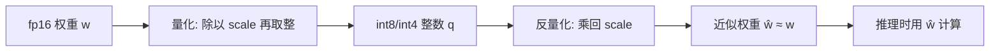

# 21｜量化直觉：把权重压到 8-bit/4-bit，为什么模型还没坏？

> 阅读目标：理解模型量化（quantization）的基本操作——如何把 fp16/bf16 权重映射到 int8/int4 的整数网格上；算清显存省了多少、误差从哪里来；并看清量化在什么条件下几乎无损、在什么条件下会明显掉点。
>
> 前置知识：第 15 篇的混合精度训练（fp16/bf16 与 fp32 的区别）、第 20 篇的 LoRA（权重矩阵的形状与参数量）、矩阵乘法的基本含义。本篇的结论分三类：**直觉**帮助理解、**严格推导**可以从公式直接算出、**需实验验证**依赖具体模型和数据，不要把第三类当成定理。

## 1. 先算一笔账：70B 模型到底占多少显存？

量化讨论的起点不是精度，而是一张显存账单。一个参数占几个字节，整个模型就占几倍的显存：

```math
\text{显存} = \text{参数量} \times \text{每参数字节数}
```

取一个 700 亿参数的模型算三档：

| 精度 | 每参数字节数 | 700 亿参数的权重显存 |
|---|---:|---:|
| fp16 / bf16 | 2 | 140 GB |
| int8 | 1 | 70 GB |
| int4 | 0.5 | 35 GB |

140 GB、70 GB、35 GB 这三个数是直接乘出来的，没有近似。140 GB 意味着单张 80 GB 的显卡装不下一个 fp16 的 70B 模型，int8 刚好能装下，int4 则只需要不到一半的卡。**这就是量化的全部动机：不是为了算得更快（虽然低精度计算常常也更快），而是为了让模型装得下、跑得起。**

注意这张表只算了权重本身。真实推理还要留出 KV Cache（第 8 篇）和激活的显存，训练还要留出梯度和优化器状态（第 12 篇的 Adam 状态、第 15 篇的主权重），所以实际占用只会比表里更大——但权重永远是最大头，压权重永远是性价比最高的第一步。

但这里立刻冒出一个反直觉的问题：fp16 有约 3 位十进制有效数字的精度，int8 只有 256 个取值，int4 只有 16 个取值。把权重从几万个可能值硬压到 16 个值，模型怎么还没坏？回答这个问题，要先把"压"这个动作写成公式。



## 2. 量化的基本操作：一把尺子 + 一次取整

最常见的仿射量化（affine quantization）只有两个要素：一把尺子（scale，记为 $s$）和一个零点（zero-point，记为 $z$）。量化与反量化是一对互逆操作：

```math
q = \mathrm{clamp}\left(\mathrm{round}\left(\frac{w}{s}\right) + z, \; q_{\min}, \; q_{\max}\right), \qquad \hat{w} = s \cdot (q - z)
```

其中 $q_{\min}$、$q_{\max}$ 是整数的取值范围：int8 对称量化取 $[-127, 127]$，int4 取 $[-8, 7]$。$\mathrm{clamp}$ 是截断：超出范围的值会被"钉"在边界上，这是第一种误差来源，叫**截断误差**（clipping error）。$\mathrm{round}$ 是取整：落在两个整数之间的值会被推到最近的整数格点上，这是第二种误差来源，叫**舍入误差**（rounding error）。

尺子 $s$ 怎么定？最朴素的办法是让量程刚好覆盖权重范围。对称量化（$z = 0$）时：

```math
s = \frac{\max |w|}{q_{\max}}
```

这个公式里藏着一个关键直觉：**尺子的刻度由最大的权重决定**。如果权重里混进一个特别大的离群值（outlier），$s$ 就会被它撑大，所有普通权重的格点都会变粗，舍入误差跟着变大。第 5 节会回到这个问题。

再说说零点 $z$ 是干什么的。上面是对称量化，$z = 0$，格点关于零对称——这对权重很合适，因为权重分布大致以零为中心。但有些量并不以零为中心：比如经过 ReLU 后的激活全是非负的，或者某层权重整体偏正。这时如果还坚持 $z = 0$，一半格点（负的那一半）就永远用不上，等于白白浪费了一半的取值。非对称量化（$z \neq 0$）就是把整排格点平移，让 $q_{\min}$ 对准最小值、$q_{\max}$ 对准最大值：

```math
s = \frac{\max w - \min w}{q_{\max} - q_{\min}}, \qquad z = q_{\min} - \mathrm{round}\left(\frac{\min w}{s}\right)
```

【严格推导】这个公式保证了反量化时 $q = q_{\min}$ 恰好对应 $\min w$（在舍入误差内）。代价是多存一个 $z$，以及推理时反量化要多做一次减法——对权重这种静态量来说，这点代价微不足道；对激活这种动态量来说，实时算 $z$ 又是一笔开销。**对称还是非对称，取决于被量化的量是否以零为中心**，而不是哪种"更高级"。

可以把量化想象成用一把最小刻度为 $s$ 的尺子去量一堆长度。尺子越粗，读数越糙；但只要被量的东西本身的"有效信息"比刻度粗得多，糙一点也无妨。模型权重正是这样：单个权重的最后几位小数，对输出的影响往往远小于权重整体的分布形态。

## 3. 数值示例：四个权重走一遍 int8 量化

取四个权重，手动走一遍对称 int8 量化（$q_{\max} = 127$）：

```math
w = [-1.1, \; -0.2, \; 0.5, \; 1.2]
```

第一步，定尺子。最大绝对值是 $1.2$：

```math
s = \frac{1.2}{127} \approx 0.00945
```

第二步，量化（除以 $s$ 再取整）：

| $w$ | $w / s$ | $q = \mathrm{round}(w/s)$ | $\hat{w} = s \cdot q$ | 误差 $\hat{w} - w$ |
|---:|---:|---:|---:|---:|
| -1.1 | -116.4 | -116 | -1.096 | +0.004 |
| -0.2 | -21.2 | -21 | -0.198 | +0.002 |
| 0.5 | 52.9 | 53 | 0.501 | +0.001 |
| 1.2 | 127.0 | 127 | 1.200 | 0.000 |

舍入误差有一个硬上限：一次取整最多偏离半个刻度，所以

```math
|\hat{w} - w| \le \frac{s}{2} \approx 0.0047
```

四个误差（0.004、0.002、0.001、0.000）都落在这个上限内。**注意这个结论成立的条件：它只在没有截断时成立。** 一旦某个权重超出 $[ -127s, 127s]$，截断误差可以远大于 $s/2$，而且没有上限——这就是为什么定 $s$ 时不能只看最大值、还要处理离群值。

再把这组数换成 int4（$q_{\max} = 7$）算一遍，差别立刻显现：

```math
s = \frac{1.2}{7} \approx 0.171, \qquad |\hat{w} - w| \le \frac{s}{2} \approx 0.086
```

int4 的误差上限是 int8 的约 18 倍（$127 / 7 \approx 18.1$）。同一个权重 $0.5$ 会被量化到 $q = 3$，反量化得 $0.514$，误差 $0.014$；权重 $-0.2$ 则落到 $q = -1$，反量化得 $-0.171$，误差 $0.029$——相对于 $-0.2$ 本身，这已经是约 15% 的相对误差。**int8 到 int4 不是"再糙一点"，而是误差量级直接跳了一个数量级。** 这就是为什么 int8 量化常常近乎无损、而 int4 量化需要额外技术（第 6 节）的原因。

## 4. 为什么误差没把模型压垮：三个理由，一个边界

### 理由一：误差是相对的，不是绝对的

第 3 节的误差上限 $s/2$ 是绝对误差，但模型在乎的是相对误差。设权重分布的标准差为 $\sigma$，尺子 $s \approx \max|w| / 127$，而 $\max|w|$ 通常是 $\sigma$ 的几倍（对近似正态分布，几千个权重里的最大值约为 $3\sigma$–$4\sigma$）。于是典型权重的相对误差大致是：

```math
\frac{|\hat{w} - w|}{|w|} \lesssim \frac{s}{2|w|} \approx \frac{3\sigma}{2 \times 127 \times |w|}
```

对量级为 $\sigma$ 的权重，相对误差只有约 1%。单个权重被扰动 1%，经过成千上万个权重的加权求和，扰动还会进一步平均掉一部分——正负误差相互抵消，只留下系统性偏差。这是量化可行的统计学基础。

### 理由二：模型有冗余，冗余吸收误差

第 20 篇讲过，微调的更新量可以住在一个低秩子空间里；反过来说，预训练好的权重矩阵本身也有大量"不那么重要"的方向。量化误差可以看作给权重矩阵加了一个小的扰动矩阵 $\Delta W = \hat{W} - W$。只要这个扰动的"能量"远小于 $W$ 本身的能量，模型的输出就不会被带偏。"远小于"到底是多少、不同层对扰动的敏感度差多少，取决于具体模型——有些层（通常是靠后的层和某些注意力投影）对量化更敏感，这是实验结论，不是定理。

### 理由三：推理只用权重，不用梯度

训练时误差会被梯度放大、累积（第 15 篇讲过 fp16 训练为什么需要主权重和 loss scaling）；推理时没有反向传播，量化误差只影响一次前向计算，不会被迭代放大。推理的计算图是单向的：误差从权重进入输出后就停止了，不存在"第 1000 步的误差是第 1 步的 1000 倍"这种累积机制。所以**推理侧量化（post-training quantization，PTQ）比训练侧低精度宽容得多**——这是量化首先在推理部署上普及的结构性原因。

### 边界：三个理由同时失效的地方

上面三个理由都有边界：相对误差在权重接近零时失效（绝对误差不变、相对误差爆炸）；冗余在某些敏感层失效；单向性在自回归生成的长链条中部分失效（第 4 篇的自回归生成会把上一步的误差喂给下一步，虽然每步不放大，但误差可以沿着序列累积）。**量化不是"免费午餐"，而是一笔有条件的交易：用可控的误差换显存和速度。**

### 再算一步：点积里的误差为什么会被平均掉

"误差相互抵消"这句话也可以算出来，不必只停留在直觉。考虑一次点积 $y = \sum_{i=1}^{d} w_i x_i$，量化后 $\hat{y} = \sum_i \hat{w}_i x_i$，误差为：

```math
\hat{y} - y = \sum_{i=1}^{d} (\hat{w}_i - w_i) x_i = \sum_{i=1}^{d} e_i x_i
```

【严格推导】假设舍入误差 $e_i$ 近似独立、均匀分布在 $[-s/2, s/2]$ 内，则单个误差的方差为 $s^2/12$。再假设输入 $x_i$ 的标准差为 1 且与 $e_i$ 独立，则输出误差的方差为：

```math
\mathrm{Var}(\hat{y} - y) = \sum_{i=1}^{d} \mathrm{Var}(e_i) \cdot \mathrm{Var}(x_i) = d \cdot \frac{s^2}{12}
```

取 $d = 4096$、第 3 节的 $s \approx 0.00945$，输出误差的标准差为 $\sqrt{4096} \times 0.00945 / \sqrt{12} \approx 64 \times 0.00273 \approx 0.175$。而输出本身的标准差：若权重标准差 $\sigma \approx 0.3$，则为 $\sqrt{4096} \times 0.3 \approx 19.2$。误差与信号之比约为 $0.175 / 19.2 \approx 0.9\%$——和第 4 节开头"约 1%"的估计对上了。

这个推导成立的条件要说清楚：它要求误差近似独立、均值为零。舍入误差接近满足这个条件（正负各半），截断误差不满足（系统性单向），所以离群值造成的截断误差不会被这样平均掉——这正是第 5 节要解决的问题。**"平均掉"只适用于随机性误差，不适用于系统性偏差**，区分这两者是理解量化成败的关键。

## 5. 尺子该按多细的粒度定：per-tensor、per-channel、分组

第 2 节的尺子是按整张权重矩阵定的（per-tensor），这是最粗的粒度。问题是：一张矩阵里不同通道的权重尺度可能差几十倍。设想两个输出通道：A 通道的权重最大约 $0.001$，B 通道约 $1.0$。per-tensor 的尺子由 B 决定：

```math
s = \frac{1.0}{127} \approx 0.0079
```

A 通道的权重 $0.001$ 除以 $s$ 得 $0.13$，取整后是 $0$——**整个 A 通道被量化成了零**。这不是"糙一点"，是信息直接丢失。

解决办法是给每个通道自己的尺子（per-channel）：A 通道用 $s_A = 0.001 / 127$，B 通道用 $s_B = 1.0 / 127$，两者互不干扰。代价是每通道多存一个 fp16 的 $s$，对 $4096 \times 4096$ 的矩阵来说是 4096 个 scale，相对 1677 万个权重可以忽略不计。

但 per-channel 还不够细：同一个通道内也可能混着离群值。于是有了折中方案**分组量化（group-wise）**：把每 128 个连续权重划为一组，每组一把尺子。以 int4、组大小 128 为例，scale 的额外开销是：

```math
\frac{2 \text{ 字节}}{128 \text{ 个权重}} = 0.0156 \text{ 字节/权重}, \qquad \frac{0.0156}{0.5} \approx 3.1\%
```

即在 int4 本身 0.5 字节/权重的基础上只多付约 3% 的显存，就把尺子的粒度从整张矩阵细化到了 128 个权重。粒度越细，离群值祸害的范围越小；代价是多存几把尺子。分组量化是今天 int4 部署的默认选择，正是这笔账算得最划算的点。

| 粒度 | 尺子数量（$4096 \times 4096$ 矩阵） | 优点 | 缺点 |
|---|---|---|---|
| per-tensor | 1 | 最简单 | 一个离群值毁掉整张矩阵 |
| per-channel | 4096 | 解决通道间尺度差 | 通道内离群值仍有害 |
| group-wise（128） | 131,072 | 离群值影响只限一组 | 多存约 3% 的 scale |

## 6. 从 int8 到 int4：为什么需要校准和特殊方法

int8 的 PTQ 通常可以直接做：按第 2 节的公式定尺子、取整，掉点很小。但 int4 的误差上限大了 18 倍（第 3 节），直接取整常常掉点明显。于是 int4 的实用方法都要多做一步：**用一小批真实数据（校准集）观察模型，决定怎么量化才最不伤输出**。两类代表性思路值得知道名字和直觉，不必深究实现：

- **GPTQ（逐列补偿）**：一次量化一列权重，量化某一列产生的误差，立刻用还没量化的列去补偿——把"这一列的误差"摊到后面的列上，使得最终的层输出误差最小。这是一个带约束的最小二乘问题，有闭式解。
- **AWQ（保护显著权重）**：观察发现：权重的重要性不只看它自己有多大，还要看它乘的激活有多大。AWQ 把"激活大"的通道对应的权重单独放大（乘一个大于 1 的系数）、相应缩小激活，从而让这些重要权重在量化时分到更细的刻度。

GPTQ、AWQ 在某个模型、某个任务上能挽回多少精度，是实验结论；但"int4 直接取整不如带校准的方法"这个方向性判断，在多个模型上都成立。另外还有一条更彻底的路线：**量化感知训练（QAT）**，即在训练/微调时就模拟量化误差，让模型自己适应糙刻度——效果更好，但要付出训练成本，所以部署存量模型时 PTQ 仍是主流。

还有一个常被忽略的维度：**权重量化与激活量化是两回事**。权重是静态的，可以慢慢算尺子；激活是随输入变化的，尺子必须实时估计，而且激活里的离群通道比权重更极端（某些通道的激活幅度可以比中位数大 100 倍以上，这是 LLM.int8() 一文的实测发现）。所以"权重 int8 + 激活 fp16"的混合方案很常见：先把最占显存的权重压下去，激活保持高精度，掉点最小、收益最大。

## 7. 非均匀量化：权重不是均匀分布的，格点也不该等距

到目前为止的尺子都是等距的：格点以 $s$ 为步长均匀排开。但真实权重并不均匀分布——它们近似正态分布，大量权重挤在零附近，尾部很稀疏。等距格点的问题是：**靠近零的格点被反复使用，远离零的格点几乎没人用**，16 个取值里有一半可能只服务于极少数的权重。

【直觉】非均匀量化（non-uniform quantization）反过来想：格点不必等距，只要每个格点"被用到的概率"差不多就行。把格点按权重的分位数来排：密集区格点密、稀疏区格点疏，每个区间里落入的权重数量大致相等，16 个取值就都不浪费。这就是 NF4（NormalFloat4）的思想——它假设权重服从正态分布，用标准正态分布的分位数定出 16 个格点，专用于 4-bit 量化。

【需实验验证】NF4 在 QLora 里被验证有效（QLoRA 的做法正是：4-bit NF4 存基座权重 + LoRA 适配器做微调，见第 20 篇），但"权重服从正态分布"这个前提本身是近似：真实权重的分布有偏态、有离群值，分位数格点并不能解决离群值问题——它解决的是"格点利用率"问题，离群值仍要靠第 5 节的细粒度尺子。所以 NF4 和分组量化不是二选一，实践中常常叠加使用：分组定尺子，组内用 NF4 格点。

一个常见的混淆要澄清：非均匀格点不改变"16 个取值"的上限，它只是把这 16 个取值放到了更划算的位置。信息论上说，等距格点浪费在"几乎不会出现的取值"上的编码空间，被重新分配给了"经常出现的取值"——这是量化里少有的"不花钱的改进"，代价只是查表（反量化时按索引查格点值）而非乘法。

## 8. 实战清单：给一个模型选量化方案时问什么

把前面几节压缩成一张决策清单。部署一个模型之前，按顺序问五个问题：

| 顺序 | 问题 | 答案指向的方案 |
|---|---|---|
| 1 | 显存瓶颈有多紧？单卡能不能装下 fp16？ | 装得下就不必量化；装不下先算 int8 够不够，再考虑 int4 |
| 2 | 只压权重，还是连激活一起压？ | 先只做权重量化（weight-only），掉点最小；激活量化留到确实需要加速时 |
| 3 | 权重里有没有离群通道？ | 有 → per-channel 或分组量化；没有 → per-tensor 也可接受 |
| 4 | 用 int4 时掉点是否可接受？ | 不可接受 → 加校准集，用 GPTQ/AWQ，或退回 int8 |
| 5 | 要不要微调被量化的模型？ | 要 → 考虑 QLoRA 路线：4-bit NF4 基座 + LoRA 适配器，而不是先微调再量化 |

【直觉】这张清单的顺序本身就是优先级：显存是硬约束（第 1 节），权重是最大头（第 6 节），离群值是主要风险（第 5 节），int4 的方法是有成本的补救（第 6 节），微调路线则是另一个维度的选择（第 20 篇）。跳过前面的问题直接上 int4 + 全套方法，是常见的过度工程；反过来，只压权重、不做任何校准就上 int4，是常见的掉点来源。

最后补一个部署时的诚实提醒：量化后的精度数字要在**目标任务**上实测。通用基准上掉 0.5 分、你的任务上可能掉 5 分，也可能一分不掉——层敏感度（第 4 节）和任务敏感度都是模型属性，清单只能告诉你往哪里查，不能代替实测。

## 9. 常见误区

**误区一："int8 就是精度减半，所以效果减半。"**
错。精度不是效果。int8 的舍入误差上限是 $s/2$，相对误差约 1%（第 4 节），而且推理没有误差累积机制。效果掉多少要看任务和模型，不能从"8 是 16 的一半"直接推导。

**误区二："量化后的模型推理一定更快。"**
不一定。显存占用一定变小（第 1 节的乘法是硬算术），但速度取决于硬件有没有对应的低精度计算单元和算子支持。如果硬件算 int8 还要先反量化回 fp16 再算，速度可能不升反降。**显存收益是确定的，速度收益是有条件的。**

**误区三："量化误差是均匀随机的，可以忽略。"**
错在"均匀"二字。舍入误差在单个权重上近似均匀（$[-s/2, s/2]$），但截断误差是系统性的：所有超出量程的大权重都被往同一个方向压（向边界），这种偏差不会相互抵消。处理离群值（第 5 节的细粒度尺子）正是为了对付系统性偏差，而不是随机噪声。

**误区四："4-bit 模型就是 8-bit 模型再压一次。"**
错。int4 的误差量级是 int8 的 18 倍，直接套用 int8 的流程通常掉点明显，需要分组尺子、校准集、GPTQ/AWQ 这类额外技术（第 6 节）。把 int4 当成"更狠的 int8"会低估它的难度。

**误区五："量化是部署时的技巧，与训练无关。"**
不完全对。PTQ 确实只动部署，但模型本身对量化的耐受度是在训练中决定的：权重分布越集中、离群值越少，量化越无损；QAT 更是直接把量化放进训练。这也是为什么有些模型天生"好量化"、有些则难——耐受度是模型属性，不只是量化方法的属性。

## 10. 自测题

**1. 一个 130 亿参数的模型用 int4 存储（不计 scale 开销），权重占多少显存？用 fp16 又是多少？**

<details>
<summary>答案</summary>

int4：$13 \times 10^9 \times 0.5 = 6.5$ GB；fp16：$13 \times 10^9 \times 2 = 26$ GB。int4 是 fp16 的四分之一。计入分组 scale 开销（约 3%）后 int4 约为 6.7 GB，结论不变。
</details>

**2. 对称 int8 量化，权重最大值 $\max|w| = 2.54$。写出 $s$，并判断权重 $w = 1.0$ 的量化误差上限是多少。**

<details>
<summary>答案</summary>

$s = 2.54 / 127 = 0.02$。舍入误差上限为 $s/2 = 0.01$，与 $w$ 本身的大小无关（只要不发生截断）。实际计算：$1.0 / 0.02 = 50$，恰好落在格点上，误差为 0——上限是保证，不是实际值。
</details>

**3. 某矩阵两个输出通道的权重最大值分别为 $0.002$ 和 $2.0$。用 per-tensor int8 量化会出什么问题？per-channel 如何解决？**

<details>
<summary>答案</summary>

per-tensor 的 $s = 2.0/127 \approx 0.0157$，小通道的权重 $0.002 / 0.0157 \approx 0.13$，取整后为 0，整个小通道的信息丢失。per-channel 给小通道自己的尺子 $s = 0.002/127 \approx 0.0000157$，小通道的权重可以分到约 127 档，信息得以保留。
</details>

**4. 为什么说"推理侧量化比训练侧低精度更宽容"？给出一个结构性理由。**

<details>
<summary>答案</summary>

推理的计算图是单向的：量化误差从权重进入输出后就停止，不会被迭代放大。训练则有反向传播和多步优化，误差会通过梯度累积和放大（第 15 篇的 fp16 训练问题正是因此需要主权重和 loss scaling）。所以同样的低精度，放在推理侧的容忍度更高。
</details>

**5. 一个 $4096 \times 4096$ 的权重矩阵做 int4 分组量化，组大小为 128，每组存一个 fp16 的 scale。scale 的总开销占权重本身（int4）显存的百分之几？**

<details>
<summary>答案</summary>

组数 $= 4096 \times 4096 / 128 = 131{,}072$，scale 开销 $= 131{,}072 \times 2$ 字节 $= 262{,}144$ 字节。权重本身 $= 4096 \times 4096 \times 0.5$ 字节 $= 8{,}388{,}608$ 字节。比例 $= 262{,}144 / 8{,}388{,}608 = 3.125\%$，约 3%。
</details>

---

下一篇预告：推理加速的另一条路——投机解码：用小模型先猜、大模型再验，为什么能又快又不改变输出？
