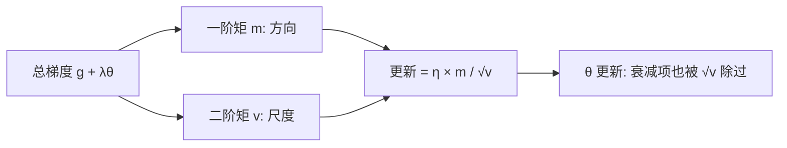

# 22｜权重衰减与 AdamW：为什么 Adam 加 L2 不等于 AdamW？

> 阅读目标：理解权重衰减（weight decay）到底在做什么；算清为什么在 SGD 里“L2 正则 = 权重衰减”，而在 Adam 里这个等式会失效；并看清 AdamW 是如何把衰减从梯度里“搬出来”，从而恢复一个干净、可解释的收缩。
>
> 前置知识：第 12 篇的 Adam（动量 $m_t$、二阶矩 $v_t$、偏差修正）、第 10 篇的训练目标（损失函数与梯度）、第 13 篇的学习率 warmup（学习率 $\eta$ 会随训练变化）。本篇的结论分三类：**直觉**帮助理解、**严格推导**可以从公式直接算出、**需实验验证**依赖具体模型和数据，不要把第三类当成定理。

## 1. 直觉：权重衰减到底在惩罚什么？

训练一个 Transformer，我们最小化的从来不只是训练损失。直觉上，我们希望模型“不要把权重长得太大”：权重越大，函数越容易对输入的微小变化做出剧烈反应，也越容易把训练集的噪声背下来。权重衰减就是把这个愿望写进优化过程——**每一步都把权重往 0 的方向拉回一点**，不管梯度怎么说。

注意这个愿望有两个版本，初学者最容易把它们混为一谈：

- **版本 A（改损失）**：在损失里加一项 $\frac{\lambda}{2}\lVert\theta\rVert^2$，这就是 L2 正则。优化器看到的梯度因此多了一项 $\lambda\theta$。
- **版本 B（改更新）**：不管损失长什么样，更新完之后直接把权重乘一个小于 1 的系数，例如 $\theta \leftarrow (1 - \eta\lambda)\theta$。这就是字面意义的“权重衰减”。

在 SGD 里，这两个版本恰好是同一件事。在 Adam 里，它们分道扬镳——而 AdamW 的全部意义，就是**在 Adam 里恢复版本 B**。

先把一句话结论放在这里，后面再算给你看：**Adam 会把所有进入梯度的东西都除以一个自适应分母；L2 项一旦进了梯度，也会被这个分母缩放，于是“衰减”不再是一个干净的、与参数成正比的收缩。AdamW 把衰减项从梯度里拿出来，绕过分母，才让衰减重新变得可解释。**

还有一个值得先想清楚的问题：为什么衰减偏偏是“乘一个系数”，而不是“每步固定减一个常数”？因为我们要惩罚的是**相对大小**，而不是绝对大小。一个权重是 $10$ 还是 $0.01$，对函数的贡献天差地别；乘法收缩让大权重每步多减、小权重每步少减，权重越接近 0、收缩越温和，永远不会因为一次衰减就冲过 0、改变符号。第 4 节会看到，Adam + L2 恰恰把这个好性质弄丢了——它在数据梯度为 0 时退化成了“每步固定减 $\eta$”，即减法式衰减。

从概率视角看，L2 正则还有另一层含义：最小化 $L_{\text{data}} + \frac{\lambda}{2}\lVert\theta\rVert^2$，等价于在参数上放一个零均值高斯先验 $p(\theta) \propto \exp(-\frac{\lambda}{2}\lVert\theta\rVert^2)$ 后求最大后验（MAP）。先验方差是 $1/\lambda$：$\lambda$ 越大，先验越“确信”权重应该接近 0，收缩就越强。这个视角的价值在于提醒我们：**权重衰减本质上是一个先验假设**，它假设“小权重更好”。这个假设在很多任务上成立（它对应着对函数复杂度的惩罚），但它终究是假设，不是数学定理——第 7 节会回到这一点。

## 2. SGD 里：L2 正则 = 权重衰减（严格推导）

设数据损失为 $L_{\text{data}}(\theta)$，它对参数 $\theta$ 的梯度记为 $g_t$。加上 L2 项后，总损失和总梯度是：

```math
L_{\text{total}} = L_{\text{data}} + \frac{\lambda}{2}\lVert\theta\rVert^2, \qquad \nabla L_{\text{total}} = g_t + \lambda\theta_t
```

其中 $\lambda > 0$ 是正则强度。SGD 的更新是沿负梯度走一步，步长为学习率 $\eta$：

```math
\theta_{t+1} = \theta_t - \eta\left(g_t + \lambda\theta_t\right) = \underbrace{(1 - \eta\lambda)}_{\text{收缩系数}}\theta_t - \eta g_t
```

这个式子是严格成立的，不需要任何近似。把它拆开读：

- $-\eta g_t$ 是数据梯度驱动的更新，和没有正则时一模一样；
- $(1 - \eta\lambda)\theta_t$ 是在数据更新之外，**先把权重乘上 $(1 - \eta\lambda)$**，即每步向 0 收缩 $\eta\lambda$ 的比例。

所以在 SGD 里，说“L2 正则”还是说“权重衰减”，描述的是同一个更新规则——只要 $\eta\lambda$ 相同。这也是为什么很多 SGD 的实现直接把两者混用：它们确实没有区别。记住“收缩系数乘权重、再减数据更新”这个拆分形式，第 6 节会看到，AdamW 正是把这个结构原样搬了回来。

这个等式成立还有一个隐含条件，值得单独点出来：**收缩系数必须在 $(0, 1)$ 之间，即 $0 < \eta\lambda < 1$。** 如果 $\eta\lambda > 1$，系数变负，权重会在 0 两侧来回翻号，而不是平稳收缩。实践中 $\eta$ 和 $\lambda$ 都很小，这个条件通常自然满足，但它提醒我们：衰减强度从来不是 $\lambda$ 一个人说了算，而是乘积 $\eta\lambda$。

## 3. Adam 里：所有梯度都要过一遍自适应分母

第 12 篇已经推导过 Adam 的更新。为了方便对照，把它原样写在这里（$t$ 为步数，$\beta_1 = 0.9$、$\beta_2 = 0.999$ 为常用默认值，$\epsilon$ 是防除零的小量）：

```math
\begin{aligned}
m_t &= \beta_1 m_{t-1} + (1 - \beta_1)\, g_t, \\
v_t &= \beta_2 v_{t-1} + (1 - \beta_2)\, g_t^2, \\
\hat{m}_t &= \frac{m_t}{1 - \beta_1^t}, \qquad \hat{v}_t = \frac{v_t}{1 - \beta_2^t}, \\
\theta_{t+1} &= \theta_t - \eta\, \frac{\hat{m}_t}{\sqrt{\hat{v}_t} + \epsilon}.
\end{aligned}
```

直觉上，$\hat{m}_t$ 是梯度的滑动平均（方向），$\sqrt{\hat{v}_t}$ 是梯度大小的滑动平均（尺度）。Adam 的核心思想是：**用方向除以尺度**，让每个参数的更新步长 roughly 是 $\eta$ 量级，而不被梯度本身的绝对大小绑架。梯度大的参数分母大，步子被压小；梯度小的参数分母小，步子被抬大。这就是“自适应学习率”。

这个设计对数据梯度是好事，但它有一个副作用：**分母不认得梯度是从哪来的**。只要一项进了 $g_t$，它就会同时进入 $m_t$ 和 $v_t$，然后被 $\sqrt{\hat{v}_t}$ 除一遍。L2 项 $\lambda\theta_t$ 一旦进了梯度，也逃不过这一除。

还有一个常被忽略的性质：Adam 的更新对梯度的整体缩放近似不变。如果把所有梯度乘上一个正数 $c$，$\hat{m}_t$ 乘 $c$，$\sqrt{\hat{v}_t}$ 也乘 $c$，比值 $\hat{m}_t / \sqrt{\hat{v}_t}$ 不变（忽略 $\epsilon$）。这个“缩放不变性”对数据梯度是优点，但对正则项却是麻烦——后面第 4 节会看到，它让 Adam + L2 的正则强度变得依赖于数据梯度的尺度。



## 4. Adam + L2：衰减被分母“归一化”了（核心推导）

现在把 L2 项塞进 Adam。优化器看到的总梯度是 $g_t + \lambda\theta_t$，于是 $m_t$、$v_t$ 都是对这个总梯度做的滑动平均。更新写出来是：

```math
\theta_{t+1} = \theta_t - \eta\, \frac{\widehat{(g + \lambda\theta)}_t}{\sqrt{\widehat{(g + \lambda\theta)^2}}_t + \epsilon}
```

注意分子分母里的帽子表示的都是对**总梯度**的滑动平均。这个式子已经没法像 SGD 那样拆成“收缩 + 数据更新”两项了。衰减项 $\lambda\theta_t$ 被 $m_t$、$v_t$ 的滑动平均和除法彻底搅在了一起。

为了看清搅成什么样，考虑一个最干净的情形：**数据梯度为 0，只有 L2 项在起作用**，且训练已经跑了一段时间、滑动平均趋于稳定。此时总梯度恒为 $g = \lambda\theta$，于是 $\hat{m}_t \approx \lambda\theta$，$\hat{v}_t \approx (\lambda\theta)^2$，$\sqrt{\hat{v}_t} \approx \lvert\lambda\theta\rvert$。更新变成：

```math
\theta_{t+1} \approx \theta_t - \eta\, \frac{\lambda\theta_t}{\lvert\lambda\theta_t\rvert} = \theta_t - \eta\, \mathrm{sign}(\theta_t)
```

这一步非常值得停下来读三遍。Adam + L2 在这里做的**不是**把权重乘上 $(1 - \eta\lambda)$，而是**每次固定地减去 $\eta$**（沿着指向 0 的方向）。衰减量 $\eta$ 与 $\theta$ 的大小无关、与 $\lambda$ 的大小也无关（只要 $\lambda\theta$ 在梯度中占主导）！权重从 $1.0$ 开始，每步减 $0.1$，走的是 $1.0 \to 0.9 \to 0.8 \to \cdots$ 这样的等差数列，而不是 $1.0 \to 0.99 \to 0.9801 \to \cdots$ 这样的等比收缩。等差收缩在接近 0 时不会自动减速——它会直接跨过 0，而不是平稳地趋近 0。

再看一个更一般的情形：数据梯度和 L2 项同时存在。设某个参数的数据梯度很大、远大于 $\lambda\theta$，另一个参数的数据梯度很小、远小于 $\lambda\theta$。在稳态近似下，两个参数的 Adam + L2 更新幅值都约等于 $\eta$（因为分子分母约掉），但 L2 项在其中的“话语权”完全不同：

| 参数 | 数据梯度 vs $\lambda\theta$ | L2 项在更新方向里的作用 |
|---|---|---|
| 大梯度参数 | $\lvert g\rvert \gg \lambda\theta$ | 几乎被淹没：更新方向主要由数据梯度决定，衰减被大分母稀释 |
| 小梯度参数 | $\lvert g\rvert \ll \lambda\theta$ | 占主导：更新方向主要由衰减决定，步长却仍是 $\eta$ 量级 |

也就是说，**Adam + L2 的正则强度不再是一个全局统一的 $\lambda$，而是随每个参数的梯度历史而变化的**。梯度大的参数“逃”掉了衰减，梯度小的参数反而被衰减推着走满步。这和 L2 正则的原意——对所有参数一视同仁地惩罚大权重——已经不是一回事了。

还有一个连锁反应：数据梯度的尺度一变（例如把损失从“求和”改成“求均值”、改 batch size、改 loss scaling），$v_t$ 的尺度跟着变，L2 项被除的倍数也跟着变。也就是说，**Adam + L2 的实际正则效果会随着这些本不该影响正则的设定而漂移**。调参时你以为自己只改了 batch size，实际上正则强度也被动地改了——这种耦合是 Adam + L2 最难调的地方。

## 5. 数值示例：一张表看清两种衰减

取一个最简单的实验：数据梯度恒为 0，只有衰减在起作用；$\eta = 0.1$，$\lambda = 0.1$，$\theta_0 = 1.0$，忽略 $\epsilon$ 并用稳态近似（第 4 节的推导，第一步在偏差修正后是精确的，后续步骤是近似）。

- **AdamW（第 6 节的算法）**：每步衰减量为 $\eta\lambda\theta_t = 0.01\,\theta_t$，权重按 $(1 - 0.01)$ 等比收缩。
- **Adam + L2**：每步衰减量约等于 $\eta = 0.1$，与 $\theta_t$ 无关，权重按等差数列下降，直到接近 0 附近行为改变。

| 步数 $t$ | AdamW 的 $\theta_t$ | Adam + L2 的 $\theta_t$（近似） |
|---:|---:|---:|
| 0 | 1.0000 | 1.0000 |
| 1 | 0.9900 | 0.9000 |
| 2 | 0.9801 | 0.8000 |
| 5 | 0.9510 | 0.5000 |
| 10 | 0.9044 | 约 0（随后在 0 附近来回穿越，而非平稳趋近） |

读这张表要注意两点。第一，Adam + L2 的衰减速度是 AdamW 的 10 倍（$0.1$ 对 $0.01$），但这不是“更强就是更好”——它强得毫无比例感：权重还很大时它减得太快，权重已经很小时它仍然减同样多。第二，AdamW 的收缩是“越小越慢”的：$\theta$ 剩一半时，每步衰减量也剩一半，永远不会一步跨过 0。这种**与自身成正比**的收缩，正是“权重衰减”这个词本来的意思。

### 长期行为：等比收缩是一笔复利

如果数据梯度一直为 0，AdamW 的权重经过 $T$ 步后是：

```math
\theta_T = (1 - \eta\lambda)^T\, \theta_0 \approx e^{-\eta\lambda T}\, \theta_0 \qquad (\eta\lambda \ll 1)
```

这个近似用的是 $(1 - x)^T \approx e^{-xT}$（$x$ 很小时）。它告诉我们一个调参时很有用的量：**衰减的“半衰期”**。令 $e^{-\eta\lambda T} = \frac{1}{2}$，得 $T_{1/2} = \ln 2 / (\eta\lambda)$。例如 $\eta = 10^{-3}$、$\lambda = 0.1$ 时，$\eta\lambda = 10^{-4}$，半衰期约 $6931$ 步——也就是说，单靠衰减把一个“无用”权重压掉一半，需要近七千步。权重衰减从来不是一记重锤，而是一股持续的、温和的拉力；指望它在几百步内“清理”掉大权重是不现实的。

真实训练中数据梯度当然不为 0，衰减最终会和数据梯度达成平衡。取一个最简单的二次损失 $L_{\text{data}} = \frac{1}{2}a(\theta - \theta^*)^2$（$a > 0$，$\theta^*$ 是数据最喜欢的参数值），用 SGD + 权重衰减求不动点：令 $\theta_{t+1} = \theta_t$，即

```math
0 = -\eta\left(a(\theta - \theta^*) + \lambda\theta\right) \quad\Longrightarrow\quad \theta_{\text{均衡}} = \frac{a}{a + \lambda}\, \theta^*
```

均衡点是数据最优解 $\theta^*$ 乘上一个小于 1 的系数 $\frac{a}{a+\lambda}$。这个公式把权重衰减的效果讲得非常干净：**曲率 $a$ 越大（数据对该参数的约束越强），收缩越轻微；曲率 $a$ 越小（数据几乎不在乎这个参数取什么值），收缩越接近把参数压到 0**。正则没有粗暴地把所有权重都压掉一半，它是按“数据在乎程度”来分配收缩的——数据约束强的方向几乎不动，数据约束弱的方向被大幅压向 0。这正是我们想要的正则行为，也是下一节 AdamW 要恢复的性质。

## 6. AdamW：把衰减从梯度里搬出来

Loshchilov 和 Hutter 在 2019 年的论文《Decoupled Weight Decay Regularization》中给出的解法简单到令人意外：**不要把衰减放进损失、放进梯度；直接在更新公式里减一项**。AdamW 的更新是：

```math
\theta_{t+1} = \theta_t - \eta\, \frac{\hat{m}_t}{\sqrt{\hat{v}_t} + \epsilon} - \underbrace{\eta\lambda\theta_t}_{\text{解耦的权重衰减}}
```

其中 $\hat{m}_t$、$\hat{v}_t$ 只对**数据梯度** $g_t$ 做滑动平均，$\lambda\theta_t$ 不再进入 $m_t$、$v_t$。把式子整理一下：

```math
\theta_{t+1} = (1 - \eta\lambda)\,\theta_t - \eta\, \frac{\hat{m}_t}{\sqrt{\hat{v}_t} + \epsilon}
```

这正是 SGD 里那个熟悉的结构，只是数据更新项从 $-\eta g_t$ 换成了 Adam 的自适应更新。衰减重新变成了一个干净的收缩系数 $(1 - \eta\lambda)$：

- **与参数成正比**：权重越大，单步衰减的绝对量越大；权重趋近 0 时，衰减自动减速，不会跨过 0。
- **与梯度尺度无关**：数据梯度变大变小、batch size 怎么改，衰减项 $\eta\lambda\theta_t$ 都不受影响（只通过 $\eta$ 的调度间接变化，见第 7 节）。
- **对所有参数一视同仁**：给定相同的 $\eta$ 和 $\lambda$，每个参数的收缩比例都是 $(1 - \eta\lambda)$，不再被各自的梯度历史区别对待。

所以 AdamW 的名字要这样读：**W 不是一个新的优化器，而是 Adam + 解耦（Decoupled）的权重衰减**。它保留了 Adam 的自适应步长，只把正则项从自适应分母的影响范围里摘了出来。Loshchilov 和 Hutter 的实验结论（需实验验证，不宜当成普适定理）是：在图像分类等任务上，AdamW 的泛化表现优于 Adam + L2，且 $\lambda$ 的最优值与学习率的耦合更弱、更好调。这个结论后来被 Transformer 的训练实践广泛采纳——今天你用的几乎所有大模型训练配方，优化器一栏写的都是 AdamW，而不是 Adam + L2。

顺带提醒一个极易踩坑的实现细节：PyTorch 里 `torch.optim.Adam` 的 `weight_decay` 参数做的是**版本 A**——它把 $\lambda\theta$ 加进梯度，也就是本篇批判的 Adam + L2；而 `torch.optim.AdamW` 的 `weight_decay` 做的才是**版本 B**——解耦衰减。两个类的参数名一模一样，行为却完全不同。看到一份代码写着“Adam，weight_decay=0.01”，不要默认它就是 AdamW；反过来，复现一篇论文的 AdamW 结果时，也不要用 Adam 的 weight_decay 去凑数。

## 7. 实践里还要注意的几件事（需实验验证）

前面几节是公式能算清的部分，下面这几条是实践中总结的惯例：它们的道理可以讲通，但具体数值和取舍依赖任务和数据，**不要把它们当成定理**。

**第一，衰减强度是 $\eta\lambda$，不是 $\lambda$。** AdamW 里每步的收缩系数是 $(1 - \eta\lambda)$，所以学习率调度（第 13 篇的 warmup、第 23 篇预告的学习率衰减）会同时改变衰减强度：学习率衰减到接近 0 的训练末期，权重衰减也自动变弱。这通常是好事（末期让模型安心收敛），但调参时要记住：你改的从来不只是学习率。反过来，warmup 阶段学习率从 0 爬升，衰减也跟着从 0 爬升——训练最初的几百步，权重几乎不受衰减影响，这恰好也是模型最动荡、最不该被额外力量干扰的阶段，算是调度带来的一个附赠好处。不同框架对 $\lambda$ 的约定也不一样：PyTorch 的 AdamW 是按 $\theta \leftarrow \theta - \eta\lambda\theta$ 实现的（衰减乘了学习率）；个别实现把衰减写成与 $\eta$ 无关的固定比例。抄配方之前，先确认你用的实现是哪一种约定，否则同样的 $\lambda$ 数字含义完全不同。还有一种更激进的做法是把衰减彻底与学习率调度脱钩（每步固定收缩比例），它在某些长训练配方里出现过，但是否更好属于需实验验证的范畴，不宜直接当成默认选择。

**第二，不是所有参数都应该衰减。** 常见做法是：只对权重矩阵（二维及以上的参数）做衰减，而**偏置（bias）和归一化层的参数（LayerNorm 的增益和偏置）不做衰减**。道理是：偏置和归一化参数的“大小”并不对应函数的复杂度——把 LayerNorm 的增益往 0 拉，是在直接缩小该层的输出尺度，而不是在正则化；把偏置往 0 拉，也不是在惩罚过拟合。实践中给所有参数统一加衰减常常也work，但分开处理是更稳妥的默认选择。

**第三，权重衰减不是稀疏化。** L2 / 权重衰减把权重往 0 拉，但只会让权重变得很小，不会精确地变成 0。想要真正的稀疏（大量权重恰好为 0），需要的是 L1 正则或其他稀疏方法。这是 L2 类方法本身的性质，和用 SGD 还是 AdamW 无关。

**第四，AdamW 不是“Adam 的修正版万能药”。** 它修的是正则项与自适应分母的耦合，没有改变 Adam 本身的性质：Adam 仍然对梯度噪声、$\beta_2$ 的选择、$\epsilon$ 的取值敏感；权重衰减仍然只是一个先验——它假设“小权重更好”，而这个假设在某些任务（例如需要大权重来表达尖锐边界的任务）上未必成立。衰减系数 $\lambda$ 仍然是一个需要调的超参数，AdamW 只是让它变得更好调，而不是不用调。

## 8. 常见误区

**误区一：“AdamW 就是 Adam 加了 L2，只是换了个名字。”**
错。Adam + L2 是把 $\lambda\theta$ 放进梯度、再过一遍自适应分母；AdamW 是把 $\eta\lambda\theta$ 直接从更新里减掉、不进梯度。两者在 SGD 里等价，在 Adam 里是两种不同的更新规则，第 5 节的数值表就是明证。

**误区二：“$\lambda$ 越大，正则效果一定越强。”**
在 Adam + L2 里不一定。$\lambda$ 变大时，$\lambda\theta$ 在总梯度里的占比变大，$v_t$ 也跟着变大，分母把它的效果部分地抵消掉；同时 $\lambda$ 还会改变 $m_t$ 的方向。在 AdamW 里，$\lambda$ 与衰减强度的关系才是单调干净的（在 $\eta$ 固定时）。

**误区三：“权重衰减和学习率是两个独立的旋钮，互不影响。”**
在 AdamW 里，每步的实际收缩是 $\eta\lambda$，两个旋钮乘在一起才起作用。只调 $\lambda$ 不看 $\eta$ 的调度，或者只调 $\eta$ 不意识到衰减也被联动了，都是调参时常见的盲区。

**误区四：“衰减到 0 附近的参数就等于被剪掉了。”**
错。权重衰减是连续收缩，不产生精确的 0；一个被衰减到 $10^{-4}$ 的权重在计算中仍然存在、仍然参与前向传播。剪枝（pruning）和稀疏化是另外的机制，不要把“很小”等同于“没有”。

**误区五：“既然 AdamW 更好，SGD + L2 就没有意义了。”**
错。SGD + L2 的等价性是严格成立的，而且 SGD 的更新没有自适应分母，行为更可预测。AdamW 解决的是“Adam 里如何干净地做衰减”，不是宣告 SGD 过时。很多视觉任务和部分微调场景仍然用 SGD 取得很好的结果，选择优化器要看任务，不看潮流。

## 9. 自测题

**1.** SGD + L2 正则时，设 $\eta = 0.01$、$\lambda = 0.1$、某参数当前值 $\theta_t = 2.0$、数据梯度 $g_t = 0.5$。写出 $\theta_{t+1}$ 的表达式并算出数值，指出其中哪一部分是权重衰减的贡献。

<details>
<summary>答案</summary>

$\theta_{t+1} = (1 - \eta\lambda)\theta_t - \eta g_t = (1 - 0.001) \times 2.0 - 0.01 \times 0.5 = 1.998 - 0.005 = 1.993$。权重衰减的贡献是把 $2.0$ 先收缩为 $1.998$（收缩了 $0.002$，即 $\eta\lambda\theta_t = 0.002$），数据更新再减去 $0.005$。
</details>

**2.** 数据梯度恒为 0、$\theta_0 = 1.0$、$\eta = 0.1$、$\lambda = 0.1$ 时，为什么 Adam + L2 的第一步（偏差修正后、忽略 $\epsilon$）恰好是 $\theta_1 = 0.9$，而 AdamW 的第一步是 $\theta_1 = 0.99$？这个差别说明了什么？

<details>
<summary>答案</summary>

Adam + L2：第一步总梯度 $g = \lambda\theta_0 = 0.1$，偏差修正后 $\hat{m}_1 = 0.1$、$\sqrt{\hat{v}_1} = 0.1$，比值为 $1$，更新为 $\eta \times 1 = 0.1$，故 $\theta_1 = 0.9$。AdamW：数据梯度为 0，自适应更新项为 0，只剩下衰减项 $\eta\lambda\theta_0 = 0.01$，故 $\theta_1 = 0.99$。差别说明：Adam + L2 的衰减量是固定的 $\eta$，与 $\theta$ 和 $\lambda$ 的大小无关（只要 $\lambda\theta$ 占主导）；AdamW 的衰减量是 $\eta\lambda\theta$，与权重成正比。
</details>

**3.** 两个参数 $\theta_A$、$\theta_B$ 的当前值相同、$\lambda$ 相同，但 $\theta_A$ 的数据梯度远大于 $\theta_B$。在 Adam + L2 里，L2 项对两者更新方向的影响有什么不同？在 AdamW 里呢？

<details>
<summary>答案</summary>

Adam + L2：L2 项进了总梯度再被 $\sqrt{\hat{v}}$ 除。对 $\theta_A$，数据梯度占主导，L2 项的方向贡献被稀释；对 $\theta_B$，L2 项占主导，更新方向主要由衰减决定，但步长仍约等于 $\eta$。也就是说，同样的 $\lambda$ 在两个参数上产生了不同的实际正则效果。AdamW：衰减项 $\eta\lambda\theta$ 直接相减，不进分母，两个参数的收缩比例都是 $(1 - \eta\lambda)$，与各自的梯度大小无关。
</details>

**4.** 你把损失的 reduction 从“对样本求均值”改成“对样本求和”（batch 不变），数据梯度因此变大了约一个 batch size 的倍数。在 Adam + L2 和 AdamW 里，这次改动分别会对权重衰减的实际效果产生什么影响？

<details>
<summary>答案</summary>

Adam + L2：数据梯度变大 → $v_t$ 变大 → L2 项 $\lambda\theta$ 被更大的分母除，实际衰减效果被削弱；同时总梯度的方向也改变了。也就是说，一个本只想改变损失尺度的改动，顺带改变了正则强度。AdamW：衰减项 $\eta\lambda\theta$ 不经过分母、不依赖梯度尺度，因此不受这次改动影响（自适应更新项本身对梯度整体缩放近似不变，见第 3 节）。这正是“解耦”的价值：正则强度不再被损失的尺度设定绑架。
</details>

---

下一篇预告：23｜梯度裁剪：大梯度来了，到底该“剪”还是该“缩”？
