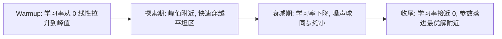

# 23｜学习率调度：warmup 之后，为什么还要让学习率衰减？

> 阅读目标：理解训练后期的学习率为什么不能一直保持峰值；算清恒定学习率下随机梯度噪声会把参数“钉”在一个多大的误差球里；并看清 cosine 衰减、线性衰减、WSD 各自在什么条件下成立、各自的代价是什么。
>
> 前置知识：第 13 篇的学习率 warmup（学习率 $\eta$ 随训练步数变化）、第 12 篇的 Adam（自适应步长不等于学习率调度）、第 22 篇的权重衰减与 AdamW（衰减强度实际是乘积 $\eta\lambda$，所以学习率变了，衰减也在变）。本篇的结论分三类：**直觉**帮助理解、**严格推导**可以从公式直接算出、**需实验验证**依赖具体模型和数据，不要把第三类当成定理。

## 1. 直觉：先跑起来，再慢慢刹车

第 13 篇讲过，训练开头要用 warmup：参数还是随机初始化，梯度噪声大，Adam 的第一步几乎只认方向不认大小，所以把学习率从 0 线性拉大，避免一开始就冲散。warmup 解决的是“起步别翻车”。本篇解决的是另一头的问题：“快到终点了，为什么还要减速？”

直觉可以用开车来类比，但类比只能走到一半。开车时你离目的地越近越要减速，否则会冲过头；训练时也有类似的“冲过头”，但它的机制不是惯性，而是**噪声**。训练用的梯度是小批量（mini-batch）算出来的，它是全批量真实梯度的一个带噪声估计：

```math
g_t = \nabla L(\theta_t) + \varepsilon_t, \qquad \mathbb{E}[\varepsilon_t] = 0, \quad \mathrm{Var}(\varepsilon_t) = \sigma^2
```

这里 $\varepsilon_t$ 不是 bug，而是小批量采样的固有属性：每个 batch 的样本不同，梯度就不一样。只要学习率 $\eta$ 不变，每一步注入的噪声幅度就是 $\eta \varepsilon_t$，它不会随着“离最优解越来越近”而自动变小。于是训练后期会出现一种熟悉的景象：损失不再下降，在一个水平附近来回震荡；验证指标也不再变好，只是在原地抖动。这不是模型学不动了，而是**步长相对于剩余的路程来说太大了**：参数每一步都被噪声推着走，始终无法“落”进最优解附近那个很小的区域。

把学习率衰减下去，就是把每一步的噪声注入幅度也衰减下去。参数的抖动范围跟着学习率一起缩小，损失才能从“震荡平台”继续往下走一截。这就是学习率调度（learning rate schedule）最核心的直觉：**前期用大学习率快速穿越平坦区域、探索参数空间，后期用小学习率把噪声压下去、精细收敛**。warmup 和衰减合起来，就是一张完整的“速度曲线”：起步慢、中间快、收尾慢。

还有一个直觉值得先建立：学习率调度调的是**全局的步长上限**，它和 Adam 的自适应是两个层次的东西。Adam 给每个参数一个自适应分母（第 12 篇），但所有参数共享同一个 $\eta_t$ 作为整体缩放；$\eta_t$ 随时间衰减，等于把所有参数的步长同时按比例缩小。反过来，只调 Adam 的 $\beta$ 或 $\epsilon$，调不出这种“全局随时间收缩”的效果。第 3 节会从数学上把这件事算清楚。

先把一句话结论放在这里，后面再展开：**恒定学习率 + 带噪声的梯度 = 永远收敛不到最优解，只能收敛到一个大小正比于学习率的噪声球里；让学习率随时间衰减到接近 0，就是把这个球越缩越小。**

## 2. 严格推导：恒定学习率下的噪声球有多大？

为了把“噪声球”算清楚，取最简单的模型：一维二次损失 $L(\theta) = \frac{a}{2}\theta^2$，其中 $a > 0$ 是曲率，最优解在 $\theta^* = 0$。带噪声的梯度下降更新是：

```math
\theta_{t+1} = \theta_t - \eta \left( a\theta_t + \varepsilon_t \right) = (1 - \eta a)\theta_t - \eta \varepsilon_t
```

其中 $\varepsilon_t$ 是均值为 0、方差为 $\sigma^2$ 的独立噪声。假设 $0 < \eta a < 1$（步长没有大到发散），递推下去，$\theta_t$ 的方差会收敛到一个稳态值。设稳态方差为 $V$，即 $\mathrm{Var}(\theta_{t+1}) = \mathrm{Var}(\theta_t) = V$，对递推式两边取方差（$\theta_t$ 与 $\varepsilon_t$ 独立）：

```math
V = (1 - \eta a)^2 V + \eta^2 \sigma^2
```

解出 $V$：

```math
V = \frac{\eta^2 \sigma^2}{1 - (1 - \eta a)^2} = \frac{\eta^2 \sigma^2}{2\eta a - \eta^2 a^2} = \frac{\eta \sigma^2}{2a - \eta a^2}
```

当 $\eta a$ 很小（实践中通常如此）时，分母近似为 $2a$，得到简洁的近似：

```math
V \approx \frac{\eta \sigma^2}{2a}, \qquad \text{标准差} \approx \sqrt{\frac{\eta \sigma^2}{2a}}
```

这个式子是严格推导在小步长下的近似，它告诉我们三件事：

- **稳态误差正比于学习率**：$\eta$ 减半，方差减半，标准差变为原来的约 $0.71$ 倍。恒定学习率永远到不了 0 误差，因为 $V$ 不随时间衰减。
- **噪声越大、曲率越小，球越大**：$\sigma^2$ 越大（batch 越小、数据越杂），球越大；$a$ 越小（损失面越平坦），同样的噪声能把参数推得越远。
- **衰减学习率就是在衰减这个球**：如果 $\eta_t$ 随时间趋向 0，稳态方差的“目标值”也随之趋向 0，参数才能真正贴近最优解。

给一个数值例子。取曲率 $a = 1$，噪声标准差 $\sigma = 0.2$（即 $\sigma^2 = 0.04$），用近似公式算不同学习率下的稳态标准差：

| 学习率 $\eta$ | 稳态方差 $V \approx \eta\sigma^2 / 2$ | 稳态标准差 |
|---|---|---|
| 0.1 | 0.002 | 约 0.045 |
| 0.03 | 0.0006 | 约 0.024 |
| 0.01 | 0.0002 | 约 0.014 |
| 0.001 | 0.00002 | 约 0.0045 |

从 0.1 衰减到 0.001，抖动幅度缩小了 10 倍。这个例子是理想化的一维二次模型，真实 Transformer 的损失面远比它复杂（非凸、高维、曲率各向异性），但“学习率决定噪声球大小”这个定性结论在随机优化理论中是稳健的：**只要梯度带噪声、学习率恒定，收敛的极限就是一个分布，而不是一个点**。

## 3. 收敛理论：什么样的衰减序列才“合格”？

经典的随机逼近理论（Robbins–Monro 条件）给出了一个干净的判据：如果学习率序列 $\{\eta_t\}$ 满足

```math
\sum_{t=1}^{\infty} \eta_t = \infty, \qquad \sum_{t=1}^{\infty} \eta_t^2 < \infty
```

那么在适当的正则条件下，带噪声的梯度下降可以几乎必然收敛到最优解。两个条件各有含义：

- $\sum \eta_t = \infty$：总步长无限，参数有机会从任何起点走到最优解。如果学习率衰减得太快（例如 $\eta_t = 1/t^2$，其和收敛），训练可能在半路上就“没油了”，还没走到最优解就停下了。
- $\sum \eta_t^2 < \infty$：噪声的累积方差有限。直觉上，第 $t$ 步注入的噪声方差正比于 $\eta_t^2$；如果 $\sum \eta_t^2$ 发散（恒定学习率就是这种情况），噪声永远在累积，参数就永远在抖。

检验几个常见序列：$\eta_t = 1/t$ 满足两个条件（调和级数发散、平方和收敛），是理论上的经典选择；恒定学习率 $\eta_t = \eta$ 满足第一个、不满足第二个，所以只能收敛到噪声球；$\eta_t = 1/\sqrt{t}$ 满足第一个、不满足第二个，同样只能收敛到一个缓慢收缩的球。

但这里必须划清一条线：**Robbins–Monro 是渐近理论，它说的是 $t \to \infty$ 时的极限，而真实训练总是在有限的总步数 $T$ 内结束**。实践中最常用的 cosine 衰减并不满足 $\sum \eta_t^2 < \infty$ 的渐近条件（它在 $T$ 步后就结束了，谈不上无穷），但它在有限时间内工作得很好。原因在第 4 节：cosine 调度是为“已知总步数 $T$”这个场景设计的，它把“在 $T$ 步内把学习率压到接近 0”作为目标，而不是追求无穷时间的渐近性质。理论告诉你方向（学习率必须衰减），实践告诉你形状（在有限预算内怎么衰减最划算）——两者都要听，但不要把其中一个当成另一个的证明。

还有一个常被忽略的联系：第 22 篇讲过，AdamW 的实际衰减强度是乘积 $\eta_t \lambda$。所以**学习率衰减的同时，权重衰减也在同步变弱**。训练后期 $\eta_t$ 只有峰值的 10%，权重衰减的收缩作用也只剩 10%。这不是 bug，而是 AdamW 定义的一部分；但它提醒我们：调学习率调度的时候，你其实同时在调正则强度。把两者分开思考，调参时会少踩很多坑。

## 4. 三种常用调度：cosine、线性、WSD

下面是实践中最常见的三张“速度曲线”。设峰值学习率为 $\eta_{\max}$，总步数为 $T$，warmup 步数为 $T_w$，衰减起点之后的时间记为 $t$（从衰减开始算）。

**Cosine 衰减**是最常见的选择，衰减段的公式是：

```math
\eta_t = \eta_{\min} + \frac{1}{2}\left(\eta_{\max} - \eta_{\min}\right)\left(1 + \cos\left(\pi \cdot \frac{t}{T - T_w}\right)\right)
```

其中 $\eta_{\min}$ 常取 0 或峰值的 10%。它的形状是：刚离开峰值时下降得很慢（cosine 在 0 附近平坦），中段下降最快，接近终点时又放缓、平滑地贴近 $\eta_{\min}$。这种形状的好处是：前期在大学习率附近停留较久，充分探索；后期平滑收尾，不会在最后一步突然“急刹车”。代价是：**它要求你事先知道总步数 $T$**。如果你中途决定多训一倍，cosine 曲线已经走完了，后半程只能用一个很小的学习率接着训，效果通常不好——这就是“cosine 陷阱”。

**线性衰减**更简单：从峰值直线降到 $\eta_{\min}$。它的优点是容易理解、容易实现；缺点是中段下降偏快，模型在大学习率区域停留的时间比 cosine 短。实验上，线性与 cosine 的差距通常不大（需实验验证），远小于“总步数定错”或“峰值学习率选错”带来的差距。

**WSD（Warmup–Stable–Decay）** 是近年大模型训练中流行起来的折中方案，形状分三段：warmup 拉升 → 一段较长的恒定峰值平台（stable）→ 最后用较短的步数（通常为总步数的 10%–20%）快速衰减到 0。它的核心好处是**灵活性**：在 stable 阶段，你可以随时决定“就此衰减、结束训练”，而不必像 cosine 那样一开始就把总步数钉死；也可以从同一个 stable 检查点出发，用不同的衰减长度训出多个版本做对比。代价是：stable 阶段的恒定大学习率意味着参数一直在噪声球里抖动，只有进入 decay 段后损失才会出现最后一段明显的下降——所以不要在 stable 阶段看到损失平台就断定模型“学不动了”，那是调度设计的一部分。

三种调度的对比：

| 调度 | 形状 | 最大优点 | 最大代价 |
|---|---|---|---|
| Cosine | 平滑 S 形衰减 | 收尾平滑，前期探索充分 | 必须预先定死总步数 |
| 线性 | 直线下降 | 简单、可预测 | 中段下降偏快 |
| WSD | 平台 + 短衰减 | 总步数灵活，可随时收尾 | 平台期损失看似停滞，容易误判 |

除了上面三种，还有两种历史悠久的调度值得知道，因为它们能帮你理解“衰减”这个词的不同实现方式。**阶梯衰减（step decay）**是每隔固定步数把学习率乘一个小于 1 的系数，例如每 30 个 epoch 乘 0.1；它的优点是实现极其简单、每一段内部都是恒定学习率，便于分析每一段的稳态行为，缺点是学习率在阶梯处突然跳变，损失曲线上会出现明显的台阶式下跌，调参时需要同时决定阶梯位置和衰减系数。**指数衰减**则是每步乘一个接近 1 的系数，$\eta_t = \eta_0 \gamma^t$（$0 < \gamma < 1$），曲线平滑但衰减速度全程不变，前期可能降得太快、后期又降得不够彻底，现在已较少作为大模型训练的首选。

还有一个经常和调度一起出现的问题：**batch size 变了，学习率该怎么跟？** 回到第 2 节的公式，稳态方差 $V \approx \eta\sigma^2/(2a)$ 里，$\sigma^2$ 是小批量梯度的噪声方差。Batch 越大，平均掉的噪声越多，$\sigma^2$ 越小，噪声球也越小——所以大 batch 通常可以配更大的学习率，这就是常说的线性缩放规则（linear scaling rule）背后的直觉：batch 翻倍，学习率也大致翻倍。但这条规则只是启发式（需实验验证），不是定理：它假设不同样本的梯度噪声近似独立同分布，且学习率远小于稳定上限；batch 大到一定程度后，继续放大带来的收益会递减，因为真实梯度本身的曲率结构成了瓶颈，而不是噪声。理解这一点，就能明白为什么“换 batch size 就要重调学习率”不是玄学，而是噪声球公式里的 $\sigma^2$ 变了。

训练流程可以画成一张图：



## 5. 数值例子：同一条曲线，不同的终点

回到第 2 节的一维二次模型，做一个思想实验。假设曲率 $a = 1$、噪声 $\sigma = 0.2$，训练 1000 步，峰值学习率 0.1。比较两种策略：

- **策略 A（恒定学习率）**：全程 $\eta = 0.1$。按第 2 节的公式，稳态标准差约 0.045。1000 步之后，参数仍在最优解附近 ±0.045 的范围内抖动，损失的期望 floor 约为 $\frac{a}{2}V = 0.001$，再也下不去。
- **策略 B（cosine 衰减到 0）**：学习率从 0.1 平滑降到 0。训练末期 $\eta$ 只有 0.001 量级，对应的瞬时噪声球标准差约 0.0045，是策略 A 的十分之一。参数最终的抖动范围由末期的学习率决定，而不是由峰值决定。

这个对比说明了一个关键点：**最终精度主要由训练末期的学习率决定，而不是由峰值决定**。峰值决定你能跑多快、探索多远；末期学习率决定你能落得多准。这也是为什么“衰减到 0”和“衰减到峰值的 10%”会有可观测的差别（需实验验证）：留一个 10% 的尾巴，等于留了一个 10% 大小的噪声球；对于要求精细收敛的任务，这 10% 可能就是最后那一点验证损失的差距。

但反过来，衰减也不是越早、越快越好。如果在模型还没学到东西的时候就把学习率压下去，等于提前结束了探索：参数会被“冻”在一个还没收敛的位置，损失还没降下来就没油了。实践中常见的失败模式有两个极端：衰减太晚，训练时间浪费在平台震荡上；衰减太早，模型欠拟合、损失还没降到底。好的调度是在两者之间找到平衡，而这个平衡点依赖于总步数、数据量和模型规模——没有普适公式，只能通过实验确定（需实验验证）。

## 6. 实践清单：调调度之前先确认的几件事

- **先定总步数，再定调度**。Cosine 和线性衰减都依赖 $T$；$T$ 变了，整条曲线都要重算。不要先定曲线、再随意延长训练。
- **峰值学习率比调度形状更重要**。把峰值选错一个数量级，任何调度都救不回来；把 cosine 换成线性，通常只带来小幅差异。调参的优先级应该是：峰值 > 总步数 > 调度形状 > 尾部最小值。
- **warmup、衰减、权重衰减是联动的**。$\eta_t$ 变了，AdamW 的实际衰减强度 $\eta_t\lambda$ 也跟着变；第 13 篇的 warmup 长度和本篇的衰减长度加起来，才是完整的速度曲线。
- **不要在平台期误判**。WSD 的 stable 段、cosine 的前期平坦段，损失都可能出现平台，这是设计的一部分；判断“学不动了”之前，先看学习率处在曲线的哪个位置。
- **延长训练要重新调度**。从一个已经 cosine 衰减完的检查点继续训练，正确做法通常是重新 warmup 到一个较小的峰值、再走一段新的衰减（re-warmup），而不是直接用尾部的小学习率接着跑——后者等于在噪声球已经很小的状态下继续探索，效率很低。
- **学习率调度不是正则化**。它不能替代权重衰减、dropout 或数据增强；它解决的是优化过程的收敛精度问题，不是泛化问题。把调度当成“防过拟合”的手段，是概念上的错位。

## 7. 常见误区

**误区一：“学习率越小越好，衰减就是为了防止发散。”** 不对。防止发散只需要学习率小于稳定上限（对二次模型是 $\eta < 2/a$）；衰减解决的是另一个问题：带噪声梯度下的稳态误差。即使学习率远小于发散阈值，恒定学习率依然会在噪声球里打转。发散是“步子太大走飞了”，噪声球是“步子不大但永远在抖”，两者机制不同。

**误区二：“Adam 已经自适应了，不需要学习率调度。”** 不对。第 12 篇的自适应分母 $\sqrt{\hat{v}_t}$ 调整的是不同参数之间的相对步长，它本身不随训练时间系统性收缩；全局缩放 $\eta_t$ 才是控制整体噪声注入幅度的旋钮。实践中 Adam + cosine 衰减是标准组合，正是因为两者管的是不同层次。

**误区三：“cosine 比线性好，是数学定理。”** 不是。Cosine 的优势（前期平坦、收尾平滑）是经验性的，在很多任务上线性衰减的效果与之接近；两者差距的量级通常小于峰值学习率或总步数选错带来的差距。把调度形状当成决定性因素，是本末倒置。

**误区四：“衰减到 0 就等于训练结束了，检查点不能再用了。”** 不完全对。衰减到 0 的检查点当然可以继续训练（微调、下游任务），只是如果要继续预训练，需要重新 warmup 并走一段新的衰减；直接用接近 0 的学习率接着跑，参数几乎不动，等于没训。

**误区五：“损失平台 = 模型到顶了，该停了。”** 不一定。先看学习率曲线：如果还在 stable 平台期或 cosine 前期，平台可能是调度设计的一部分；只有进入衰减段后损失仍然不动，才更可能是模型或数据本身到了瓶颈。

## 8. 自测题

**第 1 题**：一维二次损失 $L(\theta) = \frac{a}{2}\theta^2$，梯度噪声方差 $\sigma^2$，恒定学习率 $\eta$（$\eta a$ 很小）。稳态方差近似是多少？学习率减半后，稳态标准差变为原来的几倍？

<details>
<summary>答案</summary>

稳态方差近似为 $V \approx \eta\sigma^2 / (2a)$。学习率减半，方差减半，标准差变为原来的 $\sqrt{1/2} \approx 0.71$ 倍。注意是标准差开根号，不是直接减半——方差与 $\eta$ 成正比，标准差与 $\sqrt{\eta}$ 成正比。
</details>

**第 2 题**：Robbins–Monro 条件的两个求和式分别对应什么直觉？为什么恒定学习率不满足第二个条件？

<details>
<summary>答案</summary>

$\sum \eta_t = \infty$ 保证总步长无限、参数有机会走到最优解；$\sum \eta_t^2 < \infty$ 保证噪声累积方差有限、参数最终能停下来。恒定学习率下 $\sum \eta^2 = \infty$，噪声每步都在以同样幅度注入、累积发散，所以参数只能收敛到一个噪声球，而不是一个点。
</details>

**第 3 题**：你用 cosine 调度训了 10 万步，结束后发现数据又多了一倍、想再训 10 万步。直接用尾部的小学习率接着训，为什么通常效果不好？正确做法是什么？

<details>
<summary>答案</summary>

因为最终精度由末期学习率决定：尾部学习率已经接近 0，参数几乎不动，继续训等于在原地踏步，无法有效吸收新数据。正确做法通常是重新 warmup 到一个比原来峰值小的学习率，再走一段新的衰减（re-warmup + re-decay），给参数重新获得移动能力的机会。具体峰值和长度需实验验证。
</details>

**第 4 题**：WSD 调度的 stable 阶段损失长期平台，有人据此断定模型已经到顶、建议提前停止。这个判断错在哪里？

<details>
<summary>答案</summary>

错在把调度设计误读为模型瓶颈。Stable 阶段学习率恒定在峰值，参数本来就在噪声球里抖动，损失平台是预期内的现象；真正的收敛发生在最后的 decay 段，学习率下降、噪声球缩小之后，损失才会出现最后一段下降。在进入 decay 段之前断定“到顶”，等于在刹车之前断定车停不下来。
</details>

下一篇预告：24｜梯度裁剪：大梯度为什么要截断，而不是缩小学习率？
