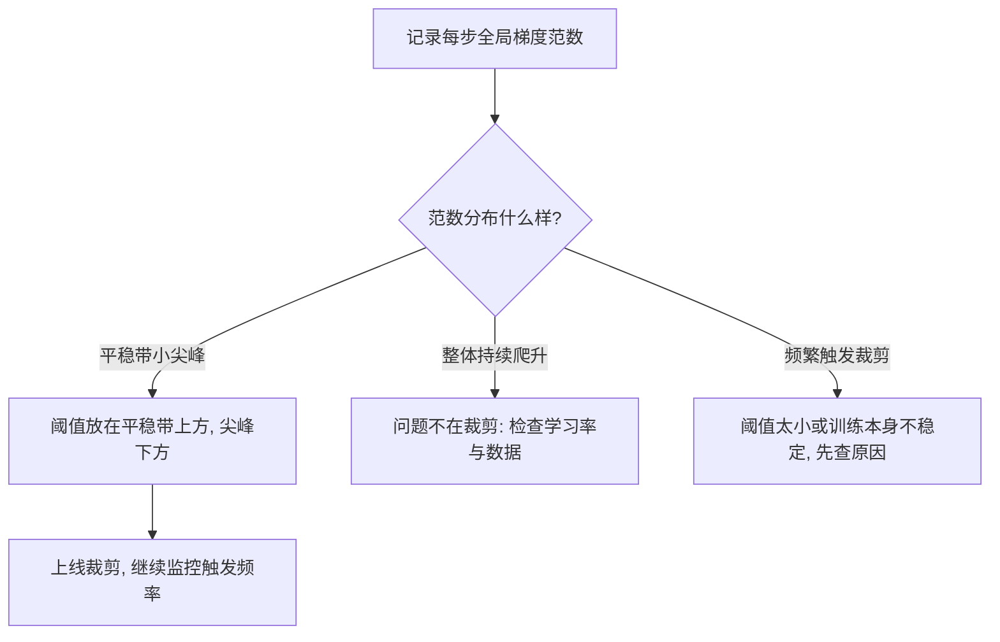

# 25｜梯度裁剪：为什么大梯度会炸掉训练？

> 阅读目标：理解训练中“梯度爆炸”到底是什么意思——不是梯度变大了一点，而是某一步的更新大到把参数推出原来的山谷；掌握全局范数裁剪（global norm clipping）的做法与公式，看清它“只缩短步长、不改变方向”这个关键性质；并分清裁剪能解决什么、掩盖什么。
>
> 前置知识：第 10 篇的交叉熵与 teacher forcing（损失对 logits 的梯度形式）、第 12 篇的 Adam（优化器如何把梯度变成更新）、第 13 篇的 warmup（训练初期为什么容易不稳定）、第 15 篇的混合精度训练（loss scaling 与裁剪的顺序有关）、第 23 篇的学习率调度（学习率与步长的关系）。本篇的结论分三类：**直觉**帮助理解、**严格推导**可以从公式直接算出、**需实验验证**依赖具体模型、数据和任务，不要把第三类当成定理。

## 1. 直觉：一步迈太大，比方向错了更危险

想象你在雾里下山，脚下的坡度就是梯度。正常情况下，坡度告诉你“往这边走一步”，步长由学习率决定。但有时候你会一脚踩空：脚下的地面突然变成悬崖，坡度在一步之内陡增几十倍。按原来的步长规则，你这一步会直接跨过整个山谷，落到对面更高的山坡上；下一步的坡度更大，再下一步迈得更远——这就是梯度爆炸的直观图像。

在神经网络里，这样的“悬崖”并不罕见，原因有几个：

- **一批坏数据**：某个 batch 里混进一条标注错误、数值异常或长度极端的样本，它的损失很大，梯度也很大，于是整批梯度的平均值被它带偏。
- **深层链式相乘**：梯度从输出层一路乘回输入层（第 06 篇的残差与第 16 篇的重算都绕不开这条链）。如果某一层在某一步的 Jacobian 谱范数远大于 1，梯度就会在反向传播中被逐层放大。
- **训练初期的不稳定**：参数还没进入合理区域时（第 13 篇讲过 warmup 要解决的正是这段时间），损失曲面本身就更陡峭、更不规则。

关键要先分清两个概念。**梯度大**本身不是问题：陡坡上梯度本来就大，沿着梯度走恰恰是下山的方向。真正的问题是**更新量大**：更新量等于学习率乘以梯度，一旦它超过了损失曲面“局部近似成立”的范围，这一步就不再是“沿着坡度下山”，而是“被弹射到一个完全未知的位置”。梯度裁剪针对的就是这一步：它不改变你往哪走，只限制你这一步最多走多远。

一个常见的类比是开车时的限速：限速不改变路线，只规定单步速度上限。正常行驶时你根本感觉不到限速的存在；只有超速的那一刻它才起作用。裁剪的阈值就是这条限速线。

## 2. 严格推导：全局范数裁剪只缩放步长，不改变方向

### 2.1 定义：先算全局范数，再决定要不要缩

设模型全部参数的梯度记为 $g$（把所有参数的梯度展平成一个长向量），它的全局范数（global norm）定义为：

```math
\|g\| = \sqrt{\sum_{i} \|g_i\|^2}
```

其中 $g_i$ 是第 $i$ 个参数张量的梯度，$\|g_i\|$ 是它自己的范数（通常取 L2 范数），求和遍历所有参数。注意：这是**所有参数合在一起**的一个数，不是每个参数各算各的。

给定阈值 $C > 0$（常取 $1.0$），裁剪后的梯度 $g'$ 定义为：

```math
g' = g \cdot \min\left(1, \frac{C}{\|g\|}\right)
```

分两种情况读这个公式：

- 若 $\|g\| \le C$，缩放因子为 1，$g' = g$，裁剪什么都不做；
- 若 $\|g\| > C$，缩放因子为 $C / \|g\| < 1$，$g'$ 是 $g$ 的等比例缩小版，且 $\|g'\| = C$ 恰好等于阈值。

**严格推导出的第一个结论：裁剪不改变梯度方向。** 因为 $g'$ 是 $g$ 乘上一个正标量，方向完全相同；改变的只是长度。这意味着裁剪不会把“往东走”变成“往西走”，它只回答“这一步走多远”。

**严格推导出的第二个结论：对 SGD，裁剪等价于给步长设上限。** SGD 的更新是 $\Delta\theta = -\eta g$（$\eta$ 为学习率）。裁剪后，更新量的范数满足：

```math
\|\Delta\theta\| = \eta \|g'\| \le \eta C
```

也就是说，无论原始梯度多大，单步更新的范数都不会超过 $\eta C$。这就是裁剪的全部保证——它是一个**步长上限**，不是损失上限，也不是“训练一定收敛”的保证。

### 2.2 数值示例：一个二维梯度，算给你看

假设某一步只有两个参数，梯度为 $g = (3, 4)$。它的范数是：

```math
\|g\| = \sqrt{3^2 + 4^2} = 5
```

取阈值 $C = 1$，缩放因子为 $1 / 5 = 0.2$，裁剪后：

```math
g' = (3 \times 0.2,\ 4 \times 0.2) = (0.6,\ 0.8), \qquad \|g'\| = 1
```

方向没变（$3:4$ 的比例还在），长度从 5 压到了 1。若学习率 $\eta = 0.1$，未裁剪的步长是 $0.1 \times 5 = 0.5$，裁剪后是 $0.1 \times 1 = 0.1$——整整缩小 5 倍。

再看一个“坏 batch”的情形。假设正常步骤的梯度范数在 $0.8$ 左右，某一步突然冒出一个范数为 $80$ 的梯度（100 倍）。不裁剪时，这一步的更新量是正常步骤的 100 倍，足以把参数推出当前山谷；取 $C = 1$ 裁剪后，这一步的更新量与正常步骤相当——方向仍然是那个坏 batch 指的方向（裁剪纠正不了方向错误），但至少它**只有一票的权重**，而不是一百票的权重。下一批正常数据还能把参数拉回来。这句话值得再读一遍：裁剪限制的是**单步破坏力**，不是单步正确性。

| 情形 | 原始范数 $\\|g\\|$ | 阈值 $C$ | 缩放因子 | 裁剪后范数 | 学习率 0.1 时的步长 |
|---|---|---|---|---|---|
| 正常步骤 | 0.8 | 1.0 | 1（不裁剪） | 0.8 | 0.08 |
| 二维例子 | 5 | 1.0 | 0.2 | 1.0 | 0.10 |
| 坏 batch | 80 | 1.0 | 0.0125 | 1.0 | 0.10 |

### 2.3 裁剪与 Adam 的关系：一个容易算错的细节

第 12 篇讲过，Adam 的更新大约是学习率乘以 $m / (\sqrt{v} + \epsilon)$，其中 $m$ 是一阶矩（梯度的滑动平均）、$v$ 是二阶矩（梯度平方的滑动平均）。这里有一个值得亲手验算的细节：

**如果把每一步的梯度都乘上同一个正数 $s$，Adam 的更新（忽略 $\epsilon$）几乎不变。** 因为 $m$ 会乘上 $s$，$v$ 会乘上 $s^2$，于是 $m / \sqrt{v}$ 中的 $s$ 约掉了。所以“对所有梯度统一缩放”对 Adam 近乎无效——裁剪对 Adam 起作用，恰恰是因为它**不是统一缩放**：它只压低那些超过阈值的异常步骤，而放过正常步骤。这样一来，异常梯度在 $m$ 和 $v$ 的滑动平均里占的权重被压低了，不会长期污染优化器的“记忆”。尤其是 $v$：梯度平方会把一次 100 倍的异常放大成 10000 倍记进 $v$ 里，之后很多步的学习率都会被这个被污染的 $v$ 压小；裁剪把异常发生的那一刻就掐住了。

由此得到一条实践规则：**裁剪要发生在优化器更新之前、作用在原始梯度上**，而不是先让 Adam 算出更新再去裁剪更新量。两者名字都叫“裁剪”，但裁剪的对象不同，效果也不同。主流框架的做法（例如 PyTorch 的 `clip_grad_norm_`）正是先算全局范数、再原地缩放全部参数的梯度，然后才交给优化器。

还有一个顺序问题，与第 15 篇的混合精度训练直接相关：用了 loss scaling 时，必须**先 unscale（除回缩放因子）再裁剪**。因为参与反向传播的是被放大过的梯度，直接对它算范数会得到一个虚高的数，裁剪阈值就失去了意义。顺序错了，裁剪等于没做——这是一个真实代码里常见的 bug。

### 2.4 一维悬崖算例：不裁剪三步就飞出去

上面都是“一公式、一结论”的静态计算，这里再跑一个动态的小例子，看裁剪如何改变整条轨迹。取一维损失 $L(\theta) = \theta^4 / 4$，它的梯度是 $g(\theta) = \theta^3$：离原点越远，梯度按立方增长——这正是“悬崖”的数学画像。学习率取 $\eta = 0.5$（故意取大，好让不稳定的行为在几步内现形），起点 $\theta_0 = 2.1$，裁剪阈值 $C = 1$。

**不裁剪的轨迹**：$\theta_0 = 2.1$ 时梯度 $g = 2.1^3 = 9.261$，一步更新 $0.5 \times 9.261 = 4.631$，$\theta_1 = 2.1 - 4.631 = -2.531$，已经越过原点落到对面；下一步梯度 $(-2.531)^3 \approx -16.204$，更新 $-8.102$，$\theta_2 \approx 5.572$；再下一步梯度 $5.572^3 \approx 172.9$，更新 $86.5$，$\theta_3 \approx -80.9$。三步之内，参数从 2.1 飞到了 -80.9，而且每一步的步长都在变大——这就是爆炸：梯度越大、步子越大、落点越远、下一步梯度更大，形成正反馈。

**裁剪后的轨迹**（阈值 $C = 1$，一维时范数就是绝对值）：$\theta_0 = 2.1$，梯度 9.261 超标，缩放到 1，步长 $0.5 \times 1 = 0.5$，$\theta_1 = 1.6$；梯度 $1.6^3 = 4.096$ 仍超标，步长还是 0.5，$\theta_2 = 1.1$；梯度 $1.1^3 = 1.331$ 仍超标，步长 0.5，$\theta_3 = 0.6$；梯度 $0.6^3 = 0.216$ 终于低于阈值，不再裁剪，步长 $0.5 \times 0.216 = 0.108$，$\theta_4 = 0.492$，此后平稳收敛向 0。

对照这两条轨迹，能看清裁剪在动态过程中的真实角色：它没有改变任何一步的方向（始终指向 $-\theta^3$ 的方向，即指向原点），也没有改变最终收敛点；它做的是**在梯度最大的悬崖区把步长钳制在 $\eta C$**，切断“步子越大、落点越远、梯度越大”的正反馈环。等参数回到平缓区，裁剪自动退出，训练恢复正常步长。这个例子里的学习率 0.5 是故意夸大的——真实训练里学习率远小于它，但同样的正反馈机制会在几十步、几百步的尺度上慢慢积累，最终表现为某天早上的 loss 曲线突然竖直向上。裁剪的价值，恰恰在于这种“平时看不见、出事时救命”的不对称性。

这里还要区分一个容易混淆的点：上面例子里不裁剪会发散，部分原因是学习率 0.5 本身就过大。裁剪**不能替代合理学习率**：如果学习率大到连平缓区的正常梯度都会震荡，裁剪只能把震荡幅度压到 $\eta C$，震荡本身还在。裁剪解决的是“梯度异常大”的问题，学习率解决的是“正常步长多大”的问题，两者各管一摊，不能互相顶替。

## 3. 实践：阈值怎么选，什么时候说明它在“救火”

### 3.1 选阈值：看范数曲线，而不是拍脑袋

阈值 $C$ 没有普适最优值，常见默认值是 $1.0$，但它必须结合你自己的梯度范数分布来判断。实用的做法是：先在不裁剪（或阈值设得很大）的前几百步里记录每步的全局范数，画出它的分布，再选一个落在“正常波动之上、异常尖峰之下”的值。



三条经验规则（**需实验验证**，不是定理）：

- **触发频率本身就是信号**：如果裁剪每几步就触发一次，说明训练本身处在不稳定区，阈值只是在替你兜底——这时应该优先检查学习率、warmup（第 13 篇）和数据，而不是把阈值越调越小。
- **阈值太小会拖慢训练**：阈值压得过低时，大量正常步骤也被等比缩小，等于变相调小了学习率（对 SGD 是直接的，对 Adam 是通过 $m$、$v$ 的相对权重间接的），收敛会变慢。
- **阈值太大等于没设**：如果阈值高于历史上出现过的最大范数，裁剪永远不会触发，等于白设。阈值必须低于“灾难性那一步”的范数才有意义。

除了直接取 1.0 这样的固定值，实践中还有两种定阈值的思路（均为**需实验验证**的经验做法）。一是**分位数法**：取训练平稳期范数分布的某个高分位数（例如 95 分位数）附近作为阈值，让裁剪只在分布的尾巴上触发；二是**按参数规模缩放**：不同模型、不同层数的梯度范数基线本身就不同，阈值照搬别人的配置未必合适，换了模型规模或 batch 大小后，范数分布值得重新测一遍再定阈值。无论用哪种方法，阈值都不是“一设永逸”的常数：训练阶段变了（例如从 warmup 进入平稳期、从预训练进入微调），范数分布也会变，阈值最好跟着复查一次。

最后区分一个名字相近但性质不同的操作：**按值裁剪**（把每个梯度元素单独截断到 $[-c, c]$ 区间内）与全局范数裁剪不是一回事。按值裁剪会改变梯度方向——因为它对每个分量各行其是，大分量被压、小分量不动，整体方向就转了；而且它对“范数大但每个分量都不大”的梯度（例如维度很高、每维分量都不起眼，加起来范数却很大）几乎不起作用。全局范数裁剪保持方向、控制整体步长，这正是大模型训练选择它的原因。看到代码里出现 clip 这个词时，先问一句：裁剪的是范数还是单个值？答案不同，数学保证也不同。

### 3.2 监控：把梯度范数当成仪表盘

比“设了裁剪”更重要的，是**把裁剪前后的范数都记下来**。两个数放在一起看，能讲出不同的故事：

- 裁剪前范数偶尔尖峰、裁剪后平稳：裁剪在正常工作，尖峰被压住了；
- 裁剪前范数持续爬升：模型可能正在滑向更陡峭的区域，裁剪只能延缓，不能阻止——第 23 篇的学习率衰减和第 13 篇的 warmup 才是更根本的手段；
- 某一步范数突然变成 NaN 或 inf：裁剪救不了，因为 NaN 乘以任何缩放因子还是 NaN。这时要查数值溢出（混合精度下尤其常见），而不是调阈值。

### 3.3 梯度累积与分布式：范数要在“完整梯度”上算

两个工程细节，顺序错了会悄悄改变裁剪的语义。第一是**梯度累积**：当显存放不下一个大 batch、改用多个 micro-batch 累积梯度时，裁剪应该作用在累积完成后的总梯度上，而不是每个 micro-batch 各裁剪一次。逐个 micro-batch 裁剪等于给每个小批量单独设上限，会改变不同 micro-batch 之间的相对权重——一个梯度大的 micro-batch 会被压低，而它在大 batch 里本应占的权重并没有变；累积完成后再裁剪一次，才能保证裁剪的是“这一步真正要用的梯度”。

第二是**分布式训练**：模型分片到多张卡上时，任何一张卡都只能看到自己那部分参数的梯度，局部范数不是全局范数。正确做法是各卡先算自己部分的平方和，再通过 all-reduce 求和开方，得到真正的全局范数，然后所有卡用**同一个**缩放因子裁剪各自的梯度。如果各卡按自己的局部范数各自裁剪，缩放因子各不相同，整体梯度方向就被改变了——这就退化成了第 4 节误区三里的逐参数裁剪，只是规模更大。单卡训练感觉不到这个问题，多卡训练里它是必须显式处理的一步。

### 3.4 裁剪的边界：它掩盖问题，也能暴露问题

裁剪最危险的一面，是它会**掩盖真正的问题**。一批标注错误的数据、一个写错符号的损失函数、一个过大的学习率，都可能表现为“梯度偶尔爆炸”，而裁剪会把这些症状压下去，让训练曲线看起来“还行”，问题却一直在水面下积累。正确的心态是：把裁剪当作安全带，而不是刹车片——安全带的作用是出事时保命，不是让你可以一直超速。每次裁剪频繁触发，都值得停下来问一句：这一步的梯度为什么这么大？

反过来，裁剪也是一种诊断工具：对比“裁剪触发的步骤”和“不触发的步骤”的数据，能帮你定位是哪类样本在制造尖峰。如果尖峰总是来自同一类样本，那问题在数据；如果尖峰随机出现，那问题更可能在优化设置。

## 4. 常见误区

**误区一：“裁剪能让梯度方向更正确。”**
错。裁剪是正标量缩放，方向纹丝不动。一个指向错误方向的大梯度，裁剪后仍然指向错误方向，只是走得没那么远。纠正方向靠数据和损失函数，不靠裁剪。

**误区二：“裁剪能解决梯度消失。”**
错。梯度消失是梯度太小、信号传不回去（第 06 篇的残差连接才是针对这个问题的结构解法之一）。裁剪只在范数**超过**阈值时起作用，对过小的梯度完全不理会。两个问题的方向正好相反。

**误区三：“每个参数单独裁剪和全局裁剪是一回事。”**
错。逐参数裁剪（每个张量各自按自己的范数裁剪）会改变不同参数之间的相对比例，从而改变整体梯度方向；全局裁剪用同一个缩放因子乘所有参数，方向不变。两者都叫 clipping，但数学性质不同，主流大模型训练用的是全局范数裁剪。

**误区四：“用了 Adam 就不需要裁剪。”**
不完全对。第 2.3 节算过，Adam 对统一缩放不敏感，但对**单步异常**敏感：一次巨大的梯度会污染 $v$ 的滑动平均，影响后续很多步。裁剪的价值正在于掐住这种单步异常。Adam 降低了裁剪的必要性，但没有取消它——尤其是在训练初期和混合精度场景下。

**误区五：“裁剪后训练就不会发散。”**
错。裁剪只保证单步更新量有上限，不保证更新方向是对的，也不保证损失会下降。如果学习率本身过大、数据有系统性错误，或者损失曲面存在裁剪也绕不过去的病态结构，训练照样可以发散。裁剪是必要的安全措施，不是充分的收敛保证。

## 5. 自测题

**1. 某步梯度 $g = (6, 8)$，阈值 $C = 2$，学习率 $\eta = 0.05$。裁剪后的梯度是多少？这一步的更新量范数是多少？**

答案：$\|g\| = \sqrt{36 + 64} = 10$，缩放因子 $2/10 = 0.2$，裁剪后 $g' = (1.2, 1.6)$，范数为 2；更新量范数为 $0.05 \times 2 = 0.1$。方向仍是 $3:4$，未变。

**2. 为什么说“裁剪对 Adam 的作用是选择性压低异常步骤”，而不是“缩小所有梯度”？**

答案：因为缩放因子是 $\min(1, C/\|g\|)$：范数不超过阈值的步骤因子为 1，完全不受影响；只有超标的步骤被缩小。又因为 Adam 的更新 $m/\sqrt{v}$ 对统一缩放近似不变，裁剪的真正效果来自这种“只压异常、不碰正常”的不对称性，它降低了异常梯度在 $m$、$v$ 滑动平均中的权重。

**3. 混合精度训练中，为什么必须先 unscale 再裁剪？如果顺序反了，会发生什么？**

答案：loss scaling 把损失乘大 $s$ 倍再反向传播，得到的梯度也整体大了 $s$ 倍。直接对它算范数会得到虚高的值：要么裁剪被过度触发（正常步骤也被压小），要么阈值相对失真。先除回 $s$ 得到真实梯度，再算范数、再裁剪，阈值才有意义。

**4. 训练中裁剪几乎每步都触发，loss 下降也很慢。你应该先调阈值，还是先查别的？为什么？**

答案：先查别的。频繁触发说明训练本身不稳定或阈值相对正常范数太小：优先检查学习率是否过大、warmup 是否充分、数据里是否有异常样本。只把阈值调小等于把学习率变相调小，会进一步拖慢收敛；而只把阈值调大则放任了异常步骤。阈值要放在“正常波动之上、异常尖峰之下”，这个位置只能从实测的范数分布里找，不能凭感觉定。

下一篇预告：26｜位置外推：训练短、推理长时为什么会崩？
