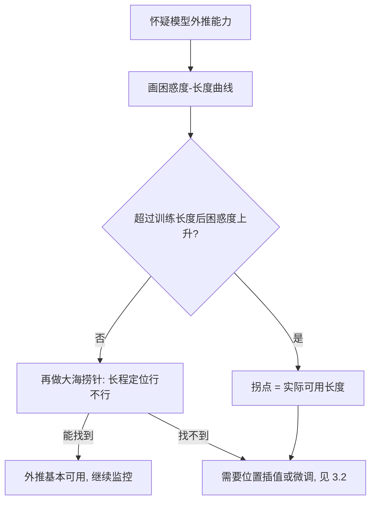

# 26｜位置外推：训练短、推理长时为什么会崩？

> 阅读目标：理解"长度外推"（length extrapolation）失败的三个数学原因——softmax 的分母随序列长度增长、RoPE 的相对旋转角超出训练范围、绝对位置向量从未被训练过；会算"要把注意力集中到某一个 token 上，logit 需要领先多少"这个关键数字；并分清位置插值等缓解方法在修什么、没修什么。
>
> 前置知识：第 01 篇的正余弦位置编码（位置信息如何进入 Q、K）、第 02 篇的缩放点积注意力（softmax 与 $\sqrt{d_k}$ 缩放）、第 05 篇的 RoPE（相对位移如何进入打分）、第 08 篇的 KV Cache（推理时序列是逐词变长的）。本篇的结论分三类：**直觉**帮助理解、**严格推导**可以从公式直接算出、**需实验验证**依赖具体模型、数据和任务，不要把第三类当成定理。

## 1. 直觉：模型学会的是"在 4k 内找答案"，不是"找答案"

想象你只在 400 米的跑道上练过跑步，比赛突然改到 3000 米。你的跑姿、配速、体力分配，全是按 400 米练出来的——不是说你跑不到 3000 米，而是超过 400 米之后，每一步都落在你从未练过的区间里。

Transformer 的训练长度就是这条"跑道"。假设模型在最长 4096 个 token 的文本上训练，那么：

- 它见过的相对距离 $\Delta = |m - n|$ 最大是 4095，从没见过 $\Delta = 20000$ 时两个 token 该怎么互动；
- 它见过的位置编号最大是 4095，从没见过位置 20000 对应的位置向量；
- 它见过的 softmax 分母最多是 4096 项求和，从没在 32768 项的分母里分过注意力。

推理时把 32768 个 token 塞进来，模型不是"拒绝工作"，而是**在三个从未训练过的输入区间里同时做外推**。外推失败不一定表现为立刻崩坏——更常见的症状是：开头几百个 token 还行，越往后越答非所问；或者整段读起来流畅，但关键信息（比如藏在中间的某个数字）找不到了。

这里要先分清两个词。**长上下文支持**（long-context support）指的是模型在训练或微调中确实见过那么长的序列；**长度外推**（length extrapolation）指的是模型只在短序列上训练，却要在长序列上推理。本篇讲的是后者——一个纯粹的"没见过"的问题，而不是"见过但学不好"的问题。

外推失败的症状通常按严重程度分三层，越往下越严重：第一层是**困惑度缓慢上升**——模型还能读、还能生成，但每个词的预测都比在短文本上差一点；第二层是**长程检索失效**——局部语言依然流畅，但藏在几万 token 之前的信息找不到了，问它就开始编造；第三层是**生成彻底失控**——注意力权重乱成一团，输出重复、跑题甚至乱码。很多模型在第一层和第二层之间能撑很久，所以"能跑 32k"和"能用好 32k"之间，隔着一道需要实测才能看清的鸿沟。

## 2. 严格推导：三处数学上必然出问题的地方

### 2.1 注意力稀释：softmax 的分母随 N 增长

先看一个与位置编码完全无关的问题：序列变长本身就会稀释注意力。

第 02 篇讲过，某个 query 对 $N$ 个 key 的注意力权重是 softmax：

```math
\alpha_i = \frac{e^{s_i}}{\sum_{j=1}^{N} e^{s_j}}, \qquad s_i = \frac{q \cdot k_i}{\sqrt{d_k}}
```

分母是 $N$ 项求和。假设所有 logit 都相等（最均匀的情况），每个权重都是 $1/N$，注意力分布的熵是：

```math
H = -\sum_{i=1}^{N} \frac{1}{N} \log \frac{1}{N} = \log N
```

$N$ 从 512 涨到 32768，$\log N$ 从 6.24 涨到 10.40（自然对数）。熵本身不是问题，问题在下面这个反问：如果模型想把一半以上的注意力集中到**某一个** token 上，它的 logit 需要比其他 token 领先多少？

设目标 token 的 logit 为 $s_t$，其余 $N-1$ 个都是 $s$，要让 $\alpha_t \ge 1/2$：

```math
\frac{e^{s_t}}{e^{s_t} + (N-1)e^{s}} \ge \frac{1}{2}
\iff e^{s_t - s} \ge N - 1
\iff s_t - s \ge \log(N-1)
```

也就是说，**所需领先量随 $\log N$ 增长**。而第 02 篇算过：$q \cdot k / \sqrt{d_k}$ 在 $q$、$k$ 分量近似标准正态时，标准差约为 1——典型 logit 之间的差距是 $O(1)$ 量级。训练长度 512 时，领先 6.24 已经是 6 个标准差；推理长度 32768 时，需要领先 10.40，接近 10 个标准差。模型在训练中从不需要制造这么大的 logit 差距，推理时也制造不出来——于是那个本该被"盯住"的关键 token，只能分到被 $N$ 稀释后的一小份注意力。

**严格推导出的结论：** 序列变长时，注意力被稀释不是模型的"失误"，而是 softmax 归一化的数学必然；要对抗稀释，logit 差距必须按 $\log N$ 的速度长大，而典型 logit 的尺度是 $O(1)$。这就是为什么"开头能答对、中间找不着"是最常见的外推症状：局部窗口内 $N$ 小、稀释轻，模型表现正常；全序列 $N$ 大，关键 token 的权重被分母淹没。

### 2.2 RoPE：相对位移超出训练范围，旋转角是没见过的组合

第 05 篇推过 RoPE 的核心恒等式：位置 $m$ 的 query 与位置 $n$ 的 key 打分，只依赖相对位移 $\Delta = m - n$。对第 $j$ 个二维子空间（共 $d/2$ 个），旋转角是 $\Delta \cdot \theta_j$，其中：

```math
\theta_j = \text{base}^{-2j/d}, \qquad j = 0, 1, \dots, d/2 - 1
```

打分展开后，每对维度的贡献是：

```math
\cos(\Delta\theta_j)\,(q_{2j}k_{2j} + q_{2j+1}k_{2j+1}) + \sin(\Delta\theta_j)\,(q_{2j+1}k_{2j} - q_{2j}k_{2j+1})
```

"只依赖相对位移"这个性质本身没错，但它**不保证任意 $\Delta$ 下的打分都合理**。原因藏在 $\theta_j$ 的取值范围里。取 $d = 64$、$\text{base} = 10000$：

- 最快的一维（$j = 0$）：$\theta_0 = 1$，每个位置转 1 弧度；
- 最慢的一维（$j = 31$）：$\theta_{31} = 10000^{-31/32} \approx 1.33 \times 10^{-4}$，每个位置只转约 $0.000133$ 弧度。

假设训练长度是 512，推理长度拉到 4096，对比最慢那一维的旋转角：

| 相对位移 $\Delta$ | 最快维 $\Delta\theta_0$ | 最慢维 $\Delta\theta_{31}$ |
|---|---|---|
| 512（训练见过） | $512 \bmod 2\pi \approx 3.06$ rad | $512 \times 1.33\times10^{-4} \approx 0.068$ rad |
| 4096（推理） | $4096 \bmod 2\pi \approx 5.65$ rad | $4096 \times 1.33\times10^{-4} \approx 0.546$ rad |
| 32768（推理） | $32768 \bmod 2\pi \approx 5.75$ rad | $32768 \times 1.33\times10^{-4} \approx 4.37$ rad |

（验算：$2\pi \approx 6.283$；$512 / 6.283 \approx 81.49$ 圈，余 $0.49 \times 6.283 \approx 3.06$；$4096 / 6.283 \approx 651.90$ 圈，余 $0.90 \times 6.283 \approx 5.65$。）

读这张表要抓住两点。第一，**最快维在训练时就已经转了很多圈**：$\Delta = 512$ 时它转了 81 圈，模型早就学会了"角度取模后"的高频模式，单看它不容易区分"训练内"和"训练外"。第二，**最慢维才是距离的刻度尺**：它转得慢，旋转角近似正比于距离，模型靠它感知"有多远"。训练时它最大只转到 0.068 弧度，推理到 4096 时要转 0.546（8 倍），到 32768 时转 4.37（64 倍）——这是一个训练中从未出现过的角度区间。模型对"相隔 32768 个 token 的两个词"的打分，用的是一组它从未优化过的 $\cos$、$\sin$ 取值。

还有一个配套性质：第 05 篇提到的 RoPE 长程衰减——随着 $\Delta$ 变大，不同频率的 $\cos(\Delta\theta_j)$ 项逐渐失相、相互抵消，query 与 key 的内积期望幅度随距离衰减。这个衰减在训练长度内是模型学会的"远距离 token 不重要"的先验；一旦外推到更远的 $\Delta$，衰减会继续走下去，远处 token 的打分被压得更低。**直觉上**，这解释了为什么外推失败时模型常常表现为"只看附近、看不见远处"：近处的高频模式还在训练分布内，远处的信号在数学上就被衰减掉了。

下面用一个四维小例子把"震荡 + 失相"算给你看。取 $d = 4$，只有两对维度：$\theta_0 = 1$，$\theta_1 = 10000^{-2/4} = 0.01$。设 $q = k = (1, 0, 1, 0)$，按 2.2 节的展开式，未缩放的打分是：

```math
s(\Delta) = \cos(\Delta \cdot 1) + \cos(\Delta \cdot 0.01)
```

- $\Delta = 0$：$s = 1 + 1 = 2$，自己与自己的打分最高；
- $\Delta = 512$：$\cos(512) \approx \cos(3.06) \approx -1.00$，$\cos(5.12) \approx 0.40$，$s \approx -0.60$；
- $\Delta = 4096$：$\cos(4096) \approx \cos(5.65) \approx 0.81$，$\cos(40.96) \approx -0.99$，$s \approx -0.19$。

（角度取模验算：$512 \bmod 2\pi \approx 3.06$，$4096 \bmod 2\pi \approx 5.65$；$40.96 \bmod 2\pi \approx 3.26$，$\cos(3.26) \approx -0.99$。）

看这个结果：打分从 2 跌到 $-0.60$、再到 $-0.19$，不是单调下降，而是**震荡中走低**——快维的 $\cos(\Delta)$ 在 $+1$ 与 $-1$ 之间来回翻，慢维的 $\cos(0.01\Delta)$ 则从 1 慢慢滑向 $-1$，把总分往下拉。真实模型的 $q$、$k$ 是几千维、内容相关的向量，单对维度的震荡会被平均掉一部分，但"高频震荡、低频漂移"这个结构不变：**距离越远，打分越多地由训练中没见过的角度组合决定**。这也是为什么 RoPE 的外推失败常常表现为"远距离的注意力权重变得随机、忽高忽低"，而不是整齐地衰减到零。

### 2.3 绝对位置编码：没见过的位置向量，本身就是未训练参数

RoPE 是相对位置编码，问题出在"没见过的相对距离"；绝对位置编码的问题更直接：**没见过的位置编号，对应的是没见过的向量**。

- **可学习位置编码**（如 GPT-2 的做法）：位置 $p$ 对应一个可训练向量 $e_p$。训练长度 4096 意味着 $e_0, \dots, e_{4095}$ 被梯度更新过，而 $e_{4096}$ 往后在整个训练中一次梯度都没收到，停留在随机初始化的状态。推理时位置 20000 的 token 带着一个随机向量参与计算——它的 Q、K 里混进了一段纯噪声。
- **正余弦位置编码**（第 01 篇）：位置 $p$ 的向量由公式定义，任何 $p$ 都能算出来，不存在"未训练参数"。但这不等于能外推：模型见过的只是 $p \le 4095$ 时各频率分量的组合模式；$p = 20000$ 时，快维转了很多圈、慢维转到新角度，整条位置向量的相位组合是训练中从未出现过的输入。公式能算出向量，不等于模型见过这个向量。

**严格推导出的结论：** 无论哪种绝对位置编码，外推失败的根源都是同一个——推理时的位置输入落在训练分布之外。可学习编码是"参数没被训练过"，正余弦编码是"相位组合没被见过"。两者都是分布外输入，只是坏的环节不同。

### 2.4 数值示例：从 512 到 32768，三处问题同时变严重

把 2.1–2.3 的数字放在一张表里，假设训练长度 512、推理拉到 32768：

| 推理长度 $N$ | 均匀注意力熵 $\log N$ | 单 token 占一半权重所需 logit 领先 $\log(N-1)$ | 最慢 RoPE 维在 $\Delta = N$ 时的旋转角 |
|---|---|---|---|
| 512（训练长度） | 6.24 | 6.24 | 0.068 rad |
| 4096 | 8.32 | 8.32 | 0.546 rad |
| 32768 | 10.40 | 10.40 | 4.37 rad |

三列同时在恶化：要领先的 logit 从 6.24 涨到 10.40，而 logit 的典型尺度还是 $O(1)$；最慢维的旋转角从 0.068 涨到 4.37，超出训练区间 64 倍。**这就是外推难的完整画像：不是某一个环节坏了，而是分母、角度、位置向量三个分布外问题同时出现**，互相放大。只修其中一个（比如只做位置插值），另外两个还在。

## 3. 实践：怎么测外推，怎么缓解

### 3.1 先测：困惑度曲线与"大海捞针"

判断一个模型能不能外推，不能只看它"在长文本上跑不报错"。两个常用的测法（均为**需实验验证**的经验做法，结论依赖具体模型）：

- **困惑度随长度曲线**：取一段长文本，在 1k、2k、4k、8k、16k……处截断，分别算困惑度。健康的模型困惑度随长度缓慢下降（更多上下文应该帮它预测得更好）；外推失败的模型会在超过训练长度后困惑度掉头上升。曲线的拐点位置，就是该模型实际能撑到的长度。
- **大海捞针**（needle in a haystack）：把一句关键信息（比如"密码是 84712"）藏在几万 token 的无关文本中间的不同深度，再问模型密码是多少。困惑度是 token 级平均分，会被局部流畅性掩盖；捞针测的是**长程定位能力**——模型能不能在 $N$ 个 token 里把权重集中到那一个 needle 上。这正是 2.1 节算过的 $\log(N-1)$ 差距要解决的问题。



### 3.2 缓解：位置插值把"没见过的距离"映射回"见过的距离"

既然问题出在"推理距离超出训练区间"，最直接的想法是：**把推理时的位置编号按比例压缩回训练区间**。这就是位置插值（Position Interpolation，PI，Chen et al., 2023）。

设训练长度 $L_{\text{train}}$，推理长度 $L_{\text{test}}$，缩放因子 $s = L_{\text{test}} / L_{\text{train}}$。PI 把位置 $m$ 映射为：

```math
m' = m / s
```

$s = 8$ 时，推理位置 32768 被映射到 4096，恰好落在训练区间内；所有相对位移也被同步压缩 8 倍，RoPE 的旋转角回到见过的范围。这个方法不需要重新训练，推理时直接改位置编号就能用——**需实验验证**的经验是，它通常能把可用长度撑大几倍，但困惑度会比同长度下原生训练的模型略高。

PI 有一个副作用值得亲手算一算：相邻 token 的旋转角差也被压缩为原来的 $1/s$。原来相邻两个位置在最快维上差 1 弧度，插值后只差 $1/8 = 0.125$ 弧度——模型对"近距离"的刻度变粗了。NTK-aware 缩放（bloc97 等人提出，2023）正是针对这一点：它不直接压缩位置，而是放大 RoPE 的 base：

```math
\text{base}' = \text{base} \cdot s^{d/(d-2)}
```

取 $d = 128$、$s = 8$：指数 $128/126 \approx 1.016$，$\text{base}' \approx 10000 \times 8^{1.016} \approx 8.3 \times 10^4$。放大 base 会让所有频率 $\theta_j = \text{base}^{-2j/d}$ 变小，但变小的程度随 $j$ 不同：高频（$j$ 小）几乎不动，低频（$j$ 大）被压得最多。**直觉上**，这相当于"只拉伸负责远距离的慢维，尽量不动负责近距离精细区分的快维"——既把大位移映射回见过的角度，又保住了相邻 token 的位置分辨率。YaRN（Peng et al., 2023）在此基础上再加两项：按频率分段的插值比例，以及对注意力 logits 的温度修正（针对 2.1 节的稀释问题，推理时给 logits 乘一个大于 1 的系数，帮模型把权重重新集中起来）。这三者都是**需实验验证**的工程方法：它们在不少开源模型上被证实有效，但"撑大几倍、损失多少"依赖具体模型和任务，没有普适保证。

### 3.3 另一条路：干脆不让注意力看到那么远

如果外推的数学根源是"分母太大、距离太远"，另一类做法是直接限制注意力范围：

- **滑动窗口注意力**（Sliding Window Attention）：每个 token 只看邻近的 $W$ 个 token（比如 4096），窗口之外的一律不看。推理长度可以任意长，因为每个 query 面对的分母永远不超过 $W$ 项、相对位移永远不超过 $W$。代价是模型彻底放弃了超长程依赖——藏在 20000 个 token 之外的 needle，它永远看不见。
- **分层/稀疏注意力**：只在少数层用全局注意力，其余层用窗口或稀疏模式。计算量下来了，但"哪几层该全局"本身就是一个需要实验调的结构选择。

这两条路的取舍很清晰：**位置插值是"让模型假装序列没那么长"，滑动窗口是"让模型真的只看那么长"**。前者保留了长程定位的可能性（代价是刻度失真），后者彻底放弃长程定位（换来稳定和便宜）。选哪个，取决于你的任务到底需不需要跨几万 token 的定位——这是任务决定的，不是方法决定的。

### 3.4 最彻底的办法：微调，把外推变回内插

前面三节的方法都不动权重；如果愿意付出训练成本，还有一条最彻底的路：**拿长文本做一次继续训练（continued pretraining），把推理长度变成训练长度**。一旦模型在 32k 的文本上训练过，32k 就不再是外推，而是内插——2.1–2.3 节的三个问题同时消失，因为分母、角度、位置向量都重新落回了训练分布。

实际操作里，这条路常和位置插值一起用：先用 PI 把位置映射回训练区间，再用少量长文本微调，让模型在新长度上重新校准打分的尺度。**需实验验证**的经验是：微调数据不需要太多（几亿到几十亿 token 的量级就能见效），但数据质量很关键——长文本必须真的包含跨越几万 token 的依赖关系（比如一本书里前后呼应的情节、一份财报里前后对照的数字），如果只是把短文本拼成长文本，模型学不到长程定位，微调等于白做。代价除了算力，还有遗忘风险：长文本微调可能轻微损害模型在短文本上的表现，实践中常混入一部分短文本一起训练来对冲。

所以四种缓解手段的排序，按"改动成本从小到大"是：位置插值（零训练）→ NTK/YaRN（零训练、公式更精细）→ 滑动窗口（改结构、零训练）→ 长文本微调（要训练、最彻底）。没有哪一种是"标准答案"，只有"在你的长度、任务和预算下，哪一种的性价比最高"。

## 4. 常见误区

**误区一："RoPE 只依赖相对位移，所以天然能外推。"**
错。相对位移性质说的是打分只依赖 $\Delta$，这是一个数学恒等式；外推要求的是**所有 $\Delta$ 下的打分都合理**。超出训练范围的 $\Delta$ 对应的旋转角组合从未被优化过，恒等式成立不等于数值合理。2.2 节的表就是反例：最慢维在 $\Delta = 32768$ 时转 4.37 弧度，训练时最多只见过 0.068。

**误区二："把训练长度拉长就一劳永逸。"**
错。训练长度翻倍，注意力计算量按 $O(N^2)$ 翻 4 倍，KV Cache 内存也翻倍；而且新长度之上还有更长，外推问题只是被平移到新的边界。真正的问题不是"长度不够长"，而是"推理长度总可能超过训练长度"——这是一个结构性问题，不是一次性能修完的参数。

**误区三："困惑度没涨，就是能处理长文。"**
错。困惑度是所有 token 的平均损失，局部流畅就能把它压低；模型可能在每句话内部都预测得很好，却完全找不到 20000 个 token 之前的那条关键信息。困惑度曲线是必要检查，不是充分检查；长程定位要用大海捞针这类检索任务单独测。

**误区四："注意力分数变小，就是模型变差了。"**
不完全对。softmax 归一化下，单个 token 的权重随 $N$ 变大而变小是数学必然（2.1 节），即使模型完全正确也会这样。真正要看的是**相对排序和差距**：目标 token 的权重是不是仍然显著高于其他 token，以及它需要的 $\log(N-1)$ 领先量模型能不能给出来。只看绝对权重会误判。

**误区五："位置插值只是把坐标压缩，等于没训练也能白嫖长上下文。"**
部分错。PI 确实零训练成本，但它改变了模型对距离的刻度（相邻位置的旋转角差被压缩为 $1/s$），也改变了 2.1 节的稀释格局——插值修的是"角度超出范围"，不修"分母变大"。能撑大几倍、损失多少精度，都是要实测的，没有"白嫖"这回事。

## 5. 自测题

**1. 训练长度 2048，推理长度也是 2048。均匀注意力的熵是多少？若想让某个 token 独占一半权重，它的 logit 需要比其他 token 领先多少？**

答案：熵 $\log 2048 \approx 7.62$；所需领先 $\log(2048 - 1) = \log 2047 \approx 7.62$。两者数值几乎相等不是巧合：均匀分布的熵和"单点占一半"的领先量都由 $\log N$ 控制。

**2. $d = 64$、$\text{base} = 10000$ 的 RoPE，最慢频率维在相对位移 $\Delta = 8192$ 时旋转多少弧度？若训练长度是 1024，该维在训练中最多见过多少弧度？**

答案：$\theta_{31} = 10000^{-31/32} \approx 1.33 \times 10^{-4}$；$\Delta = 8192$ 时旋转 $8192 \times 1.33 \times 10^{-4} \approx 1.09$ 弧度；训练最大位移 1024 对应 $1024 \times 1.33 \times 10^{-4} \approx 0.137$ 弧度。推理角度是训练最大值的约 8 倍，落在未见过的区间。

**3. 为什么说"RoPE 有相对位移性质"和"RoPE 能外推"是两回事？**

答案：前者是打分只依赖 $\Delta = m - n$ 的数学恒等式，对任意 $\Delta$ 都成立；后者要求模型在所有 $\Delta$ 下给出的打分都合理，而超出训练范围的 $\Delta$ 对应的 $\cos(\Delta\theta_j)$、$\sin(\Delta\theta_j)$ 组合从未参与过训练。恒等式保证的是"形式上只看相对距离"，不是"数值上处处合理"。

**4. 位置插值把 32k 压缩回 4k 区间后，模型对"相邻两个 token 的距离"的感知发生了什么变化？为什么 NTK-aware 要区别对待高频和低频？**

答案：相邻位置的旋转角差被压缩为原来的 $1/s$（$s = 8$ 时从 1 弧度变成 0.125 弧度），近距离的刻度变粗了。NTK-aware 放大 base 时，高频（$j$ 小）几乎不动、低频（$j$ 大）被压得最多：高频负责近距离的精细区分，动它会损害局部位置感；低频负责远距离的刻度，拉伸它才能把大位移映射回见过的角度。分开处理是为了"修远处、不伤近处"。

下一篇预告：27｜注意力 sink：为什么开头几个 token 总吸走注意力？
