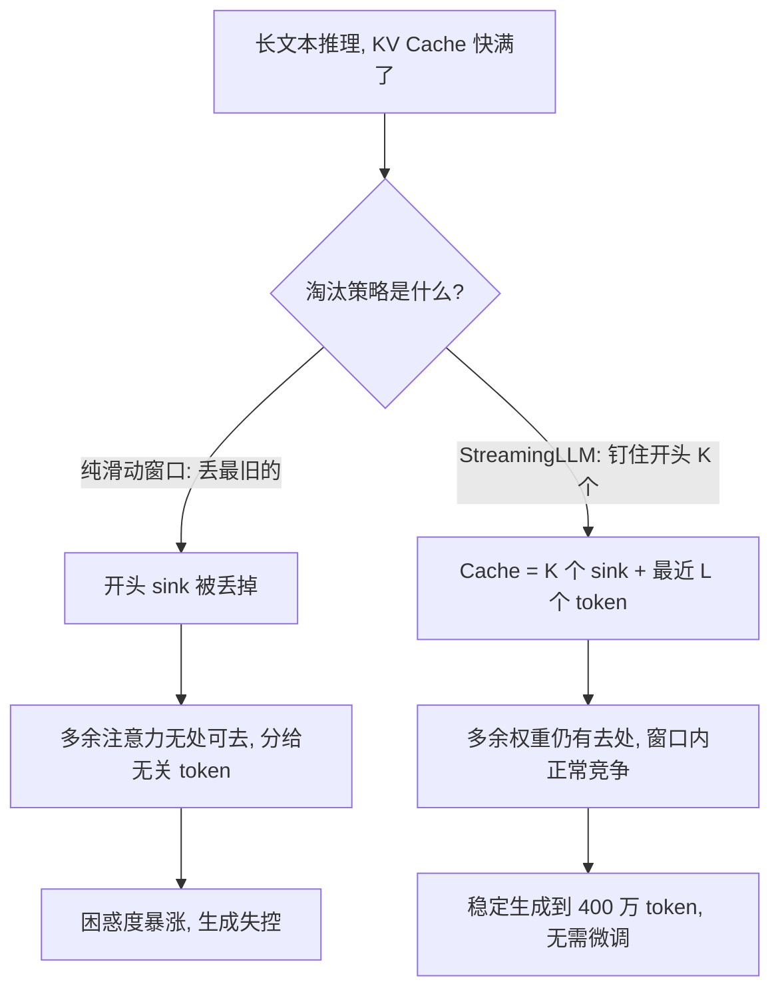

# 27｜注意力 sink：为什么开头几个 token 总吸走注意力？

> 阅读目标：理解"注意力 sink"（attention sink）是什么——为什么训练好的因果语言模型会把 30% 甚至更多的注意力权重固定分给开头几个 token，哪怕它们几乎没有语义内容；会算"一个 token 要拿走 30% 的注意力，logit 需要领先多少"；并明白为什么滑动窗口注意力一旦丢掉开头 token 就会崩，以及 StreamingLLM 如何用"留住开头 4 个 token + 滑动窗口"让模型稳定跑到 400 万 token。
>
> 前置知识：第 02 篇的缩放点积注意力（softmax 与 $\sqrt{d_k}$ 缩放、logit 的 $O(1)$ 尺度）、第 04 篇的因果 mask（为什么位置 0 对所有 query 可见）、第 08 篇的 KV Cache（推理时 K、V 被缓存、淘汰策略决定了哪些 token 还能被看到）、第 26 篇的位置外推（滑动窗口是缓解外推的手段之一）。本篇的结论分三类：**直觉**帮助理解、**严格推导**可以从公式直接算出、**需实验验证**依赖具体模型、数据和任务，不要把第三类当成定理。

## 1. 直觉：注意力是一笔必须花出去的预算

想象你在开会，规则是：每次发言，你必须把 100 分的"关注度"全部分给在场的人，一分都不能剩。大部分时候你知道该听谁——分给正在汇报的人 70 分，其他人分剩下的 30 分。但偶尔全场都在说废话，谁都不值得听，你仍然必须把 100 分分出去。这时你会怎么办？你会找一个"安全的人"——比如坐在门口、从不插话的那位——把多余的分数都倒给他，因为分给他不会影响任何决策。

Transformer 的注意力就是这个会议。softmax 有一条铁律：权重之和必须等于 1。

```math
\sum_{i=1}^{N} \alpha_i = 1, \qquad \alpha_i = \frac{e^{s_i}}{\sum_{j=1}^{N} e^{s_j}}
```

一个 query 找不到任何值得关注的 key 时，它不能"谁都不看"——它必须把 100% 的权重分出去。模型在训练中学会的解法是：**指定一个固定的"垃圾桶"，把无处安放的注意力倒进去**。这个垃圾桶就是序列开头的几个 token，人们叫它注意力 sink（attention sink）。

为什么偏偏是开头？第 04 篇讲过因果 mask：位置 0 的 token 对序列里**每一个** query 都可见，而位置 $k$ 的 token 只对它之后的 $N - k$ 个 query 可见。开头 token 是全场唯一"人人都能看见"的位置，也是每个训练序列都稳定存在的位置（通常是 BOS 或第一个词）。一个固定、可达、总在场的目标，是当垃圾桶的最佳人选——模型不需要靠内容去认它，靠位置就能找到它。

所以 sink 的第一层含义是：**注意力权重高，不等于语义重要**。开头那个 token 拿走 30% 甚至 50% 的权重，不是因为它在说重要的事，而是因为别的 token 在这个 query 面前都不值得看，而权重又必须有个去处。

如果你把某一层某个 head 的注意力矩阵画出来——横轴是 key 的位置、纵轴是 query 的位置——会看到开头几列特别亮：一条竖直的亮带从矩阵顶部一直延伸到底部，几乎每个 query 都在往那几列送权重。而矩阵其余部分则呈现出沿对角线的局部模式（附近的 token 互相注意）加上少数几个亮点（真正语义相关的远距离 token）。这条亮带就是 sink 在 attention map 上的样子：它不随 query 的内容移动，不随层数消失，在很多 head、很多层里同时出现。第一次看到这张图的人常常以为模型在"读开头"——其实它是在"倒垃圾"。

## 2. 严格推导：softmax 的归一化如何制造"垃圾桶"

### 2.1 "什么都不看"在数学上是不可能的

先把"不想看任何人"这件事算清楚。假设某个 query 对 $N$ 个 key 的 logit 全部相等（$s_i = s$），softmax 给出均匀分布：

```math
\alpha_i = \frac{e^{s}}{N e^{s}} = \frac{1}{N}
```

$N = 4096$ 时，每个 token 只拿 $1/4096 \approx 0.024\%$。均匀分配看起来"谁都没看"，但输出是所有 value 向量的平均——$N$ 个 token 的噪声全被平均进来，输出被拉向一个与当前 query 无关的均值。这不是"不看"，这是"把所有人都看了一点"，代价是输出被噪声污染。

模型真正想要的，是让**不相关的 token 的权重趋近于 0**。但 softmax 的权重是指数归一化的：要让某个 token 的权重变小，必须让另一个 token 的权重变大——总和永远是 1。于是问题变成：多余的权重交给谁，才能对输出的伤害最小？答案是一个 value 向量本身很小的 token：权重再大，乘上一个很小的 value，对输出的贡献仍然很小。**严格推导出的结论：** softmax 的求和约束 + 输出是权重的线性组合，这两个结构合起来，注定了模型需要一个"高权重、低影响"的倾倒点；sink 不是训练的副产品，而是这个结构下最优的解法之一。

### 2.2 sink 要拿走 30% 的注意力，logit 需要领先多少

设 sink token（位置 0）的 logit 为 $s_0$，其余 $N - 1$ 个 token 的 logit 全是 $s$，领先量 $\Delta = s_0 - s$。sink 的权重是：

```math
\alpha_0 = \frac{e^{s_0}}{e^{s_0} + (N-1)e^{s}} = \frac{e^{\Delta}}{e^{\Delta} + N - 1}
```

反解出领先量：

```math
\Delta = \log\frac{\alpha_0 (N-1)}{1 - \alpha_0}
```

取几个数（验算：$\alpha_0 = 0.3$、$N = 100$ 时，$e^{\Delta} = 0.3 \times 99 / 0.7 \approx 42.4$，$\Delta \approx 3.75$）：

| 序列长度 $N$ | sink 权重 $\alpha_0 = 0.3$ 所需 $\Delta$ | sink 权重 $\alpha_0 = 0.5$ 所需 $\Delta$ |
|---|---|---|
| 100 | 3.75 | 4.60 |
| 1000 | 6.06 | 6.91 |
| 4096 | 7.47 | 8.32 |

对照第 02 篇的结论：$q \cdot k / \sqrt{d_k}$ 在 $q$、$k$ 分量近似标准正态时，标准差约为 1——典型 logit 之间的差距是 $O(1)$ 量级。而 sink 需要的领先量是 4 到 8，相当于 4 到 8 个标准差。**严格推导出的结论：** sink 的 logit 领先量随 $\log N$ 增长；一个内容 token 几乎不可能靠语义相关性稳定地造出这么大的差距——但 sink 可以，因为它是一个**固定的、被反复训练的目标**：模型可以在 key 空间里专门留一个方向给它，每一步梯度都在加固这个方向。第 26 篇算过同样的 $\log(N-1)$ 领先量，那里它是内容 token 够不着的天花板；这里它恰恰是 sink 能稳定存在的理由——天花板只对"靠内容竞争"的 token 存在，对"靠位置垄断"的 sink 不存在。

### 2.3 为什么 sink 是"无害"的：权重高不等于影响大

注意力层的输出是权重的加权和：

```math
o = \sum_{i=1}^{N} \alpha_i v_i = \alpha_0 v_0 + \sum_{i \ge 1} \alpha_i v_i
```

只看 $\alpha_0$ 会吓一跳：开头 token 拿了 30% 甚至 50%。但真正决定输出的是 $\alpha_0 v_0$ 这一项——权重乘以 value 向量。一个常见的实测现象是（**需实验验证**，不同模型程度不同）：sink token 的 value 向量范数明显偏小。下面用一个具体数字把"权重高、影响小"算给你看。

设 $N = 100$，sink 的 logit 领先 $\Delta = 4.0$，其余 token 的 logit 全为 0：

- $e^{4.0} \approx 54.6$，$\alpha_0 = 54.6 / (54.6 + 99) \approx 0.355$——sink 拿走 35.5% 的注意力；
- 其余 99 个 token 平分剩下的 64.5%，每个约 0.65%；
- 若 $\|v_0\|$ 只有典型 value 向量范数的 0.2 倍，则 sink 对输出的贡献幅度约为 $0.355 \times 0.2 \approx 0.071$，即**只相当于 7% 个典型 token 的影响**。

35.5% 的权重，7% 的影响——这就是 sink 的全部秘密：**它用很高的权重，换很低的实际影响**。模型把"必须分出去"的注意力倒进一个对输出几乎没有扰动的桶里，剩下的 64.5% 权重仍然可以在真正相关的 token 之间按语义分配。

还有一层机制让 sink 更稳定。Sun 等人（2024，arXiv:2402.17762）发现，大语言模型里存在"巨大激活"（massive activations）：极少数 token 在个别固定维度上的激活值可达中位数的约 10 万倍——在 LLaMA2-7B 里出现在第 1415 和 2533 这两个固定维度上，位置正是起始 token 和第一个句号或换行 token，而且这些值几乎不随输入变化，像是模型内部自带的偏置项。**直觉上**，sink token 之所以能当一个稳定的垃圾桶，部分原因正是它自带这种"与输入无关、恒定存在"的信号：query 不需要看内容，只要认出这个恒定的方向，就能把多余权重倒过去。这是直觉层面的解释，不是已证明的定理；但它与"位置决定 sink，而非内容"是一致的。

### 2.4 为什么是开头，而不是中间某个位置

三个原因叠加，缺一不可：

- **可见性**：因果 mask 下，位置 0 对全部 $N$ 个 query 可见；位置 $k$ 只对 $N - k$ 个可见。越靠前，能"接住"多余注意力的 query 越多。
- **稳定性**：每个训练序列都有位置 0（通常是 BOS），而"第 37 个 token 是什么"随文本变化。梯度每一步都在加固位置 0 的 sink 角色，中间位置没有这种待遇。
- **内容无关性**：Xiao 等人（2023）做过一个关键实验——把开头几个 token 换成四个换行符 "\n"，困惑度照样恢复。决定 sink 的是**位置**，不是 token 本身的含义。换成句号、换行符、BOS 都可以当 sink，换掉它，模型会在新的开头 token 上重新立一个。

补充一个细节：sink 通常不是恰好 1 个 token，而是开头 1 到 4 个。原因是训练里没有人给模型"预留"一个专用的 sink 位置，模型只好把倾倒任务分摊到几个最靠前的 token 上。具体是几个，依赖模型和训练——这是**需实验验证**的经验数字，不是定理。StreamingLLM 的论文里，Llama-2、MPT、Falcon、Pythia 都表现出同样的现象，说明它不是某个模型的偶然行为，而是因果语言模型 + softmax 的结构性产物。

### 2.5 直觉：RoPE 的慢速维度如何帮 sink 跨距离"保值"

第 05 篇讲过，RoPE 把位置 $m$ 的 query 和位置 $n$ 的 key 各旋转一个角度，打分只依赖相对位移 $\Delta = m - n$；第 $j$ 个二维子空间的旋转角是 $\Delta \cdot \theta_j$，其中 $\theta_j = \text{base}^{-2j/d}$。这里有个容易被忽略的后果：**sink 要对所有 query 都有效，它的打分必须在 $\Delta$ 从 1 变到几万的过程中保持稳定**——而 RoPE 的旋转恰恰让打分随 $\Delta$ 变化。

一个合理的猜测是（**直觉**，不是已证明的定理）：模型可以把 sink key 的能量集中在**慢速频率维**上。取 $d = 128$、$\text{base} = 10000$，最慢的一维 $\theta_{63} = 10000^{-126/128} \approx 1.15 \times 10^{-4}$，相对位移从 1 拉到 4096，它的旋转角只从 $0.00012$ 变到约 $0.47$ 弧度——打分几乎不动；而最快的一维 $\theta_0 = 1$，同样一段位移要转 4096 弧度，打分早已翻来覆去几百次。如果 sink key 的能量主要落在慢速维上，无论 query 在位置 10 还是位置 100000，它看到的 sink 打分都稳定偏高，"垃圾桶"就不会因为距离变远而失效。

这个假说与 2.3 节的巨大激活观察是互补的：一个说的是"sink 的 key 藏在转得慢的维度里"，另一个说的是"sink token 自带与输入无关的恒定信号"。两者都指向同一个结论——**sink 的稳定来自某种与内容、与距离都无关的恒定结构**，而不是某个词的语义。至于是慢速维、巨大激活，还是两者一起在起作用，要靠针对性的消融实验才能分清，这是**需实验验证**的开放问题。

## 3. 实践：StreamingLLM 的配方与数字

### 3.1 先看事故：滑动窗口为什么会崩

第 08 篇讲过，推理时 KV Cache 会越长越大；第 26 篇 3.3 节提过一个缓解外推的思路——滑动窗口注意力：每个 token 只看最近的 $W$ 个 token，窗口之外的直接丢掉。逻辑上很干净：分母永远不超过 $W$ 项，相对位移永远不超过 $W$，外推问题似乎消失了。

但它在实践中会崩，而且崩得很惨。Xiao 等人（2023，arXiv:2309.17453，ICLR 2024）的实验：Llama-2-7B 的 KV Cache 只有 4096 个位置时，一旦开始丢掉开头 4 个 token，困惑度从 9.59 飙到约 3360——涨了 350 倍。同一篇论文里，Llama-2-13B 在 6.5 万 token 的 PG-19 文本上，纯滑动窗口注意力的困惑度是 5158，而全量重算的对照组只有 5.43。

2.2 节的公式解释了为什么崩得这么惨。窗口滑走之后，sink 不见了，但 softmax 求和为 1 的铁律还在：原来倒进 sink 的 30%–50% 权重，现在无处可去，只能被迫分给窗口内那些本不相关的 token。每个 query 的输出里突然多了一大份噪声，层层放大，困惑度就炸了。

为什么是 350 倍而不是 35%？因为污染会逐层放大：第 $l$ 层的注意力输出是第 $l + 1$ 层的输入，输出里多出来的噪声会扭曲下一层的 Q、K 分布，让下一层的注意力更难分清"相关"和"不相关"，于是分错的权重更多、噪声更大。几十层这样滚下来，最初只是"少了一个垃圾桶"，到最后变成每一层的注意力分布都失真，困惑度从个位数一路飙到几千也就不奇怪了。这也是为什么"只丢 4 个 token"听起来微不足道、后果却灾难性的原因：丢掉的不是 4 个 token 的信息，而是整个注意力分配的锚点。**直觉上**，这就像开会时突然把门口那位"安全的人"请出去了——多余的分数没地方倒，只能硬塞给正在汇报的人，会议立刻乱套。

### 3.2 配方：留住开头 4 个 token，再滑动窗口

StreamingLLM 的配方简单到出人意料（Xiao et al., 2023）：

- KV Cache 里**永久保留开头 $K$ 个 token**（论文取 $K = 4$），永不淘汰；
- 剩下的位置给**最近的 $L$ 个 token**，做滑动窗口；
- 窗口内 token 的位置编号按缓存内的相对顺序重新编排，使 RoPE 的相对位移始终不超过窗口长度。

就这么一个改动，Llama-2、MPT、Falcon、Pythia 无需任何微调，就能在流式生成中稳定跑到 400 万 token，速度比"每步全量重算滑动窗口"的对照组快最多 22.2 倍。



为什么是 4 个而不是 1 个？因为 2.4 节说过，sink 角色是分摊在开头几个 token 上的，钉住 1 个可能不够；4 个是论文在几个模型上验证过的经验值——够用，且多留几个的成本微不足道（4 个 token 的 KV，相对几千的窗口可以忽略）。具体到你的模型是 2 个、4 个还是更多，要实测 attention map 才能定，这是**需实验验证**的数字。

再算一笔账，看这个配方到底省了多少。设窗口 $L = 2048$、sink 数 $K = 4$，序列长到 $T = 100000$ 个 token：全量 KV Cache 要存 100000 组 K、V，而 StreamingLLM 只存 $K + L = 2052$ 组，内存省了约 49 倍；每生成一个新 token，全量注意力要扫 100000 个 key，StreamingLLM 只扫 2052 个，单步计算量同样省约 49 倍。关键是这两个数字**不再随 $T$ 增长**——序列从 10 万拉到 400 万，Cache 还是 2052 组，单步还是扫 2052 个 key。这就是"无限长度稳定生成"在工程上的含义：成本被钉死在窗口大小上，与总长度脱钩。

### 3.3 预训练时的根治：给模型一个专用的 sink token

StreamingLLM 是推理时的补救；论文还验证了另一条路：在预训练时就在序列开头加一个**专用的、可学习的 sink token**（一个没有语义的占位符）。模型从此有了一个官方指定的垃圾桶，不必再把开头几个真实 token 挪作他用，流式部署的效果进一步变好。还有一个附带好处：Son 等人（2024，arXiv:2406.12016）发现，在序列开头加 sink token 能缓解量化时的激活异常值问题——垃圾桶固定了，巨大激活就有了明确的落点，不再到处污染量化区间。

这两条路的分工很清晰：

| 做法 | 什么时候用 | 改什么 | 解决什么 |
|---|---|---|---|
| StreamingLLM（留住开头 K 个 + 滑动窗口） | 已有模型，推理时 | 只改 KV Cache 淘汰策略 | 稳定生成到极长，不动权重 |
| 预训练加专用 sink token | 训练新模型时 | 改训练数据格式 | 给模型一个官方垃圾桶，部署更干净 |

但两条路都有同一个边界：**它们解决的是"注意力无处安放"，不是"无限长上下文理解"**。被滑出窗口的 token 再也看不见了——400 万 token 的稳定生成，不等于 400 万 token 的有效记忆。第 26 篇的三重外推问题（分母稀释、RoPE 角度、位置向量）里，StreamingLLM 只绕开了"分母"和"角度"，靠的是"假装序列只有窗口那么长"；窗口之外的信息，它和纯滑动窗口一样，彻底放弃了。需要跨几万 token 定位关键信息的任务，仍然要回到第 26 篇 3.4 节的办法：长文本微调。

## 4. 常见误区

**误区一："注意力权重高，说明这个 token 很重要。"**
错。权重高有两种完全不同的原因：一种是"这个 token 真的与当前 query 相关"，另一种是"query 没找到相关的 token，权重没地方去"。sink 属于后者——它拿 30%–50% 的权重，提供的有效信息接近于 0。读 attention map 时，只看权重不看 value 的影响，会把垃圾桶当成主角。

**误区二："sink 是因为 BOS token 有特殊含义。"**
错。换行符实验（2.4 节）已经证明：把开头换成 "\n"，sink 照样出现。决定 sink 的是"开头这个位置"，不是 token 的内容。但反过来也不对：不是任意位置都能当 sink——只有因果可见性最高、训练中最稳定的位置才有资格。

**误区三："开头几个 token 没语义，KV Cache 淘汰时先丢它们最划算。"**
错，而且错得最贵。这是滑动窗口注意力崩掉的直接原因（3.1 节）：丢掉 sink，等于拆掉了注意力分布的锚点。正确的淘汰策略恰恰相反——开头几个 token 要钉死，淘汰从它们之后最旧的开始。第 08 篇的 KV Cache 淘汰策略（比如按注意力权重淘汰的 H2O 类方法）如果不把 sink 加进白名单，同样会踩这个坑。

**误区四："sink 只在推理长文本时才出现。"**
错。sink 在训练中就形成了——softmax 求和为 1 的约束在训练时就存在，模型从第一天起就在学"把多余注意力倒去开头"。短文本里它也在，只是分母 $N$ 小，均匀分布的 $1/N$ 本来就不大，sink 的存在感不强；序列变长、KV 开始淘汰时，它才从"背景"变成"主角"。

**误区五："加了专用 sink token，模型就能理解无限长上下文了。"**
错。专用 sink token 和 StreamingLLM 解决的都是"权重无处安放"这一个问题；它们不恢复被滑出窗口的信息，也不修复 RoPE 在超长位移下的角度失真。无限长度的稳定生成和无限长度的有效理解是两回事，前者是工程上已解决的，后者仍然需要长文本训练。

## 5. 自测题

**1. 序列长度 $N = 1000$，其余 token 的 logit 全相等，sink token 要独占 50% 的注意力权重，它的 logit 需要比其他 token 领先多少？**

答案：由 $\Delta = \log\frac{\alpha_0 (N-1)}{1 - \alpha_0}$，代入 $\alpha_0 = 0.5$、$N = 1000$：$\Delta = \log 999 \approx 6.91$。对照 2.2 节的表：$N = 100$ 时要领先 4.60，$N = 4096$ 时要领先 8.32——所需领先量随 $\log N$ 增长。

**2. 为什么说"softmax 权重之和为 1"就注定了模型需要一个 sink？**

答案：query 对所有 key 都不感兴趣时，权重仍然必须加起来等于 1。没有 sink，权重只能均匀分给每个 token，每个拿 $1/N$，输出变成 $N$ 个 value 向量的平均，噪声全被加进来；有了 sink，多余权重可以集中倒进一个 value 很小的 token，对输出的扰动接近于 0。约束（和为 1）+ 输出形式（加权和）合起来，决定了必须有一个"高权重、低影响"的去处。

**3. 把开头 4 个 token 换成换行符 "\n"，困惑度照样恢复，这个实验说明了什么？为什么中间位置的 token 当不了 sink？**

答案：说明 sink 由位置决定，而非 token 的内容——模型认的是"开头"这个位置，不是 BOS 或某个词的含义。中间位置当不了 sink，一是因果 mask 下它对更早的 query 不可见，能接住的 query 少；二是它的内容随文本变化，训练中没有稳定的梯度信号把它塑造成一个固定的倾倒点。

**4. 某层某 head 里，sink token 的权重 $\alpha_0 = 0.4$，它的 value 向量范数是典型 token 的 0.1 倍；另一场景里 value 范数与典型 token 相同。两种场景下 sink 对输出的贡献幅度各约是多少？这个对比说明了什么？**

答案：贡献幅度约等于权重乘以 value 范数倍数：第一种 $0.4 \times 0.1 = 0.04$，即约 4% 个典型 token 的影响；第二种 $0.4 \times 1 = 0.4$，即 40% 个典型 token 的影响。对比说明：sink 的"无害"不来自权重小——它的权重一点也不小；来自 value 小。只看注意力权重会高估 sink 的影响，必须权重和 value 一起看。

下一篇预告：28｜权重初始化：为什么深层网络一开始就要把方差算对？
