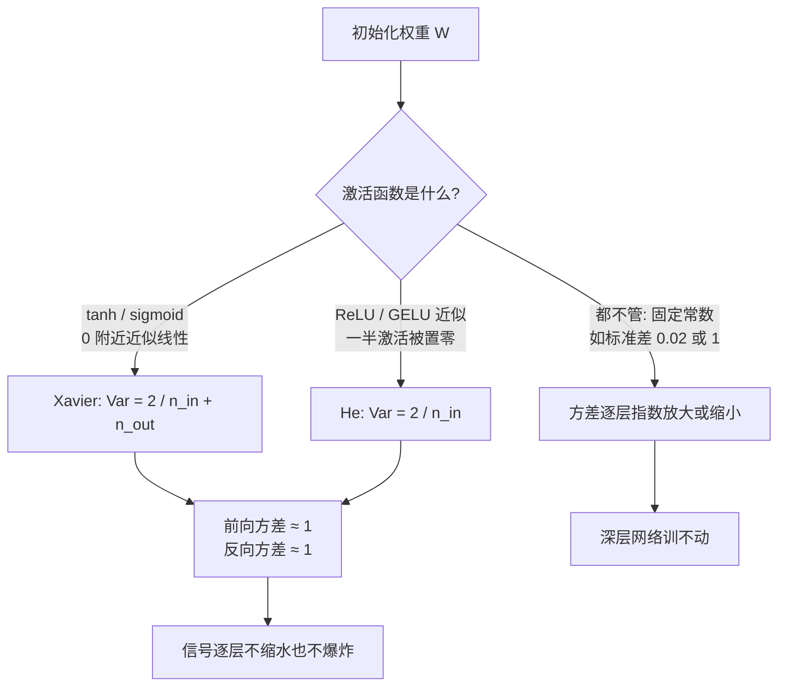

# 28｜权重初始化：为什么深层网络一开始就要把方差算对？

> 阅读目标：理解权重初始化为什么不是"随便给个随机数"——深层网络里信号的方差会逐层相乘，初始化的标准差差一个数量级，十层之后信号就可能缩水到原来的百万分之一或爆炸到原来的亿倍；会从方差传播亲手推导出 Xavier 初始化和 He 初始化的公式，并明白现代 Transformer（GPT-2 式）实际用的是哪套初始化、为什么残差分支还要再除以一个 $\sqrt{N}$。
>
> 前置知识：第 02 篇的缩放点积注意力（点积方差随维度线性增长、除以 $\sqrt{d_k}$ 的思路）、第 06 篇的残差连接与 LayerNorm（残差让梯度有直通路、归一化控制每层激活尺度）、第 12 篇的 Adam（自适应步长按梯度历史缩放更新）、第 13 篇的学习率 warmup（训练初期为什么脆弱）。本篇的结论分三类：**直觉**帮助理解、**严格推导**可以从公式直接算出、**需实验验证**依赖具体模型、数据和任务，不要把第三类当成定理。

## 1. 直觉：传话游戏里，声音要么越来越小，要么越来越响

想象一排 100 个人玩传话游戏：第一个人小声说一句话，每个人听完再复述给下一个人。如果每个人复述时都把音量乘以 0.9，传到第 100 个人时，音量只剩 $0.9^{100} \approx 0.000027$——什么都听不见了。如果每人把音量乘以 1.1，传到最后音量是 $1.1^{100} \approx 26600$ 倍——震耳欲聋。**每层只差一点点，逐层相乘之后就是天壤之别。**

深层神经网络就是这个传话游戏。输入信号每经过一层线性变换 $y = Wx$，它的方差都要乘上一个由权重方差决定的倍数。权重初始化时标准差取 1 还是 0.02，看起来只是"随机数的大小"，但经过几十层相乘，决定的是：第一层学到的梯度能不能传到最后一层、最后一层的误差信号能不能传回第一层。

这就是为什么初始化值得单独写一篇：**它不是训练开始前的一个小细节，而是训练能不能开始的前提**。方差算错了，网络在第一步就已经"死"了——信号要么缩到数值下溢，要么大到激活函数饱和、梯度消失或爆炸，后面再好的优化器（第 12 篇的 Adam）和学习率调度（第 13 篇的 warmup、第 23 篇的衰减）都救不回来，因为它们能调的是步长，调不回已经丢失的信号本身。

还有一个容易被忽略的点：初始化只在训练第 0 步起作用，但它的影响贯穿整个训练。好的初始化不会让模型"学得更快"那么简单——它决定了**每一层在训练初期看到的信号尺度是否合理**，也就是每一层的梯度是否处于"能学到东西"的量级。方差传错了，有些层从一开始就拿不到有意义的梯度，等于白白少了几层网络。

## 2. 严格推导：方差如何一层一层传下去

### 2.1 一层线性变换：方差乘上 $n_{in} \cdot \mathrm{Var}(w)$

先把一层算清楚。设某一层是 $y = Wx$，其中 $x \in \mathbb{R}^{n_{in}}$ 是输入，$W \in \mathbb{R}^{n_{out} \times n_{in}}$ 是权重，偏置先设为 0（后面会解释为什么偏置初始化为 0 没问题）。做三个标准假设：

- 权重 $w_{ij}$ 独立同分布，均值 0，方差 $\mathrm{Var}(w)$；
- 输入分量 $x_j$ 独立同分布，均值 0，方差 $\mathrm{Var}(x)$；
- $W$ 与 $x$ 相互独立。

单个输出分量 $y_i = \sum_{j=1}^{n_{in}} w_{ij} x_j$。每一项 $w_{ij}x_j$ 的均值是 $E[w]E[x] = 0$，方差是 $E[w^2]E[x^2] = \mathrm{Var}(w)\mathrm{Var}(x)$；$n_{in}$ 项独立相加，方差再乘 $n_{in}$：

```math
\mathrm{Var}(y) = n_{in} \cdot \mathrm{Var}(w) \cdot \mathrm{Var}(x)
```

**严格推导出的结论：** 一层线性变换把方差乘上 $r = n_{in} \cdot \mathrm{Var}(w)$。要让信号"原样"通过这一层，就要 $r = 1$，即：

```math
\mathrm{Var}(w) = \frac{1}{n_{in}}, \qquad \text{标准差 } \sigma_w = \frac{1}{\sqrt{n_{in}}}
```

这个公式成立的条件要说清楚：它依赖"权重与输入独立、同分布、均值为 0"这三个假设。训练开始时权重是随机初始化的、与输入独立，假设成立；但训练几步之后权重与输入开始相关，公式就不再精确——所以这是一个**初始化时刻**的结论，不是训练全程的定理。它回答的是"出发时方差该取多大"，而不是"训练中方差会怎样"。

### 2.2 十层之后：指数放大是指数级的惩罚

如果每层都乘上同一个倍数 $r$，$L$ 层之后方差就是 $r^L$。指数函数的残酷之处在于：$r$ 离 1 只差一点点，$L$ 一大，结果就面目全非。下面取 $n_{in} = 512$（一个常见的 hidden size），算三种初始化在 12 层之后的方差。

| 初始化 | 权重标准差 $\sigma_w$ | 每层倍数 $r = 512\sigma_w^2$ | 12 层后方差倍数 $r^{12}$ |
|---|---|---|---|
| 标准正态 $\mathcal{N}(0, 1)$ | $1$ | $512$ | $\approx 3.2 \times 10^{32}$ |
| 固定小值 $0.02$（GPT-2 式，见第 5 节） | $0.02$ | $0.2048$ | $\approx 5.4 \times 10^{-9}$ |
| 按公式 $\sigma_w = 1/\sqrt{512}$ | $0.0442$ | $1$ | $1$ |

验算一下中间一行：$r = 512 \times 0.0004 = 0.2048$；$0.2048^{12} = e^{12 \ln 0.2048} = e^{12 \times (-1.586)} = e^{-19.03} \approx 5.4 \times 10^{-9}$。也就是说，只用"看起来很小的 0.02"做标准差，信号经过 12 层线性变换后，标准差只剩原来的 $\sqrt{5.4 \times 10^{-9}} \approx 7.4 \times 10^{-5}$——输入的几乎全部信息都被"缩没了"。而标准正态初始化则反向爆炸 $10^{32}$ 倍，数值上直接溢出。

**严格推导出的结论：** 方差逐层相乘是指数级的，初始化标准差必须按 $1/\sqrt{n_{in}}$ 缩放，任何"固定常数"的初始化在层数稍多时都会失效。这个结论不依赖激活函数、不依赖优化器，是线性代数本身的后果。

### 2.3 数值示例：三层 ReLU 网络，一步步算方差

把公式落到具体数字上。设输入 $x$ 每个分量方差为 1（标准差 1），每层 $n_{in} = 512$、激活函数 ReLU，逐层跟踪方差。ReLU 层的完整倍数是 $r = n_{in} \cdot \mathrm{Var}(w) \cdot \frac{1}{2}$（多出来的 $\frac{1}{2}$ 是 4 节要讲的 ReLU 砍掉一半）：

- **He 初始化**（$\sigma_w = \sqrt{2/512} \approx 0.0625$）：$r = 512 \times 0.003906 \times \frac{1}{2} = 1$。三层之后方差：$1 \to 1 \to 1 \to 1$，信号原样通过。
- **固定标准差 0.02**：$r = 512 \times 0.0004 \times \frac{1}{2} = 0.1024$。三层之后方差：$1 \to 0.1024 \to 0.0105 \to 0.00107$——三层就只剩千分之一，标准差只剩约 0.033；输入里 97% 的"音量"已经丢了。
- **标准正态初始化**（$\sigma_w = 1$）：$r = 512 \times 1 \times \frac{1}{2} = 256$。三层之后方差：$1 \to 256 \to 65536 \to 1.7 \times 10^7$——第三层输出的标准差已经超过 4000，tanh 会直接饱和、ReLU 网络的梯度会爆炸。

注意这个例子里 He 初始化的每层倍数恰好是 1，不是巧合——它是按"补回 ReLU 砍掉的一半"反推出来的。而 0.02 这个"看起来很小、很安全"的数，在三层之后就让信号缩水一千倍：**初始化里没有"差不多"，差 3 倍标准差就是差 9 倍方差，逐层相乘后就是差几个数量级**。

### 2.4 反向传播：梯度走的是同一条路

前向信号会逐层相乘，反向的梯度也一样。设损失对某层输出的梯度是 $\delta^y$，则对输入的梯度是 $\delta^x = W^\top \delta^y$，即 $\delta^x_j = \sum_{i=1}^{n_{out}} w_{ij} \delta^y_i$。在同样的独立性假设下：

```math
\mathrm{Var}(\delta^x) = n_{out} \cdot \mathrm{Var}(w) \cdot \mathrm{Var}(\delta^y)
```

反向的倍数是 $n_{out} \cdot \mathrm{Var}(w)$，要让它等于 1，就要 $\mathrm{Var}(w) = 1/n_{out}$。前向要求 $1/n_{in}$，反向要求 $1/n_{out}$，两者一般不相等——这正是下一节 Xavier 初始化要调和的矛盾。**直觉上**，前向管"信号能不能传到输出"，反向管"梯度能不能传回输入"，初始化必须同时照顾两头，偏废任何一头，网络都是一头通、一头堵。

## 3. Xavier 初始化：tanh 时代的折中方案

Glorot 和 Bengio 在 2010 年的论文《Understanding the difficulty of training deep feedforward neural networks》（AISTATS 2010）里第一次把这个问题系统地算清楚了。他们的思路是：在激活函数近似线性的区域（tanh 在 0 附近斜率约为 1、sigmoid 在 0 附近斜率约为 1/4 附近且可近似），前向和反向的方差公式都成立；既然前向要 $\mathrm{Var}(w) = 1/n_{in}$、反向要 $\mathrm{Var}(w) = 1/n_{out}$，取一个折中——调和平均：

```math
\mathrm{Var}(w) = \frac{2}{n_{in} + n_{out}}
```

这就是 **Xavier 初始化**（也叫 Glorot 初始化）。它有两种常用形式：

- **正态分布版**：$w \sim \mathcal{N}\left(0, \frac{2}{n_{in}+n_{out}}\right)$；
- **均匀分布版**：$w \sim U(-a, a)$，其中 $a = \sqrt{\frac{6}{n_{in}+n_{out}}}$。

验算均匀分布版的界：均匀分布 $U(-a, a)$ 的方差是 $a^2/3$。令 $a^2/3 = 2/(n_{in}+n_{out})$，得 $a = \sqrt{6/(n_{in}+n_{out})}$——与公式一致。

举个具体数字：某层 $n_{in} = 784$（比如 28×28 图像展平）、$n_{out} = 256$，则均匀分布版的界是 $a = \sqrt{6/1040} \approx 0.076$，权重只在 $[-0.076, 0.076]$ 之间随机取。这个数看起来"很小"，但按 2.2 节的表：每层倍数 $r = 784 \times (2/1040) \approx 1.51$——略大于 1，这是 Xavier 在前向和反向之间折中的代价；若 $n_{in} = n_{out}$，则 $r$ 恰好为 1。

Xavier 成立的条件要钉牢：**它假设激活函数在 0 附近近似线性**。tanh 满足（$tanh'(0) = 1$），sigmoid 近似满足；但 ReLU 不满足——ReLU 会把一半的激活直接置零，这会让方差再打对折。把 Xavier 原样搬到 ReLU 网络上，每层倍数会系统性地偏小 1/2，深层网络的信号照样逐层缩水。这就是下一节的 He 初始化要修的 bug。

Glorot 和 Bengio 的论文里还有一组实验观察值得记住：用当时的标准初始化训练 5 层 tanh 网络时，下层（靠近输入的层）拿到的梯度比上层小几个数量级，网络基本只在训练最上面一两层——深层结构名存实亡。而按方差传播公式重新初始化之后，各层梯度回到了同一量级。这个现象与第 06 篇残差连接的动机是同一条线：深层网络的敌人始终是"信号在逐层传递中失真"，初始化是在源头上第一次拦截它。

## 4. He 初始化：ReLU 把一半信号砍掉，方差要补回来

He 等人在 2015 年的论文《Delving Deep into Rectifiers: Surpassing Human-Level Performance on ImageNet Classification》（ICCV 2015）里算清了 ReLU 的影响。设线性变换的输出是 $z$，对称分布、均值为 0，经过 ReLU 得到 $x = \max(0, z)$。一半的 $z$ 是负的、被置零，另一半原样保留：

```math
E[x^2] = \frac{1}{2} E[z^2] = \frac{1}{2} \mathrm{Var}(z)
```

也就是说，ReLU 让方差直接减半。把这个因子代回 2.1 节的公式，$y = Wx$ 的方差变成：

```math
\mathrm{Var}(y) = n_{in} \cdot \mathrm{Var}(w) \cdot \frac{1}{2} \mathrm{Var}(z)
```

要让 $\mathrm{Var}(y) = \mathrm{Var}(z)$，就要：

```math
\mathrm{Var}(w) = \frac{2}{n_{in}}, \qquad \sigma_w = \sqrt{\frac{2}{n_{in}}}
```

这就是 **He 初始化**（也叫 Kaiming 初始化）。与 Xavier 相比，它只差一个因子 2——但这个 2 是 ReLU 的结构性后果，不是调参调出来的经验数。反向传播里 ReLU 的导数同样以 1/2 的概率为 0、以 1/2 的概率为 1，算下来反向的方差条件也是 $\mathrm{Var}(w) = 2/n_{in}$，前后一致，不需要再折中。

用数字对照一下：$n_{in} = 1024$ 的 ReLU 层，He 初始化的标准差是 $\sqrt{2/1024} \approx 0.0442$；如果误用 Xavier 正态版（标准差 $\sqrt{1/1024} \approx 0.0313$），每层倍数是 $1024 \times 0.000977 \times \frac{1}{2} = 0.5$，20 层后信号方差只剩 $0.5^{20} \approx 10^{-6}$——这正是 2015 年之前很多人训不深 ReLU 网络时踩过的坑：不是 ReLU 不好，是初始化没跟着改。



注：GELU（Transformer 里实际用的激活函数）不是严格的"一半置零"，但在 0 附近的行为与 ReLU 接近，实践中 He 初始化的量级仍然适用——这是**需实验验证**的工程经验，不是严格推导。

## 5. 实践：现代 Transformer 实际怎么初始化

理论推导给出的是"出发点"，真实的大模型初始化还要处理两个理论没覆盖的问题：残差连接和 LayerNorm。

### 5.1 GPT-2 的做法：固定 0.02，再给残差分支打折

GPT-2 的初始化简单得令人意外：所有权重矩阵用 $\mathcal{N}(0, 0.02^2)$，偏置初始化为 0。按 2.2 节的表，0.02 的标准差在 $n_{in} = 768$ 时每层倍数只有 $768 \times 0.0004 \approx 0.31$——如果按纯前馈网络算，信号早就缩没了。但 Transformer 能训起来，靠的是第 06 篇讲过的两个结构：

- **残差连接**：$x_{l+1} = x_l + F(x_l)$。主路 $x_l$ 是原样通过的，分支 $F(x_l)$ 再小也只是"加一点东西"，信号不会逐层相乘式地缩水。残差把方差传播从"乘法"变成了"加法"。
- **LayerNorm**：每层（pre-LN 结构里在子层之前）把激活重新归一化到均值 0、方差 1。哪怕分支输出的方差偏小，归一化也会把它拉回标准尺度。

但残差连接带来一个新问题：$N$ 层残差加下来，方差是累加的——$\mathrm{Var}(x_N) \approx \mathrm{Var}(x_0) + N \cdot \mathrm{Var}(\text{分支输出})$。层数越多，最后的激活方差越大。GPT-2 论文的做法是：把残差分支里的权重（注意力输出投影和 MLP 输出投影）初始化标准差再除以 $\sqrt{N}$，$N$ 是残差层数；nanoGPT 等实现里写作 $0.02/\sqrt{2 \cdot \text{层数}}$（每层 block 有注意力与 MLP 两个残差分支）。**直觉上**，每个分支的贡献被压到 $1/N$ 量级，$N$ 个分支加起来总方差仍然是 $O(1)$——这就是"残差分支打折"的全部数学。

拿 GPT-2 小模型（$d_{model} = 768$，12 层）把这笔账算到底。每个 block 有 2 个残差分支，共 24 个分支；设某分支输入方差为 1，分支输出投影的权重方差是 $\sigma^2$，则单个分支输出的方差约为 $768\sigma^2$：

- **打折后**（$\sigma = 0.02/\sqrt{24} \approx 0.00408$）：单个分支输出方差 $\approx 768 \times 1.67 \times 10^{-5} \approx 0.0128$，24 个分支累计约 $0.31$，加上初始方差 1，最终激活方差约 $1.3$——量级稳定。
- **不打折**（$\sigma = 0.02$）：单个分支输出方差 $\approx 768 \times 0.0004 \approx 0.31$，24 个分支累计约 $7.4$，最终激活方差约 $8.4$——深层激活的标准差接近 3，是浅层的 3 倍。

这组数字是量级估算（**直觉**层面：它忽略了 LayerNorm 和激活函数的实际作用），但它说明了打折的意义：不是"让某一层不出错"，而是"让方差不随层数线性漂移"。层数从 12 变成 96 时，不打折的版本最终方差会漂到约 60，而打折的版本仍然钉在 $O(1)$。

### 5.2 哪些初始化细节容易被忽略

- **偏置初始化为 0 是安全的**：偏置不参与"对称性破缺"——打破对称靠的是权重随机性（见误区一），偏置为 0 时每个神经元的初始输出仍然各不相同。
- **Embedding 的初始化**：词向量矩阵通常也用 $\mathcal{N}(0, 0.02^2)$ 之类的小方差；位置编码如果是可学习参数，同样处理。如果 embedding 方差太大，第一层的输入方差就已经偏离，后面全跟着错。
- **最后一层（输出头）**：语言模型的输出投影（lm_head）常与输入 embedding 共享权重（weight tying），初始化时只需初始化一份；不共享时，输出层的方差会直接影响初始 logits 的尺度——logits 太大，softmax 一开始就接近 one-hot，交叉熵梯度会被压得很小（第 10 篇讲过交叉熵的梯度形式）。
- **LayerNorm 的参数**：缩放参数 $\gamma$ 初始化为 1、平移参数 $\beta$ 初始化为 0，这样 LayerNorm 在初始时刻是恒等映射，不改变信号尺度。

### 5.3 初始化与 warmup：为什么方差算对了还要 warmup

一个自然的问题是：第 13 篇说训练开头要用 warmup 把学习率从 0 慢慢拉大——如果初始化已经把方差算对了，warmup 是不是就多余了？不是。初始化解决的是**信号的尺度**，warmup 解决的是**更新的尺度**，两者管的是不同的量。

Adam 在训练第一步时，二阶矩估计 $\hat{v}$ 还没积累起来，更新几乎只认梯度的方向、不认大小（第 13 篇算过，第一步的有效步长接近学习率本身）。这时哪怕信号方差完全正确，第一步的更新也可能过大，把精心初始化好的权重一把推出合理区域。warmup 的作用是给优化器一个"热身期"，让 $\hat{v}$ 先积累出可信的估计，再把学习率放开。**直觉上**，初始化是把车停在正确的起跑线上，warmup 是起步时先轻踩油门——起跑线对了，不等于可以一脚地板油。两者配合，才是现代大模型训练开头的标准姿势。

### 5.4 初始化不能解决所有问题

最后要划清边界：好的初始化解决的是"训练能不能开始"，不是"训练能不能训好"。第 06 篇的残差与 LayerNorm、第 13 篇的 warmup、第 23 篇的学习率衰减、第 25 篇的梯度裁剪，都是在初始化之后继续护航的机制。初始化把信号方差送到正确的起跑线，剩下的路要靠这些机制一起走——把初始化当成万能药，是另一个方向的误解（见误区四）。

## 6. 常见误区

**误区一："权重全初始化为 0 也可以，反正训练会把它学出来。"**
错，而且错在对称性上。如果某一层的所有权重都是 0，该层每个神经元的输出完全相同、梯度也完全相同，更新之后仍然完全相同——神经元之间永远分化不出来，相当于这一层只有一个神经元在工作。随机初始化的意义不只是"给个起点"，更是**打破对称性**，让每个神经元从不同的起点出发、学到不同的东西。偏置可以为 0，因为偏置不决定对称性；权重不行。

**误区二："Xavier 和 He 差不多，随便用一个就行。"**
错。两者只差一个因子 2，但这个因子 2 是 ReLU"砍掉一半"的结构性后果。在 ReLU 网络里用 Xavier，每层方差系统性地乘 0.5；层数一深，信号照样缩水到 $10^{-6}$ 量级（4 节算过）。反过来，在 tanh 网络里用 He，每层方差乘 2，同样会指数爆炸。选哪个取决于激活函数，不是个人喜好。

**误区三："有了 LayerNorm 和 Adam，初始化就不重要了。"**
错了一半。LayerNorm 确实能把每层激活的方差拉回 1，Adam 也确实能按梯度历史自适应地调步长（第 12 篇），但它们都救不回**已经丢失的信息**：如果前向信号缩到 $10^{-5}$ 量级，不同输入之间的差异被数值噪声淹没，LayerNorm 归一化的是噪声；如果梯度本身因为方差传错而失真，Adam 缩放的也只是失真的梯度。第 13 篇的 warmup 之所以存在，部分原因正是训练初期信号尺度最脆弱——初始化、归一化、优化器是三道防线，不是一道可以替代另一道。

**误区四："初始化调得越精细，模型训得越好。"**
错。Xavier 和 He 都是"让方差在初始时刻约为 1"的量级正确的方案，实践中在这个量级附近微调（比如 GPT-2 的 0.02）带来的差异，远小于数据、学习率调度和模型结构带来的差异。初始化的目标是"别在起跑线上就死掉"，而不是"找到最优的那个标准差"。花一周时间网格搜索初始化标准差，收益通常不如多跑一组学习率。

**误区五："初始化只影响训练刚开始的几步，训久了就没关系了。"**
错。初始化决定的是每一层在训练初期的梯度量级；如果某几层在初期几乎拿不到梯度，它们的权重几乎不动，等于网络的有效深度从一开始就打了折。更糟的是，训练早期的权重更新方向会锁定后续的优化轨迹——起跑线错了，整个训练过程都在为最初的方差错误还债。

## 7. 自测题

**1. 一个 ReLU 多层感知机，每层 $n_{in} = 1024$。按 He 初始化，权重标准差应该是多少？如果误用了 Xavier 正态版（$\mathrm{Var}(w) = 1/n_{in}$），20 层之后信号方差会变成初始的多少倍？**

答案：He 初始化 $\sigma_w = \sqrt{2/1024} \approx 0.0442$。误用 Xavier 时，每层倍数 $r = n_{in} \cdot \mathrm{Var}(w) \cdot \frac{1}{2} = 1024 \times \frac{1}{1024} \times \frac{1}{2} = 0.5$（多出来的 $\frac{1}{2}$ 是 ReLU 砍掉一半的代价），20 层后方差倍数是 $0.5^{20} \approx 9.5 \times 10^{-7}$，即只剩约百万分之一。

**2. 某层 $n_{in} = 784$、$n_{out} = 256$，激活函数是 tanh。用 Xavier 均匀分布版初始化，权重的取值范围是多少？这个范围对应的方差是多少？**

答案：界 $a = \sqrt{6/(n_{in}+n_{out})} = \sqrt{6/1040} \approx 0.076$，权重在 $[-0.076, 0.076]$ 之间均匀随机。均匀分布方差 $a^2/3 \approx 0.00577/3 \approx 0.00192$，与 $2/(n_{in}+n_{out}) = 2/1040 \approx 0.00192$ 一致。

**3. 为什么权重不能全初始化为 0，而偏置初始化为 0 却没问题？**

答案：权重为 0 时，同一层的所有神经元输出相同、梯度相同，更新后仍然相同，对称性永远破不了，整层等效于一个神经元。偏置为 0 不影响对称性——神经元之间的差异来自权重矩阵的不同行，偏置只是每个神经元输出上加的常数，不决定神经元之间是否相同。

**4. GPT-2 把残差分支的初始化标准差除以 $\sqrt{2 \cdot \text{层数}}$。用第 5.1 节的方差累加解释：为什么是除以 $\sqrt{N}$（而不是 $N$ 或不除）？**

答案：残差连接下总方差是累加的：$\mathrm{Var}(x_N) \approx \mathrm{Var}(x_0) + N \cdot \mathrm{Var}(\text{单分支输出})$。分支权重标准差除以 $\sqrt{N}$，分支输出的方差就除以 $N$，$N$ 个分支加起来的总贡献是 $N \times (\mathrm{Var}/N) = O(1)$，与层数无关。除以 $N$ 会压过头（总贡献 $\sim 1/N$，深层分支几乎不起作用），不除则总方差随层数线性增长。

下一篇预告：29｜Dropout 直觉：训练时随机丢掉神经元，为什么反而更不容易过拟合？
