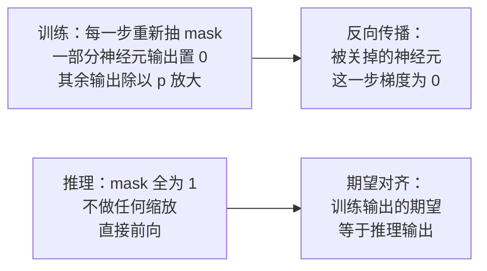

# 29｜Dropout 直觉：训练时随机丢掉神经元，为什么反而更不容易过拟合？

> **阅读目标**：理解 dropout 在训练时做什么、在推理时为什么什么都不做；能从期望和方差出发，算出 inverted dropout 的缩放因子；明白"随机丢弃"如何等价于一种正则化，以及它在 Transformer 里实际加在哪些位置。
>
> **前置知识**：第 02 篇的 softmax 与梯度直觉、第 06 篇的残差连接与 LayerNorm、第 10 篇的训练目标（交叉熵）、第 12 篇的 Adam、第 28 篇的方差传播。需要用到伯努利分布的期望与方差：若 $`m \sim \mathrm{Bernoulli}(p)`$，则 $`\mathbb{E}[m] = p`$，$`\mathrm{Var}(m) = p(1-p)`$。

## 1. 直觉：训练时随机"关掉"一部分神经元

过拟合最常见的样子，是网络学会了"偷懒的配合"：神经元 A 只有在神经元 B 输出某个特定值时才有用，两个神经元互相依赖、 jointly 记住训练集里的个别样本。换到新数据上，这种精密配合一碰就碎。

Dropout 的做法粗暴得有点反直觉：**训练的每一步，对每一层，以概率 $`1-p`$ 随机把一部分神经元的输出置为 0**，只让剩下的神经元参与这次前向和反向传播。下一步重新随机抽一遍，关掉另一批。推理时，所有神经元全部打开，一个也不关。

用一个比喻：平时训练一支球队，每场比赛随机让几名队员坐板凳。任何战术都不能建立在"某个人一定在场"的前提上，每个队员必须自己就能把活干好。到了正式比赛（推理），全员上场，球队反而比原来更稳——因为每个位置都不再依赖某个特定队友。

这个想法最早由 Hinton 等人在 2012 年提出（Srivastava et al., 2014，发表于 JMLR），最初是为全连接网络设计的，dropout 率取 0.5——每步关掉一半神经元。后来 Transformer 把它接过来，dropout 率降到 0.1（第 5 节会讲为什么）。同一个想法，从"关掉一半"到"只关一成"，变化的不是原理，而是网络结构变深、数据规模变大之后，噪声预算收紧了。

这里有两个立刻要回答的问题：

1. 训练时关掉一部分、推理时全开，前向输出的**尺度**不会乱吗？
2. 随机丢弃为什么是"正则化"，而不是单纯地"让模型变弱"？

第 2 节回答第一个问题，第 3、4 节回答第二个问题。



## 2. 严格推导：inverted dropout 为什么能保证期望不变

先把记号定下来。设某一层某个神经元的激活值是 $`a`$（对给定的输入，这是一个确定的数），dropout 的 keep 概率是 $`p`$（即以概率 $`p`$ 保留、以概率 $`1-p`$ 丢弃）。记 mask $`m \sim \mathrm{Bernoulli}(p)`$，$`m=1`$ 表示保留，$`m=0`$ 表示丢弃。

如果训练时直接输出 $`a \cdot m`$，推理时输出 $`a`$，那么训练输出的期望是：

```math
\mathbb{E}[a \cdot m] = a \cdot \mathbb{E}[m] = p \cdot a
```

训练时输出平均只有推理时的 $`p`$ 倍——下一层在训练和推理时看到的输入分布**系统性地错位**了。修正方法有两种：推理时把权重乘以 $`p`$（原始 dropout 论文的做法），或者训练时把保留下来的输出除以 $`p`$（inverted dropout，现在几乎所有框架的做法）。本文只讨论后者。

**Inverted dropout 的定义**：训练时输出

```math
\tilde{a} = \frac{a \cdot m}{p}
```

**结论一（期望不变）**：

```math
\mathbb{E}[\tilde{a}] = \frac{a}{p} \cdot \mathbb{E}[m] = \frac{a}{p} \cdot p = a
```

训练输出的期望恰好等于推理时的输出 $`a`$。这就是"除以 $`p`$"这个缩放因子的全部理由：它不是一个超参数，而是一个**让期望对齐的归一化常数**。因为期望对齐了，推理时不需要做任何处理——这正是 inverted dropout 被广泛采用的原因。

**结论二（方差被放大）**：期望对了，方差却变大了。固定 $`a`$，只对 mask 求方差：

```math
\mathrm{Var}(\tilde{a}) = \frac{a^2}{p^2} \cdot \mathrm{Var}(m) = \frac{a^2}{p^2} \cdot p(1-p) = a^2 \cdot \frac{1-p}{p}
```

这个公式值得多看一眼：

- $`p = 1`$（不 dropout）时方差为 0，退化为确定性网络；
- $`p = 0.9`$（Transformer 常用）时，方差是 $`a^2 \cdot 0.111`$，标准差约为 $`0.33 |a|`$——噪声不小，但可控；
- $`p = 0.5`$（早期全连接网络常用）时，方差是 $`a^2`$，标准差等于 $`|a|`$ 本身——噪声和信号一样大。

所以 dropout 的 keep 概率 $`p`$ 同时控制两件事：**保留多少信号，以及注入多少噪声**。$`p` 越小，正则化越强，但训练信号也越嘈杂。这就是为什么 dropout 率不是越大越好：它是一个需要权衡的超参数，不是"免费的午餐"。

**结论三（梯度也被 mask）**：反向传播时，被丢弃的神经元输出恒为 0，对它的梯度也是 0。也就是说，每一步只有约 $`p`$ 比例的神经元参与权重更新。单步看，更新变稀疏了；多步平均看，每个神经元被更新的概率都是 $`p`$，长期下来没有神经元被"饿死"。

> **一个容易踩坑的命名问题**：不同框架对 dropout 参数的定义是反的。PyTorch 的 `nn.Dropout(p=0.1)` 里，`p` 是**丢弃概率**（即本文的 $`1-p`$，keep 概率 0.9）；而很多论文写"dropout rate 0.5"时指的也是丢弃概率。读代码或论文时，先确认这个 `p` 到底是 keep 还是 drop——把 0.1 和 0.9 搞反，等于把"轻度正则化"换成了"关掉九成神经元"。

> **区分**：结论一、二是严格推导（给定伯努利 mask 的定义直接算出）；"dropout 防过拟合"的机制解释属于直觉 + 实验验证的范畴，见第 3、4 节。

## 3. 直觉：随机性怎么变成正则化——集成与 co-adaptation

### 3.1 指数级多的子网络在共享权重

一层有 $`n`$ 个神经元，每一步的 mask 有 $`2^n`$ 种可能。整个网络有 $`L`$ 层，子网络的数量是 $`2^{nL}`$ 量级。每一步训练，相当于从这个巨大的子网络集合里随机抽一个出来，用当前这批数据训练它；所有子网络**共享同一套权重**。

推理时全员上场，相当于把这些子网络的预测做了一次平均。Hinton 等人在原始论文（Srivastava et al., 2014）中的论证是：对于单层 softmax 分类器，这种"测试时用完整网络、权重按 $`p`$ 缩放"的做法，恰好等于对所有子网络的预测取**几何平均**；对于深层网络，这个等式不再严格成立，但几何平均的近似直觉仍然适用。

单层的情况为什么恰好成立，可以直观地看一眼：单层 softmax 的输出是 $`\mathrm{softmax}(W^\top x)`$，对 mask 求期望时，指数里的线性项 $`w_j^\top x \cdot m_j`$ 在取对数之后变成对 mask 的线性平均，而线性平均的指数正好对应几何平均。换句话说，softmax 的"指数 + 归一化"结构，恰好把"对子网络取期望"翻译成了"对预测取几何平均"。深层网络里非线性层层嵌套，这个翻译不再精确——但"完整网络 ≈ 子网络集成的平均"这个定性结论保留了下来。

> **区分**："dropout ≈ 集成"是直觉层面的解释，不是严格定理。严格成立的只有单层 softmax 的特例；深层网络里它是近似成立的经验结论。集成视角真正有用的部分是这个推论：**集成之所以有效，是因为成员之间足够不同**——而 dropout 的随机 mask 正是制造差异的机制。

### 3.2 打破 co-adaptation：不许"抱团"

过拟合的微观形态叫 **co-adaptation（协同适应）**：神经元之间发展出精密的互相补偿关系。比如神经元 A 的权重学偏了，神经元 B 恰好学出一个反向的偏来抵消它——在训练集上两者配合得天衣无缝，换一组数据就全盘崩溃。

Dropout 让这种配合无法建立：A 永远不知道 B 这一步在不在场，所以 A 必须自己输出"单独看也有用"的东西。久而久之，每个神经元都被迫学到**相对独立、有用的特征**，而不是只在某个特定组合里才成立的特征。这就是 dropout 的核心直觉：**用随机性逼每个神经元自立**。

举个最小的例子：某层最后要输出一个数，神经元 A 输出 $`+2`$、神经元 B 输出 $`-2`$，两者相加是 0——训练损失很小，看起来一切正常。但这是一个"抱团"的解：单独看，A 和 B 的输出都毫无意义，全靠互相抵消才蒙对答案。一旦 B 在某一步被 dropout 关掉，A 的 $`+2`$ 直接暴露出来，损失立刻飙升，梯度会狠狠地惩罚 A。几轮下来，网络被迫放弃这种互相抵消的解，转而让每个神经元输出"即使队友不在场也大致正确"的值。

这个直觉有一个可验证的推论：如果 dropout 真的在打破 co-adaptation，那么 dropout 训练出的网络里，单个神经元应该比普通网络的单个神经元"更有用"——删掉任意一个神经元，性能下降应该更平缓。这个推论在实验中得到了支持（这是"需实验验证"的结论，不是数学定理）。

### 3.3 和第 28 篇的联系：噪声注入的位置不同

第 28 篇讲初始化：让信号方差在起点处约为 1。Dropout 是在训练过程中**主动注入方差**：每一步的前向输出都带上 $`a^2 (1-p)/p`$ 的额外方差。两者目标相反——初始化要"方差别跑偏"，dropout 要"方差主动扰动"——但都不破坏期望。理解 dropout 的关键，始终是同时盯住期望和方差这两条线。

## 4. 严格推导：线性回归里 dropout 等价于一个加权 L2 惩罚

"dropout 是正则化"这句话，在最简单的模型里可以**严格证明**。考虑线性回归：输入 $`x \in \mathbb{R}^d`$，权重 $`w \in \mathbb{R}^d`$，目标 $`y`$，平方损失。对输入特征做 inverted dropout：$`z_j = x_j m_j / p`$，$`m_j`$ 独立同分布于 $`\mathrm{Bernoulli}(p)`$。

先算期望损失。对 mask 求期望：

```math
\mathbb{E}_m\left[(y - \sum_j z_j w_j)^2\right] = \left(y - \sum_j \mathbb{E}[z_j] w_j\right)^2 + \mathrm{Var}\left(\sum_j z_j w_j\right)
```

第一项：$`\mathbb{E}[z_j] = x_j`$，所以等于普通回归的损失 $`(y - x^\top w)^2`$。第二项：各 $`m_j`$ 独立，方差可加；由第 2 节，$`\mathrm{Var}(z_j) = x_j^2 (1-p)/p`$，所以：

```math
\mathrm{Var}\left(\sum_j z_j w_j\right) = \sum_j w_j^2 \cdot x_j^2 \cdot \frac{1-p}{p}
```

合起来：

```math
\mathbb{E}_m[\text{loss}] = \underbrace{(y - x^\top w)^2}_{\text{普通平方损失}} + \underbrace{\frac{1-p}{p} \sum_{j=1}^{d} x_j^2 w_j^2}_{\text{dropout 带来的惩罚项}}
```

这就是结论：**在线性回归 + 平方损失下，dropout 的期望损失 = 普通损失 + 一个数据依赖的加权 L2 惩罚**。惩罚系数是 $`(1-p)/p`$，第 $`j`$ 个权重的惩罚强度正比于 $`x_j^2`$——输入特征的量级越大，对应权重的惩罚越重。直觉上这很合理：量级大的特征一旦被丢弃，对输出的冲击也大，模型必须更谨慎地使用它。

这个"数据依赖"还有一个实践推论：**特征的尺度会改变 dropout 的正则化强度**。如果两个特征本身量级差 100 倍，dropout 对它们的惩罚就差 10000 倍——哪怕这两个特征对任务同样重要。这正是输入归一化（第 06 篇的 LayerNorm 做的事情之一）重要的另一个理由：先把特征拉到相近的尺度，dropout 的惩罚才不会被量级最大的那个特征垄断。

> **区分**：这个等价性是严格的，但**只在线性回归 + 平方损失 + 输入层 dropout** 的设定下成立。深层网络 + 交叉熵下，dropout 的正则化效果没有这样干净的闭式表达；第 4 节的价值在于给出"dropout 确实是正则化"的一个可验证的锚点，而不是声称所有情况都等价于 L2。

## 5. Dropout 在 Transformer 里加在哪里

Dropout 不是"往网络里随便撒一把噪声"，它的位置是原始 Transformer 论文（Vaswani et al., 2017）里定下来的，一共四处，dropout 率都是 0.1：

| 位置 | 丢的是什么 | 为什么加在这里 |
|---|---|---|
| 注意力权重 | softmax 之后的注意力分布 $`A`$ | 防止模型只依赖某几个位置的注意力，逼它把信息分散到更多 token 上 |
| 残差分支输出 | 每个子层（注意力 / FFN）的输出，在加回残差之前 | 残差连接是第 06 篇讲的"梯度高速路"，在这里加噪声等于给每条支路都上保险 |
| FFN 内部激活 | 两层前馈网络中间的激活 | FFN 是逐位置的"记忆库"，防止个别神经元垄断某个特征 |
| 词向量 + 位置编码之和 | embedding 层的输出 | 输入层就注入噪声，后面所有层都被迫学会抗噪的表示 |

有两处**不加**，同样值得记住。第一，**最终的 logits 上不加**——logits 直接进交叉熵损失（第 10 篇），丢弃 logits 等于直接丢弃监督信号，损失函数会学到一堆被 mask 污染的梯度。第二，**LayerNorm 的输出上通常不加**——LayerNorm（第 06 篇）刚把激活的均值方差拉回标准尺度，紧接着加 dropout 又把方差打乱，两者打架。

注意力权重的 dropout 还有一个细节：softmax 之后的注意力分布每行和为 1（第 02 篇），dropout 关掉其中几个权重、把剩下的除以 $`p`$ 放大之后，**某一行的和不再恰好是 1**——期望仍是 1（第 2 节结论一），但单步的实际值会在 1 上下波动。换句话说，dropout 让注意力分布从"确定的加权平均"变成"期望正确的随机加权平均"。这正是它起作用的方式：模型不能再精确依赖"某个位置恰好分到 0.37 的注意力"这种精细数值，只能依赖"大致上关注哪些位置"这种粗粒度的信息。

还有一个实践中常被忽略的演变：**现代大模型正在逐渐抛弃 dropout**。GPT-2 还用 0.1 的 dropout，LLaMA 系列则直接把 dropout 设为 0——数据量足够大、训练步数足够多时，过拟合本身不再是主要矛盾，dropout 注入的噪声反而拖慢收敛。这说明 dropout 不是 Transformer 的必需品，而是一个**数据规模不够大时的补救措施**。小模型、数据有限时它雪中送炭；大模型、海量数据时它可有可无。这个判断来自各家模型的公开配置，是实验层面的观察，不是定理。

> **区分**："dropout 应该加在哪里"是工程经验（不同论文、不同模型有不同的选择）；"dropout 在线性回归里等价于加权 L2"（第 4 节）是严格推导。读论文时看到某个位置加了 dropout，先问"它丢的是什么、期望对齐了没有"，再问"实验上是不是真的有用"。

## 6. 数值示例：512 个神经元与一个单特征回归

### 6.1 一层 512 个神经元，keep 概率 0.9

Transformer 里常见的 dropout 率是 0.1，即 $`p = 0.9`$。某一层有 $`n = 512`$ 个神经元：

- 每步期望保留的神经元数：$`512 \times 0.9 = 460.8`$ 个；
- 保留数量的标准差：$`\sqrt{512 \times 0.9 \times 0.1} = \sqrt{46.08} \approx 6.8`$ 个——每步保留的数量在 454～468 之间小幅波动，相对稳定；
- 单个神经元激活值 $`a = 2.0`$ 时：以 0.9 的概率输出 $`2.0/0.9 \approx 2.22`$，以 0.1 的概率输出 0；期望仍是 2.0，方差是 $`4 \times 0.1/0.9 \approx 0.444`$，标准差约 0.67。

如果把 keep 概率降到 $`p = 0.5`$：期望保留 256 个，标准差 $`\sqrt{512 \times 0.25} \approx 11.3`$；单个神经元输出以一半概率是 4.0、一半概率是 0，方差 $`4 \times 1 = 4`$，标准差 2.0——**噪声的标准差追上了信号本身**。这就是为什么 Transformer 只用 0.1 的 dropout 率：注意力层已经够脆弱，经不起 $`p = 0.5`$ 的噪声。

不同 keep 概率下的噪声强度对照（方差乘子 $`(1-p)/p`$，即输出方差相对 $`a^2`$ 的倍数）：

| keep 概率 $`p`$ | dropout 率 $`1-p`$ | 方差乘子 $`(1-p)/p`$ | 噪声标准差 / $`|a|`$ |
|:-:|:-:|:-:|:-:|
| 0.95 | 0.05 | 0.053 | 0.23 |
| 0.9 | 0.1 | 0.111 | 0.33 |
| 0.8 | 0.2 | 0.25 | 0.5 |
| 0.5 | 0.5 | 1.0 | 1.0 |

### 6.2 单特征回归里的惩罚项有多大

取第 4 节的公式，单个特征 $`x = 3`$，权重 $`w = 0.5`$：

- $`p = 0.5`$ 时：惩罚 $`= \frac{0.5}{0.5} \times 9 \times 0.25 = 2.25`$；
- $`p = 0.9`$ 时：惩罚 $`= \frac{0.1}{0.9} \times 9 \times 0.25 = 0.25`$。

普通损失 $`(y - 1.5)^2`$ 本身是 $`O(1)`$ 量级。$`p = 0.5`$ 时惩罚项 2.25 已经和损失本身相当——正则化非常强；$`p = 0.9`$ 时惩罚 0.25，只占损失的一小部分，是温和的正则化。这个数量级对比解释了实践中的选择：dropout 率 0.1 是"轻推一把"，0.5 是"大力整顿"。

## 7. 常见误区

**误区一："推理时也要开 dropout，不然训练和推理不一致。"**
错。恰恰相反：推理时必须关掉 dropout。Inverted dropout 的设计就是让训练输出的期望等于推理输出（第 2 节结论一），所以推理时直接前向、不做任何缩放，期望就是对齐的。推理时开 dropout 只会给预测注入无意义的噪声，同一个输入每次输出都不一样。如果某个场景确实需要在推理时开 dropout（比如用 dropout 估计不确定性，即 Monte Carlo Dropout），那是**主动选择**把 dropout 当作采样器，不是"保持一致"的要求。

**误区二："dropout 率越大，正则化越强，效果越好。"**
错。$`p` 越小，惩罚系数 $`(1-p)/p`$ 越大，正则化确实越强，但注入的噪声方差 $`a^2(1-p)/p`$ 也同步变大。$`p = 0.5`$ 时噪声标准差等于信号本身（6.1 节），训练信号被噪声淹没，欠拟合的风险开始超过过拟合的收益。实践中 dropout 率超过 0.5 几乎没有意义；Transformer 用 0.1，正是"轻度正则化"的选择。

**误区三："dropout 和权重衰减是一回事，都是让权重变小。"**
错了一半。两者都抑制过拟合，但机制不同：权重衰减（第 22 篇）直接把权重往 0 拉，是一个与数据无关的惩罚；dropout 的惩罚项正比于 $`x_j^2`$（第 4 节），是**数据依赖**的——特征量级大的方向罚得更重。而且 dropout 还有权重衰减没有的效果：打破 co-adaptation、制造集成。实践中两者经常一起用，互补而不是互替。

**误区四："dropout 加在任何位置都一样有效。"**
错。Dropout 在 Transformer 里加的位置是精心选择的：注意力权重上（softmax 之后）、残差分支上、前馈网络的激活上，以及词向量与位置编码相加之后（Vaswani et al., 2017，dropout 率 0.1）。但它**不加在**最终输出的 logits 上——输出层直接决定损失，丢弃输出等于直接丢弃监督信号。更微妙的是 dropout 与 BatchNorm 的配合问题：dropout 改变激活的方差，而 BatchNorm 依赖训练时统计的方差，二者叠加会产生"方差漂移"（variance shift），这在 Li et al.（2019）的研究中有系统分析。Transformer 用 LayerNorm 而非 BatchNorm，一定程度上避开了这个坑，但"dropout 位置"仍然是需要实验验证的设计选择，不是放之四海皆准的配方。

**误区五："dropout 让模型在训练时变弱，所以推理时模型一定比训练时强。"**
错。推理时确实没有噪声、用了全部神经元，但"训练损失低于推理损失"和"推理性能更好"是两回事：训练损失是在带噪声的子网络上算的，推理损失是在完整网络上算的，两者不是同一个量，数值上没有可比性。判断 dropout 有没有用，只能看**验证集**上的泛化误差，而不是比较训练损失和推理损失的大小。

## 8. 自测题

**1. 某一层神经元激活值 $`a = 3.0`$，dropout keep 概率 $`p = 0.75`$。用 inverted dropout，训练时这个神经元的输出以什么概率取什么值？期望和方差各是多少？**

答案：以 0.75 的概率输出 $`3.0/0.75 = 4.0`$，以 0.25 的概率输出 0。期望 $`= 0.75 \times 4.0 + 0.25 \times 0 = 3.0`$，等于推理输出。方差 $`= 9 \times (1-0.75)/0.75 = 9 \times 1/3 = 3.0`$，标准差约 1.73。

**2. 线性回归，两个特征 $`x_1 = 1, x_2 = 10`$，权重 $`w_1 = w_2 = 0.4`$，keep 概率 $`p = 0.8`$。写出 dropout 带来的惩罚项，并说明哪个特征对应的权重被罚得更重、为什么。**

答案：惩罚项 $`= \frac{1-0.8}{0.8} \left(1^2 \times 0.4^2 + 10^2 \times 0.4^2\right) = 0.25 \times (0.16 + 16) = 4.04`$。$`x_2`$ 对应的权重被罚得更重：惩罚正比于 $`x_j^2`$，$`x_2^2 = 100`$ 是 $`x_1^2 = 1`$ 的 100 倍。量级大的特征被丢弃时对输出冲击更大，所以模型被迫更谨慎地使用它。

**3. 为什么推理时要把 dropout 关掉，而不是保持和训练时一样的随机丢弃？如果有人在推理时也开着 dropout，预测会出什么问题？**

答案：inverted dropout 已保证训练输出的期望等于推理输出，推理时关掉 dropout、直接前向，期望就是对齐的，不需要额外处理。推理时开 dropout 会让同一个输入每次前向得到不同的输出（方差 $`a^2(1-p)/p`$ 的噪声被带进预测），预测结果不稳定、不可复现；除非是主动用 Monte Carlo Dropout 估计不确定性，否则推理时开 dropout 只有坏处。

**4. 某层有 1024 个神经元，dropout 率 0.1。某一步恰好保留了 920 个神经元（期望是 921.6 个）。这个结果正常吗？如果换成 dropout 率 0.5，保留数量的波动会有多大？**

答案：正常。保留数服从二项分布 $`B(1024, 0.9)`$，期望 921.6，标准差 $`\sqrt{1024 \times 0.9 \times 0.1} = \sqrt{92.16} \approx 9.6`$，920 只比期望低 0.17 个标准差，完全在正常波动内。换成 dropout 率 0.5：期望 512，标准差 $`\sqrt{1024 \times 0.25} = 16`$，波动更大；而且单个神经元的输出方差从 $`a^2 \times 0.111`$ 升到 $`a^2 \times 1`$，噪声相对强度大了约 9 倍。

下一篇预告：30｜梯度累积：显存不够时，怎么用小 batch 模拟大 batch？
