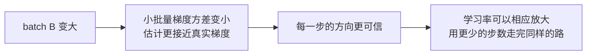

# 30｜Batch Size 与学习率：大 batch 为什么要配大学习率？

> **阅读目标**：理解 batch size 如何改变梯度的噪声水平；能从小批量梯度的方差出发，推导出"batch 翻倍、学习率翻倍"的线性放缩规则，并说清它成立的条件；明白临界 batch size 是什么，以及为什么超过它之后再加 batch 只剩浪费算力。
>
> **前置知识**：第 10 篇的训练目标（交叉熵与全批量梯度）、第 12 篇的 Adam（动量与自适应步长）、第 13 篇的 warmup、第 23 篇的学习率调度。需要用到一点概率论：独立同分布样本的均值方差是单个样本方差除以样本数；向量的方差用协方差矩阵的迹（trace）来度量。

## 1. 直觉：batch 越大，梯度越"准"，步子就可以迈得越大

训练时我们用的梯度从来不是"真实梯度"，而是**小批量梯度**：从训练集里随机抽 $`B`$ 个样本，算它们梯度的平均：

```math
g_B = \frac{1}{B} \sum_{i=1}^{B} \nabla \ell_i(\theta)
```

其中 $`\ell_i`$ 是第 $`i`$ 个样本的损失。真实梯度（全批量梯度）是它在全数据集上的期望：

```math
g = \mathbb{E}[\nabla \ell(\theta)]
```

小批量梯度 $`g_B`$ 是 $`g`$ 的一个**无偏估计**——期望等于 $`g`$，但每一步都有随机波动。这个波动就是梯度噪声。

一个日常比喻：要估计一座城市的平均身高，随机量 10 个人，估计值上下浮动好几厘米；量 1000 个人，估计值就稳得多。Batch size 就是"量了多少人"，学习率就是"根据这个估计值，你敢走多远"。估计越准，步子就可以迈得越大；估计抖得厉害，步子迈大了就可能一脚踩进坑里。

所以直觉的链条是：



但"相应放大"到底是放大多少？翻倍？开平方？还是不动？第 2 节把这个问题算清楚。

还有一个直觉值得先记下来：batch 增大带来的好处**只体现在"方向更准"上**。真实梯度 $`g`$ 本身是由数据和当前参数决定的，batch 再大也不会改变它——batch 改变的只是你对 $`g`$ 的估计有多抖。后面所有推导，包括线性放缩规则和临界 batch size，都是在量化"估计变准"这件事的价值：准到什么程度值得配大学习率，准到什么程度再准下去就不值了。

## 2. 严格推导：小批量梯度的方差是 $`\Sigma / B`$，线性放缩规则由此而来

### 2.1 方差随 $`1/B`$ 缩小

设单个样本的梯度是随机向量 $`\nabla \ell`$，它的协方差矩阵记为 $`\Sigma`$：

```math
\Sigma = \mathrm{Cov}(\nabla \ell) = \mathbb{E}[(\nabla \ell - g)(\nabla \ell - g)^\top]
```

$`B`$ 个样本独立同分布，取平均后方差除以 $`B`$（均值的方差公式，标量情形是 $`\mathrm{Var}(\bar X) = \sigma^2 / B`$，向量情形逐项成立）：

```math
\mathrm{Cov}(g_B) = \frac{\Sigma}{B}
```

用迹来度量总噪声大小：

```math
\mathbb{E}[\|g_B - g\|^2] = \mathrm{tr}\left(\frac{\Sigma}{B}\right) = \frac{\mathrm{tr}(\Sigma)}{B}
```

**结论一（严格）**：小批量梯度的均方误差与 $`1/B`$ 成正比。Batch 翻倍，梯度噪声的方差减半，标准差缩小为原来的 $`1/\sqrt{2} \approx 0.71`$ 倍。注意这里说的是**方差**减半，不是标准差减半——方差和标准差差一个平方根，第 28 篇讲方差传播时也踩过这个区分。

### 2.2 线性放缩规则：batch 乘 $`k`$，学习率乘 $`k`$

SGD 的更新是 $`\theta \leftarrow \theta - \eta \, g_B`$。把更新拆成"真实方向"和"噪声"两部分：

```math
\Delta \theta = -\eta \, g - \eta \, (g_B - g)
```

噪声项的协方差是：

```math
\mathrm{Cov}(\eta \, (g_B - g)) = \eta^2 \cdot \frac{\Sigma}{B}
```

现在把 batch 从 $`B`$ 放大到 $`kB`$，学习率从 $`\eta`$ 放大到 $`k\eta`$，同时**按 epoch 数（即数据总遍历次数）衡量训练量**。一个 epoch 里：

- 原方案：步数 $`N/B`$，每步噪声协方差 $`\eta^2 \Sigma / B`$；
- 新方案：步数 $`N/(kB)`$，每步噪声协方差 $`(k\eta)^2 \Sigma / (kB) = k \, \eta^2 \Sigma / B`$。

一个 epoch 累积的噪声协方差（各步噪声近似独立，直接相加）：

```math
\text{原方案：} \frac{N}{B} \cdot \frac{\eta^2 \Sigma}{B} = \frac{N \eta^2 \Sigma}{B^2}
```

```math
\text{新方案：} \frac{N}{kB} \cdot \frac{k \eta^2 \Sigma}{B} = \frac{N \eta^2 \Sigma}{B^2}
```

**结论二（严格，在上述假设下）**：batch 乘 $`k`$、学习率乘 $`k`$ 时，**每个 epoch 累积的更新噪声总量不变**。也就是说，线性放缩规则保持的不是"每一步的噪声"，而是"走完同样多数据之后的噪声总量"。这正是 Goyal 等人（2018）在《Accurate, Large Minibatch SGD》中的核心论证：他们把 ImageNet 上 ResNet-50 的 batch 从 256 放大到 8192（$`k = 32`$），学习率从 0.1 线性放大到 3.2，配合 warmup（第 13 篇），90 个 epoch 后 top-1 准确率 76.3%，与小 batch 基线基本持平。

> **区分**：结论一、二是严格推导，但推导里藏了两个假设——(a) 各步噪声近似独立，(b) 学习率放大 $`k`$ 倍后更新仍在稳定区内。假设 (a) 在参数缓慢变化时近似成立；假设 (b) 则是线性规则最常见的失效点，见第 5 节。线性规则是"在稳定区内成立的标度律"，不是无条件成立的定理。

### 2.3 一个数值例子：噪声总量到底怎么算

取一个一维的简化情形。设单个样本梯度的方差 $`\sigma^2 = 4`$（标准差 2），真实梯度 $`g = 1`$，数据集大小 $`N = 10^6`$。

| 方案 | batch $`B`$ | 学习率 $`\eta`$ | 每步噪声方差 $`\eta^2 \sigma^2 / B`$ | 每 epoch 步数 | 每 epoch 累积噪声方差 |
|---|---|---|---|---|---|
| 原方案 | 256 | 0.1 | $`0.01 \times 4 / 256 = 1.56 \times 10^{-4}`$ | 3906 | $`3906 \times 1.56\times10^{-4} \approx 0.61`$ |
| 线性放缩 | 8192 | 3.2 | $`10.24 \times 4 / 8192 = 5.0 \times 10^{-3}`$ | 122 | $`122 \times 5.0\times10^{-3} \approx 0.61`$ |

每步的噪声方差放大了 32 倍，但步数也缩水了 32 倍，一个 epoch 的总噪声方差完全相同（0.61）。这就是线性放缩规则的全部数学内容：**用更大的单步噪声，换更少的步数，总账不变**。

反过来也可以看到为什么"batch 翻倍、学习率不动"是次优的：学习率不动时，每 epoch 累积噪声方差变成原来的 $`1/k`$，训练反而更"安静"了——听起来是好事，但代价是你花了同样的算力、走了同样的 epoch，却只迈了原来 $`1/k`$ 的总步长，等于白白浪费了大 batch 带来的并行算力。大学习率不是为了"冒险"，而是为了**把大 batch 省下来的步数换成前进的速度**。

## 3. 临界 batch size：超过它，再加 batch 就是浪费

线性规则有个自然的问题：batch 能一直放大下去吗？答案是不能。McCandlish 等人（2018）在《An Empirical Model of Large-Batch Training》中给出了量化答案。

### 3.1 梯度噪声尺度

定义**梯度噪声尺度**（gradient noise scale）：

```math
B_{\text{noise}} = \frac{\mathrm{tr}(\Sigma)}{\|g\|^2}
```

分子是梯度的总噪声（协方差的迹），分母是真实梯度信号的平方。它的量纲是"样本数"，直觉含义是：**梯度估计里的噪声与信号相当时，所对应的 batch 大小**。

- 当 $`B \ll B_{\text{noise}}`$ 时，梯度估计以噪声为主：增大 batch 能显著降低噪声，训练效率随 batch 线性提升；
- 当 $`B \gg B_{\text{noise}}`$ 时，梯度估计已经很准了：再增大 batch，噪声几乎不再下降，多花的算力买不到更准的方向。

**临界 batch size** $`B_{\text{crit}}`$ 就约等于 $`B_{\text{noise}}`$：超过它之后，增大 batch 带来的收益急剧递减——每步看的数据多了，但每步前进的距离和方向质量几乎不变，等于用更多的算力做同样的事。

### 3.2 临界值不是常数：它在训练中变大

McCandlish 等人的实测发现了一个重要规律：**$`B_{\text{noise}}`$ 在训练早期很小、后期变大**。原因可以从定义里看出来：

- 训练早期，真实梯度 $`\|g\|`$ 很大（离最优点远，下坡方向明确），分母大 → $`B_{\text{noise}}`$ 小；
- 训练后期，$`\|g\|`$ 变小（接近最优点，信号变弱），而 $`\mathrm{tr}(\Sigma)`$ 下降得慢 → $`B_{\text{noise}}`$ 变大。

所以"多大的 batch 才算大"没有统一答案，要看训练处在哪个阶段。一个常见的实践是：**训练早期用小 batch，后期再放大 batch**——早期小 batch 的噪声本身就是一种正则化（和第 29 篇 dropout 的噪声直觉相通），后期信号弱了，才需要大 batch 把方向估准。这也是"batch size 调度"（batch size schedule）的理论依据。

> **区分**：$`B_{\text{noise}}`$ 的定义是严格的，但"临界值 ≈ $`B_{\text{noise}}`$"是一个经验标度律：它在多个模型和任务上拟合得很好，但不是从第一性原理推出的定理。实际调参时，它给的是数量级上的指导，不是精确数字。

### 3.3 一个数值例子：临界值长什么样

设某一步测得单个样本梯度的协方差迹 $`\mathrm{tr}(\Sigma) = 12`$，真实梯度的平方范数 $`\|g\|^2 = 0.03`$：

```math
B_{\text{noise}} = \frac{12}{0.03} = 400
```

临界 batch 约为 400。再看不同 batch 下梯度估计的相对误差（用标准差与信号之比衡量，$`\sqrt{\mathrm{tr}(\Sigma)/B}/\|g\|`$）：

| batch $`B`$ | 相对误差 $`\sqrt{\mathrm{tr}(\Sigma)/B}/\|g\|`$ | 相对误差的改善 |
|---|---|---|
| 32 | $`\sqrt{12/32}/0.173 \approx 3.54`$ | — |
| 128 | $`\approx 1.77`$ | 减半 |
| 400（临界值） | $`\approx 1.00`$ | 噪声与信号相当 |
| 1600 | $`\approx 0.50`$ | 再减半，但多花 4 倍算力 |
| 6400 | $`\approx 0.25`$ | 又减半，又多花 4 倍算力 |

从 32 到 400，相对误差从 3.54 降到 1.00，花了 12.5 倍算力；从 400 到 6400，误差只从 1.00 降到 0.25，却又花了 16 倍算力。**临界值之后，每降低一半误差要付出的算力是临界值之前的数倍**——这就是"收益递减"在数字上的样子。注意这里 $`\|g\| = \sqrt{0.03} \approx 0.173`$，相对误差大于 1 并不意味着训练无法进行：SGD 本来就是带噪声的优化，噪声大时只要学习率合适、步数足够，依然能收敛（第 12 篇讲 Adam 时也提过，梯度噪声和优化噪声是两回事）。

## 4. Adam 的情况：线性规则为什么不能直接搬过来

第 2 节的推导针对的是 SGD。Transformer 训练的主力是 Adam（第 12 篇），情况有所不同。

Adam 的更新方向是 $`m_t / \sqrt{v_t}`$——梯度除以梯度平方的滑动平均的平方根。关键点：**Adam 对梯度做了逐坐标的归一化**。梯度整体放大 $`k`$ 倍，$`m_t`$ 和 $`\sqrt{v_t}`$ 同时放大 $`k`$ 倍，比值不变，更新步长几乎不受梯度尺度影响。

于是 batch 增大对 Adam 的影响变了：

- 对 SGD：batch 增大 → 梯度噪声减小 → 可以按线性规则放大 $`\eta`$；
- 对 Adam：batch 增大 → 梯度估计变准 → $`m_t/\sqrt{v_t}`$ 的方向更稳定，但更新的**幅度**本来就不由梯度尺度决定，所以学习率放大的收益小得多。

实践中 Adam 的常用启发式是**平方根规则**：batch 乘 $`k`$，学习率乘 $`\sqrt{k}`$；或者更保守的做法：batch 增大时学习率**基本不动**，只享受"同样步数看到更多数据"的好处。两种做法都有广泛使用，哪个更好取决于任务——这属于"需实验验证"的结论，没有统一答案。

看一个最小的数字例子，体会 Adam 的尺度不变性。设某参数的梯度在相邻两步是 $`g_1 = 0.4`$、$`g_2 = 0.6`$，Adam（一阶矩系数 $`\beta_1 = 0.9`$，二阶矩系数 $`\beta_2 = 0.999`$，为简化忽略 bias correction）：

- $`m_1 = 0.1 \times 0.4 = 0.04`$，$`m_2 = 0.9 \times 0.04 + 0.1 \times 0.6 = 0.096`$；
- $`v_1 = 0.001 \times 0.4^2 = 0.00016`$，$`v_2 = 0.999 \times 0.00016 + 0.001 \times 0.6^2 \approx 0.00052`$；
- 更新量 $`\propto m_2 / \sqrt{v_2} = 0.096 / \sqrt{0.00052} \approx 0.096 / 0.0228 \approx 4.2`$。

现在把两个梯度同时放大 10 倍（$`g_1 = 4`$、$`g_2 = 6`$），$`m_2`$ 变为 0.96，$`v_2`$ 变为约 0.052，$`m_2/\sqrt{v_2} = 0.96/0.228 \approx 4.2`$——**完全不变**。梯度整体缩放 10 倍，Adam 的更新一丝不动。这就是为什么"batch 增大 → 梯度更准"这件事，在 Adam 这里换不成"学习率可以等比放大"：Adam 的步长本来就不认梯度的绝对尺度，只认梯度的**相对变化模式**。Batch 增大对 Adam 的真正收益，是 $`m_t`$ 和 $`v_t`$ 的估计更稳定、更新方向抖动更小，而不是步长可以放得更大。

一个容易混淆的点：平方根规则里的 $`\sqrt{k}`$ 和第 2.1 节的 $`1/\sqrt{B}`$ 看似有关，实则来源不同。第 2.1 节的 $`1/\sqrt{B}`$ 是**梯度标准差**随 batch 的变化（严格结论）；平方根规则是 Adam 实践中总结的**经验启发式**（对 SGD 的线性规则在 Adam 下的折中），两者不要互相推导。

## 5. 实践：线性规则失效的三个常见原因

### 5.1 学习率撞上稳定性上限

线性规则假设学习率放大 $`k`$ 倍后仍在稳定区内。但优化有个硬上限：学习率超过 $`2 / \lambda_{\max}`$（$`\lambda_{\max}`$ 是损失 Hessian 的最大特征值），更新就会发散——第 25 篇讲梯度裁剪时提到过这个机制。Batch 放大 32 倍、学习率也放大 32 倍时，很容易撞上这条线。这就是 Goyal 等人必须配合 **warmup** 的原因：训练初期 Hessian 的 $`\lambda_{\max}`$ 大、稳定区窄，先用小学习率热身，等参数进入平坦区域、$`\lambda_{\max}`$ 下降后，再把学习率拉到目标值（第 13 篇讲过 warmup 的完整逻辑）。换句话说，warmup 不是"锦上添花"，而是大 batch + 大学习率这套组合能成立的前提条件之一。

### 5.2 泛化差距：大 batch 找到的解可能更"尖"

一个长期有争议的经验观察：同样训练到收敛，大 batch 训练出的模型在测试集上有时略差于小 batch（Keskar et al., 2017，所谓"sharp minima"假说）。解释是：小 batch 的梯度噪声像一种隐式正则化，帮助优化器避开尖锐的极小值；大 batch 噪声小，更容易一头扎进尖锐的极小值里。这个假说本身仍有争议（后续研究指出，调好学习率和训练 epoch 后差距会缩小甚至消失），但它提醒一点：**线性规则保证的是"优化效率"，不是"泛化性能"**。两者要分开评估。

### 5.3 硬件与通信开销

大 batch 需要多卡并行，卡之间要同步梯度（all-reduce）。Batch 放大带来的并行收益，要扣掉通信开销——卡数越多，每步同步的等待时间占比越高，边际收益递减得越快。单卡上 batch 太大还会超出显存——这时第 16 篇的梯度检查点和第 15 篇的混合精度就派上用场了。工程上的最优 batch 往往由"显存上限"和"通信效率"先定下来，再反推学习率，而不是反过来。

## 6. 实操：怎么在自己的任务上找到临界 batch

理论给的是数量级，落地要靠一个小实验。标准做法是**固定总 epoch 数、扫描 batch**，画两条曲线：

1. **横轴 batch，纵轴"达到目标损失所需的总样本数"**：batch 小于临界值时，达到目标损失所需的总样本数基本不变（batch 翻倍、步数减半，总样本数相同）；超过临界值后，达到目标所需的总样本数开始上升——因为每步的方向质量不再提升，多看的数据没有换来更快的收敛。
2. **横轴 batch，纵轴"达到目标损失所需的墙钟时间"**：在临界值之前，batch 越大、并行度越高，墙钟时间越短；超过临界值后，墙钟时间的下降趋平，最终被通信和同步开销吃掉。

具体操作时有三个细节值得注意：

- **每次换 batch 都要按规则同步调学习率**：SGD 用线性规则，Adam 用平方根规则或保持不动（第 4 节），否则比较的就不是 batch 的效果，而是"学习率没调对"的效果。warmup 步数也要按比例调整（第 13 篇）。
- **比较的基准是"达到同一目标损失"，不是"跑完同一 epoch 数"**：大 batch 每 epoch 的步数少，如果只比"10 个 epoch 后的损失"，大 batch 天然吃亏——它走的总步数本来就少。公平的比较是固定目标损失、比总样本数或总时间。
- **临界值随训练阶段变化**（第 3.2 节），所以一次扫描得到的是"当前阶段"的临界值。如果训练后期发现 batch 的边际收益变小了，可以反过来**在后期放大 batch**：早期小 batch 享受噪声正则化，后期大 batch 把方向估准、把剩余算力花在刀刃上。

最后提醒一点：这套方法的成本是几次完整的训练扫描，对大模型来说很贵。实践中更常见的做法是——先在小规模代理任务（小模型、少数据）上扫出临界值的数量级，再按第 24 篇 scaling law 的思路外推到目标规模。临界值本身也随模型规模变化（McCandlish 等人发现 $`B_{\text{crit}}`$ 大致随模型规模和训练量增长），小任务上扫出的数字不能直接照搬，但数量级和"收益递减"的形状是可以迁移的。

> **区分**：本节是工程实践总结，不是定理。扫描曲线的形状在不同任务上大同小异，但拐点的具体位置每次都要实测；"小任务扫出数量级再外推"是经验做法，外推本身的误差需要用第 24 篇的标度律思维来评估。

## 7. 常见误区

**误区一："batch 越大，模型学得越好。"**
错。Batch 只改变梯度估计的噪声，不改变优化目标本身。超过临界 batch size 后，增大 batch 对方向质量几乎没有帮助，纯粹多花算力。Batch 是"估计精度"的旋钮，不是"模型质量"的旋钮。

**误区二："batch 翻倍，学习率必须翻倍，否则就错了。"**
错。线性规则是 SGD 下、稳定区内、按 epoch 计量的标度律。Adam 下常用平方根规则甚至不动学习率；学习率撞上稳定性上限时，翻倍会直接发散。规则的适用条件（第 2.2 节末尾的两个假设）比规则本身更重要。

**误区三："大 batch 之所以能用大学习率，是因为大 batch 让梯度变小了。"**
方向反了。大 batch 让梯度估计**更准**（方差变小），不是让梯度变小。真实梯度 $`g`$ 本身与 batch 无关——batch 只改变你对它的估计有多抖。把"估计变准"说成"梯度变小"，会推出一堆错误的直觉。

**误区四："噪声是坏东西，batch 越大、噪声越小越好。"**
不完全对。梯度噪声在训练早期有正则化作用（第 3.2 节），完全消除噪声不一定更好——第 29 篇的 dropout 也是主动往训练里加噪声。噪声的"好坏"取决于它在训练的哪个阶段、起了什么作用，不能只看大小。

**误区五："临界 batch size 是模型的固定属性，查表就能得到。"**
错。$`B_{\text{noise}} = \mathrm{tr}(\Sigma)/\|g\|^2`$ 里的 $`g`$ 和 $`\Sigma`$ 都随训练进程变化，临界值早期小、后期大。它是训练过程的函数，不是模型的常数。

## 8. 自测题

**第 1 题**：单个样本梯度的方差 $`\sigma^2 = 9`$，真实梯度 $`g = 2`$。Batch 从 100 放大到 400 时，小批量梯度的标准差变为原来的多少倍？

<details>
<summary>答案</summary>

标准差 $`\propto 1/\sqrt{B}`$。$`B`$ 变为 4 倍，标准差变为 $`1/\sqrt{4} = 1/2`$，即原来的一半。注意方差变为原来的 $`1/4`$，标准差变为 $`1/2`$——不要把两者搞混。
</details>

**第 2 题**：用第 2.2 节的推导，解释为什么"batch 乘 $`k`$、学习率乘 $`k`$"能保持每 epoch 的累积噪声不变，而"batch 乘 $`k`$、学习率不变"会让每 epoch 的累积噪声变为原来的 $`1/k`$。

<details>
<summary>答案</summary>

每步噪声协方差 $`\eta^2 \Sigma / B`$，每 epoch 步数 $`N/B`$。线性放缩时：步数变为 $`N/(kB)`$，每步噪声变为 $`k\eta^2\Sigma/B`$，乘积 $`(N/kB)\cdot(k\eta^2\Sigma/B) = N\eta^2\Sigma/B^2`$，不变。学习率不动时：步数变为 $`N/(kB)`$，每步噪声变为 $`\eta^2\Sigma/(kB)`$，乘积为 $`N\eta^2\Sigma/(kB^2)`$，即原来的 $`1/k`$。噪声总量变小了，但总步长也缩水了 $`k`$ 倍——等于白白浪费了大 batch 的算力。
</details>

**第 3 题**：某训练任务在第 10 个 epoch 测得 $`\mathrm{tr}(\Sigma) = 8`$，$`\|g\|^2 = 0.02`$。估算此时的梯度噪声尺度 $`B_{\text{noise}}`$。如果当前 batch 是 512，增大 batch 还会有明显收益吗？

<details>
<summary>答案</summary>

$`B_{\text{noise}} = 8 / 0.02 = 400`$。当前 batch 512 已经超过临界值 400，处在收益递减区：再增大 batch，梯度估计的精度提升很小，收益主要来自并行效率而非方向质量。如果目标是省算力，batch 甚至可以适当减小；如果目标是省时间（多卡并行），增大 batch 仍有工程意义，但不要指望它改善收敛质量。
</details>

**第 4 题**：为什么 Adam 训练时，batch 翻倍通常不按线性规则把学习率也翻倍？用 Adam 更新公式的结构解释。

<details>
<summary>答案</summary>

Adam 的更新是 $`m_t / \sqrt{v_t}`$：梯度整体缩放时，分子分母同比例变化，比值（即更新方向和幅度）几乎不变。所以 Adam 的步长本来就不由梯度尺度决定，batch 增大带来的"梯度更准"主要改善方向稳定性，而不是解锁更大的步长。实践中常用平方根规则（$`\eta \propto \sqrt{B}`$）或保持学习率不变，具体取哪个要靠实验。
</details>

**第 5 题**：你想在自己的任务上找临界 batch，做了两组实验：batch 256 跑 10 个 epoch 后损失 2.10，batch 1024 跑 10 个 epoch 后损失 2.25。能据此得出"batch 1024 超过临界值"的结论吗？如果不能，正确的比较方法是什么？

<details>
<summary>答案</summary>

不能。两组实验的总步数不同：batch 1024 每 epoch 的步数只有 batch 256 的四分之一，10 个 epoch 后它走的总步数也只有四分之一，损失更高可能只是因为"步数不够"，而不是超过了临界值。正确的比较是固定目标损失（例如损失降到 2.00），比较两组实验达到该损失所需的总样本数（或总墙钟时间）：如果 batch 1024 所需的总样本数明显多于 batch 256，说明多看的数据没有换来更快的收敛，才是超过临界值的证据（见第 6 节）。
</details>

---

**下一篇预告**：第 31 篇将讲数据并行与张量并行：大 batch 需要多卡分担时，数据、参数和梯度到底是怎么在卡之间切分与同步的？
