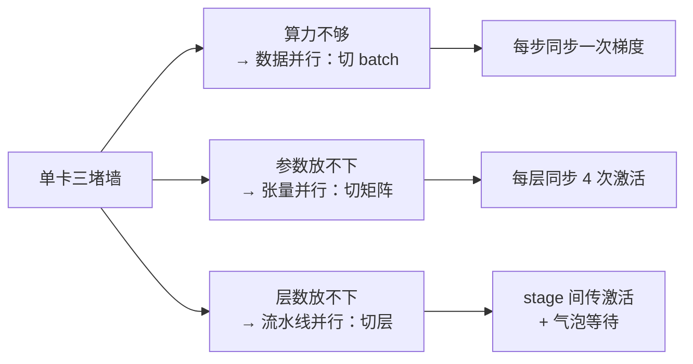
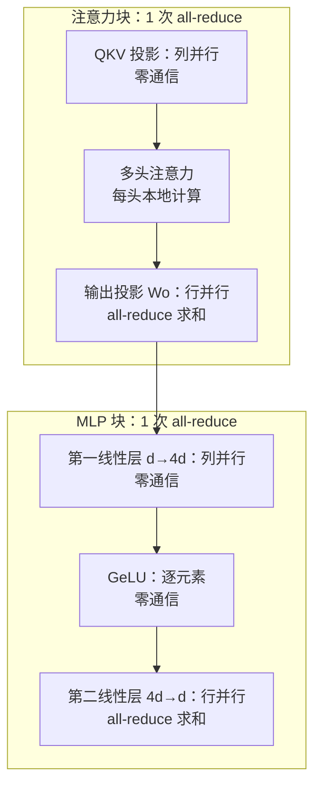

# 31｜数据并行与张量并行：一个模型塞不进一张卡、一个 batch 算不完时怎么办？

> **阅读目标**：理解数据并行、张量并行、流水线并行三种切分方式各自解决的"不够"；能从 ring all-reduce 的两阶段过程推导出通信量约为 $`2S`$，并算出 7B 模型一步的通信账；明白张量并行里"列并行不用通信、行并行必须 all-reduce"的代数原因，以及三种并行如何组合成 3D 并行。
>
> **前置知识**：第 6 篇的 Transformer 层结构（注意力 + MLP 各由两个线性层构成）、第 10 篇的训练目标（梯度是损失对参数的导数）、第 15 篇的混合精度（fp16 占 2 字节）、第 30 篇的 batch size 与临界 batch（大 batch 需要多卡分担算力）。需要用到一点线性代数：矩阵按列切分与按行切分后乘法的分配律。

## 1. 直觉：三种"不够"，对应三种切法

单卡训练一个大模型时，会撞上三堵不同的墙：

- **算力不够**：一个 batch 的梯度要算很久，加卡分担计算——这是**数据并行**（Data Parallelism, DP）；
- **显存不够**：模型参数本身一张卡放不下，必须把参数切开、每张卡只存一部分——这是**张量并行**（Tensor Parallelism, TP）；
- **还是不够**：层数太多，一张卡连几层都放不下，那就把层按顺序分给不同的卡——这是**流水线并行**（Pipeline Parallelism, PP）。

一个日常比喻：要抄一本很厚的书。数据并行是"每人抄不同的章节，最后把各章的修改意见汇总"——每人手里都有一整本书；张量并行是"每人只负责书里一半的页码，抄完再拼起来"——没人手里有整本书；流水线并行是"第一个人抄第 1–10 页传给下一个人抄 11–20 页"，像工厂流水线。

三者的关键区别可以用一张表先记下来：

| 切分方式 | 切的是什么 | 每张卡存的参数 | 解决的瓶颈 | 主要通信 |
|---|---|---|---|---|
| 数据并行 | 数据（batch） | 完整模型 | 算力 / 吞吐 | 每步一次梯度 all-reduce |
| 张量并行 | 参数矩阵（每层内） | 每层的 $`1/N`$ | 单层参数太大、显存 | 每层前向 2 次、反向 2 次 all-reduce |
| 流水线并行 | 层（模型深度方向） | $`1/P`$ 的层 | 层数太多 | 相邻 stage 之间传激活值 |

本篇先讲透前两种，第 5 节讲流水线并行，第 6 节讲三者如何组合。先记住一个总原则：**切分方式决定了通信的"形状"，而通信量最终要和计算量放在一起算账**——通信本身不贵，贵的是"通信时计算在等"。



## 2. 严格推导：数据并行——梯度平均与 ring all-reduce 的 $`2S`$

### 2.1 数据并行的数学：梯度平均等于大 batch 梯度

设 $`N`$ 张卡，第 $`i`$ 张卡拿到 batch 的一个分片，算出局部梯度 $`g_i`$。如果每张卡的分片大小相同，全 batch 的梯度就是各局部梯度的平均：

```math
g = \frac{1}{N}\sum_{i=1}^{N} g_i
```

这一步是严格的：损失是各样本损失的平均，梯度对求和是线性的，所以"分开算再平均"和"一起算"得到的是**完全相同的梯度**（浮点舍入误差除外）。数据并行不改变任何数学，只改变计算的组织方式——这也是它成为默认并行方式的原因：第 30 篇讲的"batch 翻倍"在工程上就是靠数据并行实现的。

实现上有一个细节：平均里的 $`1/N`$ 可以在反向传播前就把每张卡的损失除以 $`N`$ 来消化，这样 all-reduce 只需要做"求和"，不用再做一次除法。

### 2.2 Ring all-reduce：为什么通信量是 $`2S`$，而不是 $`NS`$

$`N`$ 张卡要对大小为 $`S`$ 的梯度求和。最 naive 的做法是每张卡把自己的梯度发给所有人：每张卡发送 $`(N-1)S`$，总通信量随 $`N`$ 线性增长，卡越多越慢。Ring all-reduce 把这个量压到了约 $`2S`$——与卡数几乎无关。

做法分两个阶段。先把梯度切成 $`N`$ 块，每块大小 $`S/N`$，$`N`$ 张卡排成一个环：

- **Scatter-reduce（归约散播）**：$`N-1`$ 轮，每轮每张卡把自己手里的一块发给下一个邻居，同时从上一个邻居收到一块、加到自己的对应块上。$`N-1`$ 轮之后，每张卡手里恰好有一块是"所有卡这一块的总和"。
- **All-gather（全收集）**：再 $`N-1`$ 轮，每张卡把自己手里那块已归约好的块传给邻居。$`N-1`$ 轮之后，每张卡都有了完整的总和。

每张卡每轮发送一块（$`S/N`$），共 $`2(N-1)`$ 轮，所以每张卡总共发送：

```math
V = 2(N-1)\cdot\frac{S}{N} = 2S\cdot\frac{N-1}{N} \approx 2S \quad (N \text{ 较大时})
```

**结论一（严格）**：ring all-reduce 每张卡的通信量约为 $`2S`$，与卡数 $`N`$ 几乎无关。卡数翻倍时，单卡通信量不翻倍——这就是数据并行能扩展到成百上千张卡的数学基础。注意这里说的是"每张卡发送 $`2S`$"，不是"总共 $`2S`$"：$`N`$ 张卡各发 $`2S`$，全网总流量是 $`2NS`$，但决定单卡等待时间的是每张卡自己的 $`2S`$。

### 2.3 通信时间与计算时间的比较：$`\alpha`$–$`\beta`$ 模型

通信时间常用 $`\alpha`$–$`\beta`$ 模型估计：$`\alpha`$ 是每次传输的固定延迟，$`\beta`$ 是每字节的传输时间（带宽的倒数）。Ring all-reduce 的时间是：

```math
T_{\text{comm}} = 2(N-1)\alpha + 2S\cdot\frac{N-1}{N}\cdot\beta
```

两项的含义不同：第一项是延迟项，随卡数线性增长（轮数多了）；第二项是带宽项，约等于 $`2S\beta`$，与卡数无关。大模型训练里梯度 $`S`$ 很大（GB 级），带宽项通常占主导；但卡数上千时，$`2(N-1)\alpha`$ 的延迟项也会冒出来——这就是超大规模训练里"通信延迟"成为新瓶颈的原因。

数据并行还有一个工程优化值得知道：**梯度分桶与重叠**（bucketing + overlap）。反向传播是逐层从后往前算梯度的，PyTorch 的 DDP 不等所有梯度算完再通信，而是某几层的梯度一算好就立刻发起 all-reduce，和前面层的反向计算重叠进行。通信时间被"藏"进了计算时间里，实际感受到的等待远小于 $`T_{\text{comm}}`$ 本身。第 4 节的数值例子会算一笔"不重叠"的上限账，实际账只会更好。

但重叠不是万能的：它成立的前提是"反向计算足够长、能盖住通信"。如果模型很小（梯度 $`S`$ 小、反向算得快），或者网络很慢（$`\beta`$ 大），通信时间超过反向计算时间，盖不住的部分就会原样暴露为等待。判断标准很简单：比较"一层的反向计算时间"和"一桶梯度的 all-reduce 时间"——前者大于后者，重叠就有效；反过来，通信就成了硬瓶颈。这也是小模型多卡训练经常"越并行越慢"的直接原因：计算被切得太碎，通信的固定成本反而占了上风。

> **区分**：结论一（$`2S`$）是严格的算法复杂度结论；"通信可以被计算完全掩盖"是工程实践结论，取决于反向计算的速度和通信的带宽——小模型、慢网络时掩盖不住，大模型、快网络时基本能掩盖。

## 3. 张量并行：列并行不用通信、行并行必须 all-reduce

数据并行有个硬伤：每张卡都要存一份完整模型。7B 模型用 Adam 训练时，单卡要存 fp32 参数（$`4P`$ 字节）+ fp32 梯度（$`4P`$）+ Adam 的两份动量（$`8P`$），共 $`16P`$ 字节——7B 参数就是 112GB，一张 80GB 的 A100 根本放不下。张量并行的思路是：把**每一层内部的矩阵**切开。

### 3.1 列并行：沿输出维切分，不需要通信

取一个线性层 $`Y = XW`$，$`X`$ 是 $`(T, d)`$（$`T`$ 个 token、维度 $`d`$），$`W`$ 是 $`(d, d)`$。把 $`W`$ 沿**输出维**（列）切成两半，$`W = [W_1, W_2]`$，则：

```math
Y = XW = [XW_1,\; XW_2] = [Y_1,\; Y_2]
```

每张卡算一半输出，拼起来就是完整结果——**中间没有任何通信**。这就是"列并行"（column-parallel）。Transformer 里 QKV 投影就是列并行：输出维是 $`3d`$，切成 $`N`$ 份后每张卡算自己那份的 Q、K、V。MLP 的第一个线性层（$`d \to 4d`$）也是列并行。

但列并行有个前提：后面的操作必须是**逐元素的**。GeLU、SiLU 这类激活函数对每个元素独立作用，所以切开算、拼起来，和整体算的结果完全相同。如果后面接的是需要"看全貌"的操作（比如 softmax 要对整行归一化），列并行就不成立了。

### 3.2 行并行：沿输入维切分，必须 all-reduce 求和

把 $`W`$ 沿**输入维**（行）切分：$`X = [X_1, X_2]`$，$`W = \begin{bmatrix} W_1 \\ W_2 \end{bmatrix}`$，则：

```math
Y = XW = X_1 W_1 + X_2 W_2 = Y_1 + Y_2
```

每张卡算出一个**部分和** $`Y_i`$，必须把所有卡的部分和加起来才得到真正的 $`Y`$——这一步就是一次 all-reduce。行并行（row-parallel）的通信就出在这里。

Transformer 里行并行出现在两个地方：注意力输出投影 $`W_O`$（输入维是 $`d`$，各卡的注意力头输出是 $`X`$ 的不同列分片），和 MLP 的第二个线性层（$`4d \to d`$）。于是每层 Transformer 的前向恰好需要 **2 次 all-reduce**：一次在注意力块末尾，一次在 MLP 块末尾。反向传播里，每次前向 all-reduce 对应一次反向 all-reduce（求和的导数仍然是求和），所以每层反向也是 2 次。**每层总共 4 次 all-reduce**——这是 Megatron-LM（Shoeybi et al., 2019）的标准结构。

### 3.3 为什么这样切是最优的：通信只发生在"求和点"

把 3.1 和 3.2 合起来看，设计原则就清楚了：**能用列并行解决的就不用行并行**，因为列并行零通信。Transformer 的结构恰好配合这一点：每个子块（注意力、MLP）都是"先列并行升维、逐元素变换、再行并行降维"的两段式，通信只发生在每段的末尾——即每层 2 个"求和点"。



还有一个细节：张量并行切分后，每张卡存的参数是原来的 $`1/N`$，但**激活值是复制的**——每张卡都持有完整的输入 $`X`$（因为列并行需要完整输入）。所以张量并行省的是参数显存，不省激活显存；激活显存要靠第 16 篇的梯度检查点或第 8 篇的 KV Cache 思路来省。反向传播时，行并行的 all-reduce 同样存在，这是"每层 4 次"的另一半来源。

> **区分**：每层 4 次 all-reduce 是 Megatron 式切分的严格计数（前向 2 + 反向 2），但它依赖一个前提——注意力头数能被并行度整除、MLP 中间维能被整除。如果模型结构不配合（比如头数 7、并行度 8），切分需要额外处理，通信次数可能变化。

## 4. 数值例子：7B 模型的一步通信账

取一个具体配置：7B 参数模型，$`d = 4096`$，32 层，8 张 A100（单卡 fp16 算力 312 TFLOPS，NVLink 带宽约 600 GB/s），每步每张卡处理 2048 个 token，梯度用 fp16。

### 4.1 数据并行的账：梯度 all-reduce

梯度大小 $`S = 7 \times 10^9 \times 2\,\text{字节} = 14\,\text{GB}$`。8 卡 ring all-reduce，每张卡发送：

```math
V = 2S\cdot\frac{7}{8} = 2 \times 14 \times 0.875 = 24.5\,\text{GB}
```

通信时间：$`24.5 / 600 \approx 0.041\,\text{秒}$`。

计算时间：8 张卡共处理 $`8 \times 2048 = 16384`$ 个 token，每 token 约 $`6P = 6 \times 7 \times 10^9 = 4.2 \times 10^{10}`$ FLOPs（第 24 篇 scaling law 的 $`6ND`$ 公式），总计算量 $`16384 \times 4.2 \times 10^{10} \approx 6.9 \times 10^{14}`$ FLOPs。8 卡总算力 $`8 \times 312 = 2496`$ TFLOPS，按 45% 利用率（MFU）算，有效算力约 $`1.1 \times 10^{15}`$ FLOP/s：

```math
T_{\text{compute}} = \frac{6.9 \times 10^{14}}{1.1 \times 10^{15}} \approx 0.61\,\text{秒}
```

通信只占计算的约 7%——而且 DDP 的分桶重叠还能把这 7% 再藏掉一部分。**结论**：在这个配置下，数据并行的通信基本不是瓶颈。

### 4.2 张量并行的账：每层 4 次 all-reduce

每张卡每步处理的 token 数 $`T = 2048`$，每次 all-reduce 的张量是 $`T \times d = 2048 \times 4096`$ 个 fp16 元素，即 $`2048 \times 4096 \times 2 = 16.8\,\text{MB}$`。Ring all-reduce 每张卡发送约 $`2 \times 16.8 \times 7/8 \approx 29.4\,\text{MB}$`。

每层 4 次（前向 2 + 反向 2），32 层共 128 次：

```math
V_{\text{TP}} = 128 \times 29.4\,\text{MB} \approx 3.8\,\text{GB}
```

通信时间：$`3.8 / 600 \approx 0.0063\,\text{秒}$`，只有数据并行通信量的约六分之一。**但这笔账有个关键前提：张量并行用的是卡内 NVLink（600 GB/s）**。如果把张量并行跨节点、走 200 GB/s 的 InfiniBand，时间翻 3 倍；如果走 25 GB/s 的普通以太网，时间翻 24 倍，通信立刻反超计算成为瓶颈。

| 方案 | 每步每卡通信量 | 600 GB/s 下耗时 | 占计算时间（0.61s） |
|---|---|---|---|
| 数据并行（梯度 all-reduce） | 24.5 GB | 0.041 s | 约 7% |
| 张量并行（128 次小 all-reduce） | 3.8 GB | 0.0063 s | 约 1% |
| 张量并行跨节点（200 GB/s） | 3.8 GB | 0.019 s | 约 3% |
| 张量并行走以太网（25 GB/s） | 3.8 GB | 0.15 s | 约 25% |

这个表就是 3D 并行的工程直觉：**张量并行留在节点内（用 NVLink），数据并行跨节点（只同步一次梯度）**。反过来配——张量并行跨慢速网络、数据并行占着 NVLink——就是把两种通信都放在了错误的位置上。

## 5. 流水线并行与气泡率

如果层数太多，连"每层切 $`1/N`$"都不够——比如 96 层的模型，张量并行 8 路后每卡仍有 12 层，每层参数加激活还是放不下——就把层按顺序切给不同的卡：第 1–12 层在卡 1，第 13–24 层在卡 2，依此类推。数据像流水线一样流过各张卡，这就是流水线并行（GPipe, Huang et al., 2019）。

流水线并行的代价是**气泡（bubble）**：流水线刚启动时，后面的卡在等前面的卡；快结束时，前面的卡在等后面的卡。设 $`p`$ 个 stage、$`m`$ 个 micro-batch，气泡时间占比约为：

```math
\text{气泡占比} \approx \frac{p-1}{m+p-1}
```

$`p = 8`$、$`m = 32`$ 时，气泡约 $`7/39 \approx 18\%`$——近五分之一的时间有卡在空等。增大 $`m`$（把 batch 切得更碎）能压小气泡，但 $`m`$ 越大、每个 micro-batch 越小，单卡计算效率又会下降；这是一个需要实测的权衡。流水线并行还有一个细节：为了填气泡，1F1B（one-forward-one-backward）调度让各 stage 前向与反向交错进行，把气泡压到理论下限附近——这是工程实现层的优化，数学上不改变气泡公式。

1F1B 的做法值得展开一点：朴素的 GPipe 调度是"所有 micro-batch 的前向全部跑完，再全部反向"，这意味着前半段所有 stage 都在等最后一个 stage 的前向、后半段又都在等第一个 stage 的反向，气泡是双份的。1F1B 改成"每个 stage 做一个 micro-batch 的前向、紧接着做一个 micro-batch 的反向、再下一个前向……"——前向和反向像拉链一样交错咬合，每个 stage 几乎一直在工作。代价是每个 stage 需要同时保存多个 micro-batch 的激活（因为它的反向比前向落后几个 micro-batch），激活显存随之上升；这正是流水线并行常与第 16 篇的梯度检查点搭配使用的原因——用重算换显存，把 1F1B 多占的激活再省回来。

> **区分**：气泡公式是严格的（给定 $`p`$ 和 $`m`$ 的调度结构），但"1F1B 能压到接近下限"是工程结论；实际气泡还受各 stage 负载是否均衡影响——如果某一层的计算量特别大，它会成为整条流水线的短板。

## 6. 实践：3D 并行怎么组合

真实的大模型训练三种并行一起用，叫做 **3D 并行**。组合的原则只有两条，来自第 4 节的账：

1. **张量并行度最小化，且只放在节点内**：TP 的通信最频繁（每层 4 次），必须用最快的互联。8 卡一台机器时，TP 度通常取 8（整机），不再放大——放大 TP 度只会增加跨节点通信。
2. **数据并行度最大化，放在节点间**：DP 每步只通信一次、通信量 $`2S`$ 与卡数无关，最适合跨慢速网络扩展。需要更大 batch 时（第 30 篇的临界 batch 允许时），优先加 DP 度。

一个常见的 70B 模型配置：总卡数 256，TP=8（节点内）、PP=8（跨节点切层）、DP=4（256 / (8×8)）。每张卡存 $`1/8`$ 的每层参数（TP）× $`1/8`$ 的层数（PP）= $`1/64`$ 的参数，70B 模型每卡约 1.1B 参数的权重——配合混合精度与优化器状态切分，单卡 80GB 才放得下。优化器状态的切分是 ZeRO 的工作，第 32 篇会讲。

还要注意一个组合时的约束：**三种并行度的乘积等于总卡数**，$`N_{\text{total}} = N_{\text{DP}} \times N_{\text{TP}} \times N_{\text{PP}}`$。调参时先定 TP（节点内卡数）和 PP（层数/单 stage 容量），剩下的卡全给 DP——DP 度越大，每步的全局 batch 越大，但别超过第 30 篇的临界 batch，否则多花的算力换不来收敛速度。

最后补一个组合时容易踩的坑：**随机性的同步**。数据并行要求所有卡上的模型参数在每一步开始时完全相同——初始化时必须用同一个随机种子，否则各卡从不同的起点出发，梯度平均就失去了意义（平均几个不同模型的梯度不等于任何一个模型的梯度）。但 dropout（第 29 篇）的随机 mask 恰恰要求各卡**不同**：如果所有卡用同一个 dropout mask，分片数据上的"随机丢弃"就变成了"所有卡丢掉同一批神经元"，正则化效果会打折扣。正确的做法是：参数初始化用统一的种子、数据分片用互不重叠的采样、dropout 用每卡独立的种子——三处随机性，三种处理，混在一起就是难以定位的训练不一致。

## 7. 常见误区

**误区一："数据并行加卡越多，训练越快。"**
错。数据并行每步的通信量约 $`2S`$ 不随卡数增长，但延迟项 $`2(N-1)\alpha`$ 随卡数线性增长；更重要的是，第 30 篇的临界 batch 限制了全局 batch 的有效上限——超过临界值后加卡只是在用更多算力做同样的事，收敛速度不再提升。

**误区二："张量并行把模型切开了，所以每张卡的计算量也减到 $`1/N`$，通信可以忽略。"**
错一半。计算量确实减到约 $`1/N`$，但通信没有消失：每层 4 次 all-reduce 是结构性的，第 4 节算出来在 NVLink 下只占 1%，是因为带宽高——换成慢速网络立刻占到 25%。通信占比取决于"带宽/算力"的比值，不是切分方式本身。

**误区三："all-reduce 就是把所有梯度发给一台中心服务器汇总再发回来。"**
错。那是参数服务器（parameter server）的做法，中心节点是瓶颈，通信量是 $`2S`$ 但全部经过一台机器。Ring all-reduce 没有中心节点，每张卡只和邻居通信，带宽被所有链路分摊——这是它能扩展到上千卡的原因。

**误区四："用了张量并行，显存问题就解决了。"**
错。张量并行只切参数，不切激活——每张卡仍持有完整的输入激活。第 8 篇 KV Cache、第 16 篇梯度检查点解决的是激活显存；优化器状态（Adam 的两份动量，占 $`8P`$ 字节）更是一点没切，要靠 ZeRO（第 32 篇）。

**误区五："流水线并行的气泡是实现没做好，调优能完全消除。"**
错。气泡来自流水线本身的"启动—排空"结构，$`(p-1)/(m+p-1)`$ 是下限而非 bug。1F1B 调度能逼近下限，但不能让气泡归零——除非 $`m \to \infty`$，而那又会拖垮单卡效率。

## 8. 自测题

**第 1 题**：8 张卡做数据并行，梯度 fp16 大小 $`S = 10\,\text{GB}$`。用 ring all-reduce，每张卡一共发送多少数据？如果改成"每张卡把梯度发给 0 号卡汇总、再由 0 号卡广播回去"（参数服务器式），0 号卡一共收发多少数据？

<details>
<summary>答案</summary>

Ring all-reduce：每张卡发送 $`2S(N-1)/N = 2 \times 10 \times 7/8 = 17.5\,\text{GB}$`。参数服务器式：0 号卡接收 7 张卡的梯度（70GB），再广播 7 份总和（70GB），共收发 140GB——是 ring 的 8 倍，且全部经过一张卡的网卡，这就是中心节点的瓶颈所在。
</details>

**第 2 题**：一个 Transformer 层，$`d = 2048`$，TP 并行度为 4，前向传播里有几次 all-reduce？每次 all-reduce 的张量是多大（token 数 $`T = 1024`$，fp16）？为什么 QKV 投影那一步不需要通信？

<details>
<summary>答案</summary>

前向 2 次：注意力输出投影（行并行）1 次 + MLP 第二线性层（行并行）1 次。每次 all-reduce 的张量是 $`T \times d = 1024 \times 2048`$ 个 fp16 元素，即 $`1024 \times 2048 \times 2 = 4\,\text{MB}$`。QKV 投影是列并行：沿输出维切分后每张卡算自己那份输出，拼起来就是完整结果，中间不需要求和，所以零通信。
</details>

**第 3 题**：接第 4.1 节的 7B 例子。如果把每张卡的 token 数从 2048 降到 256（总 token 从 16384 降到 2048），计算时间和通信时间各变成多少？通信占比会怎么变？这说明了什么？

<details>
<summary>答案</summary>

计算量与 token 数成正比：$`T_{\text{compute}} = 0.61 \times 256/2048 \approx 0.076\,\text{秒}$`。通信量只取决于梯度大小 $`S`$，与 token 数无关，仍是 0.041 秒。通信占比从 7% 升到约 54%。说明：数据并行的通信是"固定成本"，计算是"可变成本"——每卡分到的数据越少，通信占比越高；小 batch + 多卡时，训练会被通信拖垮。这也是第 30 篇"临界 batch"在工程上的另一面。
</details>

**第 4 题**：流水线并行 $`p = 4`$ 个 stage、$`m = 12`$ 个 micro-batch，气泡占比约多少？如果把 micro-batch 数加倍到 24，气泡占比变为多少？为什么不能无限制地增大 $`m`$？

<details>
<summary>答案</summary>

气泡占比 $`(p-1)/(m+p-1) = 3/15 = 20\%`$。$`m = 24`$ 时为 $`3/27 \approx 11\%`$。不能无限制增大 $`m`$，因为总 batch 固定时 $`m`$ 越大、每个 micro-batch 越小，单卡上矩阵乘的并行度下降、kernel 启动开销占比上升，计算效率反而变差；此外 micro-batch 越小，流水线调度的开销也越大。
</details>

---

**下一篇预告**：第 32 篇将讲 ZeRO：Adam 的两份动量占了 $`8P`$ 字节显存——把参数、梯度和优化器状态也按卡切分，单卡内存怎么从 $`16P`$ 降到 $`16P/N`$？
