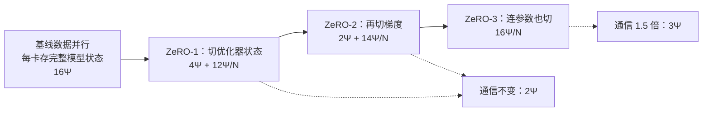
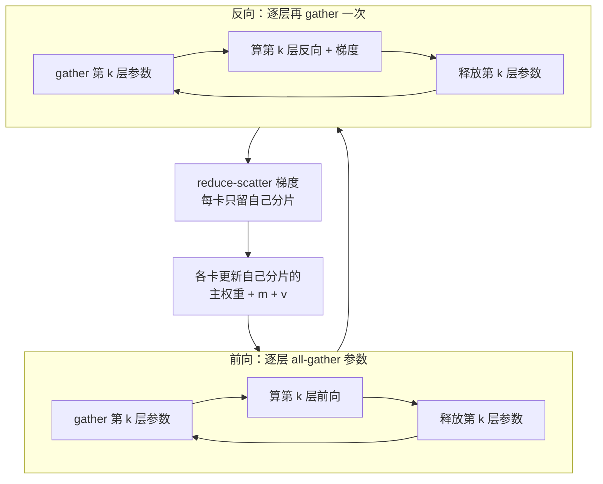

# 32｜ZeRO：单卡显存怎么从 16Ψ 降到 16Ψ/N？

> **阅读目标**：理解数据并行里"每张卡都存一份完整模型状态"的冗余从何而来；能从混合精度 + Adam 的逐项记账推导出 $`16\Psi`$，并算出 ZeRO 三个阶段每卡的显存公式；明白 ZeRO-1/2 的通信量为什么不变、ZeRO-3 为什么是基线的 1.5 倍；知道公式里的 $`N`$ 是数据并行度、不是总卡数。
>
> **前置知识**：第 12 篇的 Adam 更新规则（$`m`$、$`v`$ 两份动量）、第 15 篇的混合精度（fp16 计算 + fp32 主权重）、第 25 篇的梯度裁剪（需要全局梯度范数）、第 31 篇的数据并行（ring all-reduce 的 $`2S`$）与 3D 并行。需要用到一点集合论直觉：分片（partition）与复制（replication）的区别。

## 1. 直觉：N 张卡，每张卡都在存同一份东西

第 31 篇讲数据并行时，有一个事实被轻轻放过了：$`N`$ 张卡做数据并行，每张卡手里都有一份**完整**的模型——完整的参数、完整的梯度、完整的 Adam 优化器状态。每一步结束时，这些副本被同步成完全相同的内容。也就是说，集群里存了 $`N`$ 份一模一样的东西，只有一份是真正必需的，另外 $`N-1`$ 份纯属冗余。

为什么每张卡非存一份不可？因为数据并行的正确性依赖一个约定：**每一步开始时，所有卡的参数必须完全相同**。各卡拿不同的数据分片算梯度，all-reduce 平均后得到同一份梯度，再用同一份优化器状态做更新——只有每卡手里有完整的参数和优化器状态，这一步才能各自独立完成。冗余不是实现上的懒惰，而是"各自独立更新"这个组织方式的直接代价。ZeRO 的洞见是：更新可以分工——第 $`i`$ 张卡只更新第 $`i`$ 份参数，更新完再互相抄一份。这样一来，每张卡只需要存自己负责的那一份，完整模型只在"需要计算的那一刻"临时拼出来。

一个日常比喻：$`N`$ 个人合写一本书，每人手里都有一整本，改一个字要 $`N`$ 个人同步改。更省的办法是把书撕成 $`N`$ 份，每人只保管一份；谁要读哪一章，临时找保管人借来看，看完还回去。这就是 ZeRO（Zero Redundancy Optimizer，零冗余优化器，Rajbhandari et al., 2019）的核心思想：**数据并行不需要冗余，只需要分片**。

但"撕书"不是免费的：借书要花时间（通信），而且有些页必须人手一份才方便（比如正在算的那一层参数）。ZeRO 的三篇递进——ZeRO-1、ZeRO-2、ZeRO-3——就是沿着"什么可以撕、撕了要付出什么"的顺序，一步步把冗余撕干净。本篇先把账算清楚：先算基线是多少（第 2 节），再看三个阶段各省多少、各付多少（第 3–5 节）。



## 2. 严格推导：16Ψ 是怎么来的

设模型有 $`\Psi`$ 个参数。混合精度训练 + Adam 时，每张卡上的模型状态由五项组成：

| 状态 | 精度 | 字节/参数 | 为什么需要 |
|---|---|---|---|
| 参数（前向/反向用的工作副本） | fp16 | $`2\Psi`$ | 前向和反向计算用 fp16 跑得快 |
| 梯度 | fp16 | $`2\Psi`$ | 反向传播算出的梯度，先存 fp16 |
| fp32 主权重（master weights） | fp32 | $`4\Psi`$ | fp16 只有约 3 位十进制精度，直接拿它做更新会把小更新"四舍五入"掉，所以更新发生在 fp32 副本上，再 cast 回 fp16 |
| Adam 一阶动量 $`m`$ | fp32 | $`4\Psi`$ | 第 12 篇：$`m_t = \beta_1 m_{t-1} + (1-\beta_1) g_t`$，每个参数一份 |
| Adam 二阶动量 $`v`$ | fp32 | $`4\Psi`$ | 第 12 篇：$`v_t = \beta_2 v_{t-1} + (1-\beta_2) g_t^2`$，每个参数一份 |

加起来：

```math
M_{\text{基线}} = 2\Psi + 2\Psi + 4\Psi + 4\Psi + 4\Psi = 16\Psi \text{ 字节}
```

**结论一（严格）**：混合精度 + Adam 的数据并行，每张卡的模型状态显存是 $`16\Psi`$ 字节，与卡数无关。7B 参数的模型就是 $`16 \times 7 \times 10^9 = 112\,\text{GB}`$——一张 80GB 的 A100 连模型状态都放不下，这还没算激活。

两个要点值得先钉住：

- **最胖的一块是 fp32 的 $`12\Psi`$**（主权重 + $`m`$ + $`v`$），占了总量的四分之三。所以 ZeRO 先切它——这就是 ZeRO-1。
- **$`16\Psi`$ 只是"模型状态"（model states）**，不含激活、临时缓冲和显存碎片。激活是另一类内存（ZeRO 论文里叫残余状态，residual states），归第 16 篇的梯度检查点和 ZeRO-R 管，本篇的公式都不含它。把 $`16\Psi`$ 当成"训练总显存"是常见的偷换概念。

梯度为什么存 fp16？因为反向传播本身就是在 fp16 下算的（混合精度），梯度天然就是 fp16。把它转成 fp32 存，显存要多 $`2\Psi`$，收益却很小：梯度只用来做一次 all-reduce 求和、再喂给 Adam——Adam 的 $`m`$、$`v`$ 更新发生在 fp32 主权重那侧，梯度的舍入误差会被动量平滑掉一部分。当然，极端情况下 fp16 梯度下溢（太小的梯度变成 0）是真实风险，第 15 篇的 loss scaling 就是对付它的——这也是混合精度训练必须配 loss scaling 的原因。

Adam 的更新长什么样，决定了 $`m`$、$`v`$ 为什么各占一份、谁也省不掉。第 12 篇的更新规则是：

```math
m_t = \beta_1 m_{t-1} + (1-\beta_1) g_t, \quad v_t = \beta_2 v_{t-1} + (1-\beta_2) g_t^2
```

```math
\theta_t = \theta_{t-1} - \alpha \frac{\hat{m}_t}{\sqrt{\hat{v}_t} + \epsilon}
```

每个参数各有一份 $`m`$ 和一份 $`v`$，跟着参数走、随训练步一起更新——它们是"状态"，不是能随时重算的中间量，所以必须持久保存。这也是优化器状态没法像激活那样"用完即扔"的原因。

fp32 主权重为什么省不掉？fp16 只有 10 位尾数，约 3 位十进制精度，在 0.5 附近两个相邻可表示数之间隔着约 $`4.9 \times 10^{-4}`$。而一次 Adam 更新的量级常常只有 $`10^{-4}`$ 甚至更小——直接加在 fp16 参数上，会被四舍五入原样吞掉，参数纹丝不动。所以更新必须发生在 fp32 主权重上，算完再 cast 回 fp16。主权重不是"备份"，它是唯一真正被更新的那份参数；fp16 副本只是用来计算的"工作版"。

> **区分**：$`16\Psi`$ 是严格的逐项记账结论，但它依赖两个前提——混合精度（fp16 参数 + fp32 主权重）和 Adam 优化器。换成纯 fp32 训练或 SGD，数字会变：纯 fp32 + Adam 是 $`4 + 4 + 4 + 4 = 16\Psi`$（巧合地也是 16，但构成不同）；SGD 不带 $`m`$、$`v`$，基线只有 $`2 + 2 + 4 = 8\Psi`$。下面的 ZeRO 公式都以"混合精度 + Adam"为准。

## 3. ZeRO-1：只切优化器状态

ZeRO-1 只切最胖的那一块：把 fp32 主权重、$`m`$、$`v`$（共 $`12\Psi`$）切成 $`N`$ 份，第 $`i`$ 张卡只存第 $`i`$ 份。参数和梯度仍全量复制：

```math
M_{\text{ZeRO-1}} = 2\Psi + 2\Psi + \frac{12\Psi}{N} = 4\Psi + \frac{12\Psi}{N}
```

$`N = 64`$、7B 模型时：$`(4 + 12/64) \times 7 \times 10^9 = 4.1875 \times 7\,\text{GB} = 29.3\,\text{GB}`$——从 112GB 降到 29.3GB，单卡放得下了。

通信为什么不增加？关键在"谁需要什么"：第 $`i`$ 张卡只需要自己分片对应的梯度，就能更新自己分片的优化器状态和主权重。所以梯度的 all-reduce 可以改成两步：

1. **reduce-scatter 梯度**：各卡把梯度求和，但每卡只收到自己分片的那一份。通信量 $`\Psi`$（按 fp16 元素计，下同）；
2. **all-gather 更新后的参数**：每卡把自己分片更新好的 fp16 参数广播给所有人，拼回完整参数，供下一步前向使用。通信量 $`\Psi`$。

两步合计 $`2\Psi`$，恰好等于基线 all-reduce 的量（第 31 篇：all-reduce = reduce-scatter $`\Psi`$ + all-gather $`\Psi`$）。**结论二（严格）**：ZeRO-1 的通信量与基线数据并行相同，只是形态变了——一半花在梯度上、一半花在参数上。

ZeRO-1 有两个工程细节值得知道：

- reduce-scatter 可以分桶、与反向计算重叠（第 31 篇的 bucketing 思路），所以它基本藏得住；但参数 all-gather 必须发生在**下一步前向开始之前**，是关键路径上的同步点，藏不住。通信量虽然没变，通信在时间线上的位置变了。
- ZeRO-1 的显存下限是 $`4\Psi`$：参数和梯度仍全量复制，卡再多也降不下去。所以它最多带来约 4 倍的缩减（$`16\Psi \to 4\Psi`$），这就是 ZeRO-1 的天花板。

为什么参数 all-gather 不能提前？因为 all-gather 搬的是"更新后的参数"，而更新依赖 reduce-scatter 回来的梯度。时间线是死的：反向算梯度 → reduce-scatter → 各卡更新自己分片 → all-gather 参数 → 下一步前向。all-gather 是这条链的最后一环，前面的每一步都省不掉。所以 ZeRO-1 的通信虽然总量不变，但"可重叠"的部分只有 reduce-scatter 那一半；all-gather 那一半是硬同步。卡数越多、单步计算越短，这个硬同步的占比就越高——这也是小模型上 ZeRO-1 收益有限的原因之一。

## 4. ZeRO-2：再切梯度

ZeRO-1 切完优化器状态后，梯度（$`2\Psi`$）成了第二胖的复制项。ZeRO-2 顺手把它也切了：梯度 reduce-scatter 之后，不属于自己的分片直接丢弃，每卡只保留 $`2\Psi/N`$ 的梯度：

```math
M_{\text{ZeRO-2}} = 2\Psi + \frac{2\Psi}{N} + \frac{12\Psi}{N} = 2\Psi + \frac{14\Psi}{N}
```

$`N = 64`$、7B 模型时：$`(2 + 14/64) \times 7\,\text{GB} = 2.21875 \times 7\,\text{GB} = 15.5\,\text{GB}`$。通信仍是 reduce-scatter $`\Psi`$ + all-gather $`\Psi`$ = $`2\Psi`$，和基线、ZeRO-1 完全相同。**ZeRO-2 省的是内存，不是通信**——三个阶段里，只有 ZeRO-3 会多花通信。

一个容易忽略的细节是梯度裁剪（第 25 篇）：裁剪需要全局梯度范数 $`\|g\|`$，而 ZeRO-2 下没有一张卡拥有完整梯度。做法是每卡先算自己分片的范数平方 $`\|g_i\|^2`$，再做一次标量 all-reduce 求和、开方：

```math
\|g\| = \sqrt{\sum_{i=1}^{N} \|g_i\|^2}
```

一次标量通信的代价可以忽略。**不能因为梯度被切了就跳过裁剪**——裁剪防的是更新步长爆炸，和梯度存在哪张卡上无关。

梯度为什么不能像参数那样"用时再算"？因为梯度是反向传播的产物，算一次就要走完整条反向链；把它全扔了、需要时重算，等于把反向再跑一遍，计算量翻倍。ZeRO-2 的选择是"只留自己那份"，而不是"全扔了重算"——分片省内存的前提，是每张卡确实只需要自己那份梯度。这一点和 ZeRO-1 的逻辑完全相同：分工决定了需求，需求决定了哪些副本可以不要。

ZeRO-2 的显存下限是 $`2\Psi`$：参数仍全量复制。想再往下省，只剩最后一个复制项——参数本身。

## 5. ZeRO-3：连参数也切

ZeRO-3 把参数本身也分片：每卡只持久保存 $`1/N`$ 的参数、梯度和优化器状态：

```math
M_{\text{ZeRO-3}} = \frac{2\Psi + 2\Psi + 12\Psi}{N} = \frac{16\Psi}{N}
```

$`N = 64`$、7B 模型时：$`16 \times 7 / 64 = 1.75\,\text{GB}`$——模型状态几乎不占显存了。显存随卡数线性下降：卡翻倍，模型状态显存减半。这是 ZeRO-3 的 headline 结论，也是它能训万亿参数模型的数学基础。

代价是通信。前向计算需要完整的参数，但参数现在是分片存的，所以**每层前向之前要 all-gather 该层的参数，用完立刻释放**；反向传播同样需要参数算梯度，而前向 gather 的那份已经释放了（留着就等于又把参数存回来了），所以**反向要再 gather 一次**。再加上梯度的 reduce-scatter：

```math
V_{\text{ZeRO-3}} = \underbrace{\Psi}_{\text{前向 all-gather 参数}} + \underbrace{\Psi}_{\text{反向 all-gather 参数}} + \underbrace{\Psi}_{\text{reduce-scatter 梯度}} = 3\Psi = 1.5 \times V_{\text{基线}}
```

**结论三（严格）**：ZeRO-3 的通信量是基线数据并行的 1.5 倍。这个 1.5 是精确的倍数关系，不依赖模型大小和卡数。

临时缓冲也值得算一笔：逐层 gather 时，峰值临时显存只有一层的参数。7B 模型、32 层：$`2 \times 7 \times 10^9 / 32 \approx 0.44\,\text{GB}`$，可以忽略。但如果实现上偷懒、一次性 gather 全模型，临时显存就是完整的 $`2\Psi = 14\,\text{GB}`$，等于把省下来的又吐回去——所以 ZeRO-3 的实现必须逐层 gather、用完即释放，这是 DeepSpeed 做法的前提。

论文的原例可以当作交叉验证：7.5B 参数模型、64 卡，基线 120GB → ZeRO-1 31.4GB → ZeRO-2 16.6GB → ZeRO-3 1.9GB。用本篇公式验算：$`4.1875 \times 7.5 = 31.4`$、$`2.21875 \times 7.5 = 16.6`$、$`0.25 \times 7.5 = 1.9`$，全部对上。论文还给出：1T 参数、1024 卡时，$`16\Psi/N = 16 \times 10^{12}/1024 \approx 15.6\,\text{GB/卡}`$——万亿参数模型在今天的硬件上能训，数学上就是这一个除法。

还有一个藏等待的优化：逐层 gather 的 all-gather 可以预取（prefetch）——算第 $`k`$ 层的时候，提前发起第 $`k+1`$ 层的 all-gather，让通信和计算重叠。通信量还是 $`3\Psi`$，但关键路径上的等待被盖住了。代价是预取的那一层参数要提前占一份临时显存，峰值从一层变成两层——还是小事。**区分**：prefetch 改变的是"等待时间"，不是"通信量"；1.5 倍这个数纹丝不动，变的是你感受到的卡顿。

ZeRO-3 和第 16 篇的梯度检查点是互补的，不是互斥的。检查点省的是激活：反向时重算前向，**重算同样需要参数**——所以重算的那一层也要先 all-gather 参数，算完再释放。两者叠加时，每步的通信仍是 $`3\Psi`$（检查点不改变参数 gather 的次数，只改变激活的重算），但显存账是两份省：模型状态除以 $`N`$，激活压到 $`O(\sqrt{n})`$。大模型训练里它们几乎总是同时开。



## 6. 数值例子：7B 模型、64 卡的四档账

把第 2–5 节的公式代入同一个配置：7B 参数、64 张 A100（NVLink 600 GB/s），fp16 梯度/参数共 $`S = 14\,\text{GB}`$。

| 阶段 | 每卡模型状态显存 | 7B / 64 卡 | 每步通信量/卡 | vs 基线 |
|---|---|---|---|---|
| 基线数据并行 | $`16\Psi`$ | 112 GB（放不下） | $`2\Psi`$ ≈ 27.6 GB | 1× |
| ZeRO-1 | $`(4 + 12/64)\Psi`$ | 29.3 GB | $`2\Psi`$ ≈ 27.6 GB | 1× |
| ZeRO-2 | $`(2 + 14/64)\Psi`$ | 15.5 GB | $`2\Psi`$ ≈ 27.6 GB | 1× |
| ZeRO-3 | $`16\Psi/64`$ | 1.75 GB | $`3\Psi`$ ≈ 41.3 GB | 1.5× |

通信量的 GB 数是这样来的：基线 all-reduce 每卡发送 $`2S(N-1)/N = 2 \times 14 \times 63/64 \approx 27.6\,\text{GB}`$（第 31 篇的公式）；ZeRO-3 是它的 1.5 倍，约 41.3GB。

从表里能读出一个规律：三档之间的差距，几乎全来自 $`12\Psi/N`$ 这一项。基线到 ZeRO-1，省的是优化器状态；ZeRO-1 到 ZeRO-2，省的是梯度；ZeRO-2 到 ZeRO-3，省的是参数。每档省掉的都是当时最胖的复制项——这就是 ZeRO 论文的组织方式：按"胖瘦"排序，逐项消灭冗余。反过来也可以算边际收益：$`N = 64`$ 时，ZeRO-1 比基线省了 $`112 - 29.3 = 82.7\,\text{GB}`$，ZeRO-2 又省 $`13.8\,\text{GB}`$，ZeRO-3 再省 $`13.8\,\text{GB}`$。第一刀最狠，后面两刀的绝对收益差不多——因为 $`2\Psi`$ 的梯度和 $`2\Psi`$ 的参数本来就一样大。

通信时间账：NVLink 600 GB/s 下，基线 0.046 秒、ZeRO-3 0.069 秒；第 31 篇算出同样配置下单步计算约 0.61 秒，所以通信只占计算的约 7.5% vs 11%——**NVLink 下，1.5 倍基本感觉不到**。但如果把同样的通信放到 200 GB/s 的跨节点 InfiniBand 上：0.14 秒 vs 0.21 秒，占计算的 23% vs 34%——这时 1.5 倍就疼了。所以工程上的搭配是：ZeRO-3 尽量把数据并行组留在节点内，或者接受它——因为没有它，模型根本训不动。**"通信多了 50%"是工程结论**，成立条件是"带宽/算力"的比值；换一条更慢的网，结论的严重程度会变，但 1.5 倍这个数学比例不变。

提醒一句：表里的 GB 数只是模型状态，激活另算。ZeRO-3 的 1.75GB 不代表"7B 模型 64 卡训练一共只要 1.75GB 显存"——激活按 batch 和序列长度另算，第 16 篇的检查点仍然可能需要。

再算一个小配置当自检：13B 模型、8 卡。基线 $`16 \times 13 = 208\,\text{GB}`$，ZeRO-1 是 $`(4 + 12/8) \times 13 = 71.5\,\text{GB}`$（刚好塞进 80GB，但激活一加上就爆），ZeRO-2 是 $`(2 + 14/8) \times 13 = 48.75\,\text{GB}`$，ZeRO-3 是 $`16 \times 13 / 8 = 26\,\text{GB}`$。卡越少，ZeRO-1/2 离下限越远——$`12\Psi/N`$ 这一项在 $`N = 8`$ 时还有 $`1.5\Psi`$，不是可以忽略的小数。

## 7. 实践：ZeRO 与 3D 并行的组合

**公式里的 $`N`$ 是数据并行度 $`N_d`$，不是总卡数。** ZeRO 切的是数据并行组内的冗余。用了张量/流水线并行时，先按第 31 篇的 3D 并行分好组，ZeRO 只在每个数据并行组内部分片。接第 31 篇的 70B 例子：256 卡，TP=8、PP=8、DP=4，每卡参数 $`70\text{B}/64 \approx 1.1\text{B}`$；ZeRO-3 的模型状态是 $`16 \times 1.1\text{B}/4 = 4.4\,\text{GB/卡}`$。如果错把总卡数 256 代入公式，会算出 0.7GB——低估 6 倍多。

张量并行和 ZeRO 的分工也值得钉住：TP 切的是"层内"的参数矩阵（第 31 篇的列并行/行并行），让单层参数不再完整；ZeRO 切的是"数据并行组内"的模型状态，让优化器状态、梯度、参数不再完整。两者正交，可以叠加：TP 先把每卡的参数从 $`\Psi`$ 压到 $`\Psi/N_{TP}`$，ZeRO 再把剩下的优化器状态除以 $`N_d`$。第 31 篇 70B 例子的完整账本是：TP=8、PP=8 把参数压到 1.1B，再叠加 ZeRO-3（DP=4），模型状态 4.4GB——三者缺一不可，单靠任何一种都压不到这个数。

ZeRO 只管模型状态，激活是另一条线：同一篇论文的另一半 ZeRO-R 管残余状态，包括把激活检查点（第 16 篇）在数据并行组内分片——每卡只存自己那份检查点、需要时再取，以及减少临时缓冲和显存碎片。ZeRO-DP 回答"模型状态怎么分"，ZeRO-R 回答"剩下的显存怎么省"，两者合起来才是一篇完整的 ZeRO。以及两条常见的延伸路线：

- **ZeRO-Offload**：把优化器状态和 fp32 主权重卸载到 CPU 内存，优化器更新也在 CPU 上做，GPU 只留 fp16 参数和梯度——单机 8 卡也能训大模型，代价是每步要在 CPU-GPU 之间搬运优化器状态，PCIe 带宽成了新瓶颈。
- **ZeRO-Infinity**：再往下卸载到 NVMe 硬盘，用"显存 - 内存 - 硬盘"三级存储换模型规模，代价是更慢的搬运。

| 场景 | 推荐 | 理由 |
|---|---|---|
| 模型塞得下，只想省点显存 | ZeRO-1/2 | 通信不涨，改动最小 |
| 模型塞不下，非切不可 | ZeRO-3 | 显存随卡数线性降，接受 1.5 倍通信 |
| 单机卡少、买不起更多卡 | ZeRO-Offload / Infinity | 用 CPU 内存 / NVMe 换规模，接受搬运开销 |
| 激活也爆了 | 叠加梯度检查点（第 16 篇） | ZeRO 不管激活，两者互补 |

一句话选型：卡够多、模型塞得下，优先 ZeRO-1/2（通信不涨）；模型塞不下、非切不可，用 ZeRO-3（接受 1.5 倍通信）；单机卡少、实在没卡，考虑 Offload。选型本身是工程判断——显存公式是严格的，"够不够用"要看你的卡数和模型。

## 8. 常见误区

**误区一："ZeRO 把显存总需求变小了。"**
错。集群加起来还是 $`16\Psi`$，只不过从"每卡一份"变成了"每卡 $`1/N`$ 份"。省的是单卡峰值，不是总量；而且 ZeRO-3 逐层 gather 的临时缓冲还要另算。把"分片"理解成"压缩"，账就全算错了。

**误区二："ZeRO-3 的通信量是基线的 3 倍。"**
错。是 1.5 倍（$`3\Psi`$ vs $`2\Psi`$）。多出来的只是一次前向 all-gather 加一次反向 all-gather，而梯度通信本身从 all-reduce（$`2\Psi`$）降成了 reduce-scatter（$`\Psi`$）。把"多了一次 all-gather"直接当成"通信翻倍"，是没把 all-reduce 拆开算。

**误区三："用了 ZeRO-3，激活显存也不用管了。"**
错。ZeRO-DP 只切模型状态（参数、梯度、优化器状态）；激活是残余状态，归 ZeRO-R 和第 16 篇的梯度检查点管。ZeRO-3 的 1.75GB 账本里没有激活，大 batch 照样会把显存撑爆。

**误区四："ZeRO-1 不增加通信，所以是免费午餐。"**
错一半。通信量确实不变，但通信在时间线上的位置变了：reduce-scatter 可以分桶重叠进反向计算，参数 all-gather 却必须卡在下一步前向之前，是关键路径上的同步点。而且 ZeRO-1 的显存下限是 $`4\Psi`$，参数和梯度仍全量复制——免费的部分只有"通信量"这一项。

**误区五："ZeRO 公式里的 N 是总卡数。"**
错。是数据并行度 $`N_d`$。3D 并行下 $`N_d = \text{总卡数} / (\text{TP} \times \text{PP})`$。拿总卡数代入会系统性低估每卡显存，第 7 节的 70B 例子就是现成的反例。

## 9. 自测题

**第 1 题**：7B 模型、32 卡，ZeRO-2 每卡的模型状态显存是多少？如果换成 ZeRO-1 呢？

<details>
<summary>答案</summary>

ZeRO-2：$`(2 + 14/32) \times 7\,\text{GB} = 2.4375 \times 7 = 17.1\,\text{GB}`$。ZeRO-1：$`(4 + 12/32) \times 7\,\text{GB} = 4.375 \times 7 = 30.6\,\text{GB}`$。两者差的约 13.5GB 就是 ZeRO-2 切掉的那 $`(2 - 2/32)\Psi`$ 梯度。
</details>

**第 2 题**：基线数据并行的 all-reduce 是 $`2\Psi`$，ZeRO-1 的 reduce-scatter + all-gather 也是 $`2\Psi`$。既然总量相同，为什么说 ZeRO-1 "把通信形态变了"？这种变化在什么情况下会暴露出代价？

<details>
<summary>答案</summary>

总量相同，但两步发生在不同的时间点：reduce-scatter 跟着反向传播逐桶进行，可以和计算重叠；all-gather 必须等优化器更新完、卡在下一步前向之前，是关键路径上的同步点，藏不住。如果下一步前向很短（小模型、短序列），或者网络延迟大，这个同步点的等待就会暴露出来。基线的 all-reduce 同样有同步点，但它只出现一次、且全部发生在反向末尾。
</details>

**第 3 题**：ZeRO-3 下，7B 模型、32 层，前向每层临时 all-gather 的缓冲是多大？为什么不能一次性 all-gather 全模型？

<details>
<summary>答案</summary>

每层参数 fp16 大小是 $`2 \times 7 \times 10^9 / 32 \approx 0.44\,\text{GB}`$。一次性 gather 全模型要 14GB 临时显存——ZeRO-3 辛苦省下来的显存，一大半又被临时缓冲吃回去了。所以必须逐层 gather、用完即释放，峰值临时显存只多一层。
</details>

**第 4 题**：256 卡训练 70B 模型，TP=8、PP=8、DP=4。用 ZeRO-3 时公式里的 $`N`$ 取多少？每卡模型状态显存是多少？如果有人取 $`N = 256`$，错在哪里？

<details>
<summary>答案</summary>

$`N`$ 取数据并行度 $`N_d = 4`$。每卡参数是 $`70\text{B}/(8 \times 8) \approx 1.1\text{B}`$，模型状态 $`16 \times 1.1\text{B}/4 = 4.4\,\text{GB}`$。取 $`N = 256`$ 会算出 $`16 \times 1.1\text{B}/256 \approx 0.07\,\text{GB}`$——错在把张量并行和流水线并行切掉的参数也当成 ZeRO 能分的；ZeRO 只在数据并行组（4 张卡）内部分片，TP/PP 切掉的部分不在它的分母里。
</details>

---

**参考文献**：Rajbhandari et al., "ZeRO: Memory Optimizations Toward Training Trillion Parameter Models", SC '20 (arXiv:1910.02054)；DeepSpeed ZeRO 文档；Ren et al., "ZeRO-Offload: Democratizing Billion-Scale Model Training", 2021；Rajbhandari et al., "ZeRO-Infinity: Breaking the GPU Memory Wall for Extreme Scale Model Training", 2021。

**下一篇预告**：第 33 篇将讲序列并行（Sequence Parallelism）：张量并行里每张卡复制的那份完整激活，怎么沿着序列维也切开？
