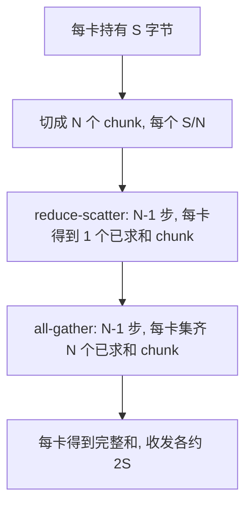

# 34｜通信原语：all-reduce、all-gather 与 reduce-scatter 是怎么算出来的？

> **阅读目标**：理解分布式训练里几种集合通信原语各自在传什么、传多少；能从"每张卡必须收到什么"推导出 ring all-reduce 的 $`2S`$ 通信量，并算出给定卡数、数据量和带宽下的耗时；明白 all-reduce 为什么可以拆成 reduce-scatter + all-gather；知道小消息为什么不用 ring、而要用延迟只有 $`\log N`$ 的树形算法。
>
> **前置知识**：第 31 篇的数据并行与张量并行（all-reduce 的 $`2S`$、张量并行每层两次 all-reduce）；第 32 篇的 ZeRO（参数、梯度、优化器状态的切分）；第 33 篇的流水线并行（段间点对点传激活）。需要一点网络直觉：传数据既要付"建立连接"的固定代价，也要付"按字节数算"的传输代价。

## 1. 直觉：集合通信就是"多卡之间按固定套路交换数据"

第 31–33 篇讲了三种切分，每种切分都留下了"卡与卡之间要交换数据"的需求：

- **数据并行**：每步结束时，各卡的梯度要加起来求平均——all-reduce；
- **ZeRO-3**：前向开始前，各卡要把切散的参数拼起来——all-gather；反向结束时，梯度要切散回各卡——reduce-scatter；
- **流水线并行**：段与段之间传激活和梯度——点对点发送/接收。

这些操作有个共同点：**参与的卡数、每卡数据的大小、通信的模式都是事先定好的**，不依赖数据内容。MPI 把这类操作叫**集合通信（collective communication）**，区别于一对一的点对点通信。NCCL（NVIDIA 的集合通信库）是今天 GPU 训练里实际执行它们的工具。

为什么值得单独讲一篇？因为集合通信的耗时经常是分布式训练的瓶颈：第 31 篇算过，数据并行每步都要做一次 all-reduce，梯度多大、通信就要传多少；而"传多少"不是拍脑袋定的——同样是求和，ring 算法每卡传约 $`2S`$，朴素的"都发给 0 号卡再广播回去"却让 0 号卡收发 $`2(N-1)S`$。算法不同，瓶颈处的流量能差出一个数量级。本篇就是要把这笔账算清楚：每个原语最少要传多少、经典算法怎么传到这个下限、以及什么时候该换算法。

先给结论（后面推导）：$`N`$ 张卡、每卡 $`S`$ 字节数据时——

- all-reduce：每卡收发各约 $`2S`$；
- all-gather / reduce-scatter：每卡收发各约 $`S`$；
- all-reduce = reduce-scatter + all-gather，所以 $`S + S = 2S`$。

> 结论性质：上面是"带宽最优算法下，每张卡收发的数据量"的**严格推导**（第 3、5 节）；具体耗时还要乘带宽、加延迟（第 2 节的 α–β 模型）。真实耗时受网络拓扑、链路争用、框架实现影响，公式给出的是理想下界附近的估计，不是实测承诺。

## 2. α–β 模型：一次通信的耗时 = 延迟 + 数据量/带宽

任何一次点对点传输，耗时都可以拆成两部分：

```math
T = \alpha + \frac{S}{\beta}
```

- $`\alpha`$（延迟，latency）：建立连接、握手、软件栈开销——与数据量无关，传 1 字节也要付。节点内 NVLink 约几微秒，跨节点 InfiniBand 约 1–5 微秒，TCP/以太网可能几十微秒。
- $`\beta`$（带宽，bandwidth）：链路每秒能传多少字节。节点内 NVLink 带宽很高（A100 的 NVLink 3.0 双向约 600 GB/s，单向约 300 GB/s），跨节点 InfiniBand HDR 约 25 GB/s（200 Gb/s）、NDR 约 50 GB/s（400 Gb/s），RoCE 以太网类似量级。

这个模型叫 **α–β 模型**。它的关键启示是：**传大块数据时，耗时由带宽项 $`S/\beta`$ 主导；传小块数据时，耗时由延迟项 $`\alpha`$ 主导**。两种情况的最优算法完全不同——这是第 7 节的主题。

模型里的 $`\beta`$ 有个容易忽略的细节：它是**单条链路**的带宽，不是全网带宽。ring 算法的好处正在于它让所有链路同时忙起来——每条链路都在传数据，没有一条链路闲置，也没有一条链路被迫扛下全部流量。

## 3. 核心推导：ring all-reduce 为什么是 2S

设定：$`N`$ 张卡排成一个环，每张卡持有 $`S`$ 字节的待求和数据（比如一份梯度）。目标：每张卡最后都拿到完整的和。



**第一步：把数据切成 N 份。** 每张卡把自己的 $`S`$ 字节切成 $`N`$ 个大小为 $`S/N`$ 的 chunk，编号 0 到 $`N-1`$。记卡 $`i`$ 的 chunk $`j`$ 为 $`x_{i,j}`$。

**第二步：reduce-scatter（$`N-1`$ 步）。** 每一步，每张卡同时做两件事：把一个 chunk 发给环上下一个邻居、从上一个邻居收到一个 chunk 并加到本地对应 chunk 上。发送的 chunk 编号每步减 1。

用 $`N=4`$ 跟踪 chunk 1 的旅程（它最后要在卡 0 上求和）：

| 步骤 | chunk 1 的位置与状态 |
|:-:|---|
| 初始 | 卡 0 有 $`x_{0,1}`$，卡 1 有 $`x_{1,1}`$，卡 2 有 $`x_{2,1}`$，卡 3 有 $`x_{3,1}`$ |
| 第 1 步 | 卡 1 把 $`x_{1,1}`$ 发给卡 2，卡 2 加上自己的 $`x_{2,1}`$ |
| 第 2 步 | 卡 2 把部分和发给卡 3，卡 3 加上自己的 $`x_{3,1}`$ |
| 第 3 步 | 卡 3 把部分和发给卡 0，卡 0 加上自己的 $`x_{0,1}`$，得到完整和 |

每个 chunk 沿环走 $`N-1`$ 步，每经过一张卡就加上那张卡的对应 chunk，最后回到归属卡时正好是完整和。$`N-1`$ 步之后，每张卡手里恰好有一个完整求和过的 chunk（卡 $`i`$ 拿到的是 chunk $`(i+1) \bmod N`$），其余 chunk 还是只有自己的那一份——这一步叫 reduce-scatter：**先 reduce（求和），再 scatter（每卡只留一片）**。

**第三步：all-gather（$`N-1`$ 步）。** 每张卡把自己手里那个已求和的 chunk 发给下一个邻居，同时转发收到的 chunk。$`N-1`$ 步之后，每个 chunk 都走完了整个环，每张卡集齐了全部 $`N`$ 个已求和的 chunk——也就是完整的和。

**算账。** 两阶段一共 $`2(N-1)`$ 步，每步每卡发 $`S/N`$ 字节：

```math
\text{每卡发送量} = 2(N-1)\cdot\frac{S}{N} = 2\frac{N-1}{N}S \approx 2S
```

接收量同样是 $`2\frac{N-1}{N}S`$。代入 α–β 模型：

```math
T_{\text{ring}} = 2(N-1)\alpha + 2\frac{N-1}{N}\cdot\frac{S}{\beta}
```

**为什么 2S 是下限、不是某个算法的巧合？** 看 reduce-scatter：卡 $`i`$ 最后要拿到 chunk $`(i+1)`$ 的完整和，这个和需要其他 $`N-1`$ 张卡各自的 $`S/N`$ 字节切片——卡 $`i`$ 至少要收到 $`(N-1)S/N`$ 字节；对称地，它自己属于别人的切片也至少要发出 $`(N-1)S/N`$ 字节。all-gather 同理：每张卡要收到别人手里的 $`N-1`$ 个已求和 chunk，也是 $`(N-1)S/N`$。两项相加，all-reduce 每卡收发各至少 $`2(N-1)S/N`$——ring 恰好达到了这个下限，所以它是**带宽最优**的。再聪明的算法也省不掉这 $`2S`$，只能在延迟项上做文章（第 7 节）。

> 适用边界：推导假设所有链路带宽相同、所有卡同时开始、没有掉队者。真实集群里，某张卡慢半拍，所有卡都要在集合点等它——这是集合通信自带的同步语义，第 8 节会回到这一点。

## 4. 数值示例：8 卡、4 GB 梯度的账

取一个具体数：$`N=8`$ 张卡，数据并行训练一个 10 亿参数的模型，fp32 梯度 $`S = 4\text{ GB}`$，跨节点 InfiniBand 带宽 $`\beta = 50\text{ GB/s}`$，延迟 $`\alpha = 5\,\mu\text{s}`$。

**ring all-reduce：**

- 每卡发送量：$`2\times\frac{7}{8}\times 4\text{ GB} = 7\text{ GB}`$，接收量同样 7 GB；
- 带宽项：$`7\text{ GB} / 50\text{ GB/s} = 140\text{ ms}`$；
- 延迟项：$`2\times 7 \times 5\,\mu\text{s} = 70\,\mu\text{s}`$，相对 140 ms 可以忽略；
- **总计约 140 ms**。每步训练都要付一次。

**对比朴素的"集中式"做法**（都发给 0 号卡求和，再由 0 号卡广播回去）：

- 0 号卡要收 $`7\times 4\text{ GB} = 28\text{ GB}`$，再发 28 GB，耗时 $`28/50 + 28/50 = 1.12\text{ s}`$；
- ring 的 140 ms 是它的 **8 倍快**。集中式的问题不在总量——全网总流量其实差不多——而在**瓶颈**：0 号卡的那两条链路扛了全部流量，其他链路全闲着。

再看全网：8 张卡每卡发 7 GB，一次 all-reduce 全网共传 56 GB。这个数字解释了为什么大模型训练要配高速互联：每步 140 ms 的通信，如果单步计算只有 200 ms，通信占比就高达 40% 以上。

换两个量级看趋势（$`N=8`$、$`\beta=50\text{ GB/s}`$ 不变）：

| $`S`$ | ring 带宽项 | ring 延迟项 | 延迟占比 |
|:-:|:-:|:-:|:-:|
| 4 KB | $`7\text{ KB}/50\text{ GB/s}\approx 0.14\,\mu\text{s}`$ | $`70\,\mu\text{s}`$ | ~100% |
| 4 MB | $`0.14\text{ ms}`$ | $`70\,\mu\text{s}`$ | 33% |
| 4 GB | $`140\text{ ms}`$ | $`70\,\mu\text{s}`$ | 0.05% |

$`S`$ 越小，延迟占比越高——小消息的战场在延迟不在带宽，第 7 节会换算法。

## 5. all-gather 与 reduce-scatter：all-reduce 的两半

第 3 节已经把 all-reduce 拆成了两步，这两步本身就是独立的原语：

**all-gather**：每张卡起初只有 $`S/N`$ 字节的独有数据（比如自己分片的参数），结束时每张卡都有完整的 $`S`$ 字节。ring 实现：$`N-1`$ 步，每步发 $`S/N`$，每卡收发各 $`(N-1)S/N \approx S`$。下限论证：每张卡必须收到别人手里的 $`N-1`$ 个切片，共 $`(N-1)S/N`$ 字节，ring 达到下限。

- 用途：第 32 篇 ZeRO-3 的前向——参数被切散在各卡上，前向计算前要 all-gather 拼起来；推理时各卡算完自己的分片也要 gather 回完整结果。

**reduce-scatter**：每张卡起初有完整的 $`S`$ 字节，结束时每张卡只有 $`S/N`$ 字节——但这 $`S/N`$ 是**所有卡对应切片的和**。ring 实现与 all-gather 对称，每卡收发各 $`(N-1)S/N \approx S`$。

- 用途：第 32 篇 ZeRO-3 的反向——梯度求和后按参数分片切散回各卡，每卡只保留自己那片的梯度。

于是 all-reduce 有了一个干净的等式：

```math
\text{all-reduce} = \text{reduce-scatter} + \text{all-gather}, \qquad S + S = 2S
```

这个拆分不只是数学游戏：ZeRO-3 正是利用了它——标准数据并行每步做一次 all-reduce（$`2S`$），ZeRO-3 把它拆开，在前向用 all-gather 拿参数、反向用 reduce-scatter 散梯度，配合参数分片省显存。第 7 节会算 ZeRO-3 的总通信账。

## 6. 其他原语：broadcast、reduce、点对点

**broadcast（一对多）**：0 号卡有一份 $`S`$ 字节的数据，要发给所有卡。树形实现：0 号卡发给 1 号和 2 号，它们再向下转发，$`\log_2 N`$ 步传遍全网：

```math
T_{\text{bcast}} = \log_2 N\cdot\left(\alpha + \frac{S}{\beta}\right)
```

用途：分发初始权重、广播超参数和随机种子。注意它和 all-gather 的区别：broadcast 的数据源只有一份（0 号卡），all-gather 的数据源是每卡一片。

**reduce（多对一）**：与 all-reduce 相同，但只有根节点拿到最终结果。树形实现同样是 $`\log_2 N\cdot(\alpha + S/\beta)`$；环形实现（reduce-scatter + gather）约 $`2(N-1)\alpha + 2\frac{N-1}{N}\cdot S/\beta`$。用途：只需要根节点要结果时，比如汇总各卡的 loss 打印日志。

**点对点 send / recv**：最基本的原语，一张卡发、另一张卡收，$`T = \alpha + S/\beta`$。第 33 篇流水线并行的段间传输就是点对点：前向传激活、反向传梯度。写代码时有个经典坑：如果两张卡同时给对方发大数据、又都等着先收，就死锁了——要用 sendrecv（同时收发）或非阻塞发送。

**barrier（屏障）**：所有卡到齐才能继续，本身不传数据，耗时约 $`\log_2 N\cdot\alpha`$。用途：计时、确保一致性。值得注意的是 all-reduce 自带同步语义——它本身就是一个隐式 barrier。

汇总一张表：

| 原语 | 每卡收发量（带宽最优） | 延迟步数 | 典型用途 |
|---|---|---|---|
| all-reduce | $`2S`$ | $`2(N-1)`$（ring） | 数据并行梯度求和、张量并行层间求和 |
| all-gather | $`S`$ | $`N-1`$（ring） | ZeRO-3 前向拼参数 |
| reduce-scatter | $`S`$ | $`N-1`$（ring） | ZeRO-3 反向散梯度 |
| broadcast | 每卡最终收到 $`S`$ | $`\log_2 N`$（树） | 分发权重、超参数 |
| reduce | 根卡最终得到 $`S`$ | $`\log_2 N`$（树） | 汇总 loss |
| send/recv | $`S`$ | 1 | 流水线段间传激活/梯度 |
| barrier | 0 | $`\log_2 N`$ | 同步、计时 |

## 7. 延迟 vs 带宽：小消息为什么不用 ring

ring 的弱点在延迟项：$`2(N-1)\alpha`$ 随卡数线性增长。$`N=1024`$ 时是 2046 步，$`\alpha=5\,\mu\text{s}`$ 就是约 10 ms——如果传的只是几 KB 的标量统计，带宽项几乎为零，10 ms 全是延迟。

树形 all-reduce（先 reduce 到根、再 broadcast 回去）只要 $`2\log_2 N`$ 步：

```math
T_{\text{tree}} = 2\log_2 N\cdot\left(\alpha + \frac{S}{\beta}\right)
```

$`N=1024`$ 时只有 20 步。但代价是带宽项变大了：每一步都要传完整的 $`S`$ 字节，带宽项是 $`2\log_2 N\cdot S/\beta`$，而 ring 只有约 $`2S/\beta`$。大消息时树比 ring 慢得多——$`S=4\text{ GB}`$、$`\beta=50\text{ GB/s}`$、$`N=8`$ 时，树要 $`6\times 80\text{ ms} = 480\text{ ms}`$，ring 只要 140 ms。

交叉点可以算出来（$`N=8`$，$`\alpha=5\,\mu\text{s}`$，$`\beta=50\text{ GB/s}`$）：

```math
6\alpha + 6\frac{S}{\beta} < 14\alpha + 1.75\frac{S}{\beta}
\quad\Longrightarrow\quad
S < \frac{8\alpha\beta}{4.25} \approx 470\text{ KB}
```

$`S`$ 小于约 470 KB 时树更快，大于时 ring 更快——分界线由 $`\alpha\beta`$（延迟×带宽）决定，这正是"延迟-带宽积"的直观含义。具体数字随硬件和实现变化，但**"小消息看延迟、大消息看带宽"**这个结论是稳的。

还有一种算法兼得两者：**recursive halving/doubling（递归折半/加倍）**。reduce-scatter 用折半交换（$`\log_2 N`$ 步）、all-gather 用加倍交换（$`\log_2 N`$ 步），总耗时：

```math
T_{\text{rh}} = 2\log_2 N\cdot\alpha + 2\frac{N-1}{N}\cdot\frac{S}{\beta}
```

延迟是对数量级，带宽是最优的 $`2S`$。代价是要求 $`N`$ 是 2 的幂、实现更复杂。实践中，NCCL 对大消息用 ring、小消息用 tree，MPI 的实现常在长消息用 recursive halving/doubling——框架替你选算法，但选算法的依据（消息大小、卡数）是你调优时要知道的。

最后把两笔实践账算清：

**PyTorch DDP 的分桶。** 反向传播算出一层的梯度，DDP 不会立刻发起一次 all-reduce——小梯度单独传，延迟占比太高。它把梯度攒进桶（bucket，默认 25 MB），一桶攒满就发起一次 all-reduce，同时反向继续算下一层，通信与计算重叠。桶太小，延迟占比上升；桶太大，重叠效果差——25 MB 是经验值，**需实验验证**，不是公式推导的结论。

**ZeRO-3 的总通信账。** 每步：前向 all-gather 参数（$`S`$）+ 反向 all-gather 参数（$`S`$，反向要再拼一次）+ reduce-scatter 梯度（$`S`$）= $`3S`$，是标准数据并行 $`2S`$ 的 **1.5 倍**。第 32 篇省下的显存，是用 50% 的额外通信换来的——显存和通信的 trade-off，到这里才算完整。

## 8. 常见误区

- **"all-reduce 传了 2S，全网就传了 2S"**——错。$`2S`$ 是**每卡**的量，全网是 $`2NS`$。反过来，"卡越多、每卡传得越少"也错：$`2\frac{N-1}{N}S`$ 随 $`N`$ 增大趋近 $`2S`$，而不是趋近 0。
- **"ring all-reduce 比树快"**——视消息大小而定。小消息时树的延迟项 $`2\log_2 N\cdot\alpha`$ 远小于 ring 的 $`2(N-1)\alpha`$，树更快；大消息时 ring 的带宽项胜出。没有全局最快的算法，只有按消息大小选算法。
- **"all-reduce 的 2S 是浪费，理想应该是 S"**——错。$`2S`$ 是下限：reduce-scatter 和 all-gather 各至少 $`S`$，谁也省不掉。朴素集中式在瓶颈卡上是 $`(N-1)S`$，ring 的 $`2S`$ 已经是最优。
- **"通信时间只取决于带宽"**——忽略了延迟。小 tensor、频繁同步时延迟主导；第 4 节的表里，4 KB 消息的耗时几乎 100% 是延迟。
- **"all-reduce 慢是因为网络慢"**——不完全对。集合通信是同步语义，一张卡掉队，所有卡都要在 all-reduce 处等它。第 33 篇的段不均衡会放大气泡，原因之一就在这里：最慢的卡决定整组的速度。
- **"ZeRO-3 通信比数据并行少"**——错，是 1.5 倍（$`3S`$ 对 $`2S`$）。ZeRO 省的是显存，不是通信。
- **"all-gather 和 broadcast 是一回事"**——错。broadcast 是一份数据从根卡发给所有人；all-gather 是每卡贡献一片、所有人拼出完整数据。数据源的分布完全不同。
- **"NCCL 的 ring 是物理上连成环的网线"**——不完全对。ring 是**逻辑**通信模式：同一节点内走 NVLink、跨节点走 InfiniBand，物理拓扑可以是胖树，算法看到的只是一张逻辑环。

## 9. 自测题

1. $`N=16`$ 张卡，梯度 $`S=8\text{ GB}`$，ring all-reduce 每卡收发各多少字节？带宽项耗时是多少（$`\beta=100\text{ GB/s}`$）？
   - 答：每卡收发各 $`2\times\frac{15}{16}\times 8\text{ GB} = 15\text{ GB}`$；带宽项 $`15\text{ GB}/100\text{ GB/s} = 150\text{ ms}`$。
2. 为什么 all-reduce 每卡的通信量不能少于 $`2\frac{N-1}{N}S`$？
   - 答：reduce-scatter 阶段，每卡要拿到自己那片完整和，必须收到其他 $`N-1`$ 张卡的切片，共 $`(N-1)S/N`$；all-gather 阶段同理又要 $`(N-1)S/N`$。两项相加就是下限，ring 恰好达到它。
3. $`N=8`$，$`\alpha=5\,\mu\text{s}`$，$`\beta=50\text{ GB/s}`$，$`S=4\text{ KB}`$：ring 和树形 all-reduce 哪个快？各约多少？
   - 答：树快。ring 约 $`14\times 5\,\mu\text{s} = 70\,\mu\text{s}`$（带宽项可忽略）；树约 $`6\times 5\,\mu\text{s} = 30\,\mu\text{s}`$。
4. ZeRO-3 每步的通信量是标准数据并行的几倍？为什么？
   - 答：1.5 倍。标准 DP 每步一次 all-reduce（$`2S`$）；ZeRO-3 每步前向 all-gather 参数（$`S`$）+ 反向 all-gather 参数（$`S`$）+ reduce-scatter 梯度（$`S`$）= $`3S`$。

---

**下一篇预告**：第 35 篇｜专家并行与 all-to-all：MoE 的 token 是怎么跨卡路由的？
