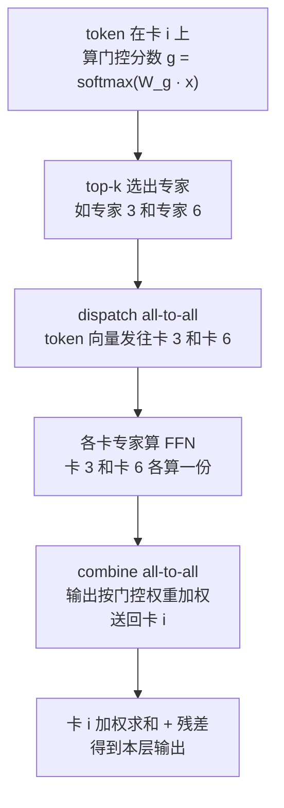

# 35｜专家并行与 all-to-all：MoE 的 token 是怎么跨卡路由的？

> **阅读目标**：理解专家并行（Expert Parallelism）为什么会产生 all-to-all 通信；能从"每张卡必须收到什么"推导出一次 dispatch + combine 每卡要传多少字节，并算出给定卡数、token 数和带宽下的耗时；明白负载不均为什么会让整组卡等最慢的一张、容量因子和负载均衡 loss 各自在防什么。
>
> **前置知识**：第 18 篇的 MoE 直觉（门控路由、top-k、只激活一部分专家）；第 31 篇的数据并行与张量并行（切分方式决定通信模式）；第 34 篇的通信原语（all-reduce 的 $`2S`$、ring 与树的取舍、α–β 模型）。本篇默认 $`E=N`$，即专家数等于卡数、每卡恰好一个专家——这是最常见的配置，一般情形在第 3 节末尾说明。

## 1. 直觉：专家一多，单卡就装不下，token 得跨卡找专家

第 18 篇讲过，MoE 层的核心交易是：**参数量变大，单步计算不变**——每个 token 只走 top-k 个专家，而不是全部 $`E`$ 个专家。这个交易在单卡上成立的前提是：所有专家都装得进一张卡的显存。

专家一多，这个前提就破了。Mixtral 8x7B 有 8 个专家，单卡勉强能装；DeepSeek-V3 有 256 个专家（每层激活 8 个），总参数 671B——没有任何一张卡装得下全部专家。于是必须把专家**分到不同的卡上**：这就是专家并行（Expert Parallelism，EP）。

一旦专家分卡，一个新问题立刻出现：token 和专家不在同一张卡上。token 在卡 A 上算出门控分数，发现自己该去的专家在卡 B 上——token 的向量必须跨卡送过去，算完再把结果送回来。这一送一回，就是本篇的主角：**all-to-all 通信**。

为什么不用张量并行来切专家？张量并行是把**每个专家内部的矩阵**切开：一个 token 走专家 3，就要和所有 8 张卡各做一次 all-reduce（第 31 篇：张量并行每层两次 all-reduce），而且 8 个专家全在算、哪怕 token 只需要其中 2 个。专家并行反过来：把**专家整体**切开，token 只和它选中的 $`k`$ 个专家所在的卡通信，不选中的专家完全不参与。MoE 的精髓是"只算选中的"，专家并行保留了这个精髓，张量并行把它丢了——所以 MoE 层用专家并行，不用张量并行。当然，两个可以叠加：专家并行分专家、张量并行再切单个专家内部的大矩阵，大模型训练里两者常常同时出现。

先给结论（后面推导）：

- 每层 MoE 有**两次** all-to-all：dispatch（把 token 送到专家所在的卡）和 combine（把专家输出按门控权重加权后送回 token 的卡）；
- 每卡每次 dispatch 的发送量约为 $`\frac{T}{N}\cdot k\cdot d\cdot b\cdot\frac{N-1}{N}`$ 字节（$`T`$ 为全组 token 总数，$`k`$ 为每 token 激活的专家数，$`d`$ 为 hidden 维，$`b`$ 为每元素字节数）；
- 全网总通信量随卡数 $`N`$ 增大而**饱和**，不线性增长——卡越多，每卡分摊的量反而越小。

> 结论性质：上面的发送量公式是"均匀路由、$`E=N`$"条件下的**严格推导**（第 3 节）；具体耗时还要乘带宽、加延迟（第 4 节的数值示例）。负载不均会让公式低估最慢那张卡的实际负担（第 5 节），真实耗时还受网络拓扑和框架实现影响。

## 2. 路由与分卡：一个 token 的跨卡之旅

先把一层 MoE 在专家并行下的执行过程拆开。设 $`E=N=8`$，每卡一个专家；一个 micro-batch 在全组共有 $`T`$ 个 token，均匀分在 8 张卡上，每卡 $`T/8`$ 个。



关键点有三个：

**第一，dispatch 和 combine 都是 all-to-all，不是 all-reduce。** all-reduce 是"所有人算出同一个和"；all-to-all 是"每个人把不同的数据发给不同的人"——卡 i 发给卡 3 的 token 和发给卡 6 的 token 是不同的向量，卡 3 收到的也不是卡 6 收到的那份。第 34 篇的原语里没有 all-to-all，因为它不属于"求一个全局量"的操作，它属于"按需交换"的操作。

**第二，门控分数决定通信量。** token 去哪个专家、去几个专家，由门控网络的输出决定——而门控输出依赖输入数据。所以 all-to-all 的通信量是**数据依赖**的：这一批 token 路由集中，某张卡收到的就多；路由分散，每张卡收到的就均匀。这和 all-reduce 的固定 $`2S`$ 完全不同：all-reduce 传多少只看张量大小，all-to-all 传多少还要看路由结果。

顺带说一句：门控网络本身不需要通信。门控权重 $`W_g`$ 只有 $`d\times E`$ 个参数（$`d=4096`$、$`E=8`$ 时约 3 万个），每张卡复制一份，本地就能算出自己 token 的门控分数。需要跨卡传的只有 token 向量本身——路由决策是本地的，数据搬运是跨卡的，这个分工要分清。

**第三，combine 送回的是加权后的输出。** 专家算完后，结果要乘上门控权重 $`g_j`$ 再送回——权重乘法可以在专家所在的卡上做（省一半传输：只传加权后的一个向量，而不是把权重和向量分开传），也可以在 token 的卡上做。主流实现（Megatron、DeepSpeed-MoE）都在专家侧加权，因为这样 combine 传的量和 dispatch 一样，都是 $`d\cdot b`$ 字节/token/专家。

**一个具体的小例子。** 假设卡 0 上有 4 个 token，门控 top-2 的路由结果如下（$`d=4096`$，bf16，每份 8 KB）：

| token | 选中的专家 | 发往 | 本卡留存 |
|---|---|---|---|
| $`x_1`$ | 专家 0、专家 3 | 卡 0（本地）、卡 3 | 1 份 |
| $`x_2`$ | 专家 1、专家 5 | 卡 1、卡 5 | 0 份 |
| $`x_3`$ | 专家 0、专家 2 | 卡 0（本地）、卡 2 | 1 份 |
| $`x_4`$ | 专家 6、专家 7 | 卡 6、卡 7 | 0 份 |

卡 0 的 dispatch：一共发出 8 份，其中 2 份是本地（$`x_1\to`$ 专家 0、$`x_3\to`$ 专家 0，不走网络），6 份跨卡（48 KB）；同时它还会从别的卡收到发往专家 0 的 token——收多少取决于别的卡有多少 token 选中了专家 0，事先算不出来，只能等路由结果。这正是 all-to-all 与 all-reduce 的根本区别：**每对卡之间交换的数据量是路由算完才知道的**，框架必须先做一次轻量的"元数据交换"（每对卡之间先通个气：我要给你发几个 token），再发起真正的数据传输。

## 3. 核心推导：一次 all-to-all 每卡要传多少？

设定：全组 $`T`$ 个 token，$`N`$ 张卡，$`E=N`$，每 token 激活 $`k`$ 个专家，hidden 维 $`d`$，每元素 $`b`$ 字节。假设 token 在各卡均匀分布、路由在各专家间均匀分布（不均的情形见第 5 节）。

**第一步：每卡手里有多少 token。** token 按数据并行的方式分在各卡，每卡 $`T/N`$ 个。

**第二步：每个 token 要发几份。** top-k 路由下，每个 token 要发往 $`k`$ 个专家所在的卡。每份 $`d\cdot b`$ 字节。所以每卡 dispatch 的总发送量（不分本地/跨卡）是：

```math
V_{\text{send}} = \frac{T}{N}\cdot k\cdot d\cdot b
```

**第三步：其中多少要跨卡。** $`E=N`$ 时，一个 token 的 $`k`$ 个专家在 $`k`$ 张不同的卡上；token 自己所在的卡恰好是其中之一的概率是 $`1/N`$（均匀路由），所以跨卡的比例是 $`(N-1)/N`$。每卡 dispatch 的**跨卡发送量**：

```math
V_{\text{dispatch}} = \frac{T}{N}\cdot k\cdot d\cdot b\cdot\frac{N-1}{N}
```

combine 送回的量与 dispatch 相同（每 token 每专家一份 $`d\cdot b`$ 的输出），所以一层 MoE 的 all-to-all 每卡跨卡总量：

```math
V_{\text{MoE}} = 2\cdot\frac{T}{N}\cdot k\cdot d\cdot b\cdot\frac{N-1}{N}
```

**第四步：全网总量。** $`N`$ 张卡加起来：

```math
V_{\text{total}} = N\cdot V_{\text{dispatch}} = T\cdot k\cdot d\cdot b\cdot\frac{N-1}{N}
```

当 $`N\to\infty`$ 时，$`V_{\text{total}}\to T\cdot k\cdot d\cdot b`$——**饱和，不随卡数线性增长**。直觉是：token 总共就 $`T\cdot k`$ 份要送出（每 token $`k`$ 份），卡再多，每份也只需要送一次；卡数增加只是把这 $`T\cdot k`$ 份发送分摊到更多卡上，每卡的量反而下降。

如果 $`E\neq N`$（比如一卡多个专家）：每卡的专家数是 $`E/N$`，token 命中本地专家的概率变成 $`E/N$` 除以 $`E`$……更准确地说，token 的 $`k`$ 个专家落在**本卡**的概率是 $`(E/N)/E = 1/N`$——和 $`E=N`$ 时一样。跨卡比例仍是 $`(N-1)/N`$，公式不变；变化的是单卡要算的专家变多了（第 5 节的负载问题随之变复杂）。所以上面的公式在 $`E`$ 为 $`N`$ 的倍数时通用。

顺手验算一下"概率是 $`1/N`$"这个关键断言：固定一个 token，它在卡 $`i`$ 上；任取一个专家，它在 $`N`$ 张卡上的位置是均匀随机的，落在卡 $`i`$ 的概率就是 $`1/N`$。$`k`$ 个专家各自独立（近似），期望有 $`k/N`$ 个落在本地、$`k(N-1)/N`$ 个在异地——每 token 期望跨卡发送 $`k\cdot d\cdot b\cdot(N-1)/N`$ 字节，和上面公式一致。注意这是**期望**：具体到某个 token，它的 $`k`$ 个专家可能全在本地（省了全部跨卡传输），也可能全在异地；只有全组平均下来，公式才精确成立。单步的实际通信量会在期望附近波动，波动大小取决于路由的集中程度——路由越集中，波动越大。

> 结论性质：$`V_{\text{dispatch}}`$ 的推导是严格的（给定均匀路由假设）；"总量饱和"也是严格的（$`T\cdot k\cdot d\cdot b`$ 是每份只送一次的上界）。但**均匀路由只是假设**——真实路由偏斜时，某张卡收到的量可以远高于平均值，见第 5 节。

## 4. 数值示例：一层 MoE 里，通信和计算各占几毫秒

取一组接近 Mixtral 8x7B 的数字：$`N=E=8`$，$`k=2`$，$`d=4096`$，bf16（$`b=2`$ 字节），每步全组 $`T=32768`$ 个 token，中间维 $`d_{ff}=14336`$。

**通信账。** 每 token 每专家 $`4096\times 2 = 8192`$ 字节 = 8 KB。每卡 dispatch 跨卡发送量：

```math
V_{\text{dispatch}} = 4096\cdot 2\cdot 8\text{ KB}\cdot\frac{7}{8} = 56\text{ MB}
```

combine 同样 56 MB，一层共 112 MB。跨节点 InfiniBand NDR 带宽 $`\beta = 50`$ GB/s 时，带宽项耗时约 $`112\text{ MB}/50\text{ GB/s}\approx 2.2`$ ms。32 层 MoE 就是约 70 ms/步——这只是带宽项，延迟项和小消息开销还没算。

**计算账。** 每卡的专家一共收到多少 token？全组 $`T\cdot k = 65536`$ 份 token-专家对，均匀分到 8 张卡，每卡 8192 个。每个专家 FFN 是 gate、up、down 三个矩阵乘法，每 token 的浮点运算：

```math
\text{FLOPs/token} = 3\cdot 2\cdot d\cdot d_{ff} = 3\cdot 2\cdot 4096\cdot 14336 \approx 3.5\times 10^{8}
```

每卡每层：$`8192\cdot 3.5\times 10^{8}\approx 2.9\times 10^{12}`$ FLOPs。按 bf16 有效算力 400 TFLOPS 算，约 7.2 ms。

**对照。** 这一层：通信约 2.2 ms，计算约 7.2 ms——all-to-all 占专家计算时间的约 30%。这组数字下通信还不是瓶颈，但已经不容忽视。换一组条件结论就变了：

| 变化 | 通信 | 计算 | 结论 |
|---|---|---|---|
| 网络降到 25 GB/s（HDR） | 4.5 ms | 7.2 ms | 通信占比升到约 60% |
| $`k=1`$（Switch 风格 top-1） | 1.1 ms | 3.6 ms | 两者同比例减半，占比不变 |
| $`d_{ff}`$ 减半 | 2.2 ms | 3.6 ms | 通信占比升到约 60% |
| 推理 decode：每步每卡 1 个 token | 全是延迟 | 几乎为 0 | all-to-all 几乎全是延迟项 |

最后一行值得单独说：推理时 batch 很小，all-to-all 的消息也很小，$`\alpha`$ 延迟项主导——第 34 篇"小消息看延迟"的结论在这里同样适用。这也是 MoE 推理里专家并行难做的原因之一：训练时的大 batch 能把 all-to-all 的带宽摊薄，推理时摊不薄。

**再把延迟项也算进去。** 用第 34 篇的 α–β 模型：一次 dispatch 里，每卡要和另外 $`N-1=7`$ 张卡各交换一次，延迟项约 $`7\alpha`$。取跨节点 $`\alpha = 5\,\mu\text{s}`$，延迟项约 35 μs——相对带宽项的 1.1 ms 可以忽略，训练场景下 all-to-all 的耗时基本就是带宽说了算。但 decode 时每步每卡只有 1 个 token：dispatch 每卡只发 $`k=2`$ 份、每份 8 KB，带宽项 $`16\text{ KB}/50\text{ GB/s}\approx 0.3\,\mu\text{s}`$，延迟项 35 μs 反而是带宽项的 100 多倍——**同一条 all-to-all，训练时看带宽、推理时看延迟**，优化方向完全不同。训练想省时间就加带宽、减 $`k`$；推理想省时间就减同步次数、把专家尽量放在本节点内。

## 5. 负载不均：容量因子与丢弃

第 3 节的公式有个前提：路由均匀。真实路由不均匀——某些专家就是更"受欢迎"。后果分两层：

**第一层：最慢的卡决定整组的速度。** all-to-all 是同步语义：dispatch 要等所有卡都发完、combine 要等所有卡都算完。某个专家收到 2 倍的 token，它的卡就要算 2 倍的专家计算，其他 7 张卡算完也得等着。第 33 篇流水线气泡的道理在这里重演：**段不均衡放大等待**，只不过这里不均衡的单位是专家。

**第二层：容量因子（capacity factor）与 token 丢弃。** Switch Transformer 的做法是给每个专家定一个容量上限：

```math
C = c\cdot\frac{T\cdot k}{E}
```

$`c`$ 是容量因子，典型值 1.25。超过容量的 token 被**丢弃**——不经过专家，直接走残差连接原样传到下一层。丢弃不是故障，是设计好的溢出保护：宁可让个别 token 跳过专家，也不让一张卡拖垮整步。

均匀路由下，丢弃几乎不会发生，可以算出来：token-专家对总数 $`T\cdot k = 65536`$，$`E=8`$，每专家平均 $`\mu = 8192`$ 个。路由均匀时，某专家收到的 token 数近似二项分布，标准差：

```math
\sigma = \sqrt{\mu\left(1-\frac{1}{E}\right)} = \sqrt{8192\cdot\frac{7}{8}} \approx 85
```

容量 $`C = 1.25\cdot 8192 = 10240`$，比均值高 $`(10240-8192)/85\approx 24`$ 个标准差——随机波动根本够不着容量线。所以**丢弃是路由偏斜的信号，不是随机性的结果**：如果监控里看到大量 token 被丢，说明门控网络把 token 往少数专家上赶，第 6 节的均衡机制没起作用，或者数据分布本身就极度偏斜。

反过来算一笔偏斜的账：假设某专家拿到 2 倍份额（16384 个 token），容量 10240 意味着约 $`(16384-10240)/16384\approx 37\%`$ 的 token 被丢弃，同时这张卡的专家计算量是别人的 2 倍——步时间几乎翻倍。这就是负载不均的真实代价：丢 token 又拖时间，两头亏。

实践中看三个数就能判断负载健不健康：**每专家的 token 数直方图**（是不是均匀）、**丢弃率**（超过 1% 就值得查路由）和 **all-to-all 在 profiler 里的占比**（如果某张卡的 all-to-all 等待时间系统性高于其他卡，就是它收到的 token 太多）。这三个数都是训练日志里现成的，不需要额外插桩——MoE 训练调优的第一步，永远是先看这三个数，再决定调 $`c`$、调 $`\alpha`$，还是换路由。

## 6. 负载均衡 loss：一个鼓励均匀的软约束

怎么让路由别那么偏？Switch Transformer 加了一个辅助 loss：

```math
\mathcal{L}_{\text{balance}} = \alpha\cdot E\cdot\sum_{i=1}^{E} f_i\cdot P_i
```

- $`f_i`$：分到专家 $`i`$ 的 token 占比（不可导，算 loss 时当常数）；
- $`P_i`$：全组 token 对专家 $`i`$ 的平均门控概率（可导，梯度从这里流过）；
- $`\alpha`$：系数，Switch 里取 0.01。

**为什么这个式子鼓励均匀？** 在 $`f_i\approx P_i`$ 的对称情形下（分流多的专家，平均门控概率也高——路由的定义决定了两者正相关），loss 的取值范围可以直接算出来：

- 完全均匀：$`f_i = P_i = 1/E`$，$`\sum f_iP_i = E\cdot(1/E^2) = 1/E`$，loss $`= \alpha`$；
- 完全坍缩（所有 token 去一个专家）：$`f_1 = P_1 = 1`$，$`\sum f_iP_i = 1`$，loss $`= \alpha\cdot E`$。

均匀时 loss 最小（$`\alpha`$），坍缩时最大（$`\alpha E`$）。所以它是个**软约束**：它给"别把所有 token 赶到一个专家"施加了一个大小为 $`\alpha`$ 量级的压力，但 $`\alpha=0.01`$ 很小，不会压倒主 loss——主任务仍然优先。

> 结论性质：上面"均匀时最小"的验证依赖 $`f_i\approx P_i`$ 这一条件。严格说，$`\sum f_iP_i`$ 作为两个独立分布的内积，最小值并不在均匀处；但在路由机制下 $`f`$ 与 $`P`$ 正相关，均匀分布是实践中可达到的下界。**loss 是"鼓励"，不是"保证"**：数据本身极度偏斜时，loss 只能缓解，不能根治——这是需实验验证的边界，不是公式能承诺的。

还有一种思路干脆换掉路由规则：**expert-choice 路由**（每个专家反过来挑自己最想要的 top-C 个 token）。这样每个专家收到的 token 数天然相等，不丢 token、不用辅助 loss；代价是有的 token 可能一个专家都不挑它（零覆盖），有的 token 被多个专家挑中。两种路由没有绝对优劣，是"谁承担不均衡"的不同选择：

|  | token-choice（本篇默认） | expert-choice |
|---|---|---|
| 谁做选择 | 每个 token 挑专家 | 每个专家挑 token |
| 每专家收到的 token 数 | 不定，取决于路由 | 固定为容量 $`C`$，天然均衡 |
| 丢 token | 超过容量的丢弃 | 不丢，但有的 token 零覆盖 |
| 需要辅助 loss 吗 | 需要（本节的 loss） | 不需要 |
| all-to-all 的量 | 数据依赖、事先未知 | 每卡固定，事先可算 |

两种路由没有绝对优劣，是"谁承担不均衡"的不同选择——token-choice 让热门专家过载，expert-choice 让冷门 token 落空。选哪种，取决于你的任务更怕"专家过载拖慢整步"，还是更怕"个别 token 得不到专家处理"——这是需实验验证的取舍，不是公式能替你决定的。

## 7. all-to-all 与 all-reduce 的对照

|  | all-reduce（第 34 篇） | all-to-all（本篇） |
|---|---|---|
| 目的 | 所有人得到同一个和 | 每个人得到专门发给自己的那份 |
| 每人收到的数据 | 相同的完整结果 | 不同的切片 |
| 通信量 | 固定 $`2S`$，只看张量大小 | 依赖路由结果，数据依赖 |
| 典型场景 | 数据并行的梯度同步 | 专家并行的 token 分发与回收 |
| 延迟敏感度 | 大消息为主，带宽主导 | 推理小 batch 时延迟主导 |

实现上还有一层工程细节：**层级化 all-to-all**。同一节点内的卡走 NVLink（带宽高、延迟低），跨节点走 InfiniBand。框架会先做节点内 all-to-all、再做节点间 all-to-all（或反过来），让大头流量走快链路。DeepSpeed-MoE 和 Megatron-LM 都有这类实现——算法还是 all-to-all，但物理链路的选择决定了那 2.2 ms 是 2.2 ms 还是 5 ms。

另一个省通信的工程技巧是 **device-limited routing**（DeepSeek-V2/V3 在用）：限制每个 token 选中的专家最多分布在 $`M`$ 张卡上（比如 $`M=4`$）。$`k=8`$ 个专家如果散在 8 张卡上，dispatch 要和 8 个对端建连接；限制到 4 张卡后，对端数减半，小消息数减半，延迟项随之减半。代价是路由的自由度被压缩了一点——某些"最优"的专家组合因为跨卡太多而被排除。这是通信和模型质量之间的又一个 trade-off，$`M`$ 取多大同样需实验验证。

最后把专家并行放回第 31–34 篇的拼图里：数据并行切 batch、张量并行切矩阵、流水线并行切层、ZeRO 切模型状态、专家并行切专家——五种切分各解决一种"放不下"，各付一种通信代价。专家并行的代价就是 all-to-all，而 all-to-all 的账，前面六节已经算清了。

实际训练里这五种切分是**叠加使用**的：一张卡同时属于一个数据并行组、一个张量并行组、一个流水线段和一个专家并行组。DeepSeek-V3 的公开配置就是例子：张量并行、流水线并行、数据并行、专家并行四种并行叠加，再配 ZeRO-1。叠加时要注意各组的通信不要撞在同一条链路上——比如把专家并行组放在同一个节点内（all-to-all 走 NVLink），把数据并行组跨节点（all-reduce 走 InfiniBand），让两种通信用不同的物理链路。切分方式的组合本身没有最优解，只有"哪种通信最贵、就把哪种放在最快的链路上"这一条工程原则；具体怎么摆，是拿到硬件拓扑后算出来的，不是从公式里推出来的。

## 8. 常见误区

- **"专家并行就是张量并行"**——错。张量并行切的是**单个矩阵**（每层两次 all-reduce），专家并行切的是**专家集合**（每层两次 all-to-all）。切分对象和通信原语都不同；一个 MoE 模型可以同时用两种并行。
- **"all-to-all 和 all-gather 是一回事"**——错。all-gather 是每人收到**同样的**完整数据；all-to-all 是每人收到**不同的**、专门发给自己的切片。数据源的分布完全不同。
- **"卡越多，all-to-all 总通信量线性增长"**——错。第 3 节的推导：总量是 $`T\cdot k\cdot d\cdot b\cdot(N-1)/N`$，随 $`N`$ 增大趋近 $`T\cdot k\cdot d\cdot b`$ 而饱和；每卡分摊反而下降。真正随卡数变差的是延迟项和负载不均的概率。
- **"token 被丢弃是 bug"**——错。容量因子下的丢弃是设计好的溢出保护；丢得多说明路由偏斜，是**信号**不是故障。均匀路由下容量线在均值 24σ 之上，随机波动根本够不着。
- **"加了负载均衡 loss 就一定均衡"**——错。它是系数只有 0.01 的软约束，只"鼓励"均匀；数据本身极度偏斜时仍可能不均。
- **"专家越多越好"**——错。专家数超过卡数后，单卡多个专家带来显存和调度开销；路由越分散，all-to-all 的小消息越多、延迟占比越高。MoE 的收益在专家数上同样有边际递减。
- **"MoE 推理时 all-to-all 不重要"**——错。推理 batch 小，all-to-all 的消息小，延迟项主导；decode 时每步每卡只有 1 个 token，all-to-all 几乎全是延迟。

## 9. 自测题

1. $`N=8`$，$`E=8`$，$`k=2`$，$`d=4096`$，bf16，每卡 4096 个 token：一次 dispatch 每卡跨卡发送多少字节？
   - 答：$`4096\cdot 2\cdot 8192\cdot 7/8 = 56`$ MB。combine 同样 56 MB，一层共 112 MB。
2. 为什么 all-to-all 的全网总通信量不随卡数线性增长？
   - 答：总量是 $`T\cdot k\cdot d\cdot b\cdot(N-1)/N`$，$`N\to\infty`$ 时趋近 $`T\cdot k\cdot d\cdot b`$。token 总共只有 $`T\cdot k`$ 份要送出，卡再多每份也只送一次；卡数增加只是分摊，不是增加总量。
3. 均匀路由下，$`T\cdot k=65536`$，$`E=8`$，容量因子 $`c=1.25`$：每专家的容量是多少？为什么几乎不丢 token？
   - 答：均值 $`\mu=8192`$，容量 $`C=10240`$；标准差约 85，容量线在均值约 24σ 之上，随机波动够不着——丢弃只发生在路由偏斜时。
4. 负载均衡 loss $`\alpha\cdot E\cdot\sum f_iP_i`$ 在均匀分流和完全坍缩时各是多少？它能保证均衡吗？
   - 答：均匀时 $`\alpha`$，坍缩时 $`\alpha E`$。不能保证——它是系数很小的软约束，只鼓励均匀；极端偏斜的数据分布下仍可能不均。

---

**下一篇预告**：第 36 篇｜PagedAttention：KV 缓存碎片化怎么解决？
