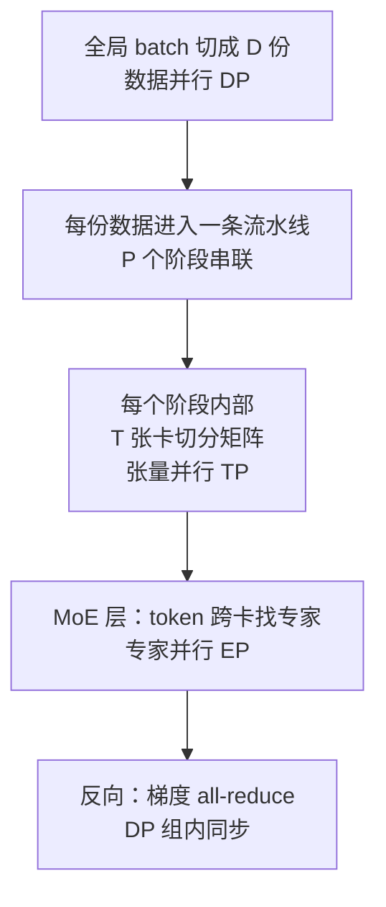

# 36｜三维并行与混合并行：DP、TP、PP、EP 怎么拼成一张训练图？

> **阅读目标**：理解数据并行（DP）、张量并行（TP）、流水线并行（PP）、专家并行（EP）四种切分各自在切什么；能从"每种并行的硬上限"推导出为什么大模型训练必须把它们拼起来；会算混合并行下单卡的模型状态显存和每类通信量，并能对一个给定的卡数做分组。
>
> **前置知识**：第 31 篇的数据并行与张量并行（三种切分方式、all-reduce 的 $`2S`$）；第 32 篇的 ZeRO（模型状态的三种切分）；第 33 篇的流水线并行（气泡占比 $`(P-1)/(M+P-1)`$、1F1B）；第 34 篇的通信原语（ring 与树的取舍、α–β 模型）；第 35 篇的专家并行（all-to-all 的通信量公式）。本篇默认混合精度训练：参数与梯度用 bf16（每元素 2 字节），fp32 主权重 + Adam 的 $`m`$、$`v`$ 共 12 字节/参数——即单份模型状态共 $`16\Psi`$ 字节，$`\Psi`$ 为参数量。

## 1. 直觉：四种并行切的是四个不同的维度

第 31–35 篇我们一次只讲了一种并行。但真实的大模型训练从来不是"只用一种"：几千张卡训练一个 70B 模型时，DP、TP、PP 往往同时出现，MoE 模型还要再叠一层 EP。为什么？因为**每种并行切的维度不一样，解决的问题也不一样**：

| 并行方式 | 切什么 | 解决什么问题 | 通信模式 |
|---|---|---|---|
| 数据并行 DP | batch：每卡一份不同的数据 | 吞吐：卡越多，每步吃的数据越多 | 梯度 all-reduce |
| 张量并行 TP | 单个矩阵/单层内部 | 单层太大、一张卡算不下 | 每层多次 all-reduce |
| 流水线并行 PP | 层：把 $`L`$ 层切成 $`P`$ 段 | 层太多、一张卡装不下 | 段边界点对点传激活 |
| 专家并行 EP | 专家：把 $`E`$ 个专家分卡 | 专家太多、一张卡装不下 | MoE 层两次 all-to-all |

一张图把四者放在同一个训练步里：



设总卡数 $`N`$，四个并行度满足：

```math
N = D \times T \times P
```

MoE 模型里 EP 组通常嵌在 DP 组或 TP 组内部（第 4 节末尾），所以上式一般不把 $`E`$ 乘进来——专家并行不额外占卡，它是把已有的卡按专家再分组。记住这个乘法关系：**卡数是乘出来的，不是加出来的**。1024 张卡可以是 $`D=32 \times T=8 \times P=4`$，也可以是 $`D=16 \times T=8 \times P=8`$，两种分法训练的是同一个模型，但显存、通信和气泡完全不同——选哪种分法，就是本篇要算的东西。

三维并行这个组合不是凭空想出来的：Megatron-LM 团队在 2021 年的论文《Efficient Large-Scale Language Model Training on GPU Clusters Using Megatron-LM》（Narayanan 等人）里系统化了它——用 512 张 V100 训练 8.3B 参数的 GPT-2，8 路张量并行叠 64 路数据并行，流水线并行随后也被接进同一套框架。今天的千卡训练只是在这个骨架上把数字放大、再叠一层 ZeRO 和专家并行，基本结构没有变。

> 结论性质：本篇的显存公式和通信量公式是"均匀切分、忽略碎片与框架开销"条件下的**严格推导**；具体到一次训练步的耗时，还要乘带宽、加延迟、考虑重叠（第 4 节的数值示例是量级估算，真实数字以实测为准）。每种并行的硬上限（第 2 节）是结构性的，不依赖具体框架。

## 2. 为什么一种并行不够：每种都有硬上限

先看如果只用一种并行，会在哪里撞墙。

**只用 DP：显存先撞墙。** DP 不切模型，每张卡都存着完整的一份 $`16\Psi`$。70B 模型就是 $`16 \times 70\times 10^9 = 1.12\,\text{TB}$`——没有任何一张卡装得下。ZeRO-3 能把 $`16\Psi`$ 切到 $`N`$ 张卡上（第 32 篇），1024 张卡时每卡只剩约 1.1 GB，看似解决了问题，但代价是通信：ZeRO-3 每步要把参数 all-gather 回来，通信量约为 DP 基线的 1.5 倍、且**随 $`\Psi`$ 线性增长**——70B 模型每步光是参数搬运就达数百 GB，而且全是跨节点通信。DP 的另一个上限是 batch：第 30 篇的临界 batch size——全局 batch 超过临界值后，再加卡只剩浪费算力。所以 DP 度数不能无限加。

**只用 TP：带宽和可切性撞墙。** TP 每层要做 4 次 all-reduce（Megatron 式：注意力后 1 次、前馈后 1 次，前向 2 次、反向 2 次），通信量随层数和激活大小增长，只适合节点内 NVLink 这种高速互联——TP 组一般不超过 8 张卡（一台机器）。而且 TP 不是想切多细就切多细：注意力头数要能被 $`T`$ 整除，hidden 维也要能被 $`T`$ 整除。以 Llama-2 70B 为例（64 个注意力头、$`h=8192`$）：$`T=8`$ 时每卡分 8 个头、hidden 切到 1024，刚好整除；$`T=16`$ 时虽然数学上也能整除（4 个头、512 维），但 16 张卡已经跨出了一台机器，all-reduce 要走节点间网络，TP 的优势就没了。更根本的是：LayerNorm 和 dropout 根本不在 TP 的切分范围内（它们要等下一篇的序列并行来处理），所以 TP 再大也省不下那部分显存。

**只用 PP：气泡和层数撞墙。** PP 的气泡占比是 $`(P-1)/(M+P-1)`$（第 33 篇），$`P`$ 越大、micro-batch 数 $`M`$ 相对越小，气泡越重；而且 $`P`$ 不能超过层数 $`L`$，80 层的模型最多切 80 段。更麻烦的是：PP 省显存不省计算——每张卡只存 $`L/P`$ 层，但 micro-batch 数量 $`M$` 越大，流水线在途的激活越多，1F1B 虽然把在途激活压到 $`P`$ 份，代价是调度更复杂。

**只用 EP：只对 MoE 有效，还怕不均。** EP 只解决"专家太多"这一个问题，dense 模型根本没有专家可切。而且第 35 篇算过：路由不均时最慢的那张卡决定整组速度，容量因子和负载均衡 loss 只能缓解、不能根除。

所以结论是：**四种并行是互补的，不是互斥的**。TP 解决"单层太宽"，PP 解决"层数太多"，DP 解决"数据不够多"，EP 解决"专家太多"。一个大模型同时有这四个"太多"，就得四种并行一起上。

合起来之后还会冒出一个新问题：**最慢的组决定整体速度**。DP 组要等最慢的一张卡传完梯度才能进下一步，PP 流水线要等最慢的一段，EP 组要等最慢的专家卡——任何一处负载不均或慢节点（straggler），都会沿着同步点扩散到全部 $`N`$ 张卡。并行度越高，同步点越多，这个"木桶效应"越明显。所以千卡训练除了调 $`D`$、$`T`$、$`P`$，还要配负载均衡、慢节点检测和检查点恢复——这些属于运维层面的配套工作，本篇只点到为止。

## 3. 核心推导：混合并行下，单卡要存多少、要传多少？

设定：参数量 $`\Psi`$，$`N = D \times T \times P`$，层数 $`L`$，hidden 维 $`h`$，序列长 $`s`$，micro-batch $`b`$，bf16（2 字节/元素）。假设均匀切分。

### 3.1 显存：模型状态

TP 把参数、梯度、优化器状态都按 $`T`$ 切开（每张 TP 卡只持有自己那份参数的优化器状态）；PP 把层按 $`P`$ 切开；DP 组内再用 ZeRO-1 把优化器状态（fp32 主权重 4 字节 + Adam 的 $`m`$、$`v`$ 共 8 字节 = 12 字节/参数）按 $`D`$ 切开。于是单卡模型状态：

```math
M_{\text{states}} = \frac{4\Psi}{T \cdot P} + \frac{12\Psi}{T \cdot P \cdot D}\ \text{字节}
```

第一项是参数（2 字节）+ 梯度（2 字节），第二项是切开后的优化器状态。注意：**TP 和 PP 切的是所有三项，ZeRO-1 只切优化器状态**——梯度不能按 DP 切，因为每张 DP 卡都要有自己那份数据的完整梯度来做 all-reduce。

**数值示例：70B 模型，$`T=8`$、$`P=8`$、$`D=16`$（共 1024 卡）。**

```math
M_{\text{states}} = \frac{4 \times 70\times 10^9}{64} + \frac{12 \times 70\times 10^9}{64 \times 16} \approx 4.4\,\text{GB} + 0.8\,\text{GB} \approx 5.2\,\text{GB}
```

对比：纯 DP 是 $`16\Psi = 1.12\,\text{TB}$`（装不下）；只用 ZeRO-3（$`D=1024`$）是 $`16\Psi/1024 \approx 1.1\,\text{GB}$`——显存更小，但代价在通信上（见 3.3）。混合并行的 5.2 GB 换来的是：**通信量不再随 $`\Psi`$ 增长**（TP/PP 的通信只和激活有关），这是它真正的价值。

### 3.2 激活显存：PP 与 TP 如何分摊，1F1B 下在途的有多少？

模型状态只是显存的一半，另一半是激活。第 16 篇讲过：反向传播要用到前向的中间结果，所以每层的前向激活都要留着。TP 把每层的激活也按 $`T`$ 切开（每张 TP 卡只存自己那份 hidden 切片对应的激活），PP 把层按 $`P`$ 切开（每张卡只存自己那 $`L/P`$ 层的激活）。但流水线有个特点：**在途的 micro-batch 越多，同时存着的激活就越多**。

用 Korthikanti 等人 2022 年论文（Reducing Activation Recomputation in Large Transformer Models）给出的估算：用 FlashAttention（不存 $`s \times s`$ 注意力矩阵，见第 14 篇）时，每层每个 micro-batch 的激活约为 $`34 \cdot s \cdot b \cdot h`$ 字节（bf16，已含 MLP 中间维 $`4h`$ 的放大和 LayerNorm 的存量）。代入下文 3.3 节的数字（$`b=2`$、$`s=4096`$、$`h=8192`$）：

```math
\text{每层激活} \approx 34 \times 4096 \times 2 \times 8192 \approx 2.3\,\text{GB}
```

每段 10 层，一个 micro-batch 在一段上就要存约 23 GB。1F1B 调度下（第 33 篇），一段上同时在途的 micro-batch 最多约 $`P = 8`$ 个——也就是**单卡激活显存峰值可达约 $`8 \times 23 = 184\,\text{GB}$`**，超过一张 80 GB HBM 卡的容量。结论：这个配置下**必须开选择性重计算**（第 16 篇：只对部分层存激活、反向时重算），或者把 micro-batch 降到 1、序列切短。混合并行省下了模型状态的显存，却把激活显存的矛盾推到了前面——调并行策略时，模型状态公式（3.1 节）和激活公式要一起算，缺一不可。

> 结论性质：$`34 \cdot s b h`$ 这个系数来自上述论文的逐项清点（注意力、MLP、LayerNorm、dropout mask 等），不同实现（比如 MLP 中间维不是 $`4h`$、用了 sliding window 注意力）系数会变；这里的 184 GB 是"不用重计算"的上限估算，实际值以 profiling 为准。但它揭示的方向是稳健的：**流水线在途 micro-batch 数 × 每段激活，是激活显存的第一项**。

### 3.3 通信：三类通信量叠加

一个训练步里，三类通信同时发生，量级各不相同：

**（a）TP 通信：每层 4 次 all-reduce。** 每次 all-reduce 的张量是 $`b \times s \times h`$ 个元素，ring all-reduce 每卡传约 $`2 \cdot b s h`$ 个元素（第 34 篇：$`2S`$）。每层 4 次，所以每层每卡：

```math
V_{\text{TP/layer}} \approx 8 \cdot b \cdot s \cdot h\ \text{个元素}
```

**（b）PP 通信：段边界点对点传激活。** 每个 micro-batch 经过一个段边界传 $`b \cdot s \cdot h`$ 个元素，$`M`$ 个 micro-batch 就是 $`M \cdot b s h`$ 个元素——没有 all-reduce 的 $`2S`$ 因子，也没有跨所有卡的同步，量最小。

**（c）DP 通信：每步一次梯度 all-reduce。** 梯度张量 bf16 共 $`2\Psi`$ 字节，ring all-reduce 每卡传约 $`2S \cdot \frac{D-1}{D} \approx 4\Psi`$ 字节——**随参数量线性增长**，是三类里总量最大的一个。但它可以和反向计算重叠（按 bucket 分段 all-reduce，算完一段传一段），所以墙上时间不等于通信量除以带宽。

**同一组数字算一遍：$`b=2`$、$`s=4096`$、$`h=8192`$、$`L=80`$、$`P=8`$（每段 10 层）、$`T=8`$。**

- TP：每层 $`8 \times 2 \times 4096 \times 8192 \approx 5.4\times 10^8`$ 个元素 ≈ 1.1 GB；每段 10 层，每个 micro-batch 约 **10 GB**——全在节点内 NVLink 上走（约 900 GB/s 量级），约 0.01–0.03 秒/micro-batch（估算，含双向带宽与协议开销，实测为准）。
- PP：每边界每 micro-batch $`b s h \times 2\,\text{字节} = 134\,\text{MB}$`；$`M=32`$ 时每步每边界约 **4.3 GB**——跨节点点对点，量小。
- DP：每步梯度 all-reduce 约 $`4\Psi = 280\,\text{GB}$`（bf16 梯度，$`D=16`$）——总量最大，但分 bucket 与反向重叠，且走节点间 InfiniBand。
- 气泡：$`P=8`$、$`M=32`$ 时 $`(P-1)/(M+P-1) = 7/39 \approx 18\%`$，即近两成时间在等流水线注满排空。

这个对比揭示了混合并行的设计原则：**把通信量大、频率高的 TP 放在最快的互联上（节点内 NVLink），把总量大但可重叠的 DP 放在次快的互联上（节点间 InfiniBand），把量最小的 PP 放在任意位置**。分组方式错了——比如把 TP 组跨节点——训练速度会立刻崩掉，而模型、数据、卡数一个都没变。

还有一个容易忽略的维度：**通信量不等于墙上时间，关键看能不能和计算重叠**。DP 的梯度 all-reduce 可以按 bucket 切开、和反向计算流水重叠——算完一层的梯度就传一层，不用等整个反向结束，所以 280 GB 的总量在墙上时间里只露出一小部分；PP 的点对点传输也可以和下一个 micro-batch 的计算重叠。但 TP 的 all-reduce 基本在计算的关键路径上：注意力算完必须等 all-reduce 回来才能进下一层，藏不起来——这就是 TP 对带宽和延迟都敏感、而 DP 只对带宽敏感的根本原因。评估一个分法时，不要只比通信总量，要问一句：这部分通信能不能被计算盖住？

## 4. 分组实战：1024 张卡怎么分？

分组就是决定 $`D`$、$`T`$、$`P`$ 三个数字。约束条件有四条：

1. **$`T \le 8`$**：一台机器 8 张卡，TP 组不出节点；且 $`T`$ 要整除注意力头数和 $`h`$。
2. **$`P \le L`$**：段数不超过层数；且 $`M \gg P`$ 才能把气泡压下去（$`M$` 越大激活显存越大，1F1B 下在途激活约 $`P`$ 份 micro-batch）。
3. **$`D \times b \times \text{accum} \le B_{\text{crit}}$`**：全局 batch 别超过临界 batch size（第 30 篇），否则加卡白加。
4. **显存约束**：3.1 节的公式算出的 $`M_{\text{states}}`$ 加上激活显存，要小于单卡显存。

两种常见分法对比（都是 1024 卡、70B 模型、$`L=80`$、$`h=8192`$）：

| 分法 | $`D \times T \times P`$ | 单卡模型状态 | TP 通信/段/micro-batch | 气泡（$`M=32`$） |
|---|---|---|---|---|
| A | $`32 \times 8 \times 4`$ | $`4\Psi/32 + 12\Psi/1024 \approx 9.7\,\text{GB}$` | 20 层 × 1.1 GB ≈ 22 GB | $`3/35 \approx 9\%`$ |
| B | $`16 \times 8 \times 8`$ | $`4\Psi/64 + 12\Psi/1024 \approx 5.2\,\text{GB}$` | 10 层 × 1.1 GB ≈ 11 GB | $`7/39 \approx 18\%`$ |

验算分法 A 的显存：$`4\Psi/(T\cdot P) = 4\times 70\times 10^9/32 = 8.75\,\text{GB}$`，优化器项 $`12\times 70\times 10^9/1024 = 0.82\,\text{GB}$`，合计约 9.6 GB（表里 9.7 GB 是四舍五入）。分法 A 显存翻倍、气泡减半；分法 B 显存减半、气泡翻倍。没有"最优分法"，只有"在当前显存、带宽、batch 约束下的权衡"——这也是大模型训练调并行策略需要专人负责的原因。

什么时候选 A、什么时候选 B？如果单卡显存是瓶颈（比如序列拉到 32k、激活显存吃紧），选 B——把层切得更细，模型状态和每段激活都更小；如果节点间带宽是瓶颈或想压气泡，选 A——段数少一半，气泡从 18% 降到 9%，且 DP 组更大（32 vs 16）意味着每步的梯度 all-reduce 要在更多卡之间同步，对带宽的要求反而更高，所以 A 的代价是 DP 通信更重。实际选型往往还要看第三个因素：**集群的节点数**。1024 张卡、每节点 8 卡就是 128 个节点；分法 A 的 DP 组横跨 32 个节点，分法 B 是 16 个——节点故障、慢节点（straggler）的影响面也随之不同。这些都不是公式能直接给出的，需要结合集群实测做最后的决定。

**拓扑映射还有一条铁律：通信最频繁的组放在物理上最近的位置。** 典型布局是：连续的 $`T`$ 个 rank 组成 TP 组（同一节点内），TP 组之间按 PP 分段（跨节点但点对点），最外层是 DP 组（跨节点 all-reduce）。MoE 模型里 EP 组通常与 TP 组重叠或与 DP 组嵌套：第 35 篇的 all-to-all 是 MoE 层独有的通信，EP 组越大、跨节点 all-to-all 越多，所以实践中 EP 组常限制在节点内或少数节点之间——专家分卡也要看网线。

另外两个工程上常用的补充手段，提一下名字、不展开推导：**交错式流水线（virtual pipeline）**把每段再切成 $`V`$ 个 chunk 交错排布，能把气泡再压小，代价是每段要多存 $`V$` 份激活；**选择性重计算**（第 16 篇的梯度检查点只对部分层用）可以在显存和计算之间再调一个旋钮。两者都是"公式之外"的调参空间。

**一组可落地的决策流程。** 第一次搭混合并行时，按这个顺序走：先定 $`T`$（节点内卡数，且整除头数与 $`h`$）；再定 $`P`$（层数够分，且 $`M \gg P`$）；再用 3.1 节的显存公式和 3.2 节的激活估算反推 $`D$` 和 micro-batch $`b`$ 是否装得下；最后检查全局 batch 有没有超过临界 batch size。四个约束都满足，分法就能跑；跑起来之后再用 profiling 看 TP 通信占比、气泡占比和 DP 重叠率，逐项调——先让它跑起来，再让它跑得快。

## 5. 常见误区

**误区一："卡越多，并行度每个维度都可以越大。"** 错。$`N = D \times T \times P`$ 是乘法，但每个维度都有自己的天花板：$`T`$ 受节点大小和可整除性限制，$`P`$ 受层数和气泡限制，$`D`$ 受临界 batch size 限制。卡数翻倍时，正确的做法往往是**按比例放大三个维度**，而不是把某一个维度顶到天花板——Chinchilla 式的扩展规律（第 24 篇）在这里同样适用：瓶颈会转移，单维度扩容迟早撞墙。

**误区二："ZeRO-3 显存最小，所以混合并行是多余的。"** 错。ZeRO-3 的显存公式 $`16\Psi/N`$ 确实漂亮，但它的通信量随 $`\Psi`$ 增长、且每步要对每层参数做 all-gather——70B 模型每步数百 GB 的跨节点参数搬运，在没有超高速互联时比 TP/PP 的激活通信贵得多。混合并行是用"多占一点显存"换"通信量不再随 $`\Psi`$ 增长"。显存和通信，永远是跷跷板的两头。

**误区三："TP 通信量最大，因为它每层都要通信。"** 错。频率高不等于总量大：TP 每层通信但只传激活（$`b s h`$ 量级），DP 每步只通信一次但要传全部梯度（$`4\Psi`$ 字节量级）。70B 模型的例子里，DP 一步传 280 GB，TP 一个 micro-batch 一段才传 10 GB——**总量上 DP 才是大头**，TP 赢在频率高、延迟敏感，所以才要放在 NVLink 上。分不清"总量"和"频率"，就会把分组排错。

**误区四："气泡只和 $`P`$ 有关，加 micro-batch 就能解决。"** 只对了一半。气泡占比 $`(P-1)/(M+P-1)`$ 确实随 $`M`$ 增大而减小，但 $`M$` 增大意味着全局 batch 增大（$`D \times b \times M$`），会撞上临界 batch size；而且朴素流水线下在途激活随 $`M`$ 线性增长，1F1B 能把在途激活压到 $`P`$ 份，但调度复杂度和对实现的依赖也随之上升。气泡、batch、显存三者互相牵制，没有免费午餐。

**误区五："EP 组越大越好，专家分得越散越好。"** 错。第 35 篇的公式里，all-to-all 的跨卡比例是 $`(N-1)/N`$：EP 组越大，这个比例越趋近于 1，几乎每个 token 都要跨卡；总量虽然饱和，但跨节点 all-to-all 的次数、同步开销和对慢卡的敏感度都在上升。实践中 EP 组常与 DP 组对齐或限制在少数节点内，让 all-to-all 尽量走高速互联——专家分卡也要看网线，分得越散不等于越快。

## 6. 自测题

**Q1.** 1024 张卡训练一个 $`\Psi = 13`$B 的模型，取 $`T=8`$、$`P=4`$、$`D=32`$，ZeRO-1。单卡模型状态约多少 GB？如果改成 $`T=4`$、$`P=8`$、$`D=32`$，单卡模型状态变成多少？哪种分法显存更小？

<details>
<summary>答案</summary>

公式：$`M = 4\Psi/(TP) + 12\Psi/(TPD)`$。

分法一：$`TP = 32`$，$`4\Psi/32 = 4\times 13/32 = 1.625\,\text{GB}$`；优化器项 $`12\Psi/1024 = 0.152\,\text{GB}$`；合计约 **1.8 GB**。

分法二：$`TP = 32`$ 同样是 32！$`T \times P = 4 \times 8 = 32 = 8 \times 4`$，所以模型状态**完全一样**，约 1.8 GB。模型状态只看乘积 $`T \times P`$，不看各自怎么分——但气泡和 TP 通信量会不同：分法二 $`P=8`$ 气泡更大、每段层数更少。所以"显存相同"不等于"两种分法等价"，要结合第 4 节的表格一起判断。

</details>

**Q2.** 为什么 TP 组通常限制在 8 张卡以内，而 DP 组可以跨上千张卡？从通信模式和互联带宽两个角度回答。

<details>
<summary>答案</summary>

通信模式：TP 每层 4 次 all-reduce，频率极高、延迟敏感，一次卡顿就拖慢整层；DP 每步 1 次梯度 all-reduce，频率低、且可与反向计算按 bucket 重叠，对延迟不敏感。

互联带宽：节点内 NVLink 约 900 GB/s 量级，节点间 InfiniBand 约 400 Gb/s（约 50 GB/s）量级，相差一个数量级以上。TP 的高频通信只能放在 NVLink 上，而一台机器通常只有 8 张卡，所以 $`T \le 8`$；DP 的低频大块通信可以走 InfiniBand 跨节点扩展到上千张卡。

</details>

**Q3.** 一个 80 层模型用 $`P=8`$、$`M=16`$ 的流水线，气泡占比是多少？如果把 $`M`$ 加倍到 32，气泡占比降到多少？这样做可能撞上什么新约束？

<details>
<summary>答案</summary>

气泡占比 $`(P-1)/(M+P-1)`$：$`M=16`$ 时 $`7/23 \approx 30\%`$；$`M=32`$ 时 $`7/39 \approx 18\%`$。

新约束：$`M`$ 加倍意味着全局 batch 加倍（$`D \times b \times M$`），可能超过临界 batch size（第 30 篇），多花的算力换不来收敛速度；同时在途激活增多，朴素调度下激活显存翻倍（1F1B 可缓解到约 $`P`$ 份，但不能消除）。

</details>

**Q4.** 某团队发现：把 TP 组从节点内改成跨节点后，训练速度掉了 40%，但模型、数据、卡数都没变。最可能的两个原因是什么？

<details>
<summary>答案</summary>

（1）TP 的每层 4 次 all-reduce 从 NVLink（~900 GB/s）掉到了 InfiniBand（~50 GB/s），高频小消息通信被带宽和延迟同时拖垮；（2）all-reduce 的 α–β 模型里（第 34 篇），跨节点后延迟项 $`\alpha`$ 变大，而 TP 的消息是小而多、最怕延迟的那种。修复方向：把 TP 组改回节点内，跨节点的部分交给 DP 或 PP。

</details>

**Q5.** 某次训练里 DP 的梯度 all-reduce 占了每步 30% 的墙上时间，但 TP 通信占比不到 5%。这说明 DP 的通信"总量大"还是"重叠差"？应该优先调什么？

<details>
<summary>答案</summary>

两者都可能，但要先区分：DP 通信总量大是结构性的（$`4\Psi`$ 字节/步），而 30% 的墙上占比说明它**没有被反向计算充分盖住**——可能是 bucket 太大、all-reduce 启动太晚，或者反向计算本身太快（小模型、短序列）。优先调的是重叠：减小 bucket、让梯度边算边传（Megatron 的"overlap grad reduce"类开关），或者增大 micro-batch 让反向计算变长、盖住更多通信。如果重叠已经拉满还占 30%，再考虑降 $`D`$、升 $`T`$/$`P`$，把一部分通信从"总量大"的 DP 挪到"总量小"的 TP/PP 上。

</details>

---

**下一篇预告**：第 37 篇《序列并行：张量并行切不掉的那部分怎么办？》——LayerNorm、dropout 和交叉熵为什么不在 TP 的切分范围内，序列并行如何把激活沿序列维再切一刀。
