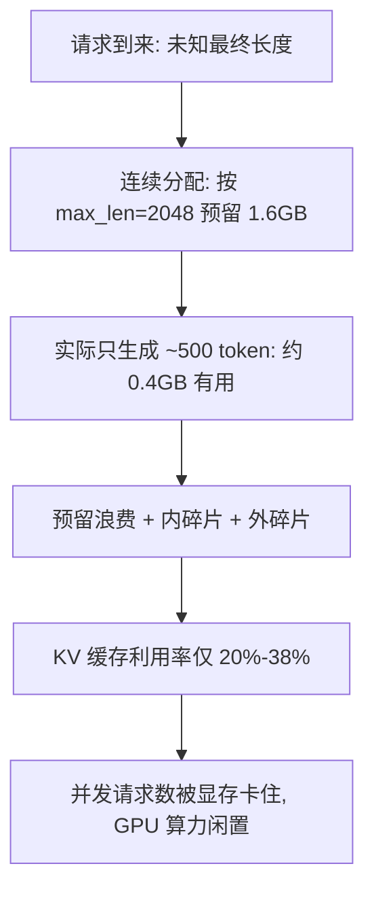
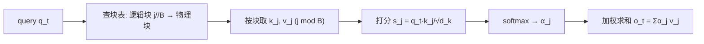

# 37｜PagedAttention：KV 缓存碎片化怎么解决？

> **阅读目标**：理解推理服务里 KV 缓存的三种浪费（预留、内碎片、外碎片）各自是怎么产生的；能从"每 token 的 KV 缓存是多大"算出连续分配下并发请求数的上限；明白 PagedAttention 如何借用操作系统的分页思想，把浪费压到每条请求不到一个块，并解释为什么分块不改变模型输出。
>
> **前置知识**：第 08 篇的 KV Cache（解码时每步复用已算出的 K、V）；第 02 篇的缩放点积注意力（softmax 权重和为 1）；第 14 篇的 FlashAttention（注意力可以分块算出完全相同的结果）。需要一点操作系统直觉：虚拟内存、页表。

## 1. 直觉：操作系统 60 年前就解决过这个问题

第 08 篇算过一笔账：解码时每生成一个 token，就要把它的 K、V 存下来，供后面所有步复用。KV 缓存是推理服务的"工作内存"——模型权重是死的、推理开始前就占好了；KV 缓存是活的，随着请求到来、变长、结束而不断分配和释放。

问题不在缓存本身，而在**怎么分配**。2023 年之前的推理系统（包括早期的 HuggingFace Transformers 生成循环、FasterTransformer、Orca）采用的办法非常直白：每个请求一来，就按**最大可能长度**预留一段**连续**的显存。比如上限 2048 个 token，就一次性划出 2048 个位置的空间，请求实际只生成 50 个 token，剩下的 1998 个位置全程空着，别的请求还用不了。

这个毛病操作系统在 1960 年代就遇到过：程序要的内存大小不一、生命周期不定，连续分配导致内存里到处是"不够大、凑不进新程序"的碎片。操作系统的答案是**分页（paging）**：把内存切成固定大小的页，程序看到的是连续的虚拟地址，实际页可以散落在物理内存各处，中间隔一张页表做映射。PagedAttention（Kwon 等，SOSP 2023，vLLM 背后的技术）就是把这一招原样搬到 KV 缓存上：**KV 缓存不再是一段连续内存，而是一组固定大小的块（block），一张块表（block table）记录"逻辑块 → 物理块"的映射**。

先给结论（后面推导）：分块之后，每条请求浪费的显存不到一个块（块大小 16 个 token 时，不到 16 个 token 的量）；论文实测，旧系统只有 20.4%–38.2% 的 KV 缓存真正存了 token 状态，vLLM 把这个比例提到了约 96.3%。吞吐量在同等延迟下比当时的最优系统（FasterTransformer、Orca）高 2–4 倍。注意：**它没有让 KV 缓存变小，只是让浪费变小**——这个区分是本篇最重要的一点，第 8 节会再强调。

> 结论性质：20.4%–38.2% 与 96.3%、2–4 倍是论文在 ShareGPT 等负载上的**实测数据**（第 5 节会复算一遍量级）；"浪费不到一个块"是**严格结论**（第 3 节）。具体到你的服务上能省多少，取决于请求的平均长度分布——平均长度越短、长度方差越大，分页省得越多。

## 2. 三种浪费：预留、内碎片、外碎片

先把"每 token 的 KV 缓存是多大"算清楚。每个 token、每层都要存一个 K 向量和一个 V 向量：

```math
\text{每 token KV 字节数} = 2 \times \text{层数} \times \text{隐藏维度} \times \text{每元素字节数}
```

拿论文里的例子：13B 模型，40 层，隐藏维度 5120，fp16（每元素 2 字节）：

```math
2 \times 40 \times 5120 \times 2 = 819{,}200\ \text{字节} \approx 0.8\ \text{MB}
```

一个 token 0.8 MB，2048 个 token 就是约 1.6 GB。论文的设定里，一张 A100 40GB 上 13B 模型的权重大约占 26 GB（65%），留给 KV 缓存的只剩约 12 GB——这就是全部家当。三种浪费就是从这 12 GB 里往外漏水：

**浪费一：按最大长度预留（reserved slots）。** 请求还没开始生成，系统就得按上限 2048 预留 1.6 GB。但真实请求的输出长度大多只有几百个 token——ShareGPT 对话里平均也就几百。预留 1.6 GB、实际用 0.4 GB，**四分之三的空间从第一秒起就是死空间**。这是最大的一笔浪费，根源是"生成长度事先不知道，只能按最坏情况准备"。

**浪费二：内碎片（internal fragmentation）。** 即使系统改成"按实际长度分配"，连续分配仍有麻烦：请求在生长，长度 47 → 48 → 49……每次变长都要重新找一段更大的连续空间、把旧数据搬过去，或者干脆一开始就多留余量。无论哪种做法，分配出去的空间总比实际用的多一点，多出来的零头就是内碎片。

**浪费三：外碎片（external fragmentation）。** 请求结束释放内存后，显存里留下许多不连续的小空洞。下一个请求要一段 1.6 GB 的连续空间——空闲总量明明够，却没有一段连续空闲够大，只能拒绝或等待。举个具体数：显存里有 6 个各 0.5 GB 的空闲洞，总共 3 GB 空闲，但最大的连续空闲只有 0.5 GB，一条要 1.6 GB 的新请求照样进不来——内存总量够用、却因为"不连续"而用不上，这是连续分配最隐蔽的浪费。它和内碎片的区别是：内碎片是"分出去的空间里没用完的部分"，外碎片是"没分出去、但拼不成整块的空间"，两者都会让利用率往下掉。

三者叠加的结果，论文实测：旧系统里只有 20.4%–38.2% 的 KV 缓存内存真正存着 token 状态，**60%–80% 都在空转**。注意这个数字不是理论推导，是论文在真实负载上量出来的——你的系统可能比这个好，也可能更差，但量级不会差太远。



## 3. 核心机制：分块 + 块表

PagedAttention 的做法只有两条规则：

1. **KV 缓存切成固定大小的块**，每块存固定数量的 token（vLLM 默认每块 16 个 token），块是分配的最小单位；
2. **每条请求维护一张块表**：逻辑块号 → 物理块号，逻辑上连续、物理上可以散落。

以一条生成到第 47 个 token 的请求为例（块大小 16）：

| 逻辑块 | 包含的 token 位置 | 物理块（示例） |
|:-:|---|---|
| 0 | 0–15 | 物理块 7 |
| 1 | 16–31 | 物理块 3 |
| 2 | 32–46 | 物理块 19（只用了 15/16 个槽位） |

第 47 个 token 写进逻辑块 2 的第 15 个槽位时，这个块满了；生成第 48 个 token 时，系统**按需再分配一个新物理块**，挂到块表末尾。没有预留、没有搬家：

- **预留浪费消失**：内存按实际长度增长，用多少、占多少；
- **内碎片有上界**：只有最后一个块可能不满，浪费不到一个块，即不到 16 个 token 的量——与序列总长度无关；
- **外碎片消失**：新块可以是显存里任何一个空闲物理块，不要求连续；释放时按块归还，任何大小的空洞都能被下一个块利用。

算一下总浪费的上界。设块大小为 $`B`$，同时有 $`N`$ 条请求在跑，每条请求浪费不到 $`B`$ 个 token 的 KV 空间：

```math
\text{总浪费} < N \times B \times \text{每 token KV 字节数}
```

关键在：浪费只跟**请求条数**成正比，跟**序列长度**无关。请求越长，这个上界占实际用量的比例越小：平均长度 500 个 token、块大小 16 时，浪费占比不到 $`16/500 \approx 3.2\%`$。这就是论文测出 96.3% 利用率的由来——不是魔法，是上界本身就很小。反过来想：如果平均长度只有 20 个 token，浪费占比会升到接近 $`16/20 = 80\%`$，分页的收益就大打折扣——结论成立的条件是"序列比块大得多"，好在真实推理负载基本满足。

块表本身的开销可以忽略不计：每条请求只需要一张"逻辑块号 → 物理块号"的整数表，几百个 token 的序列对应几十个表项，几百字节——相对动辄几百 MB 的 KV 缓存，占比不到千分之一。引用计数同样如此：每个物理块一个整数，几万个块也才几十 KB。分页机制的全部元数据加起来，还不到一块 KV 缓存的零头；这也是它能被三大推理引擎同时采纳的原因之一——收益大、成本小、改动局部。

> 严格性说明：上面"不到一个块"是严格上界；96.3% 是论文实测值（含块表、元数据等真实开销），两者量级一致，互相印证。

## 4. 推导：分块之后，注意力计算为什么完全不变

最容易产生的怀疑是：K、V 被拆散到各处，注意力算出来的结果会不会变？答案是**不会**，因为 PagedAttention 只改变存储布局，不改变参与计算的 K、V 集合。

解码第 $`t`$ 步，查询向量是 $`q_t`$，要对位置 $`0`$ 到 $`t`$ 的全部 K、V 做注意力：

```math
s_j = \frac{q_t \cdot k_j}{\sqrt{d_k}}, \qquad j = 0, \dots, t
```

```math
\alpha_j = \text{softmax}(s_0, \dots, s_t)_j, \qquad o_t = \sum_{j=0}^{t} \alpha_j v_j
```

标准实现里，$`k_j`$ 在连续内存的第 $`j`$ 个位置；PagedAttention 里，它在"块表查到的物理块"的第 $`j \bmod B`$ 个槽位：

```math
k_j = K_{\text{块表}[\lfloor j / B \rfloor]}[\, j \bmod B \,], \qquad
v_j = V_{\text{块表}[\lfloor j / B \rfloor]}[\, j \bmod B \,]
```

打分、softmax、加权求和这三步的**输入集合**与标准注意力完全相同——同样的 $`t+1`$ 个 $`(k_j, v_j)`$ 对，同样的 $`s_j`$，同样的权重 $`\alpha_j`$。所以输出 $`o_t`$ 在数学上严格相等（浮点求和顺序不同会带来 1e-6 量级的舍入差异，对生成结果没有实质影响）。PagedAttention 的 kernel 只是多做了一次"查块表、按块取数"的间接寻址。

这里有个细节值得点破：解码时 query 只有一个向量，kernel 可以先把全部 $`t+1`$ 个打分算出来、再做一次 softmax，不需要在线 softmax 那套分块归约（那是第 14 篇 FlashAttention 在预填充长 query 序列时才需要的技巧）。分页解决的是**存储**问题，分块计算解决的是**显存读写**问题，两者正交——vLLM 里它们是配合使用的，但不要把功劳记混。

补充一个阶段划分：请求刚进来时要先过**预填充（prefill）**——把整个 prompt 一次性算完，K、V 按块批量写入，块表一次性挂上一串物理块；之后进入**解码（decode）**，每步只新增一个 token、最多分配一个新块。预填充是算力 bound 的（query 很多、矩阵乘法占主导），解码是显存带宽 bound 的（每步都要把全部权重读一遍、只算一个 token，第 08 篇算过这笔账）。PagedAttention 主要优化的是解码阶段的内存占用，但块表机制在两个阶段是同一套——预填充分配的块，解码直接接着用，不用在两个阶段之间倒腾数据。代价只有一次间接寻址：kernel 取 K、V 时要先查块表，比连续寻址多一次访存；论文的消融显示这笔开销很小，因为块大小 16 恰好与 GPU 一次内存事务的粒度匹配，块内仍是连续读取。



## 5. 数值示例：同一张 A100，能并行多少请求？

沿用第 2 节的数字：13B 模型、fp16、每 token KV 约 0.8 MB；A100 40GB，权重占 26 GB，KV 缓存预算 12 GB；最大长度 2048。

**连续分配（旧系统）：**

- 每条请求预留：$`2048 \times 0.8\ \text{MB} \approx 1.6\ \text{GB}`$；
- 能并行的请求数：$`\lfloor 12 / 1.6 \rfloor = 7`$ 条；
- 假设实际平均生成 500 个 token，每条请求真实占用 $`500 \times 0.8\ \text{MB} = 0.4\ \text{GB}`$，7 条共用 2.8 GB；
- 利用率：$`2.8 / 12 \approx 23\%`$——正好落在论文实测的 20.4%–38.2% 区间里。

**PagedAttention（块大小 16）：**

- 每条请求实际占用：$`\lceil 500/16 \rceil = 32`$ 个块 $`= 512`$ 个槽位 $`\approx 0.41\ \text{GB}`$（其中浪费 12 个槽位，约 9.6 MB）；
- 能并行的请求数：$`\lfloor 12 / 0.41 \rfloor \approx 29`$ 条；
- 总浪费上限：$`29 \times 15 \times 0.8\ \text{MB} \approx 0.35\ \text{GB}`$，不到预算的 3%。

并发请求数从 7 条涨到约 29 条，**大约 4 倍**。这就是论文"吞吐量提高 2–4 倍"的来源：解码是内存带宽 bound 的（第 08 篇），batch 越大，每次读权重的成本摊到越多请求头上，GPU 利用率越高。注意这个 4 倍不是算力变强了——权重、算子、模型输出全都没变，变的只是"同样 12 GB 显存能同时伺候多少请求"。论文里更完整的数字是：在 ShareGPT 负载上，vLLM 的吞吐量比 FasterTransformer、Orca 高 2–4 倍；博客里常引用的"24 倍"是相对 HuggingFace Transformers 原始生成循环、在特定高负载下的上限，不是典型值。还有一点容易被忽略：并发数涨了，**延迟不一定跟着涨**——解码每步的耗时主要由"读一遍权重"决定，batch 从 7 涨到 29，权重还是读一遍，每步耗时几乎不变，多出来的只是 KV 读取量；所以吞吐涨、单条请求的延迟基本不变，这正是"同等延迟下吞吐提高 2–4 倍"这句话的含义。

反过来验算一个边界：如果所有请求都只生成 20 个 token，分页的浪费占比会升到接近 $`16/20`$，并发提升就只剩 1 倍出头——结论"分页省显存"成立的条件，始终是"平均序列长度远大于块大小"。

## 6. 共享与写时复制：同一个前缀，只存一份

分块还有一个连续分配做不到的副产品：**共享**。块表让"多条请求共用同一批物理块"变得自然，只要给每个物理块加一个引用计数：

- **并行采样（parallel sampling）**：同一个 prompt 采样 $`n`$ 条回答。前 $`L`$ 个 prompt token 的块完全相同，$`n`$ 条序列共享同一份物理块，只在各自分支的生成部分才各自分配新块。没有分页时，$`n`$ 条序列各存一份 prompt 的 KV 缓存，浪费 $`n-1`$ 倍。算个数：prompt 1000 个 token、采样 $`n=4`$、每 token 0.8 MB——连续分配下 prompt 部分要存 4 份，共 $`4 \times 1000 \times 0.8\ \text{MB} = 3.2\ \text{GB}`$；分页共享后只存 1 份 0.8 GB，省出 2.4 GB，够再多跑 6 条 500-token 的请求。prompt 越长、采样数越多，共享省得越多；反过来，如果 prompt 只有几十个 token，共享的绝对收益就很小——结论成立的条件同样是"共享的部分足够大"。
- **Beam search**：宽度为 $`B`$ 的束搜索，候选序列在分叉前共享全部前缀块；分叉之后各自生长。论文里这是 PagedAttention 收益最明显的场景之一。
- **写时复制（copy-on-write）**：共享的块是只读的。一旦某条序列要往共享块里写（比如它的下一个 token 落进一个仍被别的序列引用的块），系统先复制一份私有块、再写入——操作系统页表里完全相同的机制。引用计数降到 0 的块才真正释放。

共享还可以跨请求：两个用户问了同一个系统提示词开头，prompt 前缀的块可以共用——这就是 vLLM 后来的**自动前缀缓存（automatic prefix caching）**，本质上是把块表从"请求内共享"扩展到"请求间共享"。注意这一步需要哈希匹配前缀、处理缓存逐出，已经超出 PagedAttention 本身的范围；PagedAttention 提供的是"共享成为可能"的机制，不是全套缓存策略。

## 7. 块大小怎么选？小了碎、大了亏

块大小 $`B`$ 是唯一的超参数，两头都有代价：

| 块大小 | 浪费上界（每请求） | 块表与 kernel 开销 | 适用场景 |
|:-:|:-:|---|---|
| 很小（如 1–4） | 几乎为 0 | 块数多、查表频繁、内存访问不连续，kernel 变慢 | 理论最优，工程上不划算 |
| 16（vLLM 默认） | 不到 16 个 token | 适中，与 GPU 内存事务粒度匹配 | 通用甜点，vLLM/TGI/TensorRT-LLM 都收敛到这里 |
| 很大（如 256） | 接近连续分配 | 开销最小 | 序列很长时浪费占比仍可接受，但短序列吃亏 |

为什么是 16 而不是 8 或 32？这是**经验结论、需实验验证**：论文的消融实验显示，16 在浪费与 kernel 效率之间取得平衡；更大的块省下的调度开销，抵不过多浪费的显存；更小的块省下的显存，抵不过增加的寻址开销。不同硬件、不同模型上的最优值可能漂移，但量级上 16 是个稳健的默认值。

还有一个工程细节：显存真的耗尽时怎么办？vLLM 有两种抢占策略——**换出（swap）**：把低优先级请求的块搬到 CPU 内存，等有空位再搬回来；**重算（recompute）**：直接丢弃它的块，等轮到它时从头再算一遍。前者省算力、费带宽；后者省带宽、费算力。分页让这两种策略都变得便宜：换出和重算的单位都是块，不用整条请求搬家。选哪个是**工程权衡、需实验验证**：请求接近完成时重算代价大，适合换出；请求刚开始、prompt 很短时重算便宜，适合丢弃。vLLM 默认优先重算，因为实测里换出的 PCIe 传输经常比"把 prompt 再算一遍"更慢——但这句话成立的条件是 prompt 不太长、CPU 内存带宽是瓶颈，换一张硬件、换一批负载，结论可能反过来。

## 8. 常见误区

**误区一："PagedAttention 把 KV 缓存变小了。"**

没有。每 token 还是 0.8 MB，一点没少。想真正缩小每 token 的缓存，要看第 09 篇的 GQA/MQA（减少 KV 头数）、量化（第 21 篇）或 MLA 那类压缩方法。PagedAttention 省的是**浪费**，不是**用量**——它让 12 GB 显存里 96% 都在干活，而不是只让 30% 干活。把"利用率"和"单 token 开销"混为一谈，会误判它能解决什么问题。

**误区二："K、V 被拆散了，注意力结果会变。"**

不会。第 4 节证明了：参与计算的 $`(k_j, v_j)`$ 集合完全相同，softmax 的输入完全相同，输出在数学上严格相等。分页是存储布局的改变，不是算法的改变——和"把一本书从连续书架挪到按页编号的散放书架、但每次都按页码取全"没有区别。

**误区三："块越小越好，块大小 1 就零浪费。"**

块大小 1 时浪费确实趋近于 0，但块表本身变成每个 token 一项，kernel 每次取 K、V 都要查表、跳着读内存，访存效率会垮掉。16 是浪费与效率的平衡点，不是拍脑袋定的——论文做过消融实验，工程上三大推理引擎也都收敛到这个量级。

**误区四："显存够大，就不需要分页。"**

显存够大时，瓶颈会从"装不下多少请求"转移到别处，分页的相对收益确实会缩小；但"够大"是个移动靶——上下文窗口从 2k 涨到 128k、256k，单条请求的 KV 缓存从 1.6 GB 涨到 100 GB 以上，预留式分配的浪费是按最大长度成比例放大的。分页的价值不在于显存紧张的那一刻，而在于它让"浪费占比"与序列长度解耦。

**误区五："24 倍吞吐提升，换 vLLM 就能快 24 倍。"**

24 倍是博客里相对 HuggingFace Transformers 原始生成循环、在特定高负载下的上限；论文正文的严谨数字是相对 FasterTransformer、Orca 的 **2–4 倍**（同等延迟下）。拿上限当典型值，是对 benchmark 的误读——第 5 节复算的 4 倍并发提升，对应的是 2–4 倍这个区间，不是 24 倍。

## 9. 自测题

**Q1.** 13B 模型（40 层、隐藏维度 5120、fp16），一条请求最多生成 2048 个 token。连续分配下它要预留多少 KV 缓存？如果它实际只生成了 50 个 token，利用率是多少？

<details>
<summary>答案</summary>

每 token KV $`= 2 \times 40 \times 5120 \times 2 = 819{,}200`$ 字节 $`\approx 0.8`$ MB。预留 $`2048 \times 0.8\ \text{MB} \approx 1.6`$ GB；实际占用 $`50 \times 0.8 = 40`$ MB，利用率 $`40/1600 \approx 2.5\%`$。这就是"预留浪费"最极端的样子：短请求在连续分配下几乎全程空占显存。
</details>

**Q2.** 块大小 16，一条序列长 100 个 token，需要几个块？浪费了多少个槽位？浪费的上界是多少？

<details>
<summary>答案</summary>

$`\lceil 100/16 \rceil = 7`$ 个块，共 112 个槽位，浪费 $`112 - 100 = 12`$ 个槽位。浪费上界是 $`B - 1 = 15`$ 个槽位（最后一个块只用 1 个槽位时），与序列总长度无关——序列越长，这个上界占实际用量的比例越小。
</details>

**Q3.** 为什么 PagedAttention 不改变模型输出？如果把块大小从 16 改成 32，输出会变吗？

<details>
<summary>答案</summary>

因为参与注意力计算的 $`(k_j, v_j)`$ 集合、打分和 softmax 输入都与标准注意力完全相同（第 4 节），变的只是 K、V 在显存里的存放位置。块大小只影响"浪费多少、查表多频繁"，不影响计算内容——改成 32，输出在数学上仍然相同（只有浮点求和顺序的微小差异）。
</details>

**Q4.** Beam search 宽度为 4，所有候选共享 1000 个 token 的 prompt 前缀。如果没有写时复制（copy-on-write），直接让 4 条候选共用同一批物理块并各自写入，会发生什么？

<details>
<summary>答案</summary>

某条候选写入共享块时，会覆盖掉别的候选在同一位置的 K、V——4 条候选互相污染，beam search 的结果就错了。写时复制的规则是：引用计数大于 1 的块是只读的，写入前必须先复制一份私有块。这是用一块内存复制的代价，换"共享"这个正确性前提。

---

**下一篇预告**：38｜连续批处理：请求来了就插队，GPU 为什么不能闲着？

**参考文献**：Kwon, W., Li, Z., Zhuang, S., Sheng, Y., Zheng, L., Yu, C. H., Gonzalez, J. E., Zhang, H., & Stoica, I. (2023). *Efficient Memory Management for Large Language Model Serving with PagedAttention*. SOSP 2023. arXiv:2309.06180.
