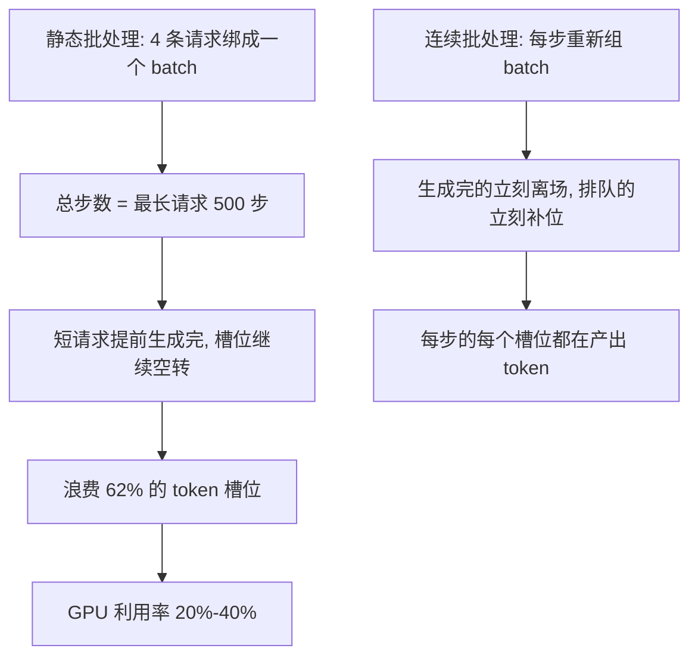

# 38｜连续批处理：请求来了就插队，GPU 为什么不能闲着？

> **阅读目标**：理解静态批处理为什么在生成任务里浪费超过一半算力；明白连续批处理如何把调度单位从"一条请求"缩小到"一次解码迭代"，让新请求在任意一步插队、已完成的请求立刻离场；能从"解码是显存带宽 bound 的"出发，算出为什么多加请求几乎不增加每步耗时、以及这个结论在什么条件下失效。
>
> **前置知识**：第 08 篇的 KV Cache（解码每步只算一个新 token，权重却要读一遍）；第 37 篇的 PagedAttention（KV 缓存分块存放、共享与抢占）；第 02 篇的缩放点积注意力；第 14 篇的 FlashAttention（解码与预填充的计算形态不同）。

## 1. 直觉：班车与地铁的区别

想象一个推理服务是一条公交线路，乘客是请求，上车是开始生成，下车是生成完毕。

**静态批处理（static batching）是班车**：车门只在发车那一刻开一次。4 个人上车，目的地分别是 10 站、50 站、200 站、500 站之后。车必须开满 500 站才能回来——第 10 站就到家的乘客，也得在车上坐到第 500 站；中途新来的乘客只能在站台等下一班。更糟的是，车上 4 个座位按"最远乘客"预留：10 站的乘客占一个座 500 站，其中 490 站是空占。

**连续批处理（continuous batching）是地铁**：每到一站就开门。10 站的乘客到站下车，座位立刻空出来，站台上等着的人马上上车。车永远是满的，没有一站是空跑。

这就是 Orca（Yu 等，OSDI 2022）提出的**迭代级调度（iteration-level scheduling）**：调度单位不再是一条完整的请求，而是一次**解码迭代**——也就是生成一个 token 的那一步。每跑完一步，调度器就重新看一眼：谁生成完了？离场；排队的人里谁能进来？进来。下一迭代的 batch 成员就此刷新。

"连续"这个名字取得很准：batch 的成员不再是"一批定下来、跑完再换"，而是**每一步都在变**——像一条没有固定班次、只有固定节拍的流水线。调度器的工作从"攒够一车人再发车"变成了"每站看一眼、有人下就有人上"，GPU 的空闲时间被压缩到只剩"某一瞬间恰好没人排队"的那几毫秒。后面几节会把这个直觉拆成三块：静态批处理到底浪费了什么（第 2 节）、连续批处理的核心机制是什么（第 3 节）、以及它成立的数学条件和边界（第 4–5 节）。

先给结论（后面推导）：在请求长度参差不齐的真实负载下，静态批处理会把超过一半的"token 槽位"浪费在"已经生成完、却还要占着位置"的请求上；连续批处理把这部分浪费清零。Orca 论文在 GPT-3 175B 上的实测是：**同等延迟水平下，吞吐量比当时的最优静态批处理系统 FasterTransformer 高 36.9 倍**。注意这个 36.9 倍是论文在特定负载、175B 模型上的数字，不是"换个系统就快 36.9 倍"的承诺——第 7 节会拆开这个数字的成立条件。

> 结论性质：36.9 倍是论文**实测数据**（第 5 节会复算量级）；"每步耗时几乎不随 batch 增大"是**严格推导在一定条件下的结论**（第 4 节），条件是"KV 读取量远小于权重读取量"，条件一破，结论就跟着破。

## 2. 静态批处理的两笔浪费

先把静态批处理的工作方式写清楚。假设一个 batch 里有 $`B`$ 条请求，第 $`i`$ 条要生成 $`L_i`$ 个 token。静态批处理把它们绑在一起跑，batch 的总步数由最长的那条决定：

```math
\text{总步数} = \max_i L_i
```

每步产生 $`B`$ 个 token 槽位（每个位置一个 token），但只有还没生成完的请求那个槽位是有效的。有效 token 总数是 $`\sum_i L_i`$，总槽位数是 $`B \times \max_i L_i`$。浪费比例就是：

```math
\text{浪费比例} = 1 - \frac{\sum_i L_i}{B \times \max_i L_i}
```

**浪费一：等最长的人（straggler）。** 拿第 1 节的 4 条请求算一笔账，长度分别是 10、50、200、500：

| 请求 | 长度 | 占位步数 | 浪费的槽位 |
|:-:|:-:|:-:|:-:|
| A | 10 | 500 | 490 |
| B | 50 | 500 | 450 |
| C | 200 | 500 | 300 |
| D | 500 | 500 | 0 |
| **合计** | **760** | **2000** | **1240** |

浪费比例 $`1240 / 2000 = 62\%`$——超过六成的算力花在"给已经生成完的请求算空气"上。真实负载比这更糟：Orca 论文指出，真实对话的输出长度是**重尾分布**——大多数请求很短，少数很长。batch 里只要混进一条很长的请求，整个 batch 就被它拖住；而且长度是事先不知道的，调度器没法提前把"差不多长"的请求分到一组。

**浪费二：padding。** 预填充阶段更直白：batch 里的 prompt 长度不同，短的要补 pad token 补到和最长的一样长，补出来的 token 也要过一遍模型、占一份算力，最后结果直接扔掉。算个数：3 条请求的 prompt 分别是 100、500、2000 个 token，拼成一个 batch 要统一 pad 到 2000，总共算 6000 个 token 的预填充，其中 $`(2000-100) + (2000-500) = 3400`$ 个是 pad 出来的空气，浪费比例 $`3400/6000 \approx 57\%`$。这笔浪费和 straggler 是同一根源——**把长度不同的请求绑在同一个固定 batch 里**。

两笔浪费叠加，早期推理系统的 GPU 利用率经常只有 20%–40%。注意这和第 37 篇的浪费是两回事：PagedAttention 解决的是"显存里 60%–80% 的 KV 缓存是空占的"（**放得下**的问题）；连续批处理解决的是"GPU 的每一步里 60% 的槽位在算空气"（**排得满**的问题）。两个机制正交，vLLM 里它们是配合使用的。



## 3. 核心机制：迭代级调度 + 选择性批处理

连续批处理只有一条规则：**每跑完一次解码迭代，调度器重新决定下一迭代的 batch 成员**。伪代码写出来只有几行：

```text
running = []          # 正在生成的请求
waiting = [...]       # 排队等着的请求
while True:
    # 1. 离场: 上一步生成完的请求移出 running
    running = [r for r in running if not r.finished]
    # 2. 入场: 只要显存还放得下, 从 waiting 补人
    while len(running) < MAX_BATCH and waiting:
        r = waiting.pop(0)
        r.prefill()   # 先把 prompt 算一遍, 写 KV 缓存
        running.append(r)
    # 3. 跑一步: batch 里的每条请求各生成一个 token
    step(running)
```

关键在第 2 步的 `prefill()`：新请求插队时要先过预填充——把整个 prompt 一次性算完、KV 缓存写好——然后才能加入解码的队伍。这一步是整步里最重的操作，第 6 节会讲它带来的新问题。

光有调度还不够，还有一个实现上的坎：batch 里的请求**长度各不相同**，它们的注意力没法像线性层那样直接拼成一个大矩阵算。Orca 的第二个贡献——**选择性批处理（selective batching）**——就是解决这个的：

- **线性层、LayerNorm、激活函数可以拼 batch 算**：这些操作是"逐 token 独立"的。第 $`i`$ 条请求的第 $`t`$ 步只依赖它自己的 hidden state，和别的请求无关。所以可以把 batch 里所有请求的当前 token 拼成一个 $`[B, d]`$ 的矩阵，一次 GEMM 算完。
- **注意力必须按请求单独算**：第 $`i`$ 条请求的注意力要对它自己的 $`t_i`$ 个历史 K、V 做 softmax，$`t_i`$ 各不相同、KV 位置也各不相同（第 37 篇：它们散落在不同的物理块里）。拼成一个矩阵就要 padding——而 padding 正是我们要消灭的浪费。所以注意力对 $`B`$ 条请求各跑一次小的 kernel，每次只算 $`1 \times t_i`$ 的打分。

为什么这样分是合理的？算一笔 FLOPs 账就明白了。解码第 $`t`$ 步，单条请求、单层的注意力 FLOPs 大约是：

```math
\text{注意力 FLOPs} \approx 4 \times t \times d_{\text{model}}
```

（打分 $`qK^T`$ 与加权求和 $`\alpha V`$ 各 $`2 \times t \times d`$。）取 $`t = 500`$、$`d = 5120`$、40 层：$`4 \times 500 \times 5120 \times 40 \approx 4.1 \times 10^8`$。而同一步里线性层的 FLOPs 是 $`2 \times 13 \times 10^9 = 2.6 \times 10^{10}`$——注意力只占约 1.6%。解码是**显存带宽 bound** 的（第 08 篇），注意力那点计算量根本不是瓶颈，所以"注意力单独算、线性层拼 batch"这个分工几乎不损失性能，却换来了"长度不同的请求可以同处一个 batch"。

> 严格性说明：上面"注意力只占 1.6%"是**量级估算**，成立条件是"解码步、$`t`$ 在几百量级"。$`t`$ 涨到几万（超长上下文）时，注意力 FLOPs 按 $`t`$ 线性增长，占比会抬头；但那时显存带宽的账也要重算——第 4 节的结论同样要加条件。

## 4. 推导：为什么多加请求几乎不增加每步耗时

这是连续批处理成立的全部数学基础。解码每步要做的事只有两件：**把权重读一遍**（$`2 \times 13 \times 10^9 = 2.6 \times 10^{10}`$ FLOPs 的计算，访存 26 GB），以及**把 batch 里每条请求的 KV 读一遍**。第 08 篇算过：解码是显存带宽 bound 的，每步耗时约等于"要读的字节数 ÷ 显存带宽"。

设 batch 大小为 $`B`$，平均已生成长度为 $`\bar{L}`$，每 token 的 KV 是 $`c`$ 字节（第 37 篇：13B 模型 fp16 下 $`c \approx 0.8`$ MB），权重总共 $`W`$ 字节，显存带宽为 $`BW`$。每步耗时：

```math
T_{\text{step}}(B) \approx \frac{W + B \times \bar{L} \times c}{BW}
```

权重 $`W`$ 只读一遍、与 $`B`$ 无关；KV 读取量随 $`B`$ 线性增长。为什么权重只读一遍？因为 batch 里的 $`B`$ 个 token 拼成一个矩阵做 GEMM 时，权重矩阵从显存读进片上缓存一次，就被 $`B`$ 行共享复用——读一次、算 $`B`$ 份，这正是批处理的全部意义。反过来，KV 缓存是每条请求私有的，没法共享，所以 KV 读取量只能随 $`B`$ 线性涨。关键在两项的量级对比：

- $`B = 4`$、$`\bar{L} = 500`$ 时：KV 读取 $`= 4 \times 500 \times 0.8\ \text{MB} = 1.6\ \text{GB}`$，相对权重 26 GB 只占 6%；
- $`B = 32`$、$`\bar{L} = 500`$ 时：KV 读取 $`= 32 \times 500 \times 0.8\ \text{MB} = 12.8\ \text{GB}`$，占到权重的一半。

拿 A100 80GB（带宽约 2 TB/s）算具体数：

| batch 大小 | 每步读权重 | 每步读 KV | 每步耗时 | 每秒产 token 数 |
|:-:|:-:|:-:|:-:|:-:|
| 4 | 26 GB | 1.6 GB | $`(26+1.6)/2000 \approx 13.8`$ ms | $`4/13.8\text{ms} \approx 290`$ |
| 32 | 26 GB | 12.8 GB | $`(26+12.8)/2000 \approx 19.4`$ ms | $`32/19.4\text{ms} \approx 1650`$ |

batch 从 4 涨到 32（8 倍），每步耗时只从 13.8 ms 涨到 19.4 ms（1.4 倍），吞吐量却涨了约 5.7 倍。**多加请求几乎不增加每步耗时**，因为每步的固定成本（读权重）被所有请求分摊了——这就是"GPU 不能闲着"的数学含义，也是连续批处理敢让 batch 动态涨大的底气。

但公式也写明了这个结论的**边界**：$`B \times \bar{L} \times c`$ 接近 $`W`$ 时，每步耗时开始随 $`B`$ 线性增长，继续加 batch 的收益递减；再往上加，KV 缓存先把显存放满（第 37 篇：12 GB 预算、每 token 0.8 MB，500-token 的请求只能并行约 29 条），batch 被显存硬顶住。所以连续批处理不是"batch 越大越好"，而是"在显存放得下、KV 读取还没追上权重读取的区间里，batch 越大越赚"。第 09 篇的 GQA/MQA 在这里有意外收获：它把每 token 的 KV 从 0.8 MB 压小，等于把 $`c`$ 变小、把这个区间的右边界往外推了一大截。

还有一个容易忽略的推论：**连续批处理提高的是吞吐量，不是单条请求的延迟**。一条请求从排队到生成完，每步还是要等 $`T_{\text{step}}`$，batch 越大、每步越慢，它的延迟反而略有上升。Orca 论文的 36.9 倍说的是"同等延迟水平下的吞吐量"，不是"每条请求快 36.9 倍"——把这两个量混为一谈，是最常见的误读。

## 5. 数值示例：同一批请求，两种调度差多少

沿用第 2 节的 4 条请求（长度 10、50、200、500），假设队列里一直有新请求等着补位、batch 上限是 4，每步耗时都按 13.8 ms 算（batch 满员时）：

**静态批处理：**

- 总步数 500，每步产 $`B = 4`$ 个槽位，其中有效 token 只有 760 个；
- 总耗时 $`= 500 \times 13.8\ \text{ms} = 6.9`$ s；
- 吞吐量 $`= 760 / 6.9 \approx 110`$ token/s；
- 请求 A 只生成 10 个 token，却要等满 500 步（6.9 s）才能拿到结果。

**连续批处理：**

- 每步都产 4 个有效 token（生成完的立刻离场、新请求立刻补位，槽位永不满载）；
- 760 个 token 需要 $`760 / 4 = 190`$ 步；
- 总耗时 $`= 190 \times 13.8\ \text{ms} \approx 2.6`$ s；
- 吞吐量 $`= 760 / 2.6 \approx 290`$ token/s，约 **2.6 倍**；
- 请求 A 在第 10 步（约 0.14 s）就拿到结果，而不是 6.9 s。

2.6 倍——不是 36.9 倍。差距从哪来？这个小例子里 batch 只有 4、长度方差有限；Orca 论文的 36.9 倍是在 GPT-3 175B 上、拿"输出长度在 1 到 128 之间均匀分布"的合成负载、对比 FasterTransformer 的静态批处理测出来的：175B 的权重更大（350 GB fp16，多卡分片）、每步固定成本更高，分摊效应更强；长度分布更散，静态批处理的 straggler 浪费更重。两个因素叠加，才把倍数推到 36.9。**复算的意义正在于此**：2.6 倍这个量级告诉你，连续批处理在"小模型、小 batch、长度差不多"的场景下收益有限；36.9 倍告诉你，在"大模型、大 batch、长度方差大"的场景下收益可以非常大。你的服务落在哪一段，取决于这三个数，不取决于论文标题。

再验算一个边界：如果 4 条请求长度全是 500（方差为 0），静态批处理的浪费比例是 $`1 - 2000/2000 = 0`$，连续批处理相对它没有任何优势——结论"连续批处理省算力"成立的条件，始终是"请求长度参差不齐"。好在真实对话负载天然满足这个条件。

## 6. 工程细节：插队不是免费的

**新请求的预填充会堵住解码。** 第 3 节的伪代码里，新请求入场要先跑 `prefill()`——把整个 prompt 一次性算完。一个 4000-token 的 prompt，预填充 FLOPs 粗算 $`2 \times 13 \times 10^9 \times 4000 \approx 1.0 \times 10^{14}`$，在 A100（约 312 TFLOPS fp16）上要约 $`1.0 \times 10^{14} / 3.12 \times 10^{14} \approx 0.33`$ s。这 0.33 秒里，正在解码的几十条请求全被堵住、一个 token 也产不出——新请求插队一次，老请求集体卡顿一次。缓解办法是**分块预填充（chunked prefill，Sarathi-Serve 2023）**：把长 prompt 切成小块，每步只算一块、和解码步混着跑，用"多几步、每步慢一点"换"没有哪一步被堵死"。这是**工程权衡、需实验验证**：块切多小，要看你的延迟目标和 prompt 长度分布。

**显存满了怎么办？** batch 动态涨大，KV 缓存迟早会满。第 37 篇的两种抢占策略在这里接上：**换出**（把低优先级请求的块搬到 CPU 内存）或**重算**（丢弃它的块、轮到时从头算）。连续批处理让抢占变得频繁——因为 batch 不再是"固定大小、跑完再换"，而是"一直有人进、一直有人出"，调度器必须在每步都检查显存水位。vLLM 的做法是设一个上限 `max_num_seqs`，running 的请求数一到上限就不放新人进来；水位告急时先抢占优先级最低的请求。这就是为什么生产系统里 batch 大小不是越大越好：显存是硬顶。

实际系统里调度器还要处理两个队列：**waiting 队列**（还没跑过预填充的请求）和 **running 队列**（正在解码的请求）。每步调度时，先看 running 里谁生成完了、腾出多少 KV 空间，再决定从 waiting 里放几个人进来、每人分多少预填充块。vLLM 的调度循环每 5 ms 左右转一圈——这个频率本身也是权衡：转太快，调度开销吃掉收益；转太慢，新请求要多等一两步才能插队。结论"插队几乎零延迟"成立的条件是"调度周期远小于单步耗时"，在解码步约 15–20 ms 的量级下，5 ms 的调度周期基本满足。

**公平性：先到先得也会饿死人吗？** 连续批处理的入场顺序通常是 FCFS（先到先得）。短请求天然占便宜：它们生成完就走、几乎不占坑；长请求一旦进场就要占着一个槽位几百步。极端情况下，一条超长请求后面排着几百条短请求，短请求反而因为"长请求还没走、槽位没空出来"而多等——这是**反向队头阻塞**。举个具体数：batch 上限 32，32 个槽位全被"各要生成 2000 token"的长请求占满，后面排队的短请求（只要 20 token）一个也进不来，只能等最先走的那条长请求跑完 2000 步——短请求明明 20 步就能完事，却要等 2000 步。缓解办法是给请求分优先级（交互式请求优先于批量任务）、或限制单条请求的最大生成长度。结论"FCFS 就够了"成立的条件是"请求长度分布不太极端、到达率不太高"，生产系统基本都会再加一层优先级。

**和 PagedAttention 的配合。** 两者解决的问题正交，但实现上互相成就：连续批处理要求"任意一步都能有人进、有人出"，这就要求 KV 缓存能**按请求粒度、随时分配和释放**——没有第 37 篇的分块机制，连续分配下"中途插队"要么找不到连续空闲、要么要搬家，调度每步都要等内存整理。反过来，PagedAttention 没有连续批处理，省下的显存也只能换成"更大的固定 batch"，straggler 的浪费还在。所以 vLLM 同时用上两者：PagedAttention 管"放得下"，连续批处理管"排得满"。

## 7. 常见误区

**误区一："连续批处理让模型变快了。"**

没有。单条请求的每步耗时 $`T_{\text{step}}`$ 不但没变，batch 变大后还略有上升（第 4 节：从 13.8 ms 到 19.4 ms）。变快的是**吞吐量**——单位时间产出的 token 总数——和**短请求的等待时间**（不用等最长的那条跑完）。拿吞吐量的倍数去承诺延迟，是偷换概念。

**误区二："batch 越大越好。"**

第 4 节的公式写明了上限：KV 读取量 $`B \times \bar{L} \times c`$ 追上权重 $`W`$ 之后，每步耗时随 $`B`$ 线性增长，吞吐量不再涨；再往上，显存先满（第 37 篇的 12 GB 预算）。生产系统设 `max_num_seqs` 不是保守，是算过账的。

**误区三："36.9 倍，换个系统就能快 36.9 倍。"**

36.9 倍是 Orca 论文在 GPT-3 175B、特定合成负载下、相对 FasterTransformer 的数字。你的模型、负载、硬件不同，倍数就不同——第 5 节复算的小例子只有 2.6 倍。拿论文上限当自己的预期，是对 benchmark 的误读（第 37 篇的"24 倍"误区同款）。

**误区四："请求来了就能立刻插队。"**

不能。插队只发生在**迭代边界**——每步结束、调度器重新组 batch 的那一刻；新请求还要先跑完预填充才能加入解码队伍。正在跑的某一步里，没有任何请求能中途加入或退出。"连续"指的是"每步都重新调度"，不是"任意时刻都能调度"。

**误区五："连续批处理会改变模型输出。"**

不会。同一条请求内部，token 的生成顺序、看到的 KV、softmax 的输入和静态批处理完全相同（第 3 节：注意力是按请求单独算的）。变的只是"哪些请求共享同一步的权重读取"，不改变任何一条请求的计算内容——和第 37 篇的分页一样，是**调度与存储的改变**，不是算法的改变。

## 8. 自测题

**Q1.** 4 条请求，输出长度分别是 20、40、60、80 个 token。静态批处理下浪费比例是多少？如果换成连续批处理（队列一直有新请求补位、batch 上限 4），总步数是多少？

<details>
<summary>答案</summary>

总步数 $`= \max(20, 40, 60, 80) = 80`$，总槽位 $`= 4 \times 80 = 320`$，有效 token $`= 20 + 40 + 60 + 80 = 200`$，浪费比例 $`= 1 - 200/320 = 37.5\%`$。连续批处理每步产 4 个有效 token，200 个 token 需要 $`200/4 = 50`$ 步——比静态的 80 步少 30 步，省下来的全是 straggler 的空转。
</details>

**Q2.** 13B 模型（fp16，权重 26 GB），A100 80GB（带宽 2 TB/s），batch 里 16 条请求、平均已生成 1000 个 token，每 token KV 0.8 MB。每步耗时多少？其中 KV 读取占多大比例？如果平均长度翻倍到 2000，结论有什么变化？

<details>
<summary>答案</summary>

KV 读取 $`= 16 \times 1000 \times 0.8\ \text{MB} = 12.8\ \text{GB}`$；每步耗时 $`= (26 + 12.8)/2000 \approx 19.4`$ ms，KV 读取占 $`12.8/38.8 \approx 33\%`$。平均长度翻倍到 2000 时，KV 读取变成 25.6 GB、几乎追平权重，每步耗时 $`= (26+25.6)/2000 \approx 25.8`$ ms——"多加请求几乎不增加耗时"的结论开始失效，batch 继续涨大的收益递减。这就是第 4 节说的边界条件。
</details>

**Q3.** 为什么 Orca 要"选择性批处理"——线性层拼 batch 算、注意力按请求单独算？如果把注意力也拼成一个大矩阵算，会出什么问题？

<details>
<summary>答案</summary>

线性层是逐 token 独立的，拼 batch 只是矩阵变高，没有正确性问题；注意力要对每条请求各自不同长度的 KV 做 softmax，拼成一个矩阵就必须 padding 到最长长度——padding 的 token 也要算打分、占算力，等于把第 2 节要消灭的浪费又请了回来。而且解码时注意力 FLOPs 只占约 1.6%（第 3 节），单独算的代价微不足道，分工是划算的。
</details>

**Q4.** 一条 4000-token prompt 的新请求插队时，正在解码的 32 条请求会卡顿约 0.33 秒（第 6 节）。分块预填充（chunked prefill）是怎么缓解这个问题的？它付出了什么代价？

<details>
<summary>答案</summary>

把 4000-token 的预填充切成小块（比如每块 512 个 token），每步只算一块、和解码步混着跑：每步慢一点，但没有哪一步会被堵死 0.33 秒，解码请求的 token 间隔（TPOT）变得平稳。代价是预填充本身要分多步完成、总耗时略有上升（每块都要单独走一遍权重读取），以及调度逻辑变复杂——用"预填充慢一点"换"解码不卡顿"，是延迟目标下的工程权衡。

---

**下一篇预告**：39｜推测解码：用小模型猜、大模型验，为什么推理能快 2–3 倍？

**参考文献**：Yu, G.-I., Jeong, J. S., Kim, G.-W., Kim, S., & Chun, B.-G. (2022). *Orca: A Distributed Serving System for Transformer-Based Generative Models*. OSDI 2022. https://www.usenix.org/conference/osdi22/presentation/yu ；Kwon, W., et al. (2023). *Efficient Memory Management for Large Language Model Serving with PagedAttention*. SOSP 2023. arXiv:2309.06180.
