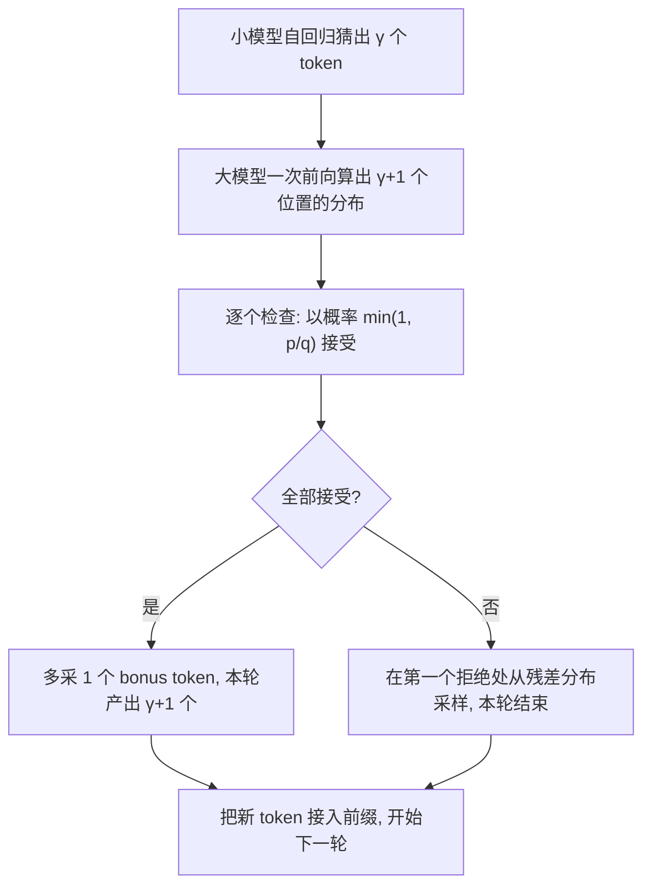

# 39｜推测解码：用小模型猜、大模型验，为什么推理能快 2–3 倍？

> **阅读目标**：理解自回归生成为什么"一次只产一个 token"是人为限制而不是数学必然；明白推测解码如何用一个便宜的小模型先猜出 γ 个 token、再让大模型一次前向并行验证，从而把每步产出的 token 数从 1 提高到 2–3 个；能从接受率 α 出发算出期望加速比，并说清它在什么条件下失效。
>
> **前置知识**：第 04 篇的因果 mask 与自回归生成（生成必须逐词）；第 08 篇的 KV Cache（解码是显存带宽 bound 的，每步要把权重读一遍）；第 11 篇的解码策略（temperature 采样与贪心）；第 38 篇的连续批处理（一次前向可以同时服务多个位置）。

## 1. 直觉：起草与审稿

想象你要写一篇文章，但有个规矩：每写一个词，都要等一位慢工出细活的专家审过才能写下一个。专家审一个词要 20 毫秒，写 100 个词就要 2 秒——慢的不是"想词"，而是"每次只审一个词"的流程。

现在换个办法：你先找一个手快但水平稍差的实习生，让他一口气起草接下来 4 个词；再把这 4 个词连同上下文一起交给专家，专家**一次**看完 4 个词，只说"第几个开始错了"。如果前 3 个都对，专家顺手把第 4 个位置的正确词也补上——这一步，你净赚 4 个词，只花了专家一次审稿的时间；如果第 1 个就错了，你只浪费了实习生起草的时间，专家还是只审了一次。

这就是推测解码（Speculative Decoding，Leviathan 等，2023；Chen 等，2023）的全部直觉：**小模型是实习生，大模型是专家**。小模型（draft model）便宜、跑得快，先猜出接下来 γ 个 token；大模型（target model）只跑一次前向，并行验证这 γ 个 token 对不对，错到哪里就从哪里接手。生成不再是"一步一个 token"，而是"一步验证 γ 个 token、产出 1 到 γ+1 个 token"。

值得多想一步：为什么这个办法不是显然的？训练时我们早就习惯了并行——第 10 篇的 teacher forcing 把真实 token 全喂进去，一次前向算出所有位置的 loss；但解码时，第 $`t+1`$ 个 token 的输入就是第 $`t`$ 个 token 的输出，依赖链看起来天生就是串行的。推测解码并没有打破这条依赖链，而是换了个思路：**先假设依赖链的走向（小模型猜），再并行验证假设（大模型验），猜错就回滚**。串行依赖还在，但它被压缩进了"验证"这一步——而验证恰好是能并行的。换句话说，推测解码利用的不是"模型变快了"，而是"解码每一步里，大模型本来就有大量并行能力被闲置了"（一次前向只算一个位置，GPU 的算力远没吃满，瓶颈在显存带宽）。

关键问题只有一个：专家审 4 个词，真的只花审 1 个词的时间吗？第 08 篇已经算过账了：解码是显存带宽 bound 的，每步耗时约等于"权重字节数 ÷ 显存带宽"。验证 γ 个 token 时，权重还是只读一遍——多算的只是几个位置的注意力，相对几十 GB 的权重读取微不足道。所以**一次前向验证 γ 个位置，耗时几乎等于一次前向只算 1 个位置**。这个"几乎免费"的并行验证，是整个方法成立的地基；第 5 节会把这笔账算清楚。

> 结论性质：下面"输出分布严格不变"是**严格定理**（第 3 节证明思路）；"加速 2–3 倍"是**实测数据加模型预测**（第 3–4 节），成立条件是"小模型猜得够准、验证确实接近免费"，条件一破，加速比就跟着掉。

## 2. 核心机制：猜 γ 个、一次验完

先把符号定下来。设目标模型分布为 $`p(x \mid \text{前缀})`$，草稿模型分布为 $`q(x \mid \text{前缀})`$，每轮草稿长度为 $`\gamma`$。

**第一步：草稿。** 小模型自回归地生成 γ 个候选 token：$`x_1, x_2, \dots, x_\gamma`$，其中 $`x_i \sim q(\cdot \mid \text{前缀}, x_1, \dots, x_{i-1})`$。这一步要跑 γ 次小模型前向——便宜，是全部成本里的小头。

**第二步：验证。** 把前缀加上 γ 个候选 token 一次性喂给大模型，**一次前向**算出 γ+1 个位置的分布：位置 0 是"前缀之后下一个 token 该是什么"（即 $`p(\cdot \mid \text{前缀})`$），位置 $`i`$ 是"前缀 + $`x_1..x_i`$ 之后下一个 token 该是什么"（即 $`p(\cdot \mid \text{前缀}, x_1, \dots, x_i)`$）。注意因果 mask 在这里帮了大忙：第 04 篇讲过，一个前向里每个位置只能看到自己之前的位置，所以一次前向同时算出 γ+1 个"如果前面都对、下一个该是什么"的分布——这正是验证需要的全部信息。

**第三步：逐个接受或拒绝。** 从 $`i = 1`$ 开始检查候选 $`x_i$`：以概率 $`\min\left(1, \frac{p(x_i)}{q(x_i)}\right)`$ 接受它；一旦在某个位置 $`i`$ 拒绝，就停下来，从"残差分布" $`\text{norm}(\max(0, p - q))`$ 里采样一个 token 作为该位置的输出，本轮结束。如果 γ 个全被接受，再从最后一个位置的分布 $`p(\cdot \mid \text{前缀}, x_1, \dots, x_\gamma)`$ 里多采样一个 token 作为奖励（bonus token）。所以每轮至少产出 1 个 token（拒绝时采的那个），最多产出 γ+1 个。

为什么拒绝时要从残差分布采样，而不是直接用大模型的分布 $`p`$ 采样？因为那样会**改变输出分布**——小模型猜对的 token 会被系统性地多算一遍。第 3 节会证明，上面这套"接受概率 + 残差采样"的组合，能让最终输出的每个 token 都**严格服从目标分布 $`p`$**，和直接用大模型一个一个采样一模一样。推测解码不是近似加速，是**无损加速**。

贪心解码是这套规则的特例：$`p`$ 和 $`q`$ 都退化成"只在 argmax 处为 1"的分布，接受条件变成"小模型的 argmax 等于大模型的 argmax"，拒绝时直接取大模型的 argmax。规则更简单，结论一样：输出和大模型贪心解码逐字相同。



## 3. 推导：接受率、期望产出与加速比

### 3.1 接受率就是 1 减总变差距离

单看一个位置：候选 token $`x`$ 是从 $`q`$ 采出来的，被接受的概率是 $`\min(1, p(x)/q(x))`$。对 $`x`$ 求期望，得到**接受率**：

```math
\alpha = \mathbb{E}_{x \sim q}\left[\min\left(1, \frac{p(x)}{q(x)}\right)\right] = \sum_x q(x) \cdot \min\left(1, \frac{p(x)}{q(x)}\right) = \sum_x \min(p(x), q(x))
```

而 $`\sum_x \min(p(x), q(x)) = 1 - \mathrm{TV}(p, q)`$，其中 $`\mathrm{TV}(p, q) = \frac{1}{2}\sum_x |p(x) - q(x)|`$ 是两个分布的总变差距离（验证：$`\min(p,q) = \frac{p + q - |p - q|}{2}`$，对 $`x`$ 求和即得）。所以：

```math
\alpha = 1 - \mathrm{TV}(p, q)
```

这句话值得停下来想一想：**小模型猜得准不准，不取决于它"最可能猜哪个词"，而取决于它的整个分布离大模型的分布有多近**。两个模型在某个 token 上分歧越大，那个 token 被接受的概率就越低；分布重合的部分越多，接受率越高。α 是"两个模型有多像"的直接度量，也是后面所有加速比计算的唯一输入。

### 3.2 每轮期望产出：几何级数求和

假设每一轮的接受事件近似独立、接受率都是 α（严格性说明见本节末尾）。一轮产出的 token 数是 $`K + 1`$，其中 $`K`$ 是连续接受的候选个数（$`K = 0, 1, \dots, \gamma`$），加 1 是拒绝时采的那个、或全接受时的 bonus token。$`K \geq k`$ 当且仅当前 $`k`$ 个候选全被接受，概率是 $`\alpha^k`$。用"期望 = 求和尾概率"的恒等式：

```math
\mathbb{E}[N] = \sum_{k=0}^{\gamma} P(K \geq k) = \sum_{k=0}^{\gamma} \alpha^k = \frac{1 - \alpha^{\gamma+1}}{1 - \alpha}
```

α 越大、γ 越大，期望产出越高，但有天花板：γ → ∞ 时，$`\mathbb{E}[N] \to \frac{1}{1-\alpha}`$。α = 0.7 时天花板是 3.33 个 token/轮——再长的草稿也突破不了这个上限，因为接受链迟早会断。

### 3.3 加速比：产出除以成本

设大模型一次前向耗时为 $`T`$，小模型一次前向耗时为 $`cT`$（$`c`$ 是成本比，约等于两个模型的参数量之比）。一轮的成本是 γ 次小模型前向 + 1 次大模型前向，即 $`(1 + \gamma c)T`$；不用的推测解码时，产出 $`\mathbb{E}[N]`$ 个 token 需要 $`\mathbb{E}[N] \cdot T`$。加速比就是：

```math
\text{加速比} = \frac{\mathbb{E}[N]}{1 + \gamma c} = \frac{1 - \alpha^{\gamma+1}}{(1 - \alpha)(1 + \gamma c)}
```

分子随 γ 增大而趋近天花板，分母随 γ 线性增长——所以 γ 有最优值，**不是越大越好**。取 α = 0.8、c = 0.05（小模型是大模型的 1/20 成本）：

| γ | 期望产出 E[N] | 一轮成本（单位 T） | 加速比 |
|:-:|:-:|:-:|:-:|
| 2 | 2.44 | 1.10 | 2.22× |
| 4 | 3.36 | 1.20 | 2.80× |
| 6 | 3.95 | 1.30 | 3.04× |
| 8 | 4.33 | 1.40 | 3.09× |
| 10 | 4.57 | 1.50 | 3.05× |

最优 γ ≈ 8，加速比约 3.09×；γ 从 8 加到 10，期望产出只多 0.24 个 token，成本却多 0.1T，加速比反而下降。真实系统里这个最优值还要用实测校准：α 不是常数（简单 token 接受率高、难 token 接受率低），c 也不是常数（小模型前向有固定开销），所以生产系统常用"自适应 γ"——根据最近几轮的接受情况动态调草稿长度。

> 严格性说明：上面把每轮各位置的接受当作独立同 α 处理，是**简化模型**——真实接受率随位置变化（越往后的候选基于越长的"猜出来的"前缀，越容易偏），且与上下文难度相关。所以表格里的 3.09× 是**模型预测**，不是承诺；Leviathan 等人在 T5-XXL 上的实测加速是 2–3×，落在同一个量级，互相印证。

## 4. 数值示例：分布严格不变，小算例验算

先拿一个 3 词表的小例子，把"残差采样为什么能保证分布不变"算一遍。设某位置上目标分布 $`p = [0.5, 0.3, 0.2]`$，草稿分布 $`q = [0.4, 0.4, 0.2]`$。

接受率 $`\alpha = \sum \min(p, q) = 0.4 + 0.3 + 0.2 = 0.9`$。残差分布 $`\text{norm}(\max(0, p - q)) = \text{norm}([0.1, 0, 0])`$，即"拒绝时一定采样 token 1"。

逐个验算最终输出的分布：

| token | 被接受的概率 | 被拒绝后采到的概率 | 输出总概率 | 目标 p |
|:-:|:-:|:-:|:-:|:-:|
| 1 | $`q_1 \cdot \min(1, p_1/q_1) = 0.4 \times 1 = 0.4`$ | $`(1-\alpha) \times 1 = 0.1`$ | 0.5 | 0.5 |
| 2 | $`q_2 \cdot \min(1, p_2/q_2) = 0.4 \times 0.75 = 0.3`$ | 0 | 0.3 | 0.3 |
| 3 | $`q_3 \cdot \min(1, p_3/q_3) = 0.2 \times 1 = 0.2`$ | 0 | 0.2 | 0.2 |

三个 token 的输出概率与目标分布 $`p`$ 逐项相等——这不是巧合。一般证明只有一行：token $`x`$ 的输出概率 = $`q(x)\min(1, p(x)/q(x)) + (1-\alpha)\cdot\frac{\max(0, p(x)-q(x))}{\sum_y \max(0, p(y)-q(y))}`$，而 $`\sum_y \max(0, p(y)-q(y)) = 1 - \alpha`$（因为 $`\sum \max(0, p-q) = 1 - \sum \min(p,q)`$），两项相加正好等于 $`p(x)`$。这就是推测解码"无损"的数学含义：**采样分布一个字都不差**，加速纯粹来自"少跑大模型前向"，不是"换了个更随意的分布"。

再算一个真实量级的加速账：70B 目标模型配 7B 草稿模型（同一家族、共享词表），$`c \approx 0.1`$；实测接受率 α ≈ 0.65，取 γ = 5。期望产出 $`\mathbb{E}[N] = \frac{1 - 0.65^6}{1 - 0.65} = \frac{1 - 0.0754}{0.35} \approx 2.64`$ 个 token/轮；一轮成本 $`1 + 5 \times 0.1 = 1.5T`$；加速比 $`\approx 2.64 / 1.5 \approx 1.76\times`$。如果换成接受率更高的同家族蒸馏小模型（α = 0.8），同样 γ = 5 时期望产出 3.69、加速比 $`3.69/1.5 \approx 2.46\times`$。所以**草稿模型选得好不好（α 高不高），比 γ 调得精不精更决定加速比**——第 6 节会讲草稿模型怎么选。

## 5. 为什么验证"几乎免费"：再算一次带宽账

第 08 篇的结论是解码每步耗时 $`T \approx \frac{W}{BW}`$，$`W`$ 是权重字节数，$`BW`$ 是显存带宽。验证 γ 个 token 时，一次前向要多读的只有两样东西：

- **KV 读取**：每个验证位置要读自己前缀的 KV。单 token 解码读 $`\bar{L} \cdot c`$（$`\bar{L}`$ 平均长度，$`c`$ 每 token 的 KV 字节数）；验证 γ+1 个位置要多读约 $`\gamma \cdot \bar{L} \cdot c`$。70B 模型 fp16 权重 140 GB，每 token 的 KV 约 0.3 MB（GQA 压缩后，第 09 篇），$`\bar{L} = 500`$、γ = 4 时多读约 $`4 \times 500 \times 0.3\,\text{MB} \approx 0.6\,\text{GB}$`，不到权重的 1%；
- **注意力计算**：γ+1 个位置各算一次打分与加权求和，FLOPs 约 $`(\gamma+1)`$ 倍于单 token，但解码本来就是带宽 bound（第 38 篇算过：注意力 FLOPs 只占约 1.6%），翻几倍仍然不是瓶颈。

所以验证一次 γ 个 token 的耗时 ≈ 一次单 token 前向的耗时，误差在百分之几的量级。这个结论成立的条件是"权重读取占主导"——第 6 节会讲它在什么情况下失效。

还有一个常被忽略的点：草稿模型的 γ 次前向同样是带宽 bound 的，但它的权重只有大模型的 $`c`$ 倍，所以 γ 次草稿前向总共才花 $`\gamma c T`$——这就是加速比公式里分母那一项的来源。整个方法本质上是在做**算力换带宽**：用小模型的几次廉价前向（多花一点计算），换大模型少跑几轮（省下几次昂贵的权重读取）。

## 6. 工程细节：回滚、变体与失效条件

**被拒绝的 token，KV 缓存怎么办？** 验证时大模型已经给 γ 个候选位置都算好了 KV、写进了缓存；一旦在位置 $`i`$ 拒绝，$`i`$ 之后所有候选位置的 KV 都是基于"错误前缀"算出来的，必须丢弃——也就是把 KV 缓存**回滚**到第 $`i-1`$ 个 token 处。好在第 37 篇的 PagedAttention 让回滚很便宜：KV 是按块存的，回滚只是把"最后一个块里多算的几个位置"标记为无效，不用搬数据；如果拒绝点恰好跨过块边界，最多丢弃一个块里已接受的几个 token 的 KV、重算一次，代价很小。

**草稿模型怎么选？** 两个硬条件：第一，**必须和目标模型共享词表**，否则猜出来的 token 编号对不上，大模型没法验证；第二，分布要尽量接近目标模型（α 直接决定加速比）。实践中三条路：用同一家族的小尺寸模型（7B 草 70B，是最常见的做法）；用目标模型自身蒸馏一个小模型；或者干脆不用独立小模型——Medusa（Cai 等，2024）给目标模型加几个"多 token 预测头"，直接从最后一个 hidden state 并行猜出接下来几个 token；Lookahead Decoding（Fu 等，2024）更进一步，连小模型都不要，用 n-gram 缓存和 Jacobi 迭代从历史生成里"猜"。这些变体省掉了独立草稿模型，但猜的分布离目标分布更远（α 更低），加速比要打折扣——还是那句老话：α 决定一切。

**草稿长度 γ 该固定还是自适应？** 第 3 节的表格是在"α 是常数"的假设下算的，但真实接受率随上下文难度波动：简单、模板化的文本接受率接近 0.9，难的推理、代码段可能跌到 0.4。固定 γ 等于用同一个长度应对两种情况——简单段猜短了浪费、困难段猜长了白算。所以生产系统常用**自适应 γ**：根据最近几轮的接受情况动态调草稿长度，接受率高就加长、接受率低就缩短。还有更进一步的套娃：草稿模型自身也可以再套一层推测解码（更小的模型给草稿模型当草稿），或者把草稿和验证放在不同设备上流水线化——小模型在小卡上先行一步猜下一轮，大模型在主卡上验证本轮，让 γ 次草稿前向的等待时间被藏起来。这些都是工程优化，不改变第 3 节的公式，只改变公式里 $`c`$ 的实际取值。

**树形验证：一次猜多条路。** γ 个候选排成一条链时，接受链在第一个拒绝处就断了，后面的猜测全作废。SpecInfer（Miao 等，2024）把候选组织成一棵树：每个位置猜几个备选分支，大模型一次前向验证整棵树，接受其中最长的一条正确路径。树越大、期望产出越高，但验证成本也随之上升（更多位置要读 KV、算注意力），同样有个最优规模——和 γ 的权衡是同一个公式换了个形式。

**什么时候推测解码不赚钱？** 三个失效条件，分别对应公式里的三项：

- **α 太低**：草稿模型和目标模型差距太大（比如跨家族、或任务太难），接受率跌到 0.3 以下时，期望产出 $`\mathbb{E}[N]`$ 逼近 1，加速比跌破 1——不如直接让大模型自己生成；
- **验证不再免费**：batch 很大或上下文很长时，KV 读取量 $`B \times \bar{L} \times c`$ 追上权重 $`W`$（第 38 篇第 4 节的边界），验证 γ 个位置的代价从"1 次前向"膨胀到接近"γ 次前向"，加速比公式里的分母要重写；
- **预填充阶段**：预填充是计算 bound 的（第 14 篇），一次前向本来就能并行算整个 prompt，没有"一步一 token"的浪费可省——推测解码只加速解码，不加速预填充。

三条失效条件其实是同一句话的不同侧面：推测解码省的是"大模型前向的次数"，一旦前向本身不再是瓶颈（计算 bound 的预填充）、或一次前向的代价被 KV 读取撑满（大 batch、长上下文）、或猜的压根不对（α 太低），省次数就省不出收益。

## 7. 常见误区

**误区一："推测解码会改变模型输出，质量会变差。"**

不会。第 4 节的小算例和证明表明，推测采样输出的每个 token 都严格服从目标分布 $`p`$——贪心下逐字相同，采样下分布相同。用推测解码生成 100 个 token，和直接用大模型生成 100 个 token，在统计上是同一个分布。质量变差的唯一可能是实现写错了接受规则（比如拒绝时直接用 $`p`$ 采样、不用残差分布），那才是有损的。

**误区二："草稿模型越大、猜得越准，加速比一定越高。"**

不一定。草稿模型变大，α 上升（分子变大），但成本比 $`c`$ 也上升（分母变大）。加速比公式 $`\frac{\mathbb{E}[N]}{1 + \gamma c}`$ 里两项在打架：7B 草 70B（$`c = 0.1`$）往往比 13B 草 70B（$`c \approx 0.19`$，α 只高一点）更划算。选草稿模型是在"猜得准"和"跑得便宜"之间找平衡点，不是越大越好。

**误区三："γ 越大越好，多猜总没坏处。"**

第 3 节的表格已经算过了：γ 超过最优值后，期望产出趋近天花板 $`1/(1-\alpha)`$，成本却线性增长，加速比反而下降。更糟的是，草稿越长、越往后的候选基于越不可靠的前缀，真实接受率会低于模型假设的常数 α——表格里的最优 γ 还是乐观估计。

**误区四："推测解码让单步变快了，所以延迟也降了。"**

要分清两个延迟：**首 token 延迟**（TTFT）基本不受影响——第一个 token 还是要等一次完整的前向；降的是**每 token 平均延迟**（TPOT）和总生成时间。短回复（只生成几个 token）几乎感觉不到加速，长回复才赚得多。和第 38 篇一样：吞吐量和延迟是两个量，别混着报。

**误区五："小模型猜、验证一次过，KV 缓存就不用管了。"**

恰恰相反，推测解码对 KV 缓存的要求更高了：每轮都要为 γ 个候选位置写 KV、再为被拒绝的部分回滚。没有第 37 篇的分块管理，回滚就意味着整段 KV 的搬移或重算——这也是为什么 vLLM 这样的系统是把 PagedAttention、连续批处理、推测解码叠在一起用的：三者解决的是同一条推理流水线上的三个不同浪费。

## 8. 自测题

**Q1.** 某位置上目标分布 $`p = [0.6, 0.3, 0.1]`$，草稿分布 $`q = [0.5, 0.3, 0.2]`$。接受率 α 是多少？总变差距离 TV(p, q) 是多少？验证 $`\alpha = 1 - \mathrm{TV}`$。

<details>
<summary>答案</summary>

$`\alpha = \sum \min(p, q) = 0.5 + 0.3 + 0.1 = 0.9`$。$`\mathrm{TV} = \frac{1}{2}(|0.6-0.5| + |0.3-0.3| + |0.1-0.2|) = \frac{1}{2}(0.1 + 0 + 0.1) = 0.1`$。$`1 - \mathrm{TV} = 0.9 = \alpha`$，成立。注意 token 3 虽然 $`p`$ 只有 0.1、$`q`$ 有 0.2，但它被接受的概率是 $`\min(1, 0.1/0.2) = 0.5`$——草稿模型"过度偏爱"的 token 会被按比例打回，这正是接受规则在纠正分布偏差。
</details>

**Q2.** α = 0.6，γ = 3，成本比 c = 0.1。期望每轮产出多少 token？加速比是多少？如果把 γ 加到 6，加速比变大还是变小？

<details>
<summary>答案</summary>

期望产出 $`\mathbb{E}[N] = \frac{1 - 0.6^4}{1 - 0.6} = \frac{1 - 0.1296}{0.4} = \frac{0.8704}{0.4} = 2.176`$ 个 token/轮；一轮成本 $`1 + 3 \times 0.1 = 1.3T`$，加速比 $`\approx 2.176 / 1.3 \approx 1.67\times`$。γ = 6 时：期望产出 $`\frac{1 - 0.6^7}{0.4} = \frac{1 - 0.02799}{0.4} \approx 2.43`$，成本 $`1 + 0.6 = 1.6T`$，加速比 $`\approx 2.43/1.6 \approx 1.52\times`$——**变小了**。α 只有 0.6 时天花板是 $`1/(1-0.6) = 2.5`$ 个 token/轮，γ = 3 已接近天花板，再加草稿长度纯属浪费成本。
</details>

**Q3.** 贪心解码下，小模型猜出的 token 序列是 [A, B, C, D]，大模型一次验证发现：第 1 个位置 argmax 是 A，第 2 个是 B，第 3 个是 E（不是 C）。本轮最终产出哪几个 token？为什么不是 [A, B, E, D]？

<details>
<summary>答案</summary>

产出 [A, B, E]，共 3 个 token。第 1、2 个接受（A、B 与大模型 argmax 一致）；第 3 个位置拒绝，取大模型的 argmax E，本轮结束。D 不能要——因为 D 是小模型在"前缀 + A, B, C"的假设下猜的，C 已经被否决，D 的条件前缀不存在了；大模型验证时第 4 个位置的分布是 $`p(\cdot \mid \text{前缀}, A, B, C)`$，不是 $`p(\cdot \mid \text{前缀}, A, B, E)`$。这就是"接受链在第一个拒绝处断开"的含义：拒绝之后的一切候选全部作废。
</details>

**Q4.** 一个推理服务 batch 已经很大（每步 KV 读取量接近权重大小），这时再开推测解码，加速效果会怎样？预填充阶段开推测解码呢？

<details>
<summary>答案</summary>

大 batch 下加速效果会大打折扣甚至为负：第 5 节"验证几乎免费"的前提是权重读取占主导；KV 读取追上权重后，验证 γ 个位置的代价接近 γ 次单 token 前向，加速比公式的分母要从 $`1 + \gamma c`$ 膨胀到约 $`1 + \gamma(c + \text{KV 占比})`$，分子却不变。预填充阶段则完全没用：预填充是计算 bound 的，一次前向本来就并行处理整个 prompt，不存在"一步一 token"的重复权重读取可省——推测解码只对解码阶段有效。
</details>

---

**下一篇预告**：40｜前缀缓存：重复的 prompt 为什么只算一次？

**参考文献**：Leviathan, Y., Kalman, M., & Matias, Y. (2023). *Fast Inference from Transformers via Speculative Decoding*. ICML 2023. arXiv:2211.17192；Chen, C., Borgeaud, S., Irving, G., Lespiau, J.-B., Sifre, L., & Jumper, J. (2023). *Accelerating Large Language Model Decoding with Speculative Sampling*. arXiv:2302.01318；Miao, X., et al. (2024). *SpecInfer: Accelerating Generative LLM Serving with Tree-based Speculative Inference and Verification*. ASPLOS 2024. arXiv:2305.19715；Cai, T., et al. (2024). *Medusa: Simple LLM Inference Acceleration Framework with Multiple Decoding Heads*. arXiv:2401.10774.
