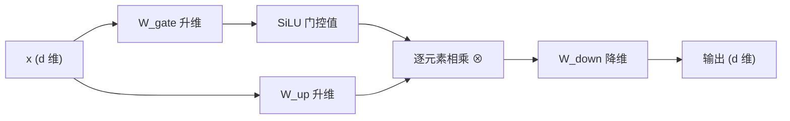

# 40｜SwiGLU：门控激活为什么取代了 ReLU？

> **阅读目标**：理解现代 Transformer 的 FFN 为什么从"线性 → ReLU → 线性"变成了"两条线性分支相乘"；明白门控（gating）是怎么让网络自己决定放行哪些维度、压住哪些维度的；能从 SiLU 的公式出发算出它的导数、最小值和渐近行为，并说清 SwiGLU 多出来的第三个矩阵为什么没有让参数量爆炸。
>
> **前置知识**：第 06 篇的残差连接、LayerNorm 与前馈网络（FFN 的标准结构是 $`d \to 4d \to d`$、激活函数夹在两次线性变换之间）；第 12 篇的 Adam（反向传播里梯度要穿过激活函数）；第 20 篇的 LoRA（矩阵乘法的参数量怎么数）。

## 1. 直觉：FFN 里多了一条"门"

第 06 篇的 FFN 长这样：输入 $`x`$ 先升维、过一个激活函数、再降维回来。

```math
\text{FFN}(x) = W_2 \cdot \text{ReLU}(x W_1 + b_1) + b_2
```

SwiGLU 把它改成了另一副样子：

```math
\text{SwiGLU}(x) = \big( \text{SiLU}(x W_{\text{gate}}) \big) \otimes (x W_{\text{up}})
```

符号说明：$`\otimes`$ 是逐元素相乘（element-wise），不是矩阵乘法；$`W_{\text{gate}}`$ 和 $`W_{\text{up}}`$ 是两个形状相同的矩阵，都把 $`d`$ 维升到隐藏维 $`h`$；最后还要乘一个 $`W_{\text{down}}`$ 把 $`h`$ 维降回 $`d`$ 维。完整的 FFN 是：

```math
\text{FFN}_{\text{SwiGLU}}(x) = \big( \text{SiLU}(x W_{\text{gate}}) \otimes (x W_{\text{up}}) \big) W_{\text{down}}
```

直觉上可以这样想：$`x W_{\text{up}}`$ 是"货物"——它把输入投影到隐藏空间，携带着信息；$`\text{SiLU}(x W_{\text{gate}})`$ 是"门卫"——它对每个隐藏维度单独打分，决定这个维度放行多少。两者逐元素相乘：门卫打分接近 0 的维度，货物再多也被拦下；打分接近 1 的维度，货物原样通过；打分是负数时，货物还会**反号**。

这和 LSTM 里"门"的思路一脉相承（第 07 篇提过门控的思想）：网络不再是"算出什么就原样往下传"，而是"算出什么、再算一个权重决定传多少"。区别在于，LSTM 的门是 sigmoid、输出严格在 $`(0, 1)`$ 之间，只能"关小"不能"反号"；SwiGLU 的门是 SiLU，输出可以是负数，于是多了一种表达能力：**反向放行**。



一个自然的问题：多了一条分支、三个矩阵，参数量是不是变多了？答案在第 6 节——没有，因为隐藏维 $`h`$ 被相应地缩小了，参数量被精确地对齐回了原来的 $`8d^2`$。

还有一个问题值得先想清楚：门控值为什么要另学一个投影 $`W_{\text{gate}}`$，而不是直接拿输入 $`x`$ 本身、或者拿货物分支 $`x W_{\text{up}}`$ 当门？因为"决定放行多少"和"携带什么信息"是两件不同的事，需要不同的子空间：同一个投影既要让某些维度数值大（携带信息），又要让另一些维度的门控值小（拦住信息），会互相掣肘。分开两个投影，网络才能独立地学"什么值得传"和"传多少"。第 5 节会看到，这种分工在反向传播里也有直接体现：门和货物的梯度是互相缩放的。

> 结论性质：下面"SiLU 的导数、最小值、渐近线"是**严格推导**（第 4 节）；"门控让网络学会选择性放行"是**直觉解释**——它能帮你理解结构，但不是定理；"SwiGLU 比 ReLU 好"是**实验结论**（第 3 节末尾），成立条件是 Shazeer 2020 的实验设置，换数据集、换规模结论可能变化。

## 2. 从 ReLU 说起：它有什么毛病

要理解 SwiGLU 为什么出现，先看它要修什么。ReLU 是 $`\text{ReLU}(z) = \max(0, z)`$，简单、便宜、梯度在正半轴恒为 1。但它有三个毛病：

**毛病一：死神经元。** $`z < 0`$ 时导数恒为 0。如果某个神经元的输入在训练中长期为负，它的权重和偏置收到的梯度就是 0——权重不再更新，输入永远为负，恶性循环，这个神经元就"死"了。初始化不好或学习率过大时，一批神经元可能在训练早期集体死亡。注意这不是"输出为 0"的问题，而是"梯度为 0、无法自救"的问题。

举个最小的例子：某个神经元的权重 $`w = [-1, -1]`$、偏置 $`b = -0.5`$，输入 $`x`$ 的两个分量恒为正（比如上一层 ReLU 的输出）。那么预激活 $`z = w \cdot x + b < 0`$ 恒成立，$`\text{ReLU}(z) = 0`$，反向传播时 $`\partial L / \partial w = (\partial L / \partial z) \cdot x = 0 \cdot x = 0`$——权重纹丝不动。无论训练多少步、损失多大，这个神经元永远输出 0，等于白白占了一个隐藏维度的位置。更糟的是，偏置的梯度也是 0，连"把偏置往上推一点、让神经元重新活过来"的机会都没有。

**毛病二：在 0 点不可导。** ReLU 在 $`z = 0`$ 处有个折点，左导数 0、右导数 1。实践中框架会取一个次梯度（通常是 0），一般不影响训练，但它意味着激活函数不是光滑的：输入在 0 附近抖动时，输出的导数会跳变。

**毛病三：输出恒非负，信息被截断。** ReLU 把所有负值压成 0。负的预激活值里可能带着有用的信息（比如"这个特征不存在"本身就是一种信号），ReLU 直接把它丢掉了。更微妙的是，ReLU 的输出均值大于 0，下一层收到的输入系统性地偏正——这被称为"均值偏移"，会让优化走得更别扭一些（第 28 篇讲初始化时提过类似的方差/均值问题）。

GELU（GPT、BERT 时代的主流选择）修了后两个毛病：$`\text{GELU}(z) = z \cdot \Phi(z)`$，其中 $`\Phi`$ 是标准正态分布函数。负值不再被一刀切成 0，而是按"这个值有多可能是正的"加权保留；函数处处光滑。但 GELU 仍然是**逐元素**的激活：每个维度的输出只取决于自己的输入，维度之间没有任何交互。SwiGLU 的野心更大：它想让激活函数本身带上"维度间的选择"，也就是门控。

## 3. GLU 家族：门是怎么长出来的

门控的思想来自 Dauphin 等人 2017 年的 GLU（Gated Linear Unit），原本是为卷积语言模型设计的：

```math
\text{GLU}(x) = (xW + b) \otimes \sigma(xV + c)
```

左边的 $`(xW + b)`$ 是线性分支，右边的 $`\sigma(xV + c)`$ 是门分支：sigmoid 把门控值压到 $`(0, 1)`$ 之间，逐元素决定左边的每个分量放行多少。Shazeer 2020 年的论文《GLU Variants Improve Transformer》把这个想法搬进 Transformer 的 FFN，并系统比较了几种变体——区别只在门分支用什么激活函数：

| 变体 | 公式（省略偏置） | 门分支 | 门控值范围 |
|---|---|---|---|
| GLU | $`(xW) \otimes \sigma(xV)`$ | sigmoid | $`(0, 1)`$，只能关小 |
| ReGLU | $`(xW) \otimes \text{ReLU}(xV)`$ | ReLU | $`[0, +\infty)`$，能放大、不能反号 |
| GEGLU | $`(xW) \otimes \text{GELU}(xV)`$ | GELU | $`(-0.17, +\infty)`$，能轻微反号 |
| **SwiGLU** | $`(xW) \otimes \text{Swish}_\beta(xV)`$ | Swish | $`(-0.28, +\infty)`$，能反号 |

其中 Swish 的定义是：

```math
\text{Swish}_\beta(z) = z \cdot \sigma(\beta z)
```

$`\beta`$ 在原始论文里是一个**可学习的标量**；实际应用中（LLaMA、PaLM、Mistral、Qwen）几乎都取 $`\beta = 1`$，这时 Swish 就是 SiLU（Sigmoid Linear Unit）：

```math
\text{SiLU}(z) = z \cdot \sigma(z) = \frac{z}{1 + e^{-z}}
```

Shazeer 的实验结论是：在同样的 Transformer 语言模型上，SwiGLU 和 GEGLU 的困惑度明显优于 ReLU 和 GELU 基线，而 SwiGLU 略胜一筹。此后 SwiGLU 成了大模型 FFN 的默认配置：PaLM、LLaMA 系列、Mistral、Qwen 都用它（Gemma 用的是同家族的 GEGLU）。注意这句话的性质：**它是实验结论，不是数学定理**——论文证明的是"在这些实验里更好"，而不是"在所有情况下都更好"。门控为什么有效，至今没有一个被普遍接受的严格解释；第 4 节的推导只能告诉你 SiLU 本身长什么样，解释不了"为什么这个形状就更好"。

不过可以给出一个合理的机制直觉，说明为什么 SwiGLU 会赢过 ReGLU：ReLU 门在预激活为负时输出**恰好为 0**，于是货物分支在该维度收到的梯度也被乘成 0——门一关，货物分支就学不到东西，两个分支同时"饿死"。SiLU 门在负区几乎处处非零（只有 $`z \to -\infty`$ 时才趋近于 0），货物分支总能收到一点梯度，门和货物可以慢慢协商着恢复。这只是直觉层面的解释：它符合梯度公式（第 5 节），但"协商着恢复"是不是真实发生的训练动态，需要实验验证，不能当作定理来用。

## 4. 严格推导：SiLU 的形状与导数

这一节是纯数学。设 $`\sigma(z) = \frac{1}{1 + e^{-z}}`$，$`f(z) = z \sigma(z)`$。

**导数。** 用乘积法则，并利用 $`\sigma'(z) = \sigma(z)(1 - \sigma(z))`$：

```math
\begin{aligned}
f'(z) &= \sigma(z) + z \cdot \sigma(z)(1 - \sigma(z)) \\
&= \sigma(z) \big[ 1 + z(1 - \sigma(z)) \big]
\end{aligned}
```

代入几个关键点验算：$`z = 0`$ 时 $`\sigma(0) = 0.5`$，$`f'(0) = 0.5 \times (1 + 0) = 0.5`$；$`z = 1`$ 时 $`\sigma(1) \approx 0.731`$，$`f'(1) \approx 0.731 \times (1 + 0.269) \approx 0.928`$；$`z = -1`$ 时 $`\sigma(-1) \approx 0.269`$，$`f'(-1) \approx 0.269 \times (1 - 0.731) \approx 0.072`$。注意 $`f'(-1) \approx 0.072`$ 不是 0——负半轴的梯度很小，但**不为零**，这是 SiLU 相对 ReLU 的关键区别：神经元在负区还能收到微弱的梯度，有机会"活过来"。

**渐近行为。** $`z \to +\infty`$ 时 $`\sigma(z) \to 1`$，所以 $`f(z) \approx z`$，像 ReLU 一样线性增长，梯度趋近于 1，不会饱和；$`z \to -\infty`$ 时 $`\sigma(z) \approx e^{z}`$，$`f(z) \approx z e^{z} \to 0^{-}`$——从下方趋近于 0（指数衰减压过了线性增长）。所以 SiLU 在远负区同样会饱和（梯度趋近于 0），它只是把 ReLU 的"硬截断"换成了"软衰减"。

**最小值。** 令 $`f'(z) = 0`$：由于 $`\sigma(z) > 0`$ 恒成立，只需 $`1 + z(1 - \sigma(z)) = 0`$，即 $`z(1 - \sigma(z)) = -1`$。这个方程没有闭式解，数值求解得 $`z^* \approx -1.2785`$。验算：$`\sigma(-1.2785) = 1 / (1 + e^{1.2785}) \approx 1 / 3.5915 \approx 0.2178`$，$`z^*(1 - \sigma(z^*)) \approx -1.2785 \times 0.7822 \approx -1.0000`$，吻合。最小值 $`f(z^*) = -1.2785 \times 0.2178 \approx -0.2785`$。也就是说 SiLU 的值域是 $`[-0.2785, +\infty)`$，负值最多只能到约 $`-0.28`$——门控值能反号，但反号的幅度被限制在一个很小的范围内。

把这三点连起来，SiLU 的形状就清楚了：正半轴近似恒等映射（保留信息、梯度为 1）；负半轴先下探到约 $`-0.28`$ 再缓慢爬回 0（小幅反号 + 软截断）；全程光滑、无折点。把它放进门控位置，效果是：门控值在 $`[0, 1]`$ 附近时是"部分放行"，大于 1 时是"放大"，在 $`[-0.28, 0)`$ 之间时是"小幅反号放行"。另外注意原点：$`f(0) = 0`$、$`f'(0) = 0.5`$——输入很小时，门既不完全关死、也不完全放行，而是把信号减半通过；这是 SiLU 在零点附近天然的"谨慎"，也是它和 ReLU 在原点处行为最直观的区别。

## 5. 门控的反向传播：门和货物互相成就

门控不只影响前向的输出，还改变了梯度的流向。设某个隐藏维度的门控值 $`g = f(z_g)`$（$`f`$ 是 SiLU）、货物值 $`u = z_u`$、相乘后的输出 $`y = g \cdot u`$，损失为 $`L`$。由链式法则：

```math
\frac{\partial L}{\partial u} = g \cdot \frac{\partial L}{\partial y}, \qquad
\frac{\partial L}{\partial g} = u \cdot \frac{\partial L}{\partial y}
```

再往前推一层，到两个分支的预激活值：

```math
\frac{\partial L}{\partial z_u} = g \cdot \frac{\partial L}{\partial y}, \qquad
\frac{\partial L}{\partial z_g} = u \cdot f'(z_g) \cdot \frac{\partial L}{\partial y}
```

这两行公式值得逐字读出含义：

- **货物分支的梯度被门控值缩放。** 门开得大（$`g`$ 接近 1 或更大），货物分支学得快；门关得小（$`g \approx 0`$），货物分支几乎收不到梯度——这个维度的货物投影就"冻住"了。门控在这里起了一个**按维度调节学习速度**的作用，有点像第 12 篇 Adam 里"每个参数有自己的学习率"，只不过这里的调节是数据依赖的：同一个维度，对不同的输入样本，门开得不一样大，学得也就有快有慢。
- **门分支的梯度被货物值缩放。** 货物值 $`|u|`$ 越大，门分支收到的梯度越大——门学得最快的场景，恰好是"这个维度的货物很重要"的场景；反过来，如果货物本身接近 0，门分支收到的梯度也接近 0，门就学不到"该开还是该关"。这是一种**互相成就、也互相拖累**的结构：门和货物必须协同着学，任何一方塌掉都会拖慢另一方。
- **SiLU 的导数给门分支留了后路。** $`f'(z_g)`$ 的最大值约 $`1.1`$（数值求解，在 $`z_g \approx 2.4`$ 附近），最小值在远负区趋近于 0。也就是说门分支的梯度总体上是"有界"的，不会像某些激活函数那样爆炸；但在远负区它同样会消失——门一旦关死在远负区，靠梯度把它推回来会很慢。这和第 2 节的死神经元是同一个问题的另一面：SwiGLU 把"死"从硬截断换成了软衰减，但没有消灭它。

还有一个容易忽略的点：逐元素相乘 $`y = g \cdot u`$ 的二阶效应。门控值 $`g`$ 本身依赖于输入 $`x`$，所以 $`y`$ 对 $`x`$ 的雅可比矩阵里会出现 $`g`$ 和 $`u`$ 的交叉项——输出对输入的敏感度不再是固定的矩阵，而是一个随输入变化的矩阵。这正是门控模型表达能力更强的一面：同一个 FFN，对不同的 token 可以表现出不同的"有效线性变换"。代价是分析变难了：第 06 篇里 FFN 还能看作"固定升维—激活—固定降维"，SwiGLU 里"激活"这一步本身就依赖输入，严格的理论分析要困难得多。

## 6. 参数量对齐：隐藏层为什么缩到 2/3

SwiGLU 的 FFN 有三个矩阵：$`W_{\text{gate}}`$、$`W_{\text{up}}`$、$`W_{\text{down}}`$。第 06 篇的标准 FFN 只有两个矩阵。直接换的话，参数量会变多——但实际模型没有这么做，而是把隐藏维 $`h`$ 缩小，让总参数量**精确对齐**。

标准 FFN（$`d \to 4d \to d`$）的参数量：

```math
2 \times d \times 4d = 8d^2
```

SwiGLU FFN（$`d \to h \to d`$，三个矩阵）的参数量：

```math
3 \times d \times h
```

令两者相等：$`3dh = 8d^2`$，得 $`h = \frac{8}{3}d = \frac{2}{3} \times 4d`$。也就是说，隐藏维取原来 $`4d`$ 的三分之二，参数量就完全一样。LLaMA 的做法是 $`h = \text{round}\left(\frac{2}{3} \times 4d \text{ 到 256 的倍数}\right)`$——取 7B 模型 $`d = 4096`$ 为例：$`\frac{2}{3} \times 16384 \approx 10922.67`$，向上取到 256 的倍数是 $`11008`$，这正是 LLaMA-7B 的 `intermediate_size`。

这个对齐的意义在于公平比较：Shazeer 的实验、以及后来所有"SwiGLU 更好"的结论，都是在**相同参数量**下得出的。门控带来的提升不是靠"参数更多"堆出来的，而是靠"同样的参数、更有效的用法"。反过来说，如果你不缩隐藏维、直接拿 $`h = 4d`$ 上 SwiGLU，参数量会变成 $`12d^2`$，是原来的 1.5 倍——效果可能更好，但那就说不清提升来自结构还是来自参数量了。

数值上再确认一次：$`d = 4096`$、$`h = 11008`$ 时，三个矩阵共 $`3 \times 4096 \times 11008 = 135{,}266{,}304`$ 个参数；标准 FFN 是 $`2 \times 4096 \times 16384 = 134{,}217{,}728`$ 个。两者相差约 0.8%——因为 11008 是向上取整到 256 倍数的结果，几乎相等，但不严格相等。严格相等只在 $`h = 8d/3`$ 恰好是整数时成立。

计算量也是对齐的，不只是参数量。一次前向里，标准 FFN 的两次矩阵乘法共 $`2 \times (2 \cdot d \cdot 4d) = 16d^2`$ 次浮点运算（每次乘加算 2 次）；SwiGLU 的三次矩阵乘法共 $`3 \times (2 \cdot d \cdot h) = 6dh = 6d \times \frac{8d}{3} = 16d^2`$ 次。逐元素相乘和 SiLU 本身的开销相对矩阵乘法可以忽略。所以 SwiGLU 在相同参数量下，浮点运算量也相同——"更好"不是靠"算得更多"换来的。

## 7. 数值示例：手算一个 2 维 SwiGLU

取 $`d = 2`$、$`h = 2`$，输入 $`x = [1,\ 0.5]`$。设：

```math
W_{\text{gate}} = \begin{bmatrix} 1 & 0 \\ 0 & 2 \end{bmatrix}, \quad
W_{\text{up}} = \begin{bmatrix} 0.5 & 1 \\ -1 & 0.5 \end{bmatrix}, \quad
W_{\text{down}} = \begin{bmatrix} 1 & 0.5 \\ 0.5 & -1 \end{bmatrix}
```

**第一步：算门控分支。** $`z_{\text{gate}} = x W_{\text{gate}} = [1 \times 1 + 0.5 \times 0,\ 1 \times 0 + 0.5 \times 2] = [1,\ 1]`$。过 SiLU：$`\sigma(1) \approx 0.7311`$，所以 $`\text{SiLU}([1, 1]) \approx [0.7311,\ 0.7311]`$。

**第二步：算货物分支。** $`z_{\text{up}} = x W_{\text{up}} = [1 \times 0.5 + 0.5 \times (-1),\ 1 \times 1 + 0.5 \times 0.5] = [0,\ 1.25]`$。

**第三步：逐元素相乘。** $`[0.7311,\ 0.7311] \otimes [0,\ 1.25] = [0,\ 0.9139]`$。注意第一个维度：货物是 0，门开得再大也没用；第二个维度：门开了约 73%，货物 1.25 被放行约 0.91。

**第四步：降维。** 输出 $`= [0,\ 0.9139] W_{\text{down}} = [0.9139 \times 0.5,\ 0.9139 \times (-1)] = [0.4569,\ -0.9139]`$。

对照 ReLU FFN（同样的 $`W_{\text{up}}`$ 当 $`W_1`$、$`W_{\text{down}}`$ 当 $`W_2`$）：$`\text{ReLU}([0, 1.25]) = [0, 1.25]`$，输出 $`= [0.625,\ -1.25]`$。这个例子里两者差别不大——因为门控值 0.73 只是温和地缩放了一下。门控真正发威的场景是门控值接近 0 或为负的时候：比如把 $`W_{\text{gate}}`$ 的第一行改成 $`[-2, 0]`$，则 $`z_{\text{gate},1} = -2`$，$`\text{SiLU}(-2) = -2 \times \sigma(-2) \approx -2 \times 0.1192 = -0.2384`$——门控值是负的，第一个维度的货物会被**反号后小幅放行**；而 ReLU 在这个位置会直接输出 0，信息被彻底丢掉。两种行为没有绝对的好坏，取决于数据需要哪一种。

把这个变体完整算完，可以看到反号是怎么一路传到输出的。改后的门控分支：$`z_{\text{gate}} = [-2,\ 1]`$，$`\text{SiLU}(z_{\text{gate}}) \approx [-0.2384,\ 0.7311]`$。货物分支不变：$`z_{\text{up}} = [0,\ 1.25]`$。逐元素相乘：$`[-0.2384,\ 0.7311] \otimes [0,\ 1.25] = [0,\ 0.9139]`$——第一个维度的货物本来就是 0，反号也反不出东西；想看清反号的效果，需要货物非零。把 $`W_{\text{up}}`$ 的第一列改成 $`[1, 1]^T`$，则 $`z_{\text{up},1} = 1 \times 1 + 0.5 \times 1 = 1.5`$，相乘后第一个维度是 $`-0.2384 \times 1.5 = -0.3576`$。降维：输出 $`= [-0.3576,\ 0.9139] W_{\text{down}} = [-0.3576 \times 1 + 0.9139 \times 0.5,\ -0.3576 \times 0.5 + 0.9139 \times (-1)] = [0.0993,\ -1.0927]`$。对照：如果门控值是 $`+0.2384`$（同等幅度的正门），第一个维度会是 $`+0.3576`$，输出变成 $`[0.8145,\ -0.7351]`$——符号翻转直接改变了输出的两个分量。门控值的一点点负值，经过降维矩阵的混合，会被放大成输出层面看得见的差异。

## 8. 常见误区

**误区一："SwiGLU 参数更多，所以效果更好。"**
错。第 6 节算过：标准做法是把隐藏维缩到 2/3，参数量精确对齐到 $`8d^2`$。提升来自结构，不是来自参数量。如果你看到某个模型用了 SwiGLU 但隐藏维没缩，那它的参数量确实多了 1.5 倍，这时要把"结构"和"规模"的贡献分开看。

**误区二："门控就是注意力，SwiGLU 是另一种注意力。"**
错。注意力（第 02、03 篇）的权重是**跨位置**的：第 $`i`$ 个位置的输出依赖于所有位置的 Key 和 Value，权重来自 $`QK^T`$。SwiGLU 的门控是**逐位置、逐维度**的：每个位置、每个隐藏维度的门控值只取决于该位置自己的输入，位置之间没有任何交互。两者解决的问题不同：注意力解决"不同位置的信息怎么混合"，门控解决"同一个位置的不同维度怎么取舍"。

**误区三："SiLU 没有死神经元问题。"**
不完全对。SiLU 在负半轴的梯度确实不为零（第 4 节算过 $`f'(-1) \approx 0.072`$），神经元有机会恢复；但在远负区（比如 $`z = -10`$），$`f'(-10) \approx \sigma(-10) \times (1 - 10 \times 0.99995) \approx 4.5 \times 10^{-5} \times (-9) \approx -4 \times 10^{-4}`$，梯度已经小到几乎为零——饱和依然存在，只是从 ReLU 的"硬死亡"变成了"软冬眠"。SiLU 缓解、没有根除这个问题。

**误区四："Swish 里的 $`\beta`$ 是可学习的，所以每个模型用的 $`\beta`$ 都不一样。"**
理论上对、实践上错。Shazeer 的原始论文里 $`\beta`$ 确实是可学习参数；但 LLaMA、PaLM 等主流实现都固定 $`\beta = 1`$（即 SiLU），没有让它参与训练。原因是 $`\beta`$ 的收益很小、还多一个超参数要调——工程上不划算。读论文时要区分"论文的完整形式"和"工业界的实际采用形式"。

**误区五："门控值是概率，0 表示关、1 表示开。"**
错。sigmoid 门（GLU 原版）的值域确实是 $`(0, 1)`$，可以这样理解；但 SwiGLU 的门控值域是 $`[-0.28, +\infty)`$：大于 1 时是放大、负值时是反号。它不是概率，更像一个"带符号的放行系数"。把门控值理解成概率，会漏掉"放大"和"反号"这两种行为。

**误区六："SwiGLU 是大模型的专属，小模型用 ReLU 就够了。"**
没有证据支持这种按规模划线的做法。Shazeer 2020 年的对照实验用的并不是今天这种千亿参数的模型，SwiGLU 的优势在那时就已经显现——它来自结构（门控带来的逐维度选择），而不是来自规模。当然，"优势存在"不等于"优势一样大"：在小模型、短训练的场景下，换激活函数带来的提升可能被训练噪声淹没，未必值得专门调参；但这是一个"收益是否值得折腾"的工程判断，不是一个"小模型不能用"的原则。反过来，把 SwiGLU 当成"大模型标配"去迷信也不对：如果你的模型瓶颈在数据或优化器上，换激活函数解决不了问题。
错。sigmoid 门（GLU 原版）的值域确实是 $`(0, 1)`$，可以这样理解；但 SwiGLU 的门控值域是 $`[-0.28, +\infty)`$：大于 1 时是放大、负值时是反号。它不是概率，更像一个"带符号的放行系数"。把门控值理解成概率，会漏掉"放大"和"反号"这两种行为。

## 9. 自测题

**1.** 设 $`d = 512`$，标准 FFN 隐藏维为 $`4d = 2048`$。若改用 SwiGLU 并保持参数量不变，隐藏维 $`h`$ 应取多少？（不考虑取整到 256 的倍数。）

<details>
<summary>答案</summary>

$`h = \frac{2}{3} \times 4d = \frac{8}{3} \times 512 \approx 1365.33`$，即 $`h = 1365\frac{1}{3}`$——不是整数。实际实现会取整到 256 的倍数（$`1280`$ 或 $`1536`$，LLaMA 的做法是向上取整到 $`1536`$），参数量与 $`8d^2`$ 略有出入。关键点：精确对齐要求 $`h = 8d/3`$，$`d`$ 不是 3 的倍数时取整不可避免。

</details>

**2.** 证明 SiLU 在 $`z \to -\infty`$ 时趋近于 $`0^{-}`$（从下方趋近于 0），并求 $`f'(0)`$ 的值。

<details>
<summary>答案</summary>

$`z \to -\infty`$ 时 $`\sigma(z) = \frac{1}{1+e^{-z}} \approx e^{z}`$，所以 $`f(z) = z\sigma(z) \approx z e^{z}`$。$`z e^{z} \to 0`$（指数衰减快于线性增长，可用洛必达法则验证：$`\lim_{z\to-\infty} z e^{z} = \lim_{t\to+\infty} -t e^{-t} = 0`$）；且 $`z < 0`$、$`\sigma(z) > 0`$，故 $`f(z) < 0`$，即从下方趋近于 0。$`f'(0) = \sigma(0)[1 + 0] = 0.5`$。

</details>

**3.** 一个 SwiGLU FFN 里，某个隐藏维度的门控值 $`g = \text{SiLU}(z_{\text{gate}}) = -0.2`$，货物值 $`u = 3.0`$。该维度传给 $`W_{\text{down}}`$ 的值是多少？如果换成 ReLU 门（ReGLU），结果又是多少？这说明了什么？

<details>
<summary>答案</summary>

SwiGLU：$`g \times u = -0.2 \times 3.0 = -0.6`$——货物被反号后小幅放行。ReGLU：$`\text{ReLU}(z_{\text{gate}})`$ 呢？需要先反推 $`z_{\text{gate}}`$：$`\text{SiLU}(z) = -0.2`$ 有两个解（约 $`z \approx -0.55`$ 和约 $`z \approx -2.4`$，因为 SiLU 在 $`z \approx -1.28`$ 处取最小值 $`-0.28`$ 后又爬回 0），但两个解都是负数，所以 $`\text{ReLU}(z_{\text{gate}}) = 0`$，传给 $`W_{\text{down}}`$ 的值是 $`0`$。说明：同样的预激活值，SwiGLU 保留了"反号"的信息，ReLU 门直接清零——这是两种门在负区的本质区别。

</details>

**4.** 为什么说"SwiGLU 更好"是一个实验结论而不是定理？如果要验证它，你至少要控制哪些变量？

<details>
<summary>答案</summary>

因为没有任何数学推导能从"SwiGLU 的结构"推出"困惑度更低"——困惑度取决于数据分布、优化过程和模型规模的相互作用，这些都不在纯数学的掌控范围内。Shazeer 的结论来自对照实验。要复现/验证，至少要控制：总参数量（隐藏维按 2/3 缩放对齐）、训练数据、训练步数与学习率 schedule、随机种子与初始化。只换激活函数、其他全部固定，才能把提升归因于结构本身。

</details>

---

**下一篇预告**：第 41 篇将讲词表与分词——BPE 是怎么把句子切成 token 的？
