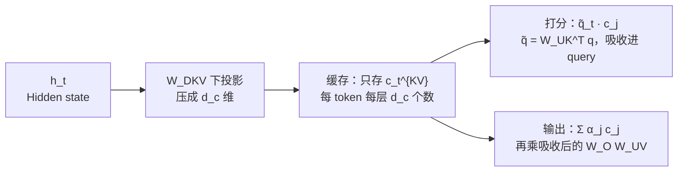

# 42｜MLA：把 KV 压成一个潜向量，为什么推理显存省了十几倍？

> **阅读目标**：理解多头潜注意力（Multi-head Latent Attention，MLA）如何把每个 token 的 KV 缓存从"每头一份 K、V"压成一个共享的低维潜向量；能从矩阵结合律出发推导"吸收"（absorption）为什么成立、算出 DeepSeek-V2 配置下缓存从 32768 个数压到 576 个数、并说清 RoPE 为什么必须走一条单独的解耦路径。
>
> **前置知识**：第 02 篇的缩放点积注意力（Q、K、V 投影与打分）；第 05 篇的 RoPE（位置编码是逐位置的旋转）；第 08 篇的 KV Cache（推理时每个 token 的 K、V 都要常驻显存，缓存大小随 batch 与序列长度线性增长）；第 09 篇的 GQA/MQA（用"共享 KV 头"来省缓存的另一种思路）。

## 1. 直觉：推理的账单不在算力，在"搬运"

第 08 篇算过一笔账：生成一个 token 时，模型要把历史上所有 token 的 K、V 从显存读出来，和当前 query 做打分。算力本身很小——一个 decode step 的注意力 FLOPs 只有几千万——但**读缓存的字节数是 GB 量级**。推理的瓶颈不是"算不出来"，是"搬不过来"：显存带宽被 KV 缓存的反复读取占满，batch 一大就塞不下（第 37 篇的 PagedAttention 治的是碎片，不是总量）。

第 09 篇的 GQA/MQA 对这个问题的回答是"少存几份"：让多个 query 头共享同一份 K、V。MQA 走到极端——所有头共享一份——缓存压到最小，但代价是每个头看到的 K、V 一模一样，头的分工（第 03 篇）被削弱了。GQA 折中一下，分 8 组，缓存是 MHA 的 1/4。

还有一条容易想到的路：第 21 篇的量化。把 KV 缓存从 fp16 压到 fp8 或 int8，字节数直接减半或降到四分之一，而且和 MLA 正交——潜向量本身也可以量化，两个压缩可以叠加。但量化治的是"每个数占几字节"，不治"一共有多少个数"；序列拉到 128k、batch 开到几百时，fp8 的 MHA 缓存依然是天文数字。MLA 治的是"数的个数"，两者解决的是不同维度的账，实际部署里经常一起用。

MLA（DeepSeek-V2，arXiv:2405.04434，2024 年提出，DeepSeek-V3 沿用）换了一个问题：**能不能不删头，而是把 K、V 本身"压扁"再存？** 它的观察是：K、V 是从同一个 hidden state 投影出来的，$n_h$ 个头、每个 $d_h$ 维，合起来是一个 $n_h \times d_h$ 维的空间——但这个空间里的信息量未必有那么大。如果 K、V 的实际内容近似落在某个低维子空间里，那就没必要把完整的 $n_h \times d_h$ 个数都存下来；存一个低维的"潜向量"（latent vector），用的时候再"展开"还原，信息损失可以很小。

这就是 MLA 的一句话：**先压缩再缓存，用的时候再展开**。缓存里只留潜向量，展开的矩阵在计算时"吸收"进 query 和输出投影里，连展开这一步的显存读写都省了。

> 结论性质：下面"缓存从多少压到多少、吸收的等式"是**严格推导**（第 3、5 节）；"K、V 的信息落在低维子空间"是**直觉 + 需实验验证**——它不是定理，是一个关于数据分布的假设，DeepSeek-V2 的消融实验支持它（MLA 在同等规模下效果不弱于 MHA），但换一个任务、换一个 $d_c$，结论要重新验证；第 6 节的横向比较是**严格推导**的缓存数字加上**经验性**的效果排序。

## 2. 低秩的赌注：K、V 其实可以"先压后还"

标准 MHA 里，第 $t$ 个 token 的 K、V 是：

```math
k_t = W_K h_t, \quad v_t = W_V h_t
```

其中 $h_t \in \mathbb{R}^{d}$ 是 hidden state，$W_K, W_V \in \mathbb{R}^{(n_h d_h) \times d}$。MLA 把这两个投影各拆成两步——**先降维，再升维**：

```math
c_t^{KV} = W_{DKV} h_t, \quad k_t = W_{UK} c_t^{KV}, \quad v_t = W_{UV} c_t^{KV}
```

- $W_{DKV} \in \mathbb{R}^{d_c \times d}$：下投影（down-projection），把 hidden state 压成 $d_c$ 维的潜向量 $c_t^{KV}$；
- $W_{UK}, W_{UV} \in \mathbb{R}^{(n_h d_h) \times d_c}$：上投影（up-projection），把潜向量展开回各头的 K、V。

关键在维度：DeepSeek-V2 取 $d_c = 512$，而 $n_h d_h = 128 \times 128 = 16384$。也就是说，**16384 维的 K（或 V）被强制经过一个 512 维的瓶颈**。换成矩阵乘法的语言：

```math
W_K = W_{UK} W_{DKV}, \quad W_V = W_{UV} W_{DKV}
```

$W_K$ 本来是一个 $16384 \times 5120$ 的自由矩阵，MLA 要求它必须能分解成两个矩阵的乘积——这等价于要求 $W_K$ 的秩不超过 $d_c = 512$。更强的一点是：**K 和 V 共享同一个潜向量** $c_t^{KV}$，即 K、V 的信息被要求挤进同一个 512 维的表示里。

这是一个很强的约束，凭什么敢下这个赌注？两点理由：

1. **K、V 来自同一个 $h_t$**，本来就高度相关——它们不是两份独立的信息，而是同一份内容的不同"看法"，共享表示的浪费比想象中小。
2. **秩是超参数，不是 0 或 1 的开关**：$d_c$ 可以调。512 不够就加到 1024，缓存翻一倍但还是比 MHA 小一个量级。压缩比成了一个可以连续调节的旋钮，而不是 GQA 那种"只能取头数的约数"的离散档位（第 6 节的表里会看到这个差别）。

注意一个容易混淆的点：**训练时 MLA 和 MHA 的计算量基本一样**。训练时可以把 $W_{UK} W_{DKV}$ 先乘成一个等效的 $W_K$，用标准注意力 kernel 跑前向和反向——低秩只是对权重矩阵形状的约束，不改变训练的 FLOPs 量级。MLA 省的是**推理时的缓存**，不是训练时的算力。DeepSeek-V2 还给 query 也加了一个潜向量（$d_c' = 1536$，见第 5 节），那是为了省训练时的激活显存，是另一笔账，别和 KV 缓存混在一起。

顺带说清 query 潜向量是干什么的，免得以为它也是为了省 KV 缓存。DeepSeek-V2 的 query 同样先压后展：

```math
c_t^Q = W_{DQ} h_t, \quad q_t = W_{UQ} c_t^Q
```

其中 $c_t^Q \in \mathbb{R}^{d_c'}$，$d_c' = 1536$。Query 只对当前 token 计算、从不进缓存，所以这一步和 KV 缓存毫无关系；它的作用在**训练**：训练时每个位置的 query 都要保存激活用于反向，$d_c' = 1536$ 比直接存 $n_h d_h = 16384$ 维的 query 便宜得多。推理时 query 潜向量同样可以吸收——$\tilde{q}_t = W_{UK}^\top q_t = W_{UK}^\top W_{UQ} c_t^Q$，一次乘法直接从 $c_t^Q$ 得到吸收后的 query，连中间的 $q_t$ 都不用物化。K、V 的潜向量是"省缓存"，query 的潜向量是"省激活"，两个潜向量解决的是两个不同位置的显存问题，不要混为一谈。

## 3. 吸收的数学：为什么缓存里只留潜向量就够了

只存 $c_t^{KV}$ 有个直接的问题：打分的时候需要的是 $k_j$，不是 $c_j^{KV}$。难道每步都要把所有历史 token 的潜向量展开成 K、V 再打分？那样展开的中间结果又要占显存，省的钱又花出去了。

答案是**矩阵结合律**：展开这一步根本不用真的做，可以把它"吸收"进 query 里。看打分公式：

```math
q_t^\top k_j = q_t^\top W_{UK} c_j^{KV} = (W_{UK}^\top q_t)^\top c_j^{KV}
```

定义吸收后的 query $\tilde{q}_t = W_{UK}^\top q_t \in \mathbb{R}^{d_c}$。打分就变成了 $\tilde{q}_t$ 和 $c_j^{KV}$ 的点积——**直接拿潜向量打分**，$k_j$ 从头到尾没有出现过。$\tilde{q}_t$ 每个 decode step 只算一次（当前 token 的 query），成本是 $d_c \times n_h d_h$ 次乘加，相对读缓存的开销可以忽略。

V 的一侧同理。注意力输出是各头 V 的加权和：

```math
o_t = W_O \sum_j \alpha_{tj} v_j = W_O \sum_j \alpha_{tj} W_{UV} c_j^{KV} = W_O W_{UV} \left( \sum_j \alpha_{tj} c_j^{KV} \right)
```

先对潜向量做加权求和（$d_c$ 维），再乘一次吸收后的输出矩阵 $W_O W_{UV}$。$v_j$ 同样没有出现过。于是推理时每层、每个 token 的缓存里只需要存：

```math
\text{每 token 每层缓存} = c_t^{KV} \in \mathbb{R}^{d_c}
```

这就是 MLA 名字的由来：**多头（multi-head）共享一个潜（latent）表示**。展开矩阵 $W_{UK}$、$W_{UV}$ 是模型权重，常驻显存、所有 token 共用，不随序列长度增长；随长度增长的只有潜向量本身。



一个细节值得验算：吸收有没有改变数值结果？没有——上面两步用的都是矩阵乘法结合律 $(AB)C = A(BC)$，是**精确等价**，不是近似。近似只发生在一个地方：训练时 $W_K$、$W_V$ 被约束为低秩（第 2 节）。推理时的吸收本身不引入任何误差。区分这两层，是理解 MLA 的关键。

## 4. RoPE 为什么不能一起吸收：解耦的设计

第 3 节的推导有个前提：$W_{UK}$ 是**固定的**矩阵。但 RoPE（第 05 篇）不是固定的——它给每个位置乘一个依赖于位置 $j$ 的旋转矩阵 $R_j$。如果把 RoPE 加在展开后的 key 上：

```math
q_t^\top R_{t-j} k_j = q_t^\top R_{t-j} W_{UK} c_j^{KV}
```

$R_{t-j}$ 和 $W_{UK}$ 一般**不对易**（$R$ 是分块 2×2 旋转，$W_{UK}$ 是稠密矩阵，$R W_{UK} \neq W_{UK} R$），旋转没法穿过 $W_{UK}$ 被吸收进 query。硬要吸收，就得把 $R_j W_{UK}$ 对每个位置都算一遍存下来——缓存又膨胀回去了。RoPE 和低秩压缩在这里是冲突的。

DeepSeek 的解法是**解耦 RoPE（decoupled RoPE）**：把位置信息从内容里拆出来，单独走一条小通道。

- 内容部分：$q_t$、$k_j$ 不加 RoPE，按第 3 节的吸收流程走；
- 位置部分：单独设一个小维度的 RoPE key $k_t^R = W_{KR} h_t \in \mathbb{R}^{d_R}$（DeepSeek-V2 取 $d_R = 64$），**所有头共享同一份**，直接加 RoPE 后和潜向量一起缓存；query 一侧每个头各有一个 64 维的 $q_t^R$（只对当前 token 算，不缓存）。

打分变成两项之和：

```math
\text{score}_{tj} = \underbrace{\tilde{q}_t^\top c_j^{KV}}_{\text{内容：潜向量打分}} + \underbrace{(q_t^R)^\top R_{t-j} k_j^R}_{\text{位置：解耦的 RoPE 打分}}
```

缓存因此是两项：$d_c$ 维潜向量 + $d_R$ 维 RoPE key。DeepSeek-V2：$512 + 64 = 576$ 个数每 token 每层。这就是第 5 节要算的 576 的来历。

注意这个设计的取舍：RoPE key 在所有头之间共享，意味着**位置信号在各头之间是一样的**，头与头的位置偏好差异只能由内容部分的 $q_t$ 来表达。实践中这没有造成可观测的损失（位置偏好本来就是各头大同小异的量），但它是一个真实存在的约束——如果你的任务极度依赖"不同头关注不同距离"（比如有的头只看邻居、有的头只看几千 token 外），解耦 RoPE 会先吃掉一部分表达能力，再由内容部分补回来。消融实验说补得回来，但这句话成立的条件是"位置偏好的头间差异不大"，属于**需实验验证**的范畴，不是数学保证。

## 5. 数值示例：DeepSeek-V2 的 57 倍，和一个通用配置的 256GB → 18GB

先算 DeepSeek-V2 的官方配置：$d = 5120$，$n_h = 128$，$d_h = 128$，$d_c = 512$，$d_R = 64$，层数 $L = 60$。

**MHA 的缓存（如果不用 MLA）。** 每 token 每层：

```math
2 \times n_h \times d_h = 2 \times 128 \times 128 = 32768 \text{ 个数}
```

**MLA 的缓存。** 每 token 每层：

```math
d_c + d_R = 512 + 64 = 576 \text{ 个数}
```

```math
\frac{32768}{576} \approx 56.9 \text{ 倍}
```

论文报告的口径略有不同：相比 DeepSeek 67B（MHA），MLA 把 KV 缓存减少了 93.3%——那是跨模型比较（67B 的头数、维度都不同），不要和上面"同一配置下 57 倍"的数字混用。两个数字都对，说的不是同一件事。

再算一个更通用的配置，看它对实际部署意味着什么。取 $d = 4096$、32 头、$d_h = 128$、32 层、fp16（2 字节/数）、序列 8192、batch 64，MLA 取 $d_c = 512$、$d_R = 64$：

| | 每 token 每层 | 每 token 全部 32 层 | batch 64 × 8192 序列 |
|---|---|---|---|
| MHA | $2\times4096 = 8192$ 个数 = 16 KB | 512 KB | $512\text{KB} \times 8192 \times 64 = 256$ GB |
| MLA | $576$ 个数 = 1.125 KB | 36 KB | $36\text{KB} \times 8192 \times 64 = 18$ GB |

验算一下 MHA 那格：16 KB × 8192 token = 128 MB 每层每个序列；× 32 层 = 4 GB 每个序列；× 64 = 256 GB。MLA：1.125 KB × 8192 = 9 MB 每层每个序列；× 32 = 288 MB；× 64 ≈ 18 GB。**压缩比 14.2 倍**（$8192/576$）。256 GB 的缓存连单机 8 卡（每卡 80 GB）都放不下，18 GB 一张卡就装得下——batch 能开多大、能同时服务多少用户，直接由这个数字决定。

还有一笔附带的账：参数量。同一 DeepSeek-V2 配置下，单层注意力参数 MHA 是 $4 \times 5120 \times 16384 \approx 3.36$ 亿（Q、K、V、O 各一份）；MLA 是下投影 $5120\times1536$ + 上投影 $1536\times128\times192$ + KV 下投影 $5120\times576$ + K/V 上投影 $2\times512\times16384$ + 输出 $5120\times16384$，合计约 1.49 亿。**缓存省了 57 倍，参数还少了一半多**——因为 query 也走了低维潜向量（$d_c' = 1536 < 5120$），大矩阵被拆小了。当然，参数少不等于效果差：低秩约束省掉的参数，本来就是在拟合 K、V 投影里的冗余自由度。

最后补一个 decode step 的额外计算成本，免得以为"吸收"是免费的：每生成一个 token，每层要多算一次 $\tilde{q}_t = W_{UK}^\top q_t$，约 $d_c \times n_h d_h = 512 \times 16384 \approx 840$ 万次乘加（约 1680 万 FLOPs）。相对每步要读的 GB 级缓存，这点计算微不足道——第 1 节说的"瓶颈在搬运不在计算"，在这里是字面意思。

这笔"搬运账"还可以按**每步读多少字节**再算一次，更直观。取 batch 为 1、序列 8192、32 层、fp16，生成一个 token 时要读的 KV 缓存总量：

```math
\text{MHA：} 16\,\text{KB} \times 8192 \times 32 = 4\,\text{GB}
```

```math
\text{MLA：} 1.125\,\text{KB} \times 8192 \times 32 = 288\,\text{MB}
```

按 H100 约 3.35 TB/s 的显存带宽折算，光读 KV 缓存，MHA 每步要花约 1.2 毫秒，MLA 只要约 0.09 毫秒。生成 100 个 token，光这一项就差出 110 毫秒——而 decode 本身的矩阵乘法在 batch 为 1 时每步只有几十微秒量级。**缓存的字节数直接决定了每步的延迟下限**，这就是推理引擎愿意为 MLA 写专用 kernel（FlashMLA）的原因：不改这个数字，batch 开不大、延迟降不下来，别的优化都是隔靴搔痒。

## 6. MLA vs MQA/GQA：省显存和保质量的权衡表

取同一配置 $d = 4096$、32 头、$d_h = 128$，只比较**每 token 每层的缓存元素数**（fp16 下乘 2 即字节数）：

| 方法 | 每 token 每层缓存 | 相对 MHA | 思路 | 质量代价 |
|---|---|---|---|---|
| MHA | $2 \times 32 \times 128 = 8192$ | 1× | 全存 | 无（基准） |
| GQA-8（8 组） | $2 \times 8 \times 128 = 2048$ | 4× | 8 个头共享一份 K、V | 组内头共享 K、V，分工受限 |
| MQA（1 组） | $2 \times 1 \times 128 = 256$ | 32× | 所有头共享一份 K、V | 所有头看同一份 K、V，分工损失最大 |
| **MLA（$d_c=512$）** | $512 + 64 = 576$ | **14.2×** | 所有头共享一个潜向量，各自展开 | K、V 被约束为低秩 + 共享潜向量 |

三点对比值得记住：

1. **MLA 的缓存比 MQA 大（576 vs 256），但质量比 MQA 好**：MQA 让所有头看**同一份** K、V；MLA 让所有头共享潜向量，但每个头有自己的上投影 $W_{UK}$、$W_{UV}$，展开后的 K、V 各不相同。头与头的差异被保留在展开矩阵里，而不是被压缩掉。
2. **MLA 的压缩比是连续可调的**：$d_c$ 是自由超参数，512、768、1024 都行；GQA 的组数必须是头数的约数（32 头只能取 32、16、8、4、2、1 组），档位是离散的。想精确地卡在"显存刚好够用"的那个点上，MLA 更灵活。
3. **MLA 和 GQA 不是互斥的**：理论上可以先 GQA 分组、再对每组做低秩压缩，两者叠加。但 DeepSeek 没有这么做——单 MLA 已经把缓存压到 MQA 量级，再叠加的收益递减、实现复杂度递增。工程上的"够用就好"在这里同样适用。

怎么选？一条粗糙但实用的经验：**短上下文、小 batch，GQA 就够了**——缓存本来就不大，没必要为 MLA 重写 kernel；**长上下文、大 batch、高并发，MLA 的收益才盖过它的实现成本**；**质量优先且不想动架构，MHA + PagedAttention + 量化**是改动最小的组合。MLA 不是在所有场景下都最优，它是"缓存成为第一瓶颈"时的答案——第 5 节的数字就是判断瓶颈在哪里的标尺。

## 7. 工程落地：只换公式不够，还得换 kernel

第 3 节的吸收在数学上是精确的，但在工程上有一个坑：**如果实现时先把潜向量展开成完整的 K、V 再调用标准注意力 kernel，省掉的显存就全吐出来了**。展开后的 K、V 是 $n_h d_h$ 维的中间张量，虽然只存在于一次前向里，但 decode 时每步都要对全部历史位置展开一次——显存读写又回到了 MHA 的量级，吸收等于白做。

正确的做法是把上投影融进注意力 kernel 里：kernel 从显存读潜向量 $c_j^{KV}$（$d_c$ 维），在片上（shared memory / 寄存器）完成 $W_{UK}$、$W_{UV}$ 的乘法和打分，中间结果不出片上存储。这就是 DeepSeek 开源的 FlashMLA 做的事情——它是 FlashAttention（第 14 篇）思路在 MLA 上的续集：分块（tiling）省的是打分矩阵的物化，吸收省的是 K、V 的物化，两者叠加才拿到完整的收益。

另一个工程细节是 MLA 和第 37 篇的 PagedAttention 是兼容的：PagedAttention 管的是"缓存以页为单位分配、避免碎片"，不管页里存的是 K、V 还是潜向量。把页里存的东西从 $2 \times n_h d_h$ 个数换成 $d_c + d_R$ 个数，页表逻辑一行不用改——这也是 MLA 能快速进生产推理引擎的原因之一：它只改注意力层内部的数学，不动显存管理的框架。

反过来也要说清 MLA 的代价：**它对 kernel 的要求比 GQA 高**。GQA 用任何支持分组注意力的标准 kernel 就能跑；MLA 需要 kernel 理解"潜向量 + 吸收"这套计算图，2024 年刚出来时主流推理框架都没有现成支持，落地要自己写 kernel 或等框架跟进。选型时这笔实现成本要和第 5 节的显存收益一起算——省 14 倍缓存很诱人，但如果团队没有写 kernel 的人力，GQA-8 可能是更现实的选择。

不过生态跟进的速度比预期快。DeepSeek-V3 沿用了 MLA，GLM、Kimi、MiniMax 等模型随后也采用了 MLA 或它的变体，vLLM、SGLang 等主流推理框架也陆续补上了 MLA 支持。一个技术从论文到生态的扩散速度，本身就是它"省的钱是否真实"的佐证——如果吸收只在数学上成立、工程上跑不起来，不会有这么多团队跟进。当然，跟进不等于没有代价：每个框架的 MLA kernel 成熟度不同，部署前仍要实测自己场景下的吞吐和延迟，不能只看论文里的倍数。

一个常见的错误比较是拿 MLA 的 576 和 MQA 的 256 比大小、得出"MLA 不如 MQA 省"的结论。这个比较漏了分母：MQA 的 256 是以"所有头共享同一份 K、V"为代价换来的；MLA 的 576 买回来的是"各头展开后互不相同"的 K、V。**缓存数字只有在质量相同的前提下才可比**，而 MLA 的卖点恰恰是：用比 MQA 多一倍的缓存，换回接近 MHA 的质量。

## 8. 常见误区

**误区一："MLA 是有损压缩，所以效果一定比 MHA 差。"**

错在把"低秩"等同于"有损"。低秩约束只在 K、V 的真实信息秩超过 $d_c$ 时才造成损失。DeepSeek-V2 的消融实验里，MLA 在同等规模下**不弱于甚至略好于 MHA**——K、V 的有效秩本来就远小于 $n_h d_h$。但这句话有条件：它依赖"长上下文里 K、V 高度相关"这个经验事实（第 1 节），且 $d_c$ 取得足够大。把 $d_c$ 压到 64 再去测，损失一定会出现。低秩不是免费午餐，是"用可调的秩换缓存"的交易。

**误区二："潜向量维度越小越好，压得越狠赚得越多。"**

$d_c$ 越小缓存越小，但两个地方会先出问题：一是 K、V 的重建误差变大（秩不够）；二是**吸收后的计算反而变贵**——$\tilde{q}_t$ 的计算量是 $d_c \times n_h d_h$，$d_c$ 小了这项反而便宜，所以这条不是瓶颈。真正的瓶颈是重建误差。正确的心态是把 $d_c$ 当成"缓存预算"来调：先定显存上限，反推 $d_c$ 能取多大，再验证效果。

**误区三："MLA 让训练也变快了。"**

没有。训练时 MLA 可以等价重写成标准 MHA（第 2 节），前向、反向的 FLOPs 量级不变；省的是推理缓存和（通过 query 潜向量）训练激活显存。把"推理省显存"说成"训练省算力"，是把两本账混在一起了。

**误区四："吸收是近似，推理结果和训练时对不上。"**

正好相反（第 3 节末尾）：吸收用的是矩阵结合律，是**精确等价**，推理和训练的数值在数学上一致（不计浮点舍入）。真正近似的地方在训练时加的低秩约束，不在推理时的吸收。反过来还有一个推论：既然吸收是精确的，任何支持 MHA 的训练框架都能直接训 MLA——只要把 $W_K$、$W_V$ 换成低秩分解的形式。

**误区五："RoPE 的 64 维是每个头 64 维。"**

不是。解耦的 RoPE key $k_t^R$ 是**所有头共享**的，每 token 每层只存 64 个数（第 4 节）。Query 一侧每个头各有 64 维 $q_t^R$，但 query 只对当前 token 计算、不进缓存，所以不增加缓存负担。把 64 乘上头数再算缓存，是重复计算。

**误区六："把 $d_c$ 设成 $d_h$，MLA 就退化回 MHA 了。"**

没有。即使 $d_c = d_h = 128$，MLA 仍然比 MHA 多两层约束：第一，K 和 V **共享同一个**潜向量，MHA 的 K、V 是各自独立投影的；第二，$W_K$、$W_V$ 的秩被 $d_c$ 封顶，而 MHA 的投影矩阵是满秩自由的。退化回 MHA 需要 $d_c \ge n_h d_h$ 且 K、V 各用独立的潜向量——那就等于没压缩。$d_c$ 的刻度不是"从 MHA 平滑过渡到 MLA"，而是"在 MLA 的框架内调压缩比"。

## 9. 自测题

**Q1.** 取 $d = 4096$、32 头、$d_h = 128$、fp16。MHA 每 token 每层的 KV 缓存是多少字节？MLA（$d_c = 512$、$d_R = 64$）是多少字节？压缩比是多少？

<details>
<summary>答案</summary>

MHA：$2 \times 32 \times 128 = 8192$ 个数 × 2 字节 = **16 KB**。MLA：$512 + 64 = 576$ 个数 × 2 字节 = **1152 字节 ≈ 1.125 KB**。压缩比 $8192/576 \approx$ **14.2 倍**。
</details>

**Q2.** 为什么打分 $q_t^\top k_j$ 可以改写成 $\tilde{q}_t^\top c_j^{KV}$，其中 $\tilde{q}_t = W_{UK}^\top q_t$？这一步是精确的还是近似的？

<details>
<summary>答案</summary>

因为 $k_j = W_{UK} c_j^{KV}$，所以 $q_t^\top k_j = q_t^\top W_{UK} c_j^{KV} = (W_{UK}^\top q_t)^\top c_j^{KV}$，只用了矩阵乘法结合律，是**精确等价**。近似只发生在训练时把 $W_K$ 约束为低秩 $W_{UK} W_{DKV}$，不在吸收这一步。
</details>

**Q3.** RoPE 为什么不能和内容 key 一起走低秩压缩、一起被吸收？MLA 是怎么解决这个冲突的？

<details>
<summary>答案</summary>

RoPE 的旋转矩阵 $R_j$ 依赖位置，且与上投影矩阵 $W_{UK}$ 一般不对易（$R_j W_{UK} \neq W_{UK} R_j$），旋转穿不过 $W_{UK}$ 被吸收进 query。MLA 用**解耦 RoPE**：内容部分不加 RoPE、走潜向量吸收；位置单独走一个 64 维的共享 RoPE key $k_t^R$，和潜向量一起缓存，打分时内容项与位置项相加。
</details>

**Q4.** 同一配置下，MQA 的缓存（256 个数/每 token 每层）比 MLA（576 个数）更小。能不能据此说 MQA 比 MLA 更省？为什么？

<details>
<summary>答案</summary>

不能。缓存数字只有在质量相同的前提下才可比。MQA 的 256 是以"所有头共享同一份 K、V"为代价换来的，头的分工损失最大；MLA 的 576 买回来的是各头经自己的上投影展开后互不相同的 K、V，质量接近 MHA。省显存的比较必须同时看质量代价，否则就是拿不同档次的东西比价格。
</details>

---

**下一篇预告**：第 43 篇将讲 ALiBi——不用位置编码、只给注意力打分加一个随距离线性衰减的偏置，为什么反而能外推到比训练更长的上下文？
