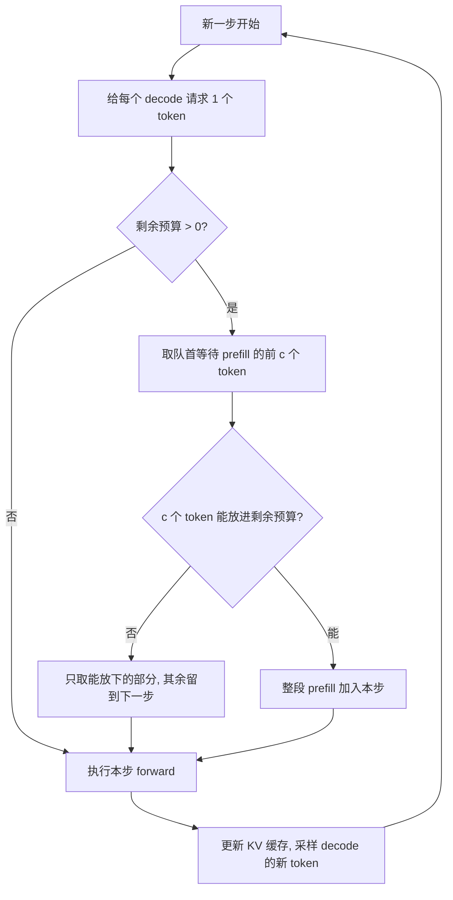

# 44｜Chunked Prefill：长提示词怎么插队而不堵住正在生成的请求

> **阅读目标**：理解长提示词的 prefill 为什么会让正在生成的请求集体卡住（generation stall）；能从因果注意力出发推导"把 prefill 切成块、每块和 decode 混跑"为什么数学上等价于一次 prefill，并算出 Llama-3.1-8B 下一个 8192 token 的提示词在不同 token 预算下对 ITL 和 TTFT 的影响，以及分块要付出的权重重读与 KV 重读代价。
>
> **前置知识**：第 02 篇的缩放点积注意力（Q、K、V 投影与打分）；第 04 篇的因果 mask 与自回归生成（prefill 一次性算全部 token、decode 一次算一个 token）；第 08 篇的 KV Cache（prefill 是算力 bound、decode 是显存带宽 bound）；第 37 篇的 PagedAttention（KV 缓存按块分配，prefill 可以分多步长大）；第 38 篇的连续批处理（请求随到随跑、每步重新组 batch）；第 43 篇的前缀缓存（跳过重复 prefill 的另一种思路）。

## 1. 直觉：一个长提示词进来，正在聊天的 32 个人同时卡住

第 38 篇讲过连续批处理：请求随到随跑，GPU 每步重新组一个 batch，解码中的请求和刚到的新请求可以混在同一步里。这听起来已经很完美了——但它留了一个洞。

想象一个在线聊天服务。32 个用户正在流式生成，每人每步吐一个 token，步长约 10 毫秒，体验丝般顺滑。这时第 33 个用户贴进来一段 8192 token 的长文档做总结。调度器把这段 prefill 塞进下一步——**同一步里，GPU 必须先算完 8192 个 token 的 prefill，才能吐出那 32 个用户等着的下一个 token**。第 5 节会算这笔账：8B 模型上，这一步要约 0.33 秒。32 个人的 token 流同时卡住 0.33 秒，然后在 prefill 结束的瞬间集中喷出来。用户看到的不是"慢"，是**卡顿**：半天没字，突然蹦出一串。

Sarathi-Serve（Agrawal 等，arXiv:2308.16369，2023 年）给这种现象起了个名字：**generation stall（生成停顿）**。它不是某个实现的 bug，而是连续批处理把"一步"当成原子单位的必然结果：一步里塞进多大的 prefill，这一步就拖多长；一步拖多长，所有 decode 就等多久。

为什么不能干脆拒绝长提示词、或者让它慢慢排队？因为长提示词是正当需求——RAG 检索回来的文档、多轮对话攒下的历史、代码库的上下文，动不动就是几千上万 token。拒绝它等于拒绝一类用户；让它排队，它的首 token 延迟（TTFT）又会拖到几秒。真正要解决的是**干扰**本身：长提示词的 prefill 和别人的 decode 不该互相伤害。

Chunked prefill 的回答只有一句话：**把一次大 prefill 切成小块，每块只占一步里的一小部分预算，剩下的预算留给 decode**。长提示词用十几步慢慢算完，decode 的 token 在每一步里照常流动。第 3 节会证明：切开算和一次算，数学上完全等价。

在展开之前，先排除两个看似省事的"土办法"。第一，**把 prefill 单独放一步、decode 单独放一步**（回到第 38 篇之前的静态批处理）：干扰是没了，但 decode 的步里算力大量空转、prefill 的步里又没有 decode 可搭，GPU 利用率直接掉回去——这是用吞吐换延迟，不划算。第二，**限制提示词长度、超过就拒绝**：等于把 RAG、长文档总结、多轮对话这整类需求挡在门外，产品上不可接受。Chunked prefill 之所以成为标准答案，是因为它既不牺牲利用率、也不拒绝用户，只改调度。

> 结论性质：下面"分块 prefill 与一次 prefill 数学等价"是**严格推导**（第 3 节）；"步长时间、ITL、TTFT 的具体数字"是**严格推导的算术**加上**经验性**的硬件假设（H100 有效算力按 400 TFLOPS、显存带宽 3.35 TB/s，见第 5 节）；vLLM 的默认参数是**工程事实**，以官方文档为准，版本升级可能变化。

## 2. 两阶段的根本不对称：prefill 吃算力，decode 吃带宽

要理解为什么"一大一小"混跑会出问题，先回到第 08 篇的结论：推理的两个阶段是两种完全不同的工作负载。

**Prefill：算力 bound。** 一次处理全部 $T$ 个 token，主导项是 $2PT$ 的矩阵乘法 FLOPs（$P$ 是参数量）。算术强度高——每读一次权重，能算很多个 token——GPU 的张量核心基本跑满，瓶颈是 FLOPs。

**Decode：显存带宽 bound。** 每步每个请求只算 1 个新 token，主导成本是把全部权重和该请求的全部 KV 缓存从 HBM 读一遍。算术强度极低——读 16 GB 权重只为算 1 个 token——瓶颈是显存带宽，算力大量闲置。

Splitwise（Patel 等，arXiv:2311.18677，2023 年）在真实硬件上量过这种不对称：BLOOM-176B 上，**一个 1500 token 的 prefill 耗时，约等于生成 6 个 token 的 decode 时间**。一个 prefill 顶六个 decode 步——而这只是 1500 token；8192 token 的 prefill，顶的是 30 多个 decode 步。

于是"一步"的长度完全由里面最大的 prefill 决定：

```math
\text{步长时间} \approx \frac{\text{本步 prefill token 数} \times 2P}{\text{有效算力}} + \frac{\text{权重 + KV 读量}}{\text{显存带宽}}
```

decode 只贡献第二项里的一小部分（每请求 1 个 token 的 KV），prefill 贡献第一项的全部。**一步里 prefill token 越多，这一步越长；这一步越长，所有 decode 的 token 间隔（ITL）就被拉得越长。** 这就是干扰的全部机制：不是 prefill 抢了 decode 的算力——decode 本来就用不满算力——而是 prefill 把 decode 的"下一步"推迟了。

反过来想也成立：decode 的步很"瘦"，每步都要读一遍权重（16 GB，约 5 毫秒），算力却几乎空转。量化一下：32 个请求的 decode 步，计算量只有 $32 \times 2 \times 8\times10^9 \approx 5.1\times10^{11}$ FLOPs，按 400 TFLOPS 计约 1.3 毫秒——而整个步要约 10 毫秒，**算力利用率只有约 13%**，剩下 87% 的时间张量核心在等显存。把一小块 prefill 塞进 decode 的步里，等于用 decode 闲置的算力"顺带"算 prefill——步长只增加 prefill 块的计算时间，权重反正已经要读一遍了。Chunked prefill 的本质，就是**把 prefill 拆成能塞进 decode 步闲置算力里的小份**。第 5 节的表会看到，预算 512 时每步 22 毫秒里，19 毫秒是 prefill 块的计算、5 毫秒是权重读取——decode 的 10 毫秒基线几乎被"顺带"消化了。

## 3. 严格推导：分块为什么数学上完全等价

直觉上"切开算"听起来像近似——毕竟注意力是全局的，一个 token 的输出依赖它前面**所有** token。凭什么切开之后结果不变？答案在因果性里。

设提示词共 $T$ 个 token，切成 $n$ 块，每块 $c$ 个 token（最后一块可能不满）。第 $k$ 块覆盖位置 $[kc, (k+1)c)$。处理第 $k$ 块时，位置 $< kc$ 的全部 token 的 K、V 已经算好、存在 KV 缓存里；本块内的 token 只需要：

1. 用自己的 Q、K、V 做块内因果注意力（块内位置 $i$ 只能看到块内位置 $\le i$）；
2. 用自己的 Q 去读缓存里**全部前缀**的 K、V。

写成公式，第 $k$ 块内位置 $i$ 的注意力输出是：

```math
o_i = \mathrm{softmax}\left(\frac{q_i K_{0:i}^T}{\sqrt{d_k}}\right) V_{0:i}, \quad K_{0:i} = [K_{\text{缓存前缀}}; K_{\text{块内 } kc:i}]
```

其中 $K_{0:i}$ 就是"从位置 0 到 $i$ 的全部 K"，和一次 prefill 里第 $i$ 个位置看到的 K **完全相同**。同理 $V_{0:i}$、同理 FFN（逐位置、不跨 token 混信息）、同理残差与 LayerNorm（第 06 篇：都在单个位置上操作）。于是每一层的每个位置，输入都相同、权重都相同，输出必然相同。归纳过全部层数：第 $k$ 块算出的 K、V，与一次 prefill 里对应位置的 K、V 完全相同。

更干净的说法是**计数论证**：注意力里每一对 $(i, j)$、$j \le i$ 的打分 $q_i^T k_j$，在一次 prefill 里恰好算一次；在分块 prefill 里，当处理包含 $i$ 的那个块时，$k_j$（无论 $j$ 在缓存前缀还是同一块内）恰好被读一次、打分恰好算一次。**没有任何一对打分被漏算，也没有任何一对被重复算**——总 FLOPs 不变（第 6 节会算内存流量的账，那是另一回事）。

还有两个细节值得点破：

- **中间块的 logits 可以不算。** 采样下一个 token 只需要提示词**最后**一个位置的 logits（第 10、11 篇）。中间块的每个位置的 logits 算出来也是扔掉——分块实现直接跳过中间块的 lm_head，省下一笔 $2Td_{\text{model}}V$ 的矩阵乘法（第 5 节的模型上约占 prefill 总 FLOPs 的 6%）。这不是近似，是"本来就不需要"。
- **RoPE 不捣乱。** 第 05 篇讲过，RoPE 给 K 的旋转角只依赖绝对位置；第 43 篇讲过，缓存的 K 带着它被算出来时的位置。第 $k$ 块从位置 $kc$ 开始算，旋转角就是 $kc\theta, (kc+1)\theta, \dots$——和一次 prefill 里完全一致。只要块按顺序从前往后算、位置编号不重置，RoPE 的相对位移性质原样成立。分块不改变任何位置信息，只改变"什么时候算"。

所以结论是干净的：**chunked prefill 不是近似算法，是调度算法**。它只改变 prefill token 被处理的时间顺序，不改变任何数值结果（浮点求和顺序的差异会带来最后一位量级的噪声，和第 43 篇的前缀缓存一样，不影响分布）。

## 4. 调度器怎么做：一个 token 预算，decode 先拿

等价性成立之后，剩下的就是调度问题：每步给谁多少 token？vLLM 的做法可以概括成三条规则（V1 文档，见文末说明）：

1. **每步一个 token 预算** $B$，由参数 `max_num_batched_tokens` 控制。V1 默认 $B = 8192$；V0 时代 chunked prefill 的默认预算是 512。
2. **decode 先拿。** 每步先给每个正在生成的请求 1 个 token（decode 的全部需求），剩下的预算 $B - N_{\text{decode}}$ 才分给等待中的 prefill。
3. **prefill 拿不下的部分自动切块。** 一个等待中的 prefill 如果放不进剩余预算，就只取能放下的前 $c$ 个 token，本步算完、KV 留下，剩下的 token 下一步继续——直到整个提示词算完，该请求转入 decode。



这个流程里有两点容易被忽略：

- **预算是一个延迟旋钮，不是一个吞吐旋钮。** 步长时间 $\approx$ 预算内 prefill token 数的计算时间，所以预算直接决定 ITL 的最坏情况：预算 512 时，最坏一步约 20 毫秒；预算 8192 时，最坏一步约 330 毫秒。vLLM 文档的建议是：延迟敏感的聊天服务用小预算（比如 2048），吞吐优先的批量任务用大预算（8192 以上）。预算等于模型最大长度时，几乎退化回"一次 prefill + decode 优先"的老策略——只剩 decode 优先这一条还在起作用。
- **预算必须大于正在 decode 的请求数。** 如果 $B < N_{\text{decode}}$，decode 自己都放不下，调度器只能让一部分请求等——这时系统已经过载，chunked prefill 救不了，要靠限流或加机器。这是预算调参的一条硬下限。
- **算完一块、剩余预算不浪费。** 一个 prefill 的最后一块算完、请求转入 decode 的那一步，调度器会立刻从等待队列取下一个 prefill 的块补进剩余预算。所以高负载下预算利用率接近 100%，空闲只发生在队列为空的时候——分块没有让 GPU 闲下来，只是让它一次少算一点。

同样的思路不只 vLLM 一家：DeepSpeed-FastGen 叫它 SplitFuse（arXiv:2310.18378），SGLang、TensorRT-LLM 也都有对应的分块 prefill 实现。名字不同，机制相同：**token 预算 + decode 优先 + 剩余部分切块**。

## 5. 数值示例：同一个 8192 token 提示词，三档预算的账

拿第 43 篇同一个模型算账：Llama-3.1-8B（32 层、8 个 KV 头、头维 128、fp16），$P = 8\times10^9$，每 token KV 128 KiB。硬件按 H100 计：fp16 dense 算力约 990 TFLOPS，有效利用率按 40% 算约 400 TFLOPS；HBM 带宽 3.35 TB/s。场景：32 个请求正在 decode（每人上下文 4096 token），一个 8192 token 的长提示词新到。

**先算不分块的基准。** 一次 prefill 8192 token：

```math
\text{FLOPs} \approx 2PT = 2 \times 8\times10^9 \times 8192 \approx 1.3\times10^{14}
```

约 0.33 秒（$1.3\times10^{14} / 4\times10^{14}$）。而一个纯 decode 步：读权重 16 GB + 32 个请求的 KV（$32 \times 4096 \times 128 \text{ KiB} \approx 17$ GB），共约 33 GB，约 10 毫秒。**一个不分块的 prefill 步，等于 33 个 decode 步的时间**——32 个用户的 ITL 从约 10 毫秒 spike 到约 330 毫秒，33 倍。

**再算三档预算。** 每步先分 32 个 decode token，剩下的是 prefill 块：

| 预算 $B$ | 每步 prefill token | 步数 | 每步耗时 | 长提示词 TTFT | prefill 期间 ITL |
|---|---|---|---|---|---|
| 512 | 480 | 18 | 约 22 ms | 约 400 ms | 约 22 ms |
| 2048 | 2016 | 5 | 约 85 ms | 约 425 ms | 约 85 ms |
| 8192（V1 默认） | 8160 | 2 | 约 330 ms | 约 335 ms | 约 330 ms |

验算一行：预算 512 时，每步 prefill 计算量 $480 \times 2 \times 8\times10^9 \approx 7.7\times10^{12}$ FLOPs，约 19 毫秒，加上权重读取约 5 毫秒（与计算重叠，取约 22 毫秒）；18 步完成（$480 \times 17 = 8160$，余 32 个 token 再占一步）。TTFT $\approx 18 \times 22 \approx 400$ 毫秒。

这张表是整篇最值得记住的结论：**TTFT 几乎不随预算变化**——总 FLOPs 不变（第 3 节已证），8192 个 token 的计算量迟早要付清；**ITL 随预算线性改善**——预算 512 时，32 个用户的卡顿从 330 毫秒压到 22 毫秒，只剩 2 倍于基线。Chunked prefill 买的不是速度，是**公平**：长提示词的代价从"所有人一起等 0.33 秒"摊薄成"所有人每步多等十几毫秒"。

两个补充说明：

- **注意力二次项在这里可以忽略，但在长上下文里不行。** 8192 token 时注意力打分 FLOPs 约 $2 \times 32 \times 8 \times 128 \times 8192^2 \approx 4.4\times10^{12}$，只占总 FLOPs 的约 3%。但它是 $T^2$ 增长的：$T = 128$k 时，注意力 FLOPs 反超 $2PT$ 主导项，步长时间的公式要改写——这是第 26 篇位置外推和第 41 篇滑动窗口注意力的地盘。
- **TTFT 的"约 400 毫秒"有个前提：这 18 步里没有别的长 prefill 插队。** 预算被多个长提示词瓜分时，每个人的 TTFT 都会拉长；调度器的公平性（先到先得、还是轮询分块）是另一个话题，不属于本篇。

## 6. 代价：分块不是免费的午餐

数学等价不等于成本等价。分块付三笔账：

**第一笔：权重重复读。** 每步 forward 都要把全部权重从 HBM 读一遍（8B fp16 约 16 GB，约 5 毫秒）。一次 prefill 只读 1 次；切成 18 步，就读 18 次——多出的 17 次约 272 GB 显存流量，按 3.35 TB/s 计约 81 毫秒的 HBM 时间上限。但要注意两个缓和因素：权重读取与 prefill 计算重叠（步长主要由计算决定时，多读的权重几乎不增加步长）；而且这 18 步本来就要为 32 个 decode 请求跑，权重反正每步都要读——"多出"的读，严格说是相对"把 prefill 集中到一步"的比较，不是相对"什么都不做"。公平的说法是：**分块把权重读取的摊销基数从 8192 个 token 稀释到每步 480 个 token**，算术强度下降，但只要步长仍由计算主导，实际 wall-clock 代价很小。

**第二笔：KV 重复读。** 第 $k$ 块的注意力要读前面全部 $kc$ 个 token 的 K、V；块越小、切得越碎，同一段前缀 K、V 被读的次数越多。不考虑 FlashAttention 的分块复用时，重读量的上限是：

```math
\text{重读 token 数} \approx \sum_{k=0}^{n-1} kc = \frac{T^2}{2c}
```

$T = 8192$、$c = 480$ 时约 7 万 token 次 $\times 128$ KiB $\approx$ 9 GB，约 3 毫秒——8B + 8k 上下文下可以忽略。但它随 $T^2$ 增长、随 $c$ 减小而变大：70B 模型（每 token KV 约 320 KiB）、$T = 32768$、$c = 512$ 时，上限约 $32768^2/(2 \times 512) \approx 100$ 万 token 次 $\times 320$ KiB $\approx 336$ GB，约 100 毫秒——这时就不能忽略了。DistServe（arXiv:2401.09670，2024 年）指出过这笔账。实际值远低于上限，因为 FlashAttention 把 K 的一块 tile 读进 SRAM 后供一整块 query 复用（第 14 篇），但**趋势**是对的：上下文越长、块越小，重读占比越高。选块大小时，这笔账要和 ITL 目标一起权衡。

**第三笔：和前缀缓存的配合有讲究。** 第 43 篇的前缀缓存按 16 token 的块匹配、分块 prefill 按几百 token 切——两个"块"互不干扰：前缀命中的部分直接跳过、不参与分块，剩下的 token 再按预算切。配合得好时，一个 8192 token 的提示词可能先命中 4096 token 的系统提示词缓存，剩下 4096 token 再分 9 步算完。但如果缓存命中发生在分块中途（比如第 3 块算完才发现后面的内容和缓存撞上），实现上要能"中途接管"已缓存的 KV——vLLM V1 的做法是先算前缀匹配、再对剩余部分分块，避免这种中途接管的复杂情况。

**第四笔：高负载下 TTFT 的排队。** 第 5 节的 TTFT 数字有个隐含前提：预算里没有别的长 prefill 竞争。两个 8192 token 的提示词同时到达、预算 512 时，它们要轮流分块——每人每步只能拿到一半预算，TTFT 翻倍到约 800 毫秒。更一般地，$M$ 个长提示词同时排队，TTFT 近似按 $M$ 倍拉长，而 ITL 却不受影响（预算总量不变）。这是分块 prefill 的公平性边界：它保护 decode 不受 prefill 干扰，但**不解决 prefill 之间的相互干扰**——后者要靠准入控制（限制并发 prefill 数）或 PD 分离。

四笔账加起来，分块 prefill 的定位就清楚了：**它是单机内的干扰摊薄器，不是干扰消除器**。每步仍有十几到几十毫秒的额外延迟；多个长提示词同时到来时，TTFT 仍会互相拖长。想把干扰彻底清零，要把 prefill 和 decode 分到不同的机器上——那是下一篇的主题。

## 7. 常见误区

**误区 1："分块 prefill 会改变模型输出。"**

错。第 3 节推导过：每对 $(i, j)$ 的打分恰好算一次，每层的输入输出与一次 prefill 完全相同。唯一的差异是浮点求和顺序带来的最后一位噪声，和前缀缓存一样，不影响分布。分块是调度，不是近似。

**误区 2："chunked prefill 让 prefill 变快了。"**

错。总 FLOPs 不变，TTFT 还略变长（第 5 节的表：预算 512 时 TTFT 约 400 毫秒，比一次 prefill 的约 330 毫秒还慢一点，多出来的主要是权重重复读和步间固定开销）。它变快的是**别人的 ITL**，不是长提示词自己的 TTFT。把"保护 decode"说成"加速 prefill"，方向就反了。

**误区 3："预算越小越好，设成 128 最丝滑。"**

错。预算太小有三重代价：TTFT 被拖长（步数 $\approx T / B$，每步还有固定开销）；权重读取的摊销基数更小、算术强度更低；KV 重读量按 $T^2/(2c)$ 增大。更硬的下限是：预算必须大于同时 decode 的请求数，否则 decode 自己都排不上队。vLLM 文档的经验是延迟敏感场景用 2048 左右、吞吐场景用 8192 以上——不是越小越好，是**按 SLO 选**。

**误区 4："有了 chunked prefill，就不需要 prefill/decode 分离了。"**

只对了一半。分块把干扰从"一次 330 毫秒"摊薄成"每步 20 毫秒"，但每步的 20 毫秒仍是干扰——对 ITL SLO 是 50 毫秒的服务来说，22 毫秒的步长已经吃掉近一半预算。彻底消除干扰的办法是把两个阶段分到不同机器、不同 GPU 池上，让 decode 的步里一个 prefill token 都没有。那是 PD 分离（Splitwise、DistServe 的路线），代价是 KV 缓存要在机器之间传输——下一篇细讲。

**误区 5："分块大小和 PagedAttention 的块大小是一回事。"**

错。两个"块"活在不同层：chunked prefill 的块是**调度单位**（几百到几千 token，决定每步算多少）；PagedAttention 的块是**存储单位**（默认 16 token，决定 KV 缓存怎么分配，见第 37 篇）。分块 prefill 每算完一块，KV 是按 16 token 的页一块块写进缓存的；两者数值上没有关系，调参时也互不干扰。

## 8. 自测题

**Q1.** 32 个请求正在 decode，一个 8192 token 的提示词新到，预算 $B = 512$。每步分给这个 prefill 多少 token？几步算完？TTFT 约多少毫秒（用第 5 节的数字）？

<details>
<summary>答案</summary>

每步先给 32 个 decode 请求各 1 个 token，剩 $512 - 32 = 480$ 个 token 给 prefill。$8192 / 480 \approx 17.1$，需要 18 步（前 17 步各 480 个 token，第 18 步 32 个 token）。每步约 22 毫秒，TTFT $\approx 18 \times 22 \approx 400$ 毫秒。注意：最后一步只有 32 个 prefill token，实际耗时略短，400 毫秒是上限估计。

</details>

**Q2.** 为什么分块 prefill 的总 FLOPs 与一次 prefill 完全相同？从注意力打分的计数上说明。

<details>
<summary>答案</summary>

每个 token 的 Q、K、V 投影和 FFN 各算一次，与分块无关。注意力打分 $q_i^T k_j$（$j \le i$）在一次 prefill 里恰好算一次；分块时，包含位置 $i$ 的那个块会读到 $k_j$（$j$ 在缓存前缀或同一块内），恰好算一次。没有任何一对打分被漏算或重复算，所以注意力 FLOPs 总量也是 $T^2$ 量级不变。变的是内存流量（权重重读、KV 重读），不是 FLOPs。

</details>

**Q3.** 预算从 2048 降到 512，ITL 和 TTFT 各怎么变？为什么 TTFT 几乎不变？

<details>
<summary>答案</summary>

ITL 从约 85 毫秒降到约 22 毫秒（每步的 prefill 计算量从 2016 token 降到 480 token）。TTFT 基本不变（约 425 毫秒 → 约 400 毫秒）：总 FLOPs 不变，8192 个 token 的计算量迟早要付清；分块只改变"什么时候算"，不改变"算多少"。TTFT 的微小差异来自步间固定开销和权重重读，不是主导项。

</details>

**Q4.** 70B 模型、每 token KV 约 320 KiB、上下文 $T = 32768$、块大小 $c = 512$。KV 重读量的上限是多少 GB、约多少毫秒（HBM 3.35 TB/s）？为什么实际值远低于这个上限？

<details>
<summary>答案</summary>

重读 token 数上限 $\approx T^2/(2c) = 32768^2/(2 \times 512) \approx 1.05\times10^6$ token 次；$\times 320$ KiB $\approx 336$ GB，约 100 毫秒。实际远低于上限，因为 FlashAttention（第 14 篇）把 K 的一块 tile 读进 SRAM 后供一整块 query 复用，不是一问一读；上限对应的是"每个 query 单独读一次全部前缀"的最坏情况。但随 $T$ 变长、$c$ 变小，重读占比上升的趋势是真实的。

</details>

---

下一篇预告：第 45 篇将讲 **PD 分离：prefill 和 decode 为什么要分到不同机器上**——分块 prefill 只是把干扰摊薄，Splitwise 与 DistServe 的做法是把两个阶段彻底分开：prefill 池只算提示词、decode 池只吐 token，KV 缓存随请求在机器之间传输，换来的是 ITL 不再受任何 prefill 影响、以及各自独立扩缩容的自由。
